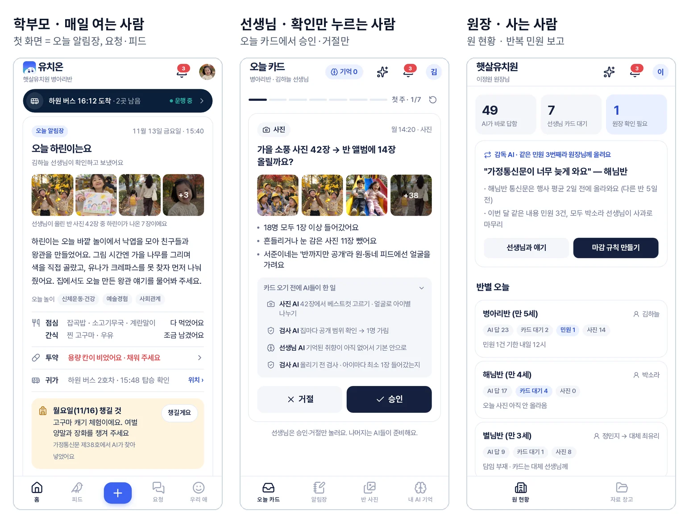
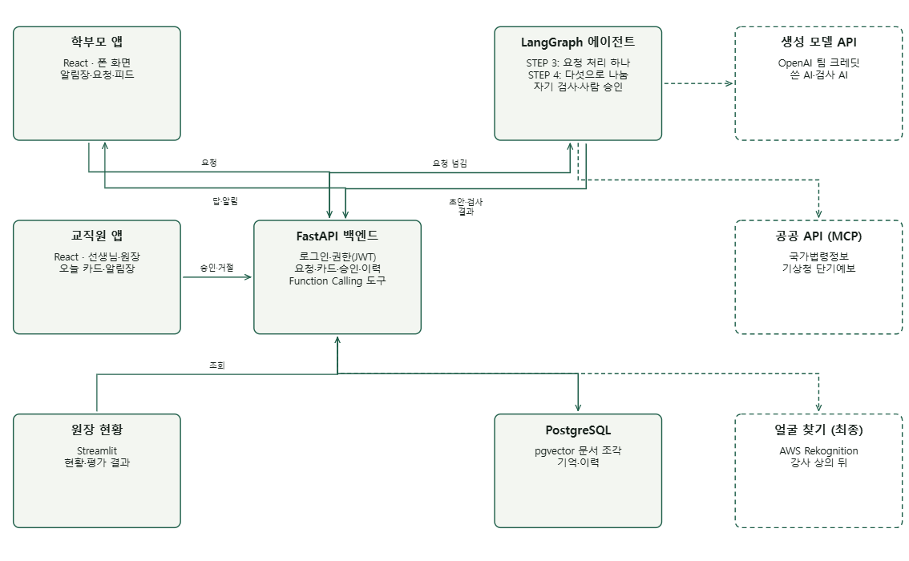

# 유치온 서비스 기획 및 요구사항 명세서

> 원본: `유치온_기획서_1117.docx`

서비스 기획·요구사항 명세서 | 11/18 실측 반영본 | 2026-11-18 갱신 | STEP 1 원래 마감 11/13 / 1차 업로드 11/16 / 보완 ○/○

## 1. 서비스 정의

자료 안내: 원아·학부모·교직원·기관 내부 자료와 아이 사진은 전부 시연용 가상 자료다. 시연 화면(https://bbyak-demo.onrender.com)은 전체 비전을 보여 주는 시연용 목업이며 실제로 동작하는 서비스가 아니다. 이번 구현 범위는 2.2의 MVP·최종(반드시/선택) 칸이 기준이다. 숫자는 [사실]·[추정]·[확인 예정]으로 나눠 적는다. WBS의 일정·담당은 계획이며 실적이 아니다. 실적은 WBS 상태·실제 시작·실제 완료 칸과 결과서 링크로만 적는다.

| 구분 | 기재 내용 |
| --- | --- |
| 서비스명 | 유치온 |
| 서비스 한 문장 | 유치원과 가정, 같은 반 학부모의 연락·사진을 모으고 요청 처리를 AI가 돕는 Android 앱(학부모·교직원용) |
| 프로젝트 주제 | 2번 지능형 업무 협업 및 자율 수행 멀티 에이전트. 일정·자산 관리 요건은 상담 일정과 상담실 예약·충돌 관리로 채움 |
| 대상 기관 | 1차 서울 동남권(송파·강동·강남·서초) 사립유치원. 시연은 가상 사립유치원 1곳(햇살유치원). 어린이집·국공립은 확장 후보 |
| 주요 사용자 | 담임교사(대표 사용자), 학부모, 원장·원감 |
| 해결 문제 | 문의·상담·민원·투약·귀가 요청과 매일 쓰는 알림장·사진이 전화·문자·알림장 앱·단톡방으로 흩어짐. 교사는 같은 안내·일정 조율·인계를 건마다 반복하고, 학부모는 요청 처리 상태와 아이의 하루를 한곳에서 보기 어려움 (문제 가설, 인터뷰로 확인) |
| 핵심 가치 | 요청 접수 → AI 분류·근거 찾기·초안 → 검사 AI 대조 → 담당자 승인 → 회신·게시 → 완료 확인을 한 흐름으로 추적함. 결정은 사람, 반복 처리는 AI |
| 기존 서비스와의 관계 | 원과 가정 사이 소통·문의·상담·민원 처리를 돕는 보조 서비스로 정의한다. 기존 알림장·소통 서비스와의 관계는 표 2.2의 범위로 한정한다. 전자 출결 기능은 제외한다. |
| MVP 범위 (12/08) | MVP(12/08): 학부모 문의 접수·분류, 통신문 근거 안내, 상담 후보·담임 확정, 민원 담임→필요 시 원장 전달, 검사 AI, 승인 카드, 알림장 글 초안 및 교사 승인, 처리 이력. 중간 발표까지 가상 원 자료만 사용한다. |
| 팀 | 5명. 지혜(기획·일정·발표 총괄, 팀장) · 태웅(백엔드·DB·인증, 부팀장) · 영민(AI 에이전트·자료 검색·메모리) · 성주(화면·대시보드·사용성) · 인혜(외부 API·AWS 배포·장애 복구) |

### 1.1 기존 방식과의 차이

| 지금 | 유치온 |
| --- | --- |
| 문의·상담 요청이 전화·문자·알림장 앱 댓글로 따로 들어옴 | 요청 화면 하나에서 유형별로 접수하고 요청마다 진행 상태가 보임 |
| 교사가 상담 가능한 시간을 직접 맞춤 | 일정 계산 코드가 담임·상담실 빈 시간 후보 3개를 내고 담임이 확정함 |
| 같은 안내 질문에 매번 직접 답함 | 자료 AI가 통신문 근거로 초안을 쓰고, 근거가 없으면 담임 카드로 넘김 |
| 민원이 담임 선에서 끝나거나 원장에게 늦게 전달됨 | 감독 AI가 분류하고, 반복·고위험 민원은 원장 보고 카드로 올림 |
| 알림장을 아이마다 따로 씀 | 활동·식단·요청 기록으로 아이별 초안을 만들고 검사 AI가 대조한 뒤 교사가 고쳐서 한 번에 보냄 |
| 반 사진·학부모끼리 이야기는 단톡방·밴드로 따로 감 | 우리 반 피드(학부모끼리)와 우리 아이 앨범 (최종 칸) |

### 1.2 대표 사용자

그림 1. 학부모는 매일 열고, 선생님은 확인만 누르고, 원장은 사는 사람 (시연용 목업 앱 화면. 아이 사진은 AI로 만든 가상 아이)

박담임(가상 인물): 햇살유치원 만 5세반 담임, 원아 18명. 오전 수업 중에 학부모 문의가 알림장 댓글과 문자로 섞여 들어오고, 하원 뒤에는 알림장 18개와 사진 정리를 한다. 상담 시간을 잡으려면 상담실 예약표와 자기 일정을 따로 본다. 실제 업무 순서와 시간은 사립 교사 인터뷰로 확인한다.

| 사용자 | 목표와 어려움 | 유치온에서 하는 일 |
| --- | --- | --- |
| 담임교사 | 수업에 집중하면서 문의를 정확히 처리하고 싶음. 예약·인계·후속 확인을 여러 채널에서 반복함 | 승인 카드 확인, 상담 시간 확정, 문의 근거 검토, 알림장 초안 확인·발송 |
| 학부모 | 아이의 하루를 매일 보고, 요청이 처리됐는지 알고 싶음 | 문의·상담·민원·투약·귀가 요청, 진행 상태 확인, 오늘 알림장, 우리 반 피드 |
| 원장·원감 | 민원과 교직원 지원 사안을 제때 알고 맡기고 싶음 | 원장 보고 카드 확인, 부재 재배정, 원 소식, 사진 공개 정책 설정 |

### 1.3 근거와 숫자

| 숫자 | 꼬리표 | 원문·대상·범위 |
| --- | --- | --- |
| 서울 유치원생의 77.1%가 사립(410곳/705곳, 원아 45,559명/59,080명) | [사실] | 유치원알리미 2026년 2차 공시 집계 |
| 사립 원아 1위 송파 26곳·3,775명(1곳당 145명) | [사실] | 같은 공시. 시연 무대 후보 |
| 전국 사립은 유치원 수의 39%(7,149곳 중 2,773곳), 원아의 70% | [사실] | 유치원알리미 2026년 2차 공시 전국 집계 |
| 악성 민원 교사 혼자 대응 39.1%, 알림장 사진 전송 강요 73.2%, 사진·기록 업무로 안전지도 공백 30.9% | [사실] | 교사 설문. 응답자가 거의 공립(공립 2,236명·사립 2명)이라 사립 근거로 일반화하지 않음. 사립 교사 인터뷰로 보완 |
| 시장 연 158억·원장 구매 83억·1년 차 0.4억 | [추정] | 원아 1명당 월 1,000원 가정 + 공공데이터 원아 수 |
| 원장 수락(1차 75곳 → 시범 27곳 → 유료 5곳), 학부모 이용 40~63% | [추정] | 공공데이터에 배수를 얹은 계산 |
| 원장 지불 의향·월 금액, 교사가 AI 초안을 고치지 않고 보내는 비율, 원의 월 민원 건수, 학부모 앱 열람 횟수 | [확인 예정] | 사립 원장·교사·학부모 인터뷰 (WBS T23) |

## 2. 목표와 범위

### 2.1 목표

- 학부모 요청을 유형·담당·상태·다음 조치가 보이는 카드로 바꾼다.

- AI가 쓴 답변·알림장 초안은 검사 AI가 대조하고 교직원이 확인한 뒤에만 나간다.

- 한 요청이 학부모 → 담임 → (필요하면) 원장으로 이어지는 흐름을 끊기지 않게 추적한다.

- 계산·저장·필수값 검사는 코드로 하고, 해석이 필요한 일만 에이전트가 맡는다.

- 상담 확정, 민원 답변, 알림장 발송, 사진 공개, 투약·인계 확인은 사람이 한다.

### 2.2 범위: MVP와 최종

구현 범위는 표 2.2의 MVP와 최종(반드시/선택)으로 나눈다. 화면 목업에 보이는 모든 기능이 구현 대상은 아니다. MVP는 상담 예약·안내 문의 답변·민원 분류와 원장 보고·검사 AI·알림장 초안을 우선 완성한다. 앱 설치 없이 브라우저에서 실행하는 웹 앱은 12/24 별도 제출물이며 Android 앱과 같은 기능·서버를 재사용한다.

| 칸 | 기능 | 기준 |
| --- | --- | --- |
| MVP · 12/08 중간 발표 | 상담 예약(후보 3개 → 담임 확정, 상담실 충돌 검사), 문의 답변(통신문 근거·출처)과 자료 창고(원 자료 적재·대조, 화면은 최종), 민원 분류·원장 보고, 검사 AI(내보내기 전 대조·돌려보내기), 승인 카드(교직원 받은함), 알림장 초안(글), 거절 이유 → 다음 제안, 처리 이력, 서비스 안 알림 | 중간 발표엔 자기 검사를 하는 에이전트와 사람 승인을 민원 흐름부터 안정적으로 보여 줌(가이드: 핵심 기능 1개 이상 안정 시연). 다섯 에이전트 협업은 STEP 4(12/11). 데이터는 가상 원 자료만 |
| 최종(반드시) · 1/04 최종 발표 | 학부모 홈, 투약·귀가 요청, 상담 지연·종료 알림, 부재 재배정·원장 현황, 내 AI 기억, 교직원 공통 도구, 우리 반·원 피드와 앨범, 실제 호출 확인된 공공 API. 원장 현황은 같은 React 앱의 원장 화면으로 제공한다. 12/24 브라우저 웹은 앱 설치 없이 실행하는 필수 별도 제출물이며 Android Capacitor 앱과 같은 React 화면·서버를 재사용해 웹 서비스는 하나로 배포한다. Play 비공개 베타는 앱 패키지의 추가 배포 산출물이다. | 필수 흐름과 권한·승인 기준을 충족하고, 웹 배포 URL·Android 설치·Play 베타 단계와 검증 결과를 각각 남긴다. |
| 최종(선택) · 1/04 최종 발표 | 알림장 사진 정리·얼굴 찾기(사진 AI), 화상상담, 반 모임, 통학버스, 동네 피드, 성장 영상. | 가상 아이 사진·가상 음성·모의 운행 데이터만 사용한다. 회귀 시험(T61·T65)에서 필수 흐름을 깨면 원인이 된 선택 기능을 기능 스위치로 끄고 배포하며 결정 기록에 남긴다. |

회귀 시험(T61·T65)에서 필수 흐름이 깨지면 원인이 된 선택 기능을 기능 스위치로 끄고 배포하고, 결정 기록에 남긴다. 전자출결·원비 결제·회계·나이스 같은 행정·국가 시스템은 구현 범위에서 제외한다. 사진·음성 시연에는 가상 자료만 사용한다.

### 2.3 먼저 검증할 흐름

강사님 11/13 피드백대로, 한 요청이 학부모 → 담임 → 원장으로 이어지는 흐름부터 끝까지 돌린다. 팀 자체 평가 문항도 이 두 흐름에서 시작한다. 중간 발표(12/08)는 민원 흐름을 메인으로, 상담 거절→재제안을 이어서 보여 준다.

| 흐름 | 단계 | 사람이 하는 일 |
| --- | --- | --- |
| 민원 | 학부모 민원 접수 → 감독 AI 분류(민원·긴급도) → 자료 AI가 통신문·운영 규정 근거를 찾아 답변 초안 → 검사 AI 대조 → 담임 카드 → 같은 내용 3번째거나 고위험이면 원장 보고 카드 → 처리 결과 알림 | 담임이 답변 승인, 원장이 보고 확인·지시 |
| 상담 | 학부모 상담 요청 → 일정 계산 코드가 담임·상담실 빈 시간 후보 3개 → 담임 확정 또는 거절(이유) → 거절 이유를 기억해 다음 후보에 반영 → 같은 이유 3번이면 개인 규칙 제안 | 담임이 확정, 규칙은 담임이 승인해야 적용 |

### 2.4 T04 상세 업무·권한 기준

T04 흐름·권한 명세의 공통 상태 코드, 화면 표시, 민원 위험 분기와 사람의 승인 권한을 다음 기준으로 사용한다. 상태 표시 문구는 팀 합의 기준이며, 알림 시점과 일부 예외 처리는 아래 후속 확인이 끝날 때까지 제안으로 남긴다.

| 상태 코드 | 의미 | 학부모 표시 | 교직원 표시 | 변경 주체 |
| --- | --- | --- | --- | --- |
| `received` | 요청 저장·ID 생성 | 접수됨 | 접수 | 시스템 |
| `classified` | 유형·긴급도·담당 후보 분류 | 접수됨 | 미배정 | 감독 AI |
| `needs_info` | 필수 정보 또는 상담 시간 선택 대기 | 정보가 더 필요해요 / 시간을 골라 주세요 | 학부모 응답 대기 | 감독 AI·코드 |
| `assigned` | 담당 배정, 초안 준비 | 선생님께 전달됨 | 준비 중 | 감독 AI·원장 재배정 |
| `awaiting_review` | 사람 판단 대기, 흐름 정지 | 선생님 확인 중 | 확인 필요 | 시스템 |
| `escalated` | 원장 보고 카드 생성 | 원장님 확인 중 | 원장 보고 | 감독 AI·담임 |
| `on_hold` | 이유·예정일을 남긴 보류 | 확인이 늦어지고 있어요 | 보류 | 담임·원장 |
| `approved` | 사람 승인, 내보내기 직전 | 선생님 확인 완료 | 승인됨 | 담임·원장 |
| `sent_or_booked` | 회신 발송 또는 예약 확정 | 답변 도착 / 예약 확정 | 발송됨 / 예약됨 | 시스템 |
| `completed` / `rejected` | 처리 완료 / 이유가 있는 반려 | 완료 / 처리할 수 없는 요청이에요 | 완료 / 반려 | 민원 완료는 담임, 반려는 담임·원장 |

| 흐름 | 구현·운영 규칙 |
| --- | --- |
| 민원 분류 | 위험 등급은 일반·긴급·판단 필요로 나눈다. 긴급은 아이 안전, 교직원 개인 위협, 법적 조치·외부기관 언급, 개인정보 유출 주장 중 하나를 AI가 높은 확신으로 판단한 경우다. 해당 범주인지 확신하지 못하면 판단 필요로 둔다. 긴급·판단 필요는 AI 답변 초안을 만들지 않고 담임·원장 카드를 함께 생성한다. |
| 반복 민원 | 같은 반·최근 30일·같은 주제의 민원을 학부모가 달라도 합산한다. 3번째면 원장 보고 카드를 만들고, 담임 카드는 유지한다. |
| 민원 회신·완료 | AI 자동 회신·자동 완료를 금지한다. 담임이 승인해 회신하고, 학부모가 확인한 뒤 담임이 처리 완료를 눌러야 완료된다. 원장은 보고 확인·지시·재배정을 맡고 담임 회신 승인을 대신하지 않는다. |
| 상담 | 시간 후보 최대 3개를 보여 주고 학부모가 가능한 시간 1~3개를 선택한다. 담임은 선택된 후보 중 하나를 확정한다. 확정 전에는 예약되지 않으며, 같은 시간·상담실 동시 저장은 한 건만 성공한다. |
| 안내 문의 | 통신문·운영 규정 등 원 자료에서 근거를 찾고 문서명·위치·적용일을 답변 초안에 붙인다. 정보가 부족하면 되묻고, 근거가 없거나 문서가 충돌하면 추측하지 않고 담임 카드로 넘긴다. |
| 알림장 | AI 초안과 검사를 거친 뒤 교사가 수정·확인하고 발송한다. 누락·민감정보 검사가 실패하면 발송을 잠근다. |

| 권한 | 허용 범위·행동 |
| --- | --- |
| 학부모 | 본인이 보낸 요청·본인 아이의 발송된 알림장만 조회하고, 상담 후보 1~3개 선택·민원 확인을 한다. |
| 담임 | 본인 반 카드·이력을 처리하고 위험 등급을 일반 또는 긴급으로 재분류하며, 민원 회신·완료, 상담 확정, 알림장 발송을 사람 승인으로 수행한다. 재배정받은 반만 예외로 조회한다. |
| 원장·원감 | 원 전체 카드 조회, 담당 재배정(이유 기록), 원장 보고 확인·지시를 한다. 담임의 회신 승인·완료를 자동으로 대체하지 않는다. |
| AI·시스템 | 분류·검색·초안·검사·알림을 수행한다. 민원 회신, 상담 확정, 알림장 발송, 완료 처리, 법률 판단과 최종 위험 등급 판단은 하지 않는다. 권한은 화면 숨김이 아니라 서버에서 기관·반·역할로 검사한다. |

| 후속 확인 | 현재 문서 상태 |
| --- | --- |
| F1 학부모가 확인 버튼을 누르지 않은 민원의 완료 처리 | T04 문서의 제안은 담임이 사유를 남기고 완료하되 별도 집계하는 방식이다. 팀 확인 전 확정 요구사항으로 취급하지 않는다. |
| F2 퇴근 뒤 긴급·판단 필요 알림 | 아이 안전 건만 즉시, 나머지는 다음 근무 시간 알림 제안. 최종 알림 정책 확인 필요. |
| F3 판단 필요 민원의 원장 보고 | T04 명세는 담임·원장 카드를 함께 만드는 것으로 작성되어 있다. 실제 합의 상태를 확인해 결정 기록에 남긴다. |
| F4 긴급·판단 필요 신뢰도 기준 | T06 평가 문항으로 기준을 만들고 검증한다. 기준값은 미확정이다. |

알림 시점 표는 T04 명세의 제안이며 운영 결정이 아니다. T04 문서의 제안·후속 확인은 강사·팀 확인 전까지 수용 기준으로 확정하지 않는다.

## 3. 기능 요구사항

우선순위는 필수(MVP 완료 조건), 중요(최종 반드시 구현), 선택(최종 선택 기능), 선택(맨 뒤 순서)다. 단계는 2.2의 칸과 맞춘다.

| ID | 기능 | 단계 | 우선순위 | 수용 기준 |
| --- | --- | --- | --- | --- |
| FR-01 | 로그인·역할별 화면 | MVP | 필수 | 학부모·교사·원장 역할로 로그인하고 역할에 맞는 메뉴만 보임. 다른 기관·다른 반 자료는 URL·API로 직접 불러도 거부됨 |
| FR-02 | 학부모 요청 접수 | MVP | 필수 | 안내 문의·상담·민원 유형으로 제출하면 요청 ID와 접수 상태가 생김. 필수 정보가 빠지면 빠진 항목을 묻고 접수 상태를 표시함 |
| FR-03 | 감독 AI 분류·긴급 전달 | MVP | 필수 | 위험 등급을 일반·긴급·판단 필요로 기록한다. 긴급은 정의된 4개 위험 범주를 높은 확신으로 판단한 경우, 판단 필요는 해당 범주인지 확신하지 못한 경우다. 긴급·판단 필요는 초안 없이 담임·원장 카드로 전달한다. |
| FR-04 | 통신문 근거 문의 답변 | MVP | 필수 | 답변 초안에 근거 문서명·위치·적용일을 표시함. 근거가 없거나 문서끼리 충돌하면 추측하지 않고 담임 카드로 넘김 |
| FR-05 | 상담 예약(상담실 포함) | MVP | 필수 | 코드가 후보 최대 3개를 제시하고 학부모가 가능한 1~3개를 고른다. 담임은 학부모가 고른 후보 중 하나만 확정한다. 담임 확정 전 예약되지 않고, 저장 직전에 DB에서 중복·충돌을 다시 확인한다. |
| FR-06 | 거절 이유 → 다음 제안 | MVP | 필수 | 담임이 거절 이유를 남기면 다음 후보에 반영됨. 같은 이유가 3번 쌓이면 개인 규칙을 제안하되 담임 승인 전에는 적용되지 않음 |
| FR-07 | 민원 분류·원장 보고 | MVP | 필수 | 민원 요약·근거·위험 등급·반복 여부를 담임 카드에 붙인다. 같은 내용은 같은 반·최근 30일·같은 주제로 묶고, 보낸 학부모가 달라도 합산한다. 3번째 또는 긴급·판단 필요면 원장 보고 카드를 만든다. AI는 법률 판단·자동 회신·완료 처리를 하지 않는다. |
| FR-08 | 검사 AI | MVP | 필수 | 내보내기 전에 출처·날짜·대상·누락·민감정보를 대조함. 실패하면 앞 단계로 최대 2번 돌려보낸 뒤 사람에게 넘김 |
| FR-09 | 승인 카드(교직원 받은함) | MVP | 필수 | 미배정·확인 필요·판단 필요·보류·진행 중·완료 필터를 제공한다. 승인 대기 중에는 흐름이 멈추고, 재개할 때 권한·상태를 다시 확인하며 같은 요청을 두 번 실행하지 않는다. |
| FR-10 | 알림장 초안(글) | MVP | 필수 | 교사 입력(활동·준비물)과 원 자료(식단·일정), 요청 기록(투약·귀가)으로 아이별 초안을 만듦. 확인 필요 항목이 남으면 발송이 잠기고, 교사 확인 후에만 보내짐 |
| FR-11 | 처리 이력 | MVP | 필수 | 생성·분류·담당 변경·승인/반려·발송·완료가 사용자·시각·결과와 함께 남음 |
| FR-12 | 서비스 안 알림 | MVP | 필수 | 승인·회신·상태 변경을 서비스 안 알림으로 보냄. 실패 시 제한된 재시도, 요청 ID로 중복 발송을 막음. 카카오 알림톡은 하지 않음 |
| FR-13 | 자료 창고(원 자료 올리기·출처) | MVP | 필수 | 원장·담임이 올린 통신문·일정·식단을 읽어 답변 근거로 쓰고 공개 범위를 붙임(MVP는 올리기 API·가상 자료, 화면은 최종). 다른 자료와 날짜·숫자가 다르면 올리기 전에 표시함. 공개 자료는 출처·기준일·실제 호출 여부를 저장하고, 목록만 확인한 API를 연동 완료로 표시하지 않음 |
| FR-14 | 학부모 홈 | 최종 | 중요 | 맨 위에 오늘 알림장(아이의 하루·식사·투약/귀가·준비물), 그 아래 내 요청 진행이 보임. 알림장의 투약·귀가 줄이 요청 상태와 같음. 알림장에 바로 답장하고 준비물은 '챙겼어요'로 표시함 |
| FR-15 | 알림장 사진 정리 | 최종(선택) | 선택 | 교사가 올린 사진에서 흐린 사진을 빼고 아이별로 나눔(가상 아이 사진만). 사진 카드 승인 전에는 어느 가정에도 보이지 않음 |
| FR-16 | 투약·귀가 요청 | 최종 | 중요 | 필수값 누락과 등록되지 않은 인계자를 표시함. 교직원이 실제 확인을 기록하기 전에는 완료되지 않음 |
| FR-17 | 상담 지연·종료 알림 | 최종 | 중요 | 앞 상담이 늦어지면 대체 시간을 제안하고, 종료 10분 전 알림을 보냄 |
| FR-18 | 화상상담 | 최종(선택) | 선택 | 예약 참여자만 접속함. 음성 분석은 가상 음성으로만 시연하고 실제 녹음은 쓰지 않음 |
| FR-19 | 부재 재배정·원장 현황 | 최종 | 중요 | 원장은 미배정·대기·지연·완료 건수를 보고 카드를 재배정함. 기존 담당·변경 이유·시각이 남음 |
| FR-20 | 내 AI 기억 보기·지우기 | 최종 | 중요 | 세 역할 모두 같은 화면에서 자기 기억만 보고 지움. 민감·일회성 정보는 저장하지 않음. 선생님 기억에는 승인한 답('원에 남은 답')과 켜 둔 자동 규칙도 보이고, 끄면 다시 카드로 물음 |
| FR-21 | 교직원 공통 도구 | 최종 | 중요 | AI에게 묻기·원 일정·알림·알림 받는 시간을 역할마다 같은 부품으로 씀. 퇴근 뒤 알림은 모아 두고 아이 안전·발열만 바로 보냄 |
| FR-22 | 우리 반·원 피드와 앨범 | 최종 | 중요 | 우리 반 칸은 학부모끼리만 보고 교직원 계정은 조회할 수 없음. 우리 원 칸은 교직원도 봄. 각 가정의 공개 범위를 넘는 사진은 보이지 않음. 학부모가 사진을 올리면 흐리거나 비슷한 사진을 묶고, 공개 범위를 넘는 얼굴은 가린 뒤 올림 |
| FR-23 | 얼굴로 우리 아이 찾기 | 최종(선택) | 선택 | AI 생성 가상 아이 사진만 사용한다. 강사님은 가상 사진 사용이 가능하다고 확인했다. 실제 원아 사진은 사용하지 않는다. Rekognition API 접근·실호출과 서울 리전·AWS 학습 사용 opt-out 설정은 담당자 확인 후 기록하고, 확인 전에는 고정 결과 목업으로 처리한다. 동의 변경·오인식 정정 시 태그 제거와 이력을 검증한다. |
| FR-24 | 반 모임·놓친 얘기 | 최종(선택) | 선택 | 시간 후보가 원 일정·하원 시간과 겹치지 않음. 참석하는 집은 이름이 보이고 불참은 보이지 않음. 반 대화는 세 줄로 요약하고 원 일정과 겹치는 모임을 알려 줌 |
| FR-25 | 통학버스 위치 | 최종(선택) | 선택 | 운행 중에만 우리 정류장 기준(남은 정류장·도착 예정)으로 보이고 도착 5분 전에 알려 줌. 운행이 끝나면 기록을 지움. 시연은 모의 운행 데이터. 실제로는 동승 선생님 폰이 운행 중에만 위치를 보냄 |
|  |  |  |  |  |
| FR-27 | 공공 API 연동 | 최종 | 중요 | 실제로 불러 본 API만 서비스에 씀. 1순위 국가법령정보(민원 답변 근거)·기상청 단기예보(행사 문의) |
| FR-28 | 동네 피드 | 최종(선택) | 선택(맨 뒤 순서) | 본인이 공개를 켠 글만 같은 동네 다른 원 학부모에게 보임 |
| FR-29 | 성장 영상 | 최종(선택) | 선택(맨 뒤 순서) | 앨범 사진으로 아이별 짧은 영상을 만듦(가상 사진) |
| FR-30 | Android 앱 패키징·설치 | 최종 | 중요 | React 학부모·교직원 화면을 Capacitor Android 앱으로 빌드한다. 설치 시 앱이 실행되고 HTTPS 배포 API에 연결되며, APK/AAB에 API 키·비밀값이 포함되지 않는다. |
| FR-31 | Google Play 비공개 베타 배포 | 최종 | 중요 | Android App Bundle을 Play Console 비공개 테스트 트랙에 제출하고 지정 테스터 목록·테스트 참여 링크·피드백 채널을 설정한다. 테스터가 Play Store를 통해 설치해 로그인·요청 흐름을 확인하고 결과를 기록한다. Production 공개는 범위에서 제외한다. |

## 4. 비기능 요구사항

| ID | 영역 | 목표·수용 기준 |
| --- | --- | --- |
| NFR-01 | 인증·권한 | JWT 로그인과 서버 쪽 역할·기관·반 권한 검사. 화면 숨김만으로 막지 않음. 권한 없는 요청은 거부하고 기록을 남김 |
| NFR-02 | 개인정보·아동 안전 | 시연 데이터는 전부 가상. 실제 아이 사진·얼굴 특징값·실명·상담 녹음은 입력·저장·외부 전송하지 않음 |
| NFR-03 | 사람과 AI의 일 나누기 | 상담 확정·민원 답변·알림장 발송·사진 공개는 사람이 승인함. 투약 용량 같은 값은 AI가 추측하지 않고 원문만 옮김. 쓴 AI와 검사 AI를 나눔 |
| NFR-04 | 근거·불확실성 | 출처를 댈 수 없는 답은 단정하지 않음. 문서 충돌·모델 오류는 카드로 넘김 |
| NFR-05 | 추적성 | 요청·카드·승인·도구 호출·알림을 요청 ID로 이어 성공·실패·재시도 이력을 남김. 비밀값과 불필요한 개인정보는 로그에 남기지 않음 |
| NFR-06 | 실패 처리·자동 복구 | 도구·API 실패는 제한된 재시도 뒤 안전하게 멈추고 담당자에게 알림. 장애를 주입해 감지·복구 결과를 기록함(Auto-Healing) |
| NFR-07 | 데이터 품질 | 문서마다 기관·대상·공개 범위·출처·시행일을 관리함. 오래되거나 충돌하는 문서는 자동 확정하지 않음 |
| NFR-08 | 단계별 배포 | 첫 배포부터 AWS EC2에서 Docker Compose로 배포한다. T73에서 AWS 계정·권한·EC2·네트워크·비밀값 관리 준비를 확인한 뒤 T30에서 초기 배포와 CPU·메모리 사용량, health check를 기록한다. T63 웹 제출물도 AWS EC2에 배포한다. AWS 접근 지연 시 12/24 URL은 강사님이 주신 VM을 임시 대안으로 사용할 수 있으며, 대체 사용 사실과 AWS 상태를 별도 기록한다. 비밀값은 저장소에 올리지 않는다. |
| NFR-09 | 평가 재현성 | BFCL 원본 30문항, 팀 자체 30문항, 서비스 연동 결과를 별도 표·별도 분모로 남김. 모델·프롬프트·자료 버전을 고정함 |
| NFR-10 | 사용성·응답 표시 | 담당·상태·다음 조치·승인 필요 여부가 한 화면에 보임. AI 처리 단계는 스트리밍으로 진행 상황을 보여 줌 |
| NFR-11 | 사진 공개·동의 | 사진 공개 승인은 담임(반)·원장(원 전체)만 함. 동의 변경은 다음 처리부터 바로 반영되고, 잘못 붙은 태그는 신고 즉시 내려감. 실제 적용 전 보호자 동의 절차를 별도로 둠 |
| NFR-12 | Android·Play 배포 및 아동정보 | Capacitor Android 앱은 서명된 Android App Bundle로 배포하고 Play App Signing 설정을 확인한다. 앱은 HTTPS API만 사용하고 API 키·비밀값을 포함하지 않는다. Play Console에 개인정보처리방침, Data safety, 대상 연령·콘텐츠 등급을 실제 기능·수집 자료와 일치하게 기재하고, 아동 대상에 해당하면 Families 정책 적용 여부를 검토한다. 베타에는 가상 데이터만 사용한다. |
| NFR-13 | CI/CD | GitHub Actions가 Pull Request마다 테스트와 Docker 이미지 빌드를 실행한다. 실패 결과가 PR에 표시되고, 로그·이미지 빌드 과정에 비밀값이 노출되지 않는다. 자동 운영 배포는 수행하지 않는다. |

## 5. 화면 정의

| 화면 | 사용자 | 주요 요소 | 단계 |
| --- | --- | --- | --- |
| 로그인·역할 선택 | 전체 | 로그인, 역할별 첫 화면 | MVP |
| 요청 | 학부모 | 왼쪽 내 요청 목록, 오른쪽 대화. 새 요청은 같은 화면에서 유형 선택 | MVP |
| 오늘 카드(받은함) | 교사·원장 | 승인 카드 목록, 유형·상태·담당 필터, 카드 상세(근거·검사 결과·승인/거절/보류) | MVP |
| 상담 후보 | 학부모·교사 | 후보 3개, 담임 확정·거절 이유, 충돌 안내 | MVP |
| 알림장 | 교사 | 아이별 글 초안, 검사 AI 표시, 고치기·한 번에 보내기. 선택 기능은 가상 사진 정리. | MVP 글 초안·발송, 사진 정리는 최종(선택) |
| 자료 창고 | 원장·교사 | 자료 올리기, 다른 자료와 안 맞는 곳, 공개 범위, 미리 만든 답 | 최종 |
| 원장 보고 | 원장 | 반복·고위험 민원, 지시·재배정 | MVP |
| 학부모 홈 | 학부모 | 오늘 알림장(답장·챙길 것), 내 요청 진행, 원 소식 | 최종 |
| 피드·우리 아이 | 학부모 | 반드시: 우리 반·우리 원 피드와 앨범, 내 AI 기억. 선택: 알림장 사진 정리·얼굴 찾기(사진 AI), 동네 피드·성장 영상. | 최종(반드시/선택) |
| 반 모임·버스 | 학부모 | 모임 후보·참석, 놓친 얘기 세 줄, 운행 중 버스 한 줄과 상세 | 최종(선택) |
| 공통 도구 | 교사·원장 | AI에게 묻기·원 일정·알림·내 정보 | 최종 |
| 원장 현황(React 앱 내) | 원장 | 미배정·대기·지연·완료, 재배정, 평가 결과. 교직원·학부모와 같은 React 앱의 역할별 원장 화면. | 최종 |
| 대화형 AI 웹 제출물 | 전체 사용자 | 12/24 배포 URL. 앱 설치 없이 브라우저에서 실행하는 별도 필수 제출물. Android와 같은 React 화면·서버를 재사용해 배포 서비스는 하나로 유지. | 최종(반드시) · 12/24 |
| 화상상담 | 학부모·교사 | 예약 참여자 접속, 가상 음성 분석 | 최종(선택) |

## 6. 멀티 에이전트 설계

에이전트는 판단이 필요한 다섯 자리만 맡는다. 빈 시간 계산·알림 발송·예약 저장·사진 장수 세기는 코드로 한다.

만드는 순서는 수업 순서(단일 에이전트 → 협업)를 따른다. STEP 3(11/23~12/04)에는 요청 처리 에이전트 하나에 분류·근거 검색·초안·자기 검사·사람 승인을 넣어 MVP를 돌리고, STEP 4(12/09~12/11)에 이 그래프를 아래 다섯 에이전트로 나눈다. 자기 검사는 STEP 3에선 쓰는 프롬프트와 다른 검사 노드이고, STEP 4에서 검사 AI로 분리한다.

| 에이전트 | 하는 일 | 쓰는 도구(Function Calling, 이름은 예시 — 11/20 API 설계 문서에서 확정) | 사람에게 넘기는 기준 |
| --- | --- | --- | --- |
| 감독 AI | 요청 유형·긴급도 분류, 흐름 선택, 담당 지정 | create_card, route_request, notify_staff | 모호·긴급·권한 부족 |
| 자료 AI | 통신문·운영 규정·법령에서 근거 찾기, 답변 초안 | search_documents, get_law_article | 근거 없음·문서 충돌 |
| 기억 AI | 사람별 거절 이유·선호·교사 말투를 불러와 다음 제안에 반영 | get_memory, propose_rule | 민감·일회성 정보는 저장 안 함 |
| 사진 AI (선택) | 흐린 사진 빼기, 아이별 분류(가상 사진) | classify_photos, match_faces | 낮은 신뢰도는 교사 확인 |
| 검사 AI | 내보내기 전 출처·날짜·대상·누락·민감정보 대조 | check_draft, return_to_step | 2번 돌려보내도 실패하면 사람 |
| 코드(에이전트 아님) | 상담 빈 시간 계산, 예약 저장·충돌 검사, 알림, 중복 방지 | find_consult_slots, book_slot | 규칙대로 실행 |

| 우리 말 | LangGraph 구현 | 쓰는 산출물 |
| --- | --- | --- |
| 요청 처리 에이전트 하나 | 상태 그래프(분류 → 근거 검색 → 초안 → 자기 검사 → 승인 대기 → 종료) | STEP 3 상태 전이 그래프 설계서 |
| 감독 AI | 슈퍼바이저 노드 | STEP 4 협업 아키텍처 |
| 자료 AI와 기억 AI를 동시에 | Send 병렬 실행 | STEP 4 |
| 검사 AI가 돌려보내기 | 조건 엣지, 최대 2번 뒤 사람 (STEP 3에선 자기 검사 노드) | STEP 3 자기 성찰 테스트 결과서, STEP 4 협업 아키텍처 |
| 사람 승인 | interrupt로 멈춘 뒤 재개 | STEP 3·4 |
| 기억 | 우리 DB(사람별 기억 테이블·체크포인트) | STEP 4 |

공통 상태: received → classified → needs_info / assigned → awaiting_review → approved → sent_or_booked → completed, 또는 on_hold / escalated(원장 보고) / rejected.

## 7. 기술과 데이터

그림 2. 서비스 구성도

그림 2는 이번에 고른 선택을 반영한 서비스 구성이다. 점선은 외부 서비스다.

| 영역 | 선택 | 설명 |
| --- | --- | --- |
| 화면 | React + Capacitor Android | 학부모·교사·원장 화면을 하나의 역할 기반 React 앱으로 제공한다. 원장 현황·평가 화면도 React 앱 안에 둔다. 브라우저 웹과 Capacitor Android가 같은 화면·API 서버를 재사용하므로 별도 대시보드 서비스를 배포하지 않는다. |
| API | FastAPI + Pydantic | 인증, 요청·카드·승인·이력, Function Calling 도구 계약 |
| 업무 흐름 | LangGraph | 승인 대기·재개, 재개 때 권한·상태·중복 실행 재확인 |
| 저장·인증 | PostgreSQL + pgvector, 자체 로그인(JWT) | 계정·기관·반, 요청·카드·문서 조각·기억·이력을 PostgreSQL에 저장한다. 세션은 무상태 JWT를 사용하고 중복 방지는 요청 ID 유니크 키로 처리하므로 별도 Redis 세션 저장소는 두지 않는다. |
| 검색 | 자체 실행 공개 임베딩(예: bge-m3) | 모델·차원을 바꾸면 다시 색인 |
| 생성 모델 | gpt-6-luna 유지(확정). 11/17 GPT 모델 13개 실측, 점수 상한은 gpt-6.1-terra. 역할별 모델은 설정값으로 두고 기본은 luna | 조회 허용 채점 팀 30문항은 Luna 23.5/30, Terra 26/30이며, 질문 1건 추정 요금은 각각 약 2원·20원이다. 2.5문항을 더 맞히기 위해 10배 요금을 부담하지 않고 Luna를 기본으로 유지한다. 역할별 변경은 D28 검토 계획을 따른다. |
| 도구 연결·알림 | MCP + 직접 알림 구현 | n8n은 쓰지 않음. 재시도·중복 방지는 백엔드가 맡음 |
| 일정 계산 | OR-Tools 등 코드 | 후보만 내고 확정은 담임 |
| 사진·얼굴 (선택) | AWS Rekognition (서울 리전, 가상 아이 사진) | 강사 확인: AI가 만든 가상 아이 사진 사용은 가능. 실제 원아 사진은 사용하지 않는다. 실제 호출·권한·AWS 학습 사용 opt-out 설정은 담당자 확인 후 기록하고, 확인 전에는 목업으로 처리한다. |
| 통학버스 (선택) | 지도 길찾기 API + 코드 계산 | 동승 선생님 폰이 운행 중에만 위치를 보냄. 도착 예상은 코드로 계산, 시연은 모의 운행 |
| 관측 | LangSmith | 에이전트 호출·도구 선택 추적 |
| 배포 | 첫 배포부터 AWS EC2 + Docker Compose | T73에서 AWS 배포 준비를 확인하고 T30에서 첫 배포·자원 사용량·health check를 기록한다. AWS 접근 지연 시 제공 VM은 12/24 URL의 임시 대안으로만 사용한다. |
| Android 앱 패키징 | Capacitor + Android Studio/SDK + Google Play Console | React 학부모·교직원 화면을 Capacitor Android로 패키징한다. 12월 둘째 주 초기 AAB를 Play Console 비공개 테스트에 먼저 제출하고, 테스터 피드백을 받은 뒤 12/28에 업데이트한다. Play App Signing·테스터 목록·피드백 채널을 설정하며 Production 공개는 제외한다. |
| CI/CD | GitHub Actions | PR마다 자동 테스트와 Docker 이미지 빌드를 실행한다. 빌드 상태를 PR에서 확인하고, 운영 자동 배포는 하지 않는다. |

### 7.1 데이터 출처 상태 (11/16 기준)

| 상태 | 자료 | 쓰는 곳 |
| --- | --- | --- |
| 받아서 씀 | 행안부 연령별 주민등록 인구, 유치원알리미 2026년 2차 공시 | 타깃 지역 계산 |
| 불러 봤는데 안 됨 | NEIS 급식 API — 유치원 코드로 0건(11/11) | 식단은 원이 올리는 자료로 받음 |
| 목록만 확인 | 국가법령정보, 기상청 단기예보, 에어코리아, 천문연 특일, 식약처, 질병청, 어린이보호구역, 놀이시설 안전검사, 교육청 식단 파일, 누리과정 자료 | 1순위 2개(국가법령정보·기상청)부터 11/20 전에 실제 호출 |
| 가상으로 만듦 | 가정통신문, 원 일정, 식단표, 운영 규정, 상담 시간표, 계정·민원·요청 기록, 아이 사진(AI 생성) | MVP 전부 |

## 8. 완료 기준과 검증

| ID | 시나리오 | 기대 결과 | 단계 |
| --- | --- | --- | --- |
| AC-01 | 민원: 학부모 → 담임 → 원장 | 3번째 반복 민원은 같은 반·최근 30일·같은 주제로 집계하고 원장 카드가 생긴다. 회신은 담임 승인 후 발송되고, 학부모 확인 후 담임이 완료 처리한다. 긴급·판단 필요는 초안 없이 담임·원장 카드로 전달된다. | MVP |
| AC-02 | 상담: 후보 → 학부모 선택 → 담임 확정/거절 → 재제안 | 후보 최대 3개 중 학부모가 1~3개를 선택한다. 선택 후보 중 담임이 확정하기 전 예약되지 않고 동시 저장은 한 건만 성공한다. 거절 이유는 다음 후보에 반영되고 같은 이유 3번째 규칙은 승인 전 미적용이다. | MVP (중간 발표 장면) |
| AC-03 | 근거 문의 답변 | 출처가 붙은 초안이 나오고, 근거 없는 질문은 담임 카드로 넘어감 | MVP |
| AC-04 | 알림장 초안 | 심어 둔 누락을 검사 AI가 짚고 발송이 잠김. 고친 뒤 한 번에 보내짐 | MVP |
| AC-05 | 승인 재개·중복 | 승인 뒤 재개를 여러 번 눌러도 한 번만 처리됨 | MVP |
| AC-06 | 권한 | 다른 반·기관 계정은 요청·카드를 볼 수 없고, 교직원은 우리 반 학부모 피드를 볼 수 없다. 시험은 T24·T54 권한 구현을 대상으로 T61 결함 목록과 T65 통합 테스트 결과서에 기록한다. | MVP·최종 |
| AC-07 | 안내 문의 함수 호출 평가 | BFCL 원본과 팀 자체 문항은 별도 분모로 채점한다. T05 실측은 팀 v0.3 세트를 사용했고, PR #235에는 v0.5 Markdown·JSON 평가 원본이 제출되어 있다. 두 버전의 파일·실행 증거를 구분하고, 정보 부족이면 추가 질문하는지 확인한다. | MVP |
| AC-08 | 사진 공개·동의·오인식 | 승인 전 사진 비공개, 동의 철회 시 태그 제거, "이 아이 아니에요" 뒤 태그 내려감(가상 사진) | 최종 |
| AC-09 | 투약·귀가 | 미등록 인계자를 표시하고 교직원 확인 전 완료되지 않음 | 최종 |
| AC-10 | 장애 복구 | 모델·외부 API·DB 연결 장애를 주입하면 감지·재시도·대체 경로·알림이 기록됨 | 최종 |
| AC-11 | Google Play 베타 피드백 반영 | 베타 피드백을 추적표에 기록하고 선정 의견 1건 이상을 최종 업데이트에 반영한다. T75 피드백 추적표와 T71·T72 재검증 기록으로 증거를 연결한다. | 최종 |

지표: 분류 정확도, 근거 일치율, 수정 없는 승인률, 검사 적발률(심어 둔 누락 중 짚은 비율), 상담 충돌 차단, 장애 복구 성공률·평균 복구 시간, 얼굴 찾기 정답률·오부착률(가상 사진). 목표값은 가상 평가셋을 고정한 뒤 정하고 실제 기관 성과로 말하지 않는다.

## 9. 일정과 역할

| 날짜 | 수업 필수 산출물(웹 배포 URL·결과서 포함) | Android·Play 추가 산출물 |
| --- | --- | --- |
| 원래 마감 11/13 / 1차 업로드 11/16 / 보완 ○/○ | 기획서·WBS 1차 제출(GitHub Docs/Step1 + 대시보드) — 기획서, WBS |  |
| 11/18 | 함수 호출 평가 준비 — BFCL 원본 30문항 결과, 팀 자체 30문항 설계 |  |
| 11/20 | API·DB 설계 — API 설계 문서, 데이터베이스 스키마 설계서 |  |
| 11/27 | 단일 에이전트 설계 — 단일 에이전트 상태 전이 그래프 설계서 |  |
| 12/04 | MVP 기능 완성(민원 흐름은 12/02 먼저) — 자기 성찰 로직 테스트 결과서 |  |
| 12/08 | 중간 발표 — 중간 발표 PT |  |
| 12/11 | 협업 설계 — 멀티 에이전트 협업 아키텍처 설계서 |  |
| 12/18 | 기능 추가 마감 — AI 보안 가드레일 설계 문서, Auto-Healing 구현 결과서 |  |
| 12/24 | M7 [수업 필수] 웹 배포 URL: 대화형 AI 웹 애플리케이션(배포 URL). 앱 설치 없이 브라우저에서 실행하며 Android와 기능·서버를 재사용한다. AWS EC2를 기본 배포환경으로 한다. AWS 접근이 지연될 경우 강사님이 주신 VM은 12/24 웹 URL의 임시 대안으로만 사용하고 얼굴 찾기는 고정 결과 목업으로 시연한다. |  |
| 12/31 | [수업 필수] 테스트·배포 결과서: 통합 테스트 결과서, 부하·비용 가정을 포함한 배포 아키텍처 설계도 |  |
| 12/11 초기 제출 · 12/14 승인 확인 · 12/15 테스터 설치 · 12/18 피드백 · 12/28 최종 AAB · 12/31 최종 검증 |  | M9 [Android·Play 추가] Google Play 비공개 베타: T69 초기 AAB → T76 승인 확인 → T77 테스터 설치 → T75 피드백 추적 → T71 최종 AAB → T72 최종 재검증. 12/14까지 승인되지 않으면 서명 APK로 일정대로 진행하고 Play 상태는 별도 기록. |
| 1/04 | 최종 발표 — 최종 PT, 소스코드, 시연영상(3~5분) |  |

각 STEP 산출물은 팀 레포 Docs/StepN에 올리고 대시보드에 링크를 붙여 제출완료로 바꾼다(강사 11/16). 대시보드는 월요일 주간 목표, 매일 일지, 금요일 회고를 쓴다. 일지는 요일 고정(월 지혜 · 화 태웅 · 수 영민 · 목 성주 · 금 인혜)으로 각자 주 1회 이상 쓰고, 최종 발표 개인 기여도 근거로 쓴다.

제출 WBS는 T 번호 작업으로 관리하고, 팀 레포 보드의 이슈는 지우지 않고 T 번호 태그를 붙여 하위 작업으로 쓴다.

| 담당 | 주 책임 | 에이전트 일의 짝 |
| --- | --- | --- |
| 지혜 | 기획·일정·발표, 팀 자체 평가 문항·자기 성찰 결과서·통합 테스트 결과서 | 검사 AI·자료 AI 품질 평가 |
| 태웅 | 백엔드·DB·인증, 상담 예약·민원 카드·기억 저장, 피드 권한·화상상담 접속 | 감독 AI 도구(API) 연결, 기억 AI 저장 |
| 영민 | 감독·자료·기억·검사 AI, 상태 전이 그래프·협업 아키텍처·가드레일 | 각 에이전트 로직 |
| 성주 | 학부모·교직원 화면, 알림장 초안 화면·템플릿, React 앱 내 원장 현황 화면 | 알림장 초안 프롬프트(영민 검토) |
| 인혜 | 개발환경·배포·Auto-Healing, BFCL 실행, MCP, 공공 API, 사진 AI; Play Console 베타 사전 준비(WBS T70)·테스터 설치 검증(WBS T72); Google Play 초기·최종 배포 지원 및 최종 검증(T69·T71·T72) | 에이전트 연동 검증(E2E) |

AI 담당 한 사람에게 판단·연동 검증이 몰리지 않게, 에이전트 로직은 영민이 만들고 품질 평가는 지혜, 연동 검증은 인혜, 도구 API는 태웅이 맡는다. 12월 말 지혜 부재 기간에는 성주가 팀장 역할을 맡고 인혜가 배포·연동을 지원한다(부재 기간 확인).

## 10. 위험

| 위험 | 영향 | 대응 |
| --- | --- | --- |
| 선택 기능을 포함한 최종 범위의 회귀 위험 | 높음 | 회귀 시험(T61·T65)에서 필수 흐름이 깨지면 원인이 된 선택 기능을 기능 스위치로 끄고 배포하고, 결정 기록에 남긴다. |
| AI 일이 영민 한 명에게 몰림 | 높음 | 에이전트마다 평가(지혜)·연동 검증(인혜)·도구 API(태웅) 짝을 둠. 알림장 초안은 성주, 사진 AI는 인혜 |
| 화면·에이전트가 백엔드를 기다림 | 중간 | 11/18 입출력 계약 합의 뒤 모의 API와 샘플 데이터로 함께 시작. 화면 작업의 선행은 백엔드 구현이 아니라 모의 API |
| MVP 작업이 12/02~12/04에 몰림 | 높음 | 민원 흐름을 12/02에 먼저 끝까지 돌리고(강사님 '먼저 검증할 흐름'), 상담·문의·알림장은 12/04까지 |
| 아이 얼굴은 민감정보 | 높음 | 가상 아이 사진만. 실제 적용은 보호자 동의·보관·삭제 기준 확인 뒤 |
| 실제 상담 녹음 기준 미확인 | 높음 | 가상 음성으로만 시연 |
| 교사 설문이 공립 표본 | 중간 | 사립 원장·교사 인터뷰로 보완(11/23~11/27, WBS T23) |
| 한 대 배포의 확장·무중단 근거 부족 | 중간 | 재접속·복구 시험과 보완 계획을 같이 제출 |
| 승인 재개·알림 중복 | 높음 | 요청 ID로 중복을 막고 결과가 불명확하면 사람 확인 |
| Play 검토 지연·대체 채널 혼동 | 높음 | 12/11 초기 AAB 제출(T69) → 12/14 승인 확인(T76) → 12/15 테스터 설치(T77) → 12/18 피드백(T75) → 12/28 최종 AAB(T71) → 12/31 최종 검증(T72)으로 관리한다. 12/14까지 승인되지 않으면 서명 APK로 일정대로 진행하고 Play 승인·배포 상태는 별도로 기록한다. |
| 첫 배포 전 AWS 접근·EC2 준비 지연 | 중간 | T73을 T30 선행 작업으로 두고 AWS 계정·권한·EC2 준비를 먼저 확인한다. 기본 배포환경은 첫 배포부터 AWS EC2다. 접근이 지연되면 12/24 웹 URL에 한해 제공 VM을 임시 대안으로 쓸 수 있고, 사용 사실·AWS 상태를 기록한다. 선택 사진 AI(T50)는 Rekognition 준비 전 목업으로 처리한다. |

## 11. 결정 기록

| 정해진 것 | 내용 |
| --- | --- |
| 팀·역할 | 5명, 11/10 역할표대로(멘토 제안 "팀원마다 에이전트 하나"는 안 씀) 12월 말 지혜 부재 시 성주가 팀장 역할을 맡고 인혜가 지원한다. |
| 대상 | 1차 서울 동남권 사립유치원, 시연은 가상 사립유치원 1곳 |
| 알림장 | 한다. AI 아이별 초안 → 검사 AI → 교사 확인 후 발송 |
| 범위 | 화면 목업의 모든 기능을 구현 대상으로 보지 않고, 표 2.2의 MVP·최종(반드시/선택)을 따른다. 12/24 브라우저 웹 제출물, Android 앱, Google Play 비공개 베타는 최종 추가 산출물이며 일반 공개/Production 출시는 제외한다. 데이터는 가상 자료만 쓴다. |
| 숫자·데이터 | [사실]·[추정]·[확인 예정] 꼬리표, MVP는 가상 원 자료만 |
| 상담실 | 상담실 예약을 자산 관리 요건으로 인정 |
| 3차 결정 D14~D23 | D14 첫 배포부터 AWS EC2, 접근 지연 시 VM은 12/24 URL의 임시 대안. D15 필수 흐름 보호. D16 필수 회귀 발생 시 원인 선택 기능을 기능 스위치로 끈다. D17 날짜 유지·검토자 재배정. D18~D19 Play 단계와 APK 대안. D20 가상 사진 사용 확인, API 접근·설정 별도 확인. D21 T05에서 두 모델 비교(결과는 D27에 확정). D22 범위 내 완료 작업 수. D23 11/16 기준일과 실제일을 WBS에 분리 기록. |
| Android 배포 | React 학부모·교직원 앱을 Capacitor Android로 패키징하고 Google Play 비공개 테스트(베타) 트랙에 지정 테스터로 배포한다. Play Console 권한·개인정보 고지·Data safety·대상 연령을 점검한다. 일반 공개/Production 출시는 제외하고, 승인 지연 시 내부 시연용 서명 APK를 준비한다. |
| 진척률·구현 증거 | 계획과 실제 구현 결과를 구분한다. 화면 목업·가상 데이터·실제 API 호출·API 키 신청 상태를 각각 표시하고, 통계는 원문·대상·추정 범위를 함께 보존한다. 사진은 동의 변경·공개 권한·오인식 처리 시험 증거를 연결한다. 11/13 원래 마감, 이후 업로드·보완·실제 제출 날짜는 각각 기록한다. |

강사님 의견에 따라 추가 기술 사용을 금지하는 것이 아니라, 사용 범위·필수 웹 산출물·실제 모델 호출 가능 여부를 확인한다. 아래 표에 기술별 이유, 구현 범위, 수업 방식과의 차이, 강사·매니저 확인 사항을 기록한다.

| 기술·선택 | 사용 이유 | 구현 범위 | 수업 방식과 다른 점 | 강사·매니저 확인 내용 |
| --- | --- | --- | --- | --- |
| Android 앱 | 학부모·교직원·원장이 같은 앱에서 역할별 업무를 처리 | 브라우저용 React 앱과 동일한 React 화면을 Capacitor로 APK/AAB 패키징한다. 원장 현황도 같은 앱의 역할별 화면이며 API 키는 앱에 넣지 않는다. | 필수 브라우저 웹 제출과 Android 패키지가 코드·서버를 공유해 별도 원장 대시보드 서비스가 없다. | 브라우저 URL 제출과 Android/Play 패키지 산출물은 구분하고, 운영 웹 서비스는 한 개로 관리하는 기준 확인 |
| Google Play 비공개 베타 | 지정 테스터 설치와 피드백 수집 | Closed testing에 초기 AAB·업데이트를 단계별 제출, Production 공개 제외 | 정규 웹 제출과 구분하는 추가 배포·검증 절차 | 베타 링크·테스터 수·심사 상태를 어떤 증거로 제출할지 확인 |
| 사진 API (Rekognition) | 가상 아이 사진 정리·얼굴 찾기 기능 검증 | 강사 확인: AI 생성 가상 아이 사진 사용은 문제없다. 실제 원아 사진은 금지한다. Rekognition API 접근·실호출과 AWS 설정이 확인되기 전에는 고정 결과 목업을 사용한다. | 화면 목업과 구분해 외부 API 실제 호출 여부를 별도 기록 | 강사 확인: 가상 아이 사진 사용은 문제없음. API 접근·실제 호출과 AWS 설정은 매니저와 확인 |
| 배포 서버 | 웹 앱·원장 화면·Android API가 단일 백엔드 서비스를 공유 | 첫 배포부터 AWS EC2를 사용하며, T73 준비 확인 뒤 T30에서 자원 사용량·health check를 기록 | 원장 화면이 React 앱에 통합되므로 추가 대시보드 서비스 없이 웹과 Android가 같은 AWS 배포 API 서비스를 사용한다. | AWS 구성·비용·비밀값·백업·복구와 웹 배포 URL의 확인 근거를 기록 |
| 생성 모델 | 문의 분류·근거 답변·에이전트 흐름 생성 | gpt-6-luna를 기본 모델로 유지. 11/17 밤 GPT 13개 모델을 BFCL·팀 v0.3 각 30문항으로 반복 측정 | D27에 따라 기본은 Luna. 역할별 모델은 설정값으로 두고, T43 뒤 D28 계획에 따라 Luna와 Terra를 역할별 비교 | 13개 모델의 반복 점수와 추정 비용을 §11.1에 기록했다. 화면 BFCL 24/21과 ZIP 21/21의 차이는 strict 설정 차이로 확인됐다. 원본 ZIP은 `assets/T05/eval_bfcl.zip`; 11/17 야간 반복 실측은 별도 실행 기록과 구분해 보존한다. |

### 11.1 4차 결정과 모델 비교 근거 (11/17)

| 결정 | 선택 | 상태·적용 기준 |
| --- | --- | --- |
| D24 착수 판단 시점 | B · 12/9 한 번 | 12/9에 한 번만 선택 기능 착수 여부를 판단한다. |
| D25 착수 조건 | B · 내 필수 작업이 제때 들어가면 | 각 선택 기능 담당자의 필수 작업이 기준 일정에 맞게 진행 중일 때만 해당 선택 작업을 시작한다. 필수 작업이 지연되면 착수하지 않거나 보류한다. |
| D26 보류 순서·재개 시점 | A · 맨 뒤부터, 동결 전 다시 시작 | T60 → T59 → T56 → T50 순서로 뒤에서부터 보류한다. 동결 전에 재개 여부를 판단한다. 동결 날짜는 아직 미정이므로 팀이 확정한 뒤 WBS에 기록한다. |
| D27 생성 모델 | A · gpt-6-luna 유지 | 11/17 밤 13개 모델 실측에서 Luna는 팀 30문항 조회 허용 채점 23.5/30, 질문 1건 약 2원이다. 최고 점수권의 가장 저렴한 Terra는 26/30, 약 20원이다. 2.5문항 차이에 10배 비용을 쓰지 않고 Luna를 유지한다. |
| D28 역할별 모델 | 예정 · T43 뒤(약 12/10) | 역할별로 gpt-6-luna와 gpt-6.1-terra만 비교한다. 품질 이득이 확인된 역할에만 Terra를 적용하고 나머지는 Luna를 유지한다. 아직 예정이며 실행 결과로 확정하지 않는다. |

| T05 평가 세트 | 실행 시각·조건 | gpt-6-luna | gpt-5.4-mini | 기록 기준 |
| --- | --- | ---: | ---: | --- |
| BFCL 원본 30문항 단회(화면 실행기, strict=false) | 11/17 17:47 | 24/30 | 21/30 | 단회 화면 요약 |
| 팀 공식 문항 v0.3 단회(PR #235) | 11/17 17:52 | 21/30 | 12/30 | 단회 팀 평가 |
| 자체 문항 v0.5 | 11/17 17:32 · 영민 | 19/30 | 19/30 | 단회 요약, 호출 원시 근거 별도 연결 |
| BFCL 원본 30문항 반복(strict 끔) | 11/17 오후 1회 + 밤 5회 | 평균 22.8/30 | 평균 22.3/30 | 각 6회 평균, 모델 간 유의한 차이 없음 |
| 팀 공식 문항 v0.3 반복 | 11/17 오후 1회 + 밤 5회 | 21/30 (6회 모두) | 평균 13.8/30 (12~15) | 조회 허용 채점, 각 6회 |

#### 13개 모델 반복 실측과 비용 비교

| 모델 | 팀 30문항 조회 허용 | 팀 30문항 엄격 | BFCL 평균 | 질문 1건 | 월 1,100건 | 실행 횟수(팀·BFCL) |
| --- | ---: | ---: | ---: | ---: | ---: | ---: |
| gpt-6.1-terra | 26.0 | 14.7 | 23.5 | 20원 | 22,060원 | 3·2 |
| gpt-6.1-sol | 26.0 | 20.0 | 24.0 | 40원 | 44,121원 | 3·2 |
| gpt-6-astra | 26.0 | 19.3 | 24.0 | 201원 | 220,605원 | 3·2 |
| gpt-5.6-terra | 25.7 | 22.7 | 21.5 | 42원 | 45,886원 | 3·2 |
| gpt-5.6-sol | 24.0 | 20.3 | 24.5 | 80원 | 88,242원 | 3·2 |
| gpt-5.5 | 24.0 | 19.0 | 24.5 | 104원 | 114,715원 | 3·2 |
| gpt-6-luna | 23.5 | 21.0 | 22.8 | 2.0원 | 2,206원 | 6·6 |
| gpt-5.6-luna | 22.7 | 21.3 | 22.0 | 4.2원 | 4,586원 | 3·2 |
| gpt-6-sol | 22.7 | 18.3 | 25.0 | 40원 | 44,121원 | 3·2 |
| gpt-5.4 | 22.0 | 19.0 | 22.0 | 52원 | 57,357원 | 3·2 |
| gpt-4.1-mini | 20.3 | 20.3 | 24.5 | 7.7원 | 8,477원 | 3·2 |
| gpt-5.4-mini | 17.8 | 13.8 | 22.3 | 16원 | 17,207원 | 6·6 |
| gpt-5.4-nano | 13.3 | 13.0 | 24.0 | 4.2원 | 4,626원 | 3·2 |

엄격 채점은 v0.3 정답지의 호출 개수와 인자를 정확히 맞춰야 통과한다. 조회 허용 채점은 `search_documents`, `get_memory`, `find_consult_slots`의 추가 조회는 허용하지만, `create_card`, `book_slot` 등 쓰기 도구를 추가 호출하면 오답이다. 큰 모델은 상담 전에 거절 이유를 `get_memory`로 읽거나 문서를 반복 조회해 엄격 채점에서 점수가 낮아질 수 있다.

BFCL 단회 결과 차이는 서로 다른 실행기의 strict 설정에서 생겼다. 화면 요약을 만든 `bfcl_original_openai.py`는 함수 정의에 `strict: false`를 넣었고, ZIP의 `run_bfcl.py`는 strict를 지정하지 않아 OpenAI 기본값인 `true`로 실행했다. strict가 켜지면 선택 인자까지 필수로 취급되어 모델이 필요하지 않은 값을 채우게 된다. 두 모델 모두 `simple_309`에 `team: ""`을 넣었고, `multiple_178`에는 Luna가 `deck: []`, mini가 만들어 낸 카드 목록을 넣어 오답이 됐다. 별도 실행에서 나온 응답 시간 차이도 실행 조건 차이로 본다. strict를 끄고 6회 반복한 BFCL 평균은 Luna 22.8, mini 22.3으로 두 모델 차이가 거의 없다. 13개 모델의 BFCL 평균도 21.5~25점 범위였다.

팀 v0.3에서는 Luna가 6회 모두 21점, mini는 12~15점(평균 13.8점)이었다. 가장 큰 차이는 정보 부족 4문항에서 났다. Luna는 평균 4.0개, mini는 0.7개를 맞혀 학부모에게 추가 질문하는 흐름에서 차이를 보였다. 단, 이는 해당 v0.3의 조회 허용 채점 결과이며 BFCL 점수와 합산하지 않는다.

Luna의 남은 주요 오답은 권한 밖 요청이다. 원비 카드 결제 요청(P04)에서 6회 모두 거절 대신 원비 규정을 검색했고, 옆 반 정보 요청(P02)에서 6회 중 1회 카드를 만들었다. 초기 시험의 시스템 프롬프트가 한 줄이어서 생긴 규칙 문제로 보고, 먼저 권한 거절·장애 처리 규칙을 시스템 프롬프트에 넣는다(추가 모델 요금 없음). 재평가 후에도 남으면 감독 역할에만 gpt-6.1-terra를 쓰는 대안을 검토한다(질문 1건 약 6.5원 추정).

실행 조건은 11/17 22:03~22:23, 태웅, 팀 OpenAI 키, Responses API, `tool_choice=auto`, strict 끔, 온도·추론 기본값이다. 모델별 3~6회 실행했으며 오후 T05·T06 결과도 집계했다. 이번 실측 비용은 약 $3.95다. BFCL은 강사님 BFCL-PREPARE 고정 30문항(revision 61fc060), 팀 문항은 PR #235 v0.3이다. 비용은 학부모 질문 1건당 모델 4회 호출, 입력 3,000토큰·출력 150토큰 가정으로 계산했다. 원아 100명 기관의 월 1,100건은 하루 50건×22일이다. 가격 기준은 11/17 OpenAI 공식 가격표, 환율은 1달러=1,337원이다. 실제 운영 비용은 호출 토큰 로그로 다시 계산한다.

기존 화면 실행기와 ZIP 실행기의 차이는 strict 설정으로 확인했다. ZIP의 `SOURCE-MANIFEST.json`은 BFCL revision 61fc0608cfd831fcfbbaa676ebdfef0ed963eeda와 선택한 30개 문항 ID를 기록하고, run 파일에는 모델 ID·실행 시각·문항별 입출력이 있다. 단, ZIP의 채점기는 공식 BFCL 실행기가 아닌 `team-reimpl-educational-bfcl-v3-subset-1`이다. ZIP 원시 자료와 11/17 반복 실측은 실행을 구분해 보관한다. v0.3(PR #235)·v0.5의 개별 호출 원시 근거는 별도로 T05에 연결한다. **T05에서 남은 일은 v0.3·v0.5 원시 근거 연결이며, 연결되면 완료 처리한다.**

#### 선택 작업 계획 공수와 착수 관문

| 작업·담당 | 계획 총공수 | 개발 | 검토 | 통합·시험 |
| --- | ---: | ---: | ---: | ---: |
| T50 · 인혜 | 16시간 | 0시간 | 2시간 | 14시간 |
| T56 · 태웅 | 16시간 | 8시간 | 4시간 | 4시간 |
| T59 · 성주 | 8시간 | 3시간 | 3시간 | 2시간 |
| T60 · 태웅 | 8시간 | 3시간 | 3시간 | 2시간 |

D24에 따라 12/9 한 번 판단하고, D25에 따라 담당자의 필수 작업이 제때 진행 중일 때만 선택 작업에 착수한다. 보류는 우선순위 맨 뒤 T60부터 T59, T56, T50 순서로 적용하고 동결 전 재개 여부를 판단한다. 동결 날짜는 미정이다. T50 담당자의 역할은 기능 개발이 아니라 검토·통합·시험이므로 개발 공수는 0시간으로 확정한다. 검토 2시간과 통합·시험 14시간을 합쳐 계획 총공수 16시간이다.

## 12. 요구사항과 WBS 연결

요구사항마다 담당과 그 요구사항을 만드는 WBS 작업을 이었다. 작업표의 '관련 요구사항'에서 자동으로 만든 표다.

| 요구사항 | 담당 | 연결 WBS 작업 |
| --- | --- | --- |
| AC-01 | 지혜 | T40 |
| AC-02 | 지혜 | T40 |
| AC-03 | 지혜 | T40 |
| AC-04 | 지혜 | T40 |
| AC-05 | 지혜 | T40 |
| FR-01 | 지혜 / 태웅 / 성주 / 인혜 | T04, T09, T10, T12, T13, T19, T24, T36 |
| FR-02 | 지혜 / 태웅 / 성주 / 인혜 | T04, T06, T09, T10, T12, T13, T19, T21, T27, T36 |
| FR-03 | 지혜 / 태웅 / 성주 / 영민 / 인혜 | T04, T06, T09, T10, T12, T13, T14, T19, T25, T29, T36, T43, T44, T47 |
| FR-04 | 지혜 / 태웅 / 영민 / 성주 / 인혜 | T04, T06, T09, T10, T11, T12, T13, T14, T19, T20, T33, T36, T43, T44, T47 |
| FR-05 | 지혜 / 태웅 / 성주 / 영민 / 인혜 | T04, T06, T09, T10, T12, T13, T14, T19, T35, T36, T37, T43, T47 |
| FR-06 | 지혜 / 태웅 / 성주 / 영민 / 인혜 | T04, T06, T09, T10, T12, T13, T14, T19, T36, T39, T43, T47 |
| FR-07 | 지혜 / 태웅 / 성주 / 영민 / 인혜 | T04, T06, T09, T10, T12, T13, T14, T19, T31, T36, T37, T43, T47 |
| FR-08 | 지혜 / 태웅 / 성주 / 영민 / 인혜 | T04, T06, T09, T10, T12, T13, T14, T19, T25, T34, T36, T38, T43, T47 |
| FR-09 | 지혜 / 태웅 / 성주 / 영민 / 인혜 | T04, T09, T10, T12, T13, T19, T25, T27, T28, T29, T36 |
| FR-10 | 지혜 / 태웅 / 영민 / 성주 / 인혜 | T04, T09, T10, T11, T12, T13, T19, T32, T36 |
| FR-11 | 지혜 / 태웅 / 성주 / 인혜 | T04, T09, T10, T12, T13, T19, T27, T28, T36 |
| FR-12 | 지혜 / 태웅 / 성주 / 인혜 | T04, T09, T10, T12, T13, T19, T26, T36 |
| FR-13 | 지혜 / 태웅 / 성주 / 인혜 / 영민 | T04, T09, T10, T12, T13, T15, T19, T20, T36, T57 |
| FR-14 | 성주 | T45 |
| FR-15 | 인혜 | T50 |
| FR-16 | 태웅 | T46 |
| FR-17 | 태웅 | T48 |
| FR-18 | 태웅 | T56 |
| FR-19 | 성주 | T53 |
| FR-20 | 성주 | T49 |
| FR-21 | 성주 | T57 |
| FR-22 | 태웅 | T54 |
| FR-23 | 인혜 | T16, T50, T73 |
| FR-24 | 성주 | T59 |
| FR-25 | 성주 | T59 |
| FR-27 | 인혜 / 영민 | T15, T52 |
| FR-28 | 태웅 | T60 |
| FR-29 | 태웅 | T60 |
| NFR-01 | 지혜 / 태웅 / 영민 / 인혜 | T04, T24, T55, T61 |
| NFR-02 | 영민 / 인혜 | T55, T61 |
| NFR-03 | 지혜 / 영민 / 인혜 | T04, T34, T55, T61 |
| NFR-04 | 영민 / 인혜 | T55, T61 |
| NFR-05 | 인혜 | T26, T61 |
| NFR-06 | 인혜 | T26, T58, T61 |
| NFR-07 | 지혜 / 영민 / 인혜 | T17, T20, T61 |
| NFR-08 | 인혜 / 태웅 | T18, T30, T61, T63, T66, T73, T74 |
| NFR-09 | 인혜 / 지혜 | T05, T06, T41, T61, T65 |
| NFR-10 | 인혜 / 성주 | T61, T62 |
| NFR-11 | 인혜 / 영민 | T50, T55, T61, T73 |
| FR-30 | 성주 / 태웅 / 인혜 | T69 |
| NFR-12 | 태웅 / 인혜 | T69, T70, T71, T72 |
| FR-31 | 지혜 / 태웅 / 인혜 | T70, T71, T72 |
| NFR-13 | 태웅 / 인혜 | T74 |
| AC-06 | 태웅 / 성주 / 인혜 | T24, T54, T61, T65 |
| AC-11 | 지혜 / 성주 / 인혜 | T75, T71, T72 |

## 13. 참고 자료

- 시연 화면(시연용 목업): https://bbyak-demo.onrender.com/#/parent/home (학부모 홈. 선생님·원장 화면은 '우리 애' 탭의 '다른 화면 보기')

- 기획 결정 25개 선택 사이트: https://saebom-desk-plan-7k2q.onrender.com/

- 작성 기준: AIO 1기 최종 프로젝트 가이드, 기획서 잘 쓰는 법, WBS 잘 쓰는 법, 주요 산출물 예시, BFCL 평가 준비 안내

- Google Play 공식 참고: 비공개 테스트·릴리스 안내 https://support.google.com/googleplay/android-developer/answer/9845334 ; 대상 연령·콘텐츠·개인정보 고지 https://support.google.com/googleplay/android-developer/answer/9867159 ; Families 정책 https://support.google.com/googleplay/android-developer/answer/9893335

- AWS 공식 참고: Rekognition 리전·엔드포인트 https://docs.aws.amazon.com/general/latest/gr/rekognition.html ; AI 서비스 옵트아웃 정책 https://docs.aws.amazon.com/organizations/latest/userguide/orgs_manage_policies_ai-opt-out.html

## 결정 기록

| 결정 항목 | 고른 선택지 | 추천 여부 | 선택 상태 | 추천 이유 |
| --- | --- | --- | --- | --- |
| D01 기존 서비스와의 관계 | A · 소통은 대체, 행정은 기존 그대로 | 추천 | 직접 선택 | 알림장을 만들기로 정한 이상 소통 앱으로는 대체가 맞고, 행정·국가 시스템은 손대지 않는다고 선을 그을 수 있어요. |
| D02 중간 발표(12/08) 장면 | A · 민원 흐름 메인 + 상담 거절→재제안 | 추천 | 직접 선택 | 강사님 11/13 피드백(학부모→교사→원장 흐름 우선 검증)과 맞고, WBS상 가장 먼저 끝나서 안정적으로 보여 줄 수 있어요. |
| D03 STEP 3 에이전트 범위 | A · 요청 처리 에이전트 하나 → STEP 4에 다섯으로 | 추천 | 직접 선택 | STEP 3 산출물 이름이 '단일 에이전트'이고, 자기 성찰 테스트 결과서 마감(12/04) 전에 시험할 대상이 생겨요. |
| D04 내 AI 기억의 MVP 범위 | A · 거절 이유 → 다음 제안만 MVP | 추천 | 직접 선택 | 중간 발표 장면(상담 거절→재제안)에 필요하고 공수가 하루예요. |
| D05 원장 현황 화면 위치 | A · React 앱 안에 통합 | 직접 선택 | 확정 | 원장 현황·평가를 같은 React 앱 화면으로 제공한다. 브라우저 웹과 Android가 기능·API 서버를 공유해 추가 대시보드 서비스 배포를 없앤다. |
| D06 WBS와 깃헙 보드 | A · WBS는 T 번호, 보드 이슈는 하위 작업 | 추천 | 직접 선택 | 이미 만든 이슈를 버리지 않고, 최종 발표 개인 기여도 근거로 이어 쓸 수 있어요. |
| D07 DB·캐시 스택 | A · PostgreSQL만 | 추천 | 직접 선택 | 중복 방지는 PostgreSQL 유니크 키로 충분하고, 서버가 하나 줄어 배포·Auto-Healing 시험이 단순해져요. |
| D08 가상 유치원 이름 | A · 햇살유치원 | 추천 | 직접 선택 | 기획서 기준이 시연 앱이고, 1장 그림에 이미 햇살유치원이 찍혀 있어요. |
| D09 통학버스 위치 보내는 방식(최종) | A · 동승 선생님 폰 | 추천 | 직접 선택 | 장비 없이 바로 설명되고, 운행 중에만 보낸다는 규칙과 맞아요. |
| D10 생성 모델(팀 크레딧) | gpt-6-luna 유지 · GPT 13개 모델 반복 실측 완료 | 실제 T05 결과 반영 | 확정(11/18, D27) | strict 끔 BFCL 6회 평균 Luna 22.8/30·mini 22.3/30, 팀 v0.3 조회 허용 Luna 6회 모두 21·mini 평균 13.8. 조회 허용 점수 Terra 26/30(약 20원/질문), Luna 23.5/30(약 2원/질문). 24:21 대 ZIP 21:21은 strict 설정 차이로 확인했다. 점수는 평가별로 분리한다. |
| D11 얼굴 찾기 방식(최종) | AWS Rekognition 서울 리전, AI 생성 가상 아이 사진 | 가상 사진 사용 확인 | API 접근·설정은 확인 중 | 강사님은 가상 아이 사진 사용이 가능하다고 확인했다. 실제 원아 사진은 사용하지 않으며 API 접근·AWS 설정은 별도 확인한다. |
| D12 대시보드 일지 순번 | A · 요일 고정 | 추천 | 직접 선택 | 작성 횟수 집계가 사람별이라 요일을 박아 두면 빠지는 사람이 생기지 않아요. |
| D14 | 첫 배포 서버 | 변경 결정 · 첫 배포부터 AWS EC2 | 확정(11/17 변경) | T73에서 AWS 계정·권한·EC2 준비를 확인한 뒤 T30에서 첫 배포를 진행한다. T63 웹 제출물도 AWS EC2가 기본이며, 접근 지연 시 제공 VM은 12/24 URL의 임시 대안으로만 사용한다. |
| D15 | A · 핵심 흐름 보호 | A · 핵심 흐름 보호 | 확정 | 필수 기능을 보호하고 최종 선택 기능은 T50·T56·T59·T60 네 작업 묶음으로 관리한다. |
| D16 | 지연 시 제외 조건 | B · 회귀 기준 | 확정 | T61/T65에서 필수 흐름 회귀가 발생하면 원인 선택 기능을 feature flag로 비활성화. |
| D17 | 12/9~18 일정 몰림 | B · 일정 유지·검토만 재배정 | 확정 | T45·T47·T49·T57 검토자만 지혜로 변경; 작업 날짜는 유지. |
| D18 | Play 승인 지연 | A · 서명 APK 대안 | 확정 | 12/14까지 미승인이면 서명 APK로 테스트 일정 유지. Play 배포 실적과 분리 기록. |
| D19 | Play 단계 | A · 다섯 단계 | 확정 | T69 초기 AAB, T76 승인 확인, T77 테스터 설치, T75 피드백, T71 업데이트. T72 최종 설치 확인. |
| D20 | Rekognition 사용 | A · 가상 아이 사진 사용 확인 | 강사 확인 완료 | 가상 사진 사용은 가능하다고 확인했다. 실제 원아 사진은 사용하지 않고 API 접근·AWS 설정은 별도 확인한다. |
| D21 | 생성 모델 | B · T05에서 여러 모델 비교 | 직접 선택 | 실행 완료 · D27에서 gpt-6-luna 유지 확정 | 11/17 GPT 13개 모델의 반복 점수·질문당 비용 실측을 §11.1에 연결했다. BFCL strict 차이 원인도 확인했다. 요청·응답 모델 ID와 원시 호출 로그를 출처별로 보존한다. |
| D22 | 진척률 분모 | A · 작업 수 | 확정 | 완료 작업/범위 내 전체 작업. 완료 정의는 PR 병합 및 수용 기준 충족. |
| D23 | 간트 실제 진행 | A · 엑셀 반영 | 진행 규칙 반영 | 계획 기준일 11/16 및 실제 시작·완료일을 엑셀에 기록하고 주간 갱신. |
| D24 선택 기능 착수 판단 시점 | B · 12/9 한 번 | 직접 선택 | 확정(11/17) | 12/9에 한 번만 착수 여부를 판단한다. |
| D25 선택 기능 착수 조건 | B · 내 필수 작업이 제때 들어가면 | 직접 선택 | 확정(11/17) | 각 선택 기능 담당자의 필수 작업이 제때 진행 중일 때만 해당 선택 작업을 시작한다. 지연되면 미착수·보류한다. |
| D26 보류 순서·재개 시점 | A · 맨 뒤부터, 동결 전 다시 시작 | 직접 선택 | 확정(11/17) | T60→T59→T56→T50 순으로 뒤에서부터 보류하고 동결 전 재개 여부를 판단한다. 동결 날짜는 미정이며 팀 확정 후 기록한다. |
| D27 생성 모델 확정 | A · gpt-6-luna 유지 | 직접 선택 | 확정(11/18) | 13개 모델 반복 실측에서 strict 끔 BFCL 6회 평균 Luna 22.8/30·mini 22.3/30, 팀 v0.3 조회 허용 Luna 6회 모두 21·mini 평균 13.8. Terra 26/30은 약 20원/질문, Luna 23.5/30은 약 2원/질문이다. BFCL 단회 24:21 대 21:21은 화면 strict=false와 ZIP 기본 strict=true 차이로 확인했다. 평가별 수치는 합산하지 않는다. |

결정 기록과 WBS에는 계획과 실적을 분리해 적는다. 확인되지 않은 날짜와 결과는 실적으로 기재하지 않는다.
