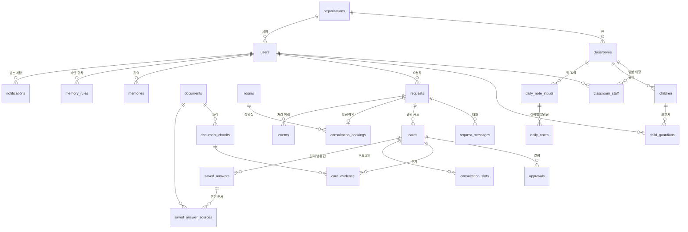

# 유치온 데이터베이스 스키마 설계서 (T09)

| 항목 | 내용 |
| --- | --- |
| 작업 | T09 데이터베이스 스키마 설계서 (#166) |
| 작성 | 태웅 · 검토 영민 |
| 판 | 초안 3 · 2026-11-17 (T04 대조 검토 반영) |
| 대상 DB | PostgreSQL 16 + pgvector (`compose.yaml`의 `pgvector/pgvector:pg16`) |
| DDL | [`db_schema_draft.sql`](db_schema_draft.sql) — 설계 검토용. 실제 적용은 T19 마이그레이션(`apps/api/migrations`)으로 옮김 |
| 기준 문서 | 기획서 1116판 3장 FR-01~FR-13, 4장 NFR, 6장 공통 상태, 7장 기술과 데이터 · T04 흐름·권한 명세(11/17 팀 합의, PR #234) |

## 1. 범위

MVP(12/08) 기능 FR-01~FR-13이 쓰는 표를 모두 정의한다. 최종(반드시) 기능 중 MVP 표를 그대로 쓰는 것(상담 지연 알림·부재 재배정·원장 현황·내 AI 기억)은 이 문서에서 어느 표를 쓰는지까지 적는다. 투약·귀가(T46)와 피드·앨범(T54)은 착수할 때 표를 더한다. 최종(선택) 기능인 사진·화상상담·반 모임·통학버스·동네 피드·성장 영상의 표는 착수를 정한 뒤에 설계한다.

## 2. 설계 원칙

| 원칙 | 하는 방법 | 이유 |
| --- | --- | --- |
| 기관 경계는 DB가 막음 | 기관에 속한 표는 모두 `org_id`를 갖고, 다른 표를 참조할 때 `(id, org_id)` 짝으로 참조함 | 다른 원의 반·계정·요청이 섞이는 실수를 API 코드보다 먼저 DB가 거부함(NFR-01) |
| 중복은 유니크 키로 막음 | 요청 키·결정 판·알림 키·예약 시간에 유니크·배제 제약을 둠 | 재시도·두 번 누르기·동시 저장이 생겨도 한 건만 남음(FR-09, FR-12, AC-05) |
| 상태 값은 `text` + `CHECK` | PostgreSQL ENUM 대신 허용 값 목록을 제약으로 둠 | 상태를 더하거나 뺄 때 마이그레이션이 단순함 |
| 이력은 쌓기만 함 | `events`는 INSERT만 하고 고치거나 지우지 않음 | 누가·언제·무엇을 바꿨는지 그대로 남아야 함(FR-11, NFR-05) |
| 판단은 AI, 계산·저장은 코드 | AI 결과(분류·초안·검사)는 `jsonb` 칸에 저장하고, 확정·예약·발송 조건은 제약으로 검사함 | 기획서 2.1 "계산·저장·필수값 검사는 코드로" |
| 가상 자료 표시 | 기관·아이·문서에 `is_virtual` 칸을 둠(기본값 참) | 시연 데이터가 전부 가상임을 데이터에도 남김(NFR-02) |

## 3. 전체 그림

## 4. 표 목록

### 4.1 기관·반·계정

| 표 | 무엇 | 핵심 칸 | 요구사항 |
| --- | --- | --- | --- |
| `organizations` | 유치원 | `name`, `kind`, `region`, `is_virtual` | FR-01 |
| `classrooms` | 반 | `org_id`, `name`, `age_group`, `school_year` | FR-01 |
| `users` | 계정(학부모·교사·원장) | `role`, `login_id`, `password_hash`, `token_version` | FR-01, NFR-01 |
| `classroom_staff` | 반 담당 교사(대체 담임 기간 포함) | `classroom_id`, `user_id`, `is_homeroom`, `valid_from`, `valid_to` | FR-01, FR-05 |
| `children` | 원아(가상) | `classroom_id`, `display_name` | FR-02, FR-10 |
| `child_guardians` | 원아와 보호자 계정 연결 | `child_id`, `user_id`, `relation` | FR-01, FR-02 |

원감은 `role = 'director'`에 `title = '원감'`으로 둔다. T04 7장 권한표도 원장·원감을 한 칸으로 본다. 대체 담임은 `classroom_staff`에 기간(`valid_from`~`valid_to`)을 넣어 그 기간에만 그 반 자료를 본다(T04 7.1). 기간이 비어 있으면 계속 담당한다.

### 4.2 요청·대화

| 표 | 무엇 | 핵심 칸 | 요구사항 |
| --- | --- | --- | --- |
| `requests` | 학부모 요청 한 건 | `type`, `status`, `urgency`, `risk_level`, `topic_key`, `parent_confirmed_at`, `missing_fields`, `client_request_id`, `previous_request_id` | FR-02, FR-03, FR-07 |
| `request_messages` | 요청 화면 오른쪽 대화 | `sender_type`(사람·AI·시스템), `body` | FR-02, FR-04 |

- `type`: `inquiry`(안내 문의) · `consultation`(상담) · `complaint`(민원) · `medication`(투약) · `pickup`(귀가). 투약·귀가는 값만 미리 두고 세부 칸은 T46에서 더한다.
- `client_request_id`: 화면이 제출할 때 만드는 키다. 같은 사람이 같은 키로 다시 보내면 DB가 거부하므로, 네트워크 재시도로 요청이 두 번 생기지 않는다.
- `urgency`: 모든 요청의 급한 정도(`low`·`normal`·`high`·`urgent`). 받은함 정렬에 쓴다.
- `risk_level`: 민원에만 붙이는 위험 등급이다. `normal`(일반) · `urgent`(긴급) · `uncertain`(판단 필요)(T04 2.3, 합의 4). 긴급이면 `risk_category`에 네 가지 중 무엇인지 넣어야 저장된다: `child_safety`(아이 안전) · `staff_attack`(교직원 비난·위협) · `legal_external`(법적 조치·외부 기관) · `privacy_leak`(개인정보 유출 주장). 감독 AI의 확신 정도는 `risk_confidence`(0~1)에 남기고, 긴급과 판단 필요를 나누는 기준값은 T06 평가로 정한다. 사람이 판단 필요를 일반·긴급으로 다시 나누면 `events`에 `risk_reclassified`로 이전 값·새 값·이유를 남긴다.
- `topic_key`: 감독 AI가 민원에 붙이는 주제 값이다. "같은 내용 3번째 민원이면 원장 보고"(FR-07)는 **같은 반 · 최근 30일 · 같은 `topic_key`** 민원 수로 센다. 보낸 학부모가 달라도 합산한다(T04 합의 3).
- `parent_confirmed_at`: 민원 회신에 학부모가 '확인했어요'를 누른 시각이다. 민원은 이 값이 찬 뒤 담임이 '처리 완료'를 눌러야 `completed`가 되고, 자동 완료는 하지 않는다(T04 합의 2). 상태 값을 늘리지 않고 이 칸 하나로 처리한다.
- `missing_fields`: 필수 정보가 빠졌을 때 물어볼 항목 목록(FR-02).
- `previous_request_id`: `completed`·`rejected`는 끝 상태라, 다시 열려면 학부모가 새 요청을 보내고 이 칸에 이전 요청을 잇는다(T04 2.1). 같은 기관 요청만 이을 수 있다.
- 반복 횟수(같은 반·최근 30일·같은 `topic_key` 민원 수)는 칸으로 두지 않고 카드를 조회할 때 `requests_repeat_idx`로 센다. 원장 보고를 만든 때의 수는 `events`의 `escalated` 행 `detail`에 남긴다.

### 4.3 승인 카드·결정·근거

| 표 | 무엇 | 핵심 칸 | 요구사항 |
| --- | --- | --- | --- |
| `cards` | 교직원 받은함의 카드 | `kind`, `status`, `assignee_id`, `due_at`, `draft`, `check_result`, `check_attempts`, `version` | FR-03, FR-07~FR-10 |
| `approvals` | 사람의 결정(승인·고쳐서 승인·거절·보류·반려·처리 완료) | `card_version`, `decision`, `reason_code`, `reason_text` | FR-06, FR-09 |
| `card_evidence` | 카드 초안이 댄 근거 문서 조각 | `chunk_id`, `rank`, `score`, `quote` | FR-04, NFR-04 |

- `kind`: `reply_draft`(답변 초안) · `consult_slots`(상담 후보) · `director_report`(원장 보고) · `needs_info`(정보 요청) · `daily_note`(알림장 묶음) · `rule_proposal`(개인 규칙 제안).
- `assignee_id`: 카드를 만들 때 담당자 ID를 바로 넣는다. 원장 보고 카드는 원장 ID가 없으면 저장되지 않는다. 감독 AI가 담당을 못 정하면 비워 두고, 그 카드가 받은함 '미배정'에 들어가 원장·원감이 지정한다.
- `check_attempts`: 검사 AI가 돌려보낸 횟수. 최대 2를 넘으면 DB가 거부하므로, 3번째부터는 코드가 사람에게 넘겨야 한다(FR-08).
- `version`: 카드가 바뀔 때마다 1씩 올린다. `approvals`는 `(card_id, card_version)`에 결정을 하나만 받으므로, 승인 버튼이나 재개를 여러 번 눌러도 한 번만 처리된다(AC-05). 화면은 결정할 때 자기가 본 `version`을 같이 보낸다.
- `decision`: `approve`(승인) · `edit_approve`(고쳐서 승인) · `reject`(거절 → 초안 다시) · `hold`(보류) · `resume`(보류 재개 → `awaiting_review`) · `dismiss`(반려 → 요청을 처리하지 않음, `rejected`) · `complete`(민원 처리 완료) · `escalate`(담임이 원장님께 올리기, T04 8장 #5) · `instruct`(원장 지시 → 원장 보고 카드 `done`, 요청 `escalated → awaiting_review`). T04 2.1이 거절과 반려를 다른 길로 그리므로 값을 나눴다.
- 거절·반려는 `reason_code`, 보류와 원장 지시는 `reason_text`(지시 내용)가 있어야 저장된다. 거절 이유가 기억과 규칙 제안의 재료가 된다(FR-06).
- 원장 보고 카드(`director_report`)에 결정을 내리는 사람은 원장·원감뿐이다(T04 7.2). 카드 종류에 따른 이 권한은 API가 검사한다.
- 보류한 카드는 `cards.hold_until`(예정일)이 있어야 저장된다. 학부모 화면에는 예정일만 보이고, 보류 이유는 교직원끼리만 본다(T04 3장·9장).
- 근거 문서명·위치·적용일은 `card_evidence → document_chunks → documents`로 이어서 보여 준다.
- 알림장 묶음 카드와 규칙 제안 카드는 요청이 없으므로 `subject_type`·`subject_id`로 대상을 가리킨다.

### 4.4 자료 창고·문서 조각

| 표 | 무엇 | 핵심 칸 | 요구사항 |
| --- | --- | --- | --- |
| `documents` | 원이 올린 자료·공공 자료 | `doc_type`, `visibility`, `source`, `api_called_at`, `effective_from/to`, `status`, `supersedes_id`, `content_sha256` | FR-13, NFR-07 |
| `document_chunks` | 검색 단위 조각 | `location`, `content`, `embedding vector(1024)`, `embedding_model` | FR-04 |

- `visibility`: `staff`(교직원만) · `parents`(학부모) · `all`. 검색할 때 묻는 사람 역할로 거른다.
- `status = 'conflict_pending'`: 다른 자료와 날짜·숫자가 달라 확인을 기다리는 자료. 이 상태 자료는 답변 근거로 쓰지 않는다(FR-13).
- `api_called_at`: 공공 API를 실제로 불러 온 시각. 목록만 확인한 API는 비워 두어 "연동 완료"로 보이지 않게 한다(FR-13, FR-27).
- `content_sha256`: 같은 파일을 두 번 올리면 거부한다.
- `supersedes_id`: 새 판이 대신하는 옛 판(같은 기관 문서만). 자료를 올릴 때 `replaces_document_id`를 받으면 같은 트랜잭션에서 새 문서의 이 칸을 채우고 옛 문서를 `superseded`로 바꾼다. 그러면 4.6의 트리거가 옛 판을 근거로 쓴 원에 남은 답을 무효로 한다(T04 합의 7). 한 판을 대신하는 새 판은 하나뿐이다.
- 임베딩은 bge-m3 기준 1024차원이다. 모델 이름은 `embedding_model` 칸과 환경 변수로 관리하고, 모델이나 차원을 바꾸면 다시 색인한다.

### 4.5 상담 예약 (자산 = 상담실)

| 표 | 무엇 | 핵심 칸 | 요구사항 |
| --- | --- | --- | --- |
| `rooms` | 상담실 | `name`, `is_active` | FR-05 |
| `staff_busy_blocks` | 담임이 상담할 수 없는 시간 | `user_id`, `period`(시간 범위), `kind` | FR-05 |
| `consultation_slots` | 일정 계산 코드가 낸 후보(회차마다 최대 3개) | `card_id`, `teacher_id`, `room_id`, `period`, `round`, `rank`, `status` | FR-05, FR-06 |
| `consultation_bookings` | 담임이 확정한 예약 | `teacher_id`, `room_id`, `period`, `status`, `confirmed_by` | FR-05, FR-17 |

`consultation_bookings`에는 배제 제약 두 개를 둔다. 확정된 예약끼리 **같은 상담실의 시간이 겹치거나, 같은 담임의 시간이 겹치면** DB가 저장을 거부한다. 일정 계산 코드가 미리 확인하더라도, 저장 직전에 두 사람이 동시에 확정하면 겹칠 수 있다. 이 제약이 있으면 동시에 저장해도 한 건만 성공한다(FR-05, AC-02). 취소된 예약은 제약에서 빠지므로 그 시간을 다시 예약할 수 있다. 담임 거절이나 저장 순간 충돌로 후보를 다시 낼 때는 같은 카드에서 `round`를 1 올리고, 앞 회차 후보는 `discarded`로 남긴다(T04 4.1). 상담 지연·종료 10분 전 알림(FR-17, T48)은 이 표의 `period`를 읽어 `notifications`에 넣는다.

### 4.6 기억·개인 규칙·원에 남은 답

| 표 | 무엇 | 핵심 칸 | 요구사항 |
| --- | --- | --- | --- |
| `memories` | 사람별 기억(거절 이유·선호·말투) | `owner_id`, `kind`, `reason_code`, `content`, `structured`, `deleted_at` | FR-06, FR-20 |
| `memory_rules` | 같은 거절 이유가 3번 쌓여 제안된 개인 규칙 | `reason_code`, `rule_text`, `rule_json`, `status` | FR-06 |
| `saved_answers` | 원에 남은 답(담임이 승인한 문의 답, 원 단위) | `question`, `question_embedding`, `answer`, `source_card_id`, `status` | FR-04, FR-20 |
| `saved_answer_sources` | 그 답이 근거로 쓴 문서 | `saved_answer_id`, `document_id` | FR-04, FR-13 |

- 거절 이유가 저장되면 `memories`에 같은 `reason_code`로 쌓는다. 지우지 않은 기억 중 같은 값이 3개가 되면 코드가 `memory_rules`에 `proposed`로 넣고 규칙 제안 카드를 만든다.
- 규칙은 담임이 승인해야 `active`가 되고, 그 전에는 다음 후보 계산에 쓰지 않는다. 같은 사람·같은 이유의 규칙은 `proposed`나 `active` 상태로 하나만 있을 수 있다.
- 사용자가 기억을 지우면 `deleted_at`을 채우고 다음 제안에서 뺀다(FR-20 "내 AI 기억 보기·지우기"는 이 표를 그대로 씀).
- 민감·일회성 정보는 저장하지 않는다. 저장 전 거르는 일은 기억 AI와 검사 AI가 맡는다.
- **원에 남은 답**은 한 사람의 기억이 아니라 원 전체가 쓰는 답이라 `memories`와 따로 둔다. 같은 질문이 오면 `question_embedding`으로 가까운 답을 찾고, 질문 뜻이 충분히 같고 근거 문서가 최신일 때만 카드 없이 바로 답한다(T04 합의 7). 바로 답한 일은 `events`에 `answered_from_saved`로 남긴다.
- 근거 문서가 새 판(`superseded`)이 되거나 충돌 확인 대기(`conflict_pending`)가 되면, DB 트리거가 그 문서를 쓴 답을 `invalidated`로 바꾼다. 무효가 된 답은 검색 대상(HNSW 부분 인덱스)에서도 빠진다. "뜻이 충분히 같다"의 기준값은 T06 평가로 정한다.
- 담임의 '내 AI 기억' 화면에서 `approved_by = 나`인 원에 남은 답을 보여 주고 끌 수 있다. 끄면 `status = 'off'`가 되어 검색에서 빠지고, 같은 질문은 다시 카드로 묻는다(FR-20). 꺼 둔 답도 근거 문서가 새 판이 되면 무효로 바뀐다.

### 4.7 알림장(글 초안)

| 표 | 무엇 | 핵심 칸 | 요구사항 |
| --- | --- | --- | --- |
| `daily_note_inputs` | 교사가 반 단위로 넣는 그날 활동·준비물 | `classroom_id`, `note_date`, `activities`, `supplies` | FR-10 |
| `daily_notes` | 아이별 알림장 | `child_id`, `note_date`, `status`, `content`, `open_checks`, `confirmed_by`, `confirmed_at` | FR-10, FR-14 |

상태 값 `draft`·`needs_check`·`ready`·`sent`는 T04 6장의 `note_drafted`·`note_needs_check`·`note_ready`·`note_sent`와 같은 뜻이다(표가 따로라 앞의 `note_`를 뺐다). MVP는 반 전체를 한 번에 보내고, 반에 `needs_check`가 하나라도 있으면 보내기를 잠근다(T04 합의 6). 잠금은 두 겹이다. **아이별로는 DB CHECK가** `open_checks`가 남은 알림장을 `sent`로 바꾸지 못하게 막고, **반 단위 잠금은 API 트랜잭션이** 막는다. API는 그 반·그날 알림장을 모두 잠근 뒤 하나라도 `ready`가 아니면 아무것도 보내지 않고 409 `NOTE_BATCH_BLOCKED`로 답한다(FR-10, AC-04). `ready`·`sent`는 교사 확인(`confirmed_by`·`confirmed_at`)이 있어야 저장된다(T04 6.1 "교사가 확인함", NFR-03). 식단·일정은 `documents`에서, 투약·귀가 줄은 `requests`에서 가져와 `content`에 넣는다.

### 4.8 처리 이력·알림·평가

| 표 | 무엇 | 핵심 칸 | 요구사항 |
| --- | --- | --- | --- |
| `events` | 요청·카드에 일어난 모든 일 | `actor_type`, `agent_name`, `action`, `from_status`, `to_status`, `detail` | FR-11, NFR-05 |
| `notifications` | 서비스 안 알림 | `recipient_id`, `kind`, `subject_type`, `subject_id`, `dedupe_key`, `status`, `attempts`, `deliver_after`, `read_at` | FR-12, FR-21 |
| `eval_runs` | 평가 실행 기록 | `suite`, `requested_model`, `returned_model`, `started_at`, `total`, `passed`, `errors` | 원장 현황 평가 결과, NFR-09 |

- `events.action`: 생성·분류·정보 요청·배정·재배정·초안·검사·돌려보내기·승인·거절·보류·보류 재개(`resumed`)·원장 보고·원장 지시(`instructed`)·발송·예약·완료·도구 호출·도구 실패·권한 거부·학부모 확인·위험 등급 다시 분류·반려·원에 남은 답으로 답함. 부재 재배정(FR-19)은 `reassigned`에 이전 담당·새 담당·이유를 `detail`로 남긴다. 권한 없는 요청도 `permission_denied`로 남긴다(NFR-01).
- `detail`에는 비밀값과 불필요한 개인정보를 넣지 않는다(NFR-05).
- `notifications.dedupe_key`: 예를 들어 `card:<카드 ID>:approved:<받는 사람 ID>`처럼 만든다. 같은 키는 한 번만 들어가므로 재시도해도 알림이 두 번 가지 않는다. 재시도는 최대 3번이다(FR-12).
- `notifications.kind`: T04 9장 알림 시점 11가지만 받는다. `needs_info` · `new_card`(새 카드) · `urgent_complaint`(긴급 민원) · `uncertain_complaint`(판단 필요 민원) · `director_report`(반복 3번째 원장 보고) · `on_hold` · `sent_or_booked` · `parent_confirmed`(학부모가 확인함) · `completed`(민원 완료) · `rejected` · `note_sent`(오늘 알림장). 최종 기능(상담 지연 알림 T48 등)은 그때 값을 더한다.
- `subject_type`·`subject_id`: 요청·카드가 아닌 대상을 가리킨다. 지금은 `note_sent` 알림이 아이별 알림장(`daily_note`)을 가리킬 때만 쓴다.
- `deliver_after`: 퇴근 뒤 알림을 모아 두었다가 보내는 데 쓴다(FR-21, 최종).
- `eval_runs`: 요청한 모델 ID와 응답에 돌아온 모델 ID를 함께 남긴다. 원장 현황의 '평가 결과'와 모델 선택 근거(T05)를 같은 기록에서 본다.

### 4.9 교직원 받은함과 원장 현황

교직원 받은함은 뷰 `staff_inbox`가 카드마다 필터 하나(`inbox_filter`)를 붙인다(T04 2.2, 합의 5).

| `inbox_filter` | 받은함 필터 | 들어가는 카드 |
| --- | --- | --- |
| `unassigned` | 미배정 | 담당이 없는 카드 |
| `needs_review` | 확인 필요 | 요청이 `awaiting_review`·`escalated`, 학부모가 확인한 민원(`sent_or_booked` + `parent_confirmed_at`), 요청 없는 카드(규칙 제안 등) 중 결정 대기 |
| `uncertain` | 판단 필요 | 위험 등급 `uncertain` 민원 |
| `on_hold` | 보류 | 카드나 요청이 보류 |
| `in_progress` | 진행 중 | 학부모·AI·시스템 차례인 것 |
| `done` | 완료 | 카드 `done`·`rejected`, 요청 `completed`·`rejected` |

긴급 민원은 필터를 따로 두지 않고 `is_urgent`로 '확인 필요' 맨 위에 올린다. 판단 필요 민원을 사람이 다시 나누면 `risk_level`이 바뀌어 '확인 필요'로 옮겨 간다.

원장 현황(FR-19)은 표를 따로 두지 않고 `staff_inbox`를 세는 뷰 `director_overview`로 만든다. 미배정 = 받은함 '미배정'(`inbox_filter = 'unassigned'`)과 같은 기준, 대기 = `pending`·`in_review`·`on_hold`, 지연 = 대기 중이면서 `due_at`이 지난 것, 완료 = 오늘 `done`이 된 것. 재배정 이력은 `events`의 `reassigned`, 평가 결과는 `eval_runs`에서 가져온다.

## 5. 상태 값

### 5.1 요청 `requests.status`

기획서 6장 공통 상태를 그대로 쓴다.

| 값 | 뜻 |
| --- | --- |
| `received` | 접수됨 |
| `classified` | 감독 AI가 유형·긴급도를 붙임 |
| `needs_info` | 필수 정보가 빠져 학부모에게 물음 |
| `assigned` | 담당자가 정해짐 |
| `awaiting_review` | 카드가 사람 결정을 기다림 |
| `approved` | 사람이 승인함 |
| `sent_or_booked` | 회신이 나갔거나 예약이 확정됨 |
| `completed` | 학부모 쪽 완료까지 끝남 |
| `on_hold` | 보류 |
| `escalated` | 원장 보고로 올라감 |
| `rejected` | 처리하지 않기로 함 |

어떤 상태에서 어떤 상태로 갈 수 있는지와 역할별 화면 표시 이름은 T04 2장(공통 전이 규칙·표시 이름 표)이 정하고, 전이는 API 코드에서 검사한다. DB는 값이 목록 안에 있는지만 검사한다.

### 5.2 카드 `cards.status`

카드 처리 단계를 나타내는 **내부 값이고 화면에는 쓰지 않는다**. 화면의 받은함 필터는 이 값과 요청 상태를 함께 보고 `staff_inbox`가 정하고(4.9), 화면에 보이는 상태 이름은 요청 상태에 맞춘 T04 2장의 교직원 표시 이름(API의 `status_label`)을 쓴다.

| 값 | 뜻 |
| --- | --- |
| `unassigned` | 담당 없음 |
| `pending` | 사람 결정을 기다림 |
| `in_review` | 담당이 열어 보는 중 |
| `on_hold` | 보류 |
| `approved` | 승인됨(후속 처리 전) |
| `rejected` | 거절·반려됨 |
| `done` | 처리 끝 |

## 6. DB가 막는 것과 확인 결과 (2026-11-17)

초안 3 DDL을 `pgvector/pgvector:pg16` 임시 컨테이너에 다시 적용하고 가상 데이터로 아래 시험을 모두 다시 돌렸다. 표 26개와 뷰 2개, 트리거 1개가 오류 없이 만들어졌다. '긴급인데 네 가지 중…' 행부터는 T04 합의를 반영한 뒤, '끝난 요청을 이전 요청으로…' 행부터는 T04 대조 검토를 반영한 뒤 더한 시험이다.

| 시험 | 기대 | 결과 | 막는 제약 |
| --- | --- | --- | --- |
| 같은 요청 키로 두 번 제출 | 거부 | 거부됨 | `requests (requester_id, client_request_id)` 유니크 |
| 다른 기관의 반에 요청 붙이기 | 거부 | 거부됨 | `(classroom_id, org_id)` 복합 FK |
| 다른 기관 학부모가 이 원 요청 만들기 | 거부 | 거부됨 | `(requester_id, org_id)` 복합 FK |
| 같은 상담실·겹치는 시간 예약 | 거부 | 거부됨 | 상담실 배제 제약 |
| 두 연결이 같은 시간을 동시에 예약 | 한 건만 저장 | 한 건 저장, 한 건 거부 | 상담실 배제 제약 |
| 안 겹치는 예약 두 건, 취소된 예약 시간 재예약 | 저장 | 저장됨 | — |
| 같은 카드 판에 결정 두 번 | 거부 | 거부됨 | `approvals (card_id, card_version)` 유니크 |
| 이유 없이 거절 | 거부 | 거부됨 | `approvals` CHECK |
| 판 1 승인 뒤 판 2에 이유 있는 거절 | 저장 | 저장됨 | — |
| 확인 항목이 남은 알림장 발송 | 거부 | 거부됨 | `daily_notes` CHECK |
| 같은 이유로 규칙 제안 두 번 | 거부 | 거부됨 | `memory_rules` 부분 유니크 |
| 같은 알림 두 번 넣기 | 거부 | 거부됨 | `notifications.dedupe_key` 유니크 |
| 검사 3번째 돌려보내기 | 거부 | 거부됨 | `cards.check_attempts` CHECK |
| 문서 조각 벡터 검색 | 가까운 조각 반환 | 반환됨 | HNSW 인덱스 |
| 원장 현황 집계 | 지연 1건 | 대기 1·지연 1 | `director_overview` 뷰 |
| 긴급 민원인데 네 가지 중 무엇인지 없음 | 거부 | 거부됨 | `requests` CHECK |
| 민원이 아닌 요청에 위험 등급·학부모 확인 | 거부 | 거부됨 | `requests` CHECK |
| 이유 없이 반려 · 이유 없이 보류 결정 | 거부 | 거부됨 | `approvals` CHECK |
| 예정일 없이 카드 보류 / 예정일 있는 보류 | 거부 / 저장 | 거부됨 / 저장됨 | `cards` CHECK |
| 근거 문서가 새 판으로 바뀜 | 그 문서를 쓴 원에 남은 답이 무효 | `invalidated` (`document_superseded`) | `documents` 트리거 |
| 받은함 필터 6종 | 판단 필요·긴급·학부모 확인·확인 전·미배정이 제 필터로 | 판단 필요=`uncertain`, 긴급=`needs_review`+맨 위, 확인함=`needs_review`, 확인 전=`in_progress`, 담당 없음=`unassigned` | `staff_inbox` 뷰 |
| 같은 반·30일·같은 주제 민원 수(학부모 3명) | 3 | 3 | `requests_repeat_idx` |
| 끝난 요청을 이전 요청으로 잇기 / 자기 자신을 잇기 | 저장 / 거부 | 저장됨 / 거부됨 | `requests` 복합 FK·CHECK |
| 새 판이 옛 판을 가리킴 / 새 판 둘이 같은 옛 판을 / 다른 기관 문서를 옛 판으로 | 저장 / 거부 / 거부 | 저장됨 / 거부됨 / 거부됨 | `documents.supersedes_id` 유니크·복합 FK |
| 담당 없는 원장 보고 카드 / 원장 ID로 만든 원장 보고 카드 | 거부 / 저장 | 거부됨 / 저장됨 | `cards` CHECK |
| 보류 재개(`resume`)·원장님께 올리기(`escalate`) 결정 | 저장 | 저장됨 | `approvals.decision` CHECK |
| 내용 없는 원장 지시 / 내용 있는 원장 지시 | 거부 / 저장 | 거부됨 / 저장됨 | `approvals` CHECK |
| 이력 `resumed`·`instructed` / 목록에 없는 이력 | 저장 / 거부 | 저장됨 / 거부됨 | `events.action` CHECK |
| 같은 카드에 2회차 후보 / 같은 회차·같은 순번 두 번 | 저장 / 거부 | 저장됨 / 거부됨 | `consultation_slots (card_id, round, rank)` 유니크 |
| 원에 남은 답 끄기 → 근거 문서 새 판 | `off` 저장 → 무효 | 저장됨 → `invalidated` (`document_superseded`) | `documents` 트리거 |
| 교사 확인 없이 보낼 준비 / 바로 발송 / 확인 후 준비 → 발송 | 거부 / 거부 / 저장 | 거부됨 / 거부됨 / 저장됨 | `daily_notes` CHECK |
| 9장에 없는 알림 종류 / 대상 종류만 있음 / 알림장을 가리키는 발송 알림 | 거부 / 거부 / 저장 | 거부됨 / 거부됨 / 저장됨 | `notifications` CHECK |
| 원장 현황 미배정과 받은함 미배정 | 같은 수 | 1 = 1 | `director_overview` 뷰 |

## 7. 인덱스

| 인덱스 | 쓰는 화면·작업 |
| --- | --- |
| `requests (org_id, status)` | 기관별 상태 목록 |
| `requests (requester_id, created_at DESC)` | 학부모 '내 요청' 목록 |
| `requests (classroom_id, topic_key, created_at)` 민원만 | 같은 반·같은 주제 민원 반복 횟수 |
| `cards (org_id, assignee_id, status)` 열린 카드만 | 교직원 받은함 |
| `cards (org_id, due_at)` 열린 카드만 | 원장 현황 지연 계산 |
| `document_chunks` HNSW(`vector_cosine_ops`) | 근거 검색 |
| `saved_answers` HNSW, `active`만 | 원에 남은 답 찾기 |
| `events (request_id, id)` | 요청 처리 이력 |
| `notifications (recipient_id, created_at DESC)` 안 읽은 것만 | 알림 목록 |
| `notifications (deliver_after)` 보낼 것만 | 알림 발송 대기열 |

## 8. 인증·세션 — 무상태 JWT, Redis 없음

로그인하면 서버가 액세스 토큰(JWT) 하나를 준다. 서버는 세션을 저장하지 않는다.

| 항목 | 정한 것 |
| --- | --- |
| 비밀번호 | `users.password_hash`에 argon2(또는 bcrypt) 해시만 저장 |
| 토큰 내용 | `sub`(계정 ID) · `org`(기관 ID) · `role` · `ver`(`token_version`) · `iat` · `exp` |
| 유효 시간 | 액세스 토큰 12시간(시연 기준, T24에서 확정) |
| 서명 키 | 환경 변수 `JWT_SECRET`(`.env.example`에 이름만 있음) |
| 로그아웃·강제 만료 | `users.token_version`을 1 올리면 그 전에 발급한 토큰이 모두 무효 |
| 권한 검사 | 토큰은 "누구인지"만 알려 준다. 반·아이·요청에 접근할 수 있는지는 요청마다 DB(`classroom_staff`·`child_guardians`·`org_id`)로 확인한다. 화면 숨김만으로 막지 않는다(NFR-01) |
| 앱과 웹 | Android 앱과 브라우저 웹이 같은 API를 쓰므로 쿠키 대신 `Authorization: Bearer` 헤더로 보낸다 |

**Redis를 두지 않는 이유**

| Redis가 흔히 맡는 일 | 유치온에서 대신하는 방법 |
| --- | --- |
| 로그인 세션 저장 | 무상태 JWT라 저장할 세션이 없음. 강제 만료는 `token_version` 한 칸으로 처리 |
| 중복 요청·중복 알림 막기 | PostgreSQL 유니크 키(`client_request_id`, `dedupe_key`, `card_version`)로 막음 |
| 동시 예약 잠금 | PostgreSQL 배제 제약이 겹치는 예약을 거부함 |
| 작업 대기열 | 알림은 `notifications`의 `pending` 행을 발송 작업이 읽어 처리함. 시연 규모(가상 유치원 1곳)에서는 이것으로 충분함 |
| 캐시 | 시연 규모에서 필요하지 않음. 응답이 느려지면 T66 부하 시험 결과를 보고 다시 판단함 |

서버 한 대에 Docker Compose로 배포하므로 서비스를 하나 줄이는 것이 메모리·운영 면에서도 낫다.

## 9. 역할별로 볼 수 있는 행 (T04 7장 기준)

| 역할 | 요청·카드 | 자료 | 기억 |
| --- | --- | --- | --- |
| 학부모 | 자기가 낸 요청과 그 대화·진행 상태만. 카드·위험 등급·보류 이유는 볼 수 없음 | `visibility`가 `parents`·`all`인 자료, 우리 아이 알림장(발송 후) | 자기 기억만 |
| 담임 | 우리 반(`classroom_staff`, 대체 담임은 기간 안) 요청·카드 + 재배정받은 카드. 다른 반은 볼 수 없음 | 우리 원 자료 전부, 우리 반 알림장 | 자기 기억만 |
| 원장·원감 | 우리 원의 모든 요청·카드, 원장 보고 카드 | 우리 원 자료 전부, 원 전체 알림장(읽기) | 자기 기억만 |

모든 조회는 토큰의 `org`와 행의 `org_id`가 같아야 한다. 권한은 화면에서 숨기는 것이 아니라 서버가 역할·기관·반을 검사하고, URL·API로 직접 불러도 거부하며 `events`에 `permission_denied`로 남긴다(T04 7.1, FR-01). 누가 어떤 행동을 할 수 있는지(승인·반려·재배정·상담 확정·처리 완료 등)는 T04 7.2를 따른다. 우리 반 피드를 교직원이 못 보는 규칙(FR-22)은 T54에서 피드 표와 함께 정한다.

## 10. LangGraph 체크포인트

승인 대기에서 멈췄다가 재개하는 흐름(interrupt)의 상태는 LangGraph의 PostgreSQL 체크포인트 저장소가 자기 표를 만들어 저장한다. 이 표는 라이브러리가 관리하므로 이 설계서의 DDL에 넣지 않는다. 카드와는 `cards.graph_thread_id`로 잇는다. 재개할 때는 체크포인트만 믿지 않고 카드의 `status`·`version`과 사용자 권한을 다시 확인한다(기획서 7장).

## 11. 나중에 더하는 표

| 기능 | 작업 | 방법 |
| --- | --- | --- |
| 투약·귀가 요청 | T46 (12/09~10) | `requests.type`은 이미 있음. 투약 정보·등록 인계자·교직원 확인 기록 표를 더함 |
| 우리 반·원 피드와 앨범 | T54 (12/14~15) | 게시물·사진·공개 범위 표를 더하고 칸별 권한을 정함 |
| 상담 지연·종료 알림 | T48 | 기존 `consultation_bookings`·`notifications` 사용 |
| 부재 재배정·원장 현황 | T53 | 기존 `cards`·`events`·`director_overview` 사용 |
| 내 AI 기억 보기·지우기 | 최종 | 기존 `memories`·`memory_rules` 사용 |
| 최종(선택) 기능 | T50·T56·T59·T60 | 착수를 정한 뒤 설계함 |

## 12. T10(11/18)에서 정할 것

1. 거절 이유 코드 목록(`reason_code`). 예: 시간 안 됨·상담실 없음·정보 부족·다른 담당. 반려 이유 코드도 같이.
2. `topic_key`를 붙이는 기준(감독 AI 출력 형식). 기간·범위는 T04 합의 3(같은 반·30일·같은 주제)으로 정해짐.
3. 카드 종류별 처리 기한(`due_at`). 원장 현황의 '지연'이 이 값으로 정해짐.
4. 알림 `dedupe_key` 만드는 규칙.
5. 요청·카드 상태가 바뀔 때 화면이 받을 필드(T13 API 설계로 이어짐).
6. T04 후속 F1: 학부모가 '확인했어요'를 안 눌러도 담임이 이유를 남기고 완료할 수 있게 할지. 하면 원장 현황에 "학부모 미확인 완료" 칸을 더함.
7. 같은 질문 여러 건을 카드 한 장으로 묶을지(T04 5.2 [제안]). 묶으면 카드 하나에 요청 여러 건을 잇는 표(`card_requests`)를 더함.
8. 보류 카드를 예정일(`hold_until`)에 시스템이 자동 재개할지, 담당이 `resume`을 눌러야만 재개할지.
9. `urgency = 'urgent'`와 민원 `risk_level = 'urgent'`가 둘 다 '긴급'이다. 받은함 맨 위 기준은 위험 등급 하나로 두고, `urgency`는 화면에서 '급한 정도'로 따로 부를지(T04에 없는 칸).
10. 요청 없는 카드(알림장 묶음·규칙 제안)를 받은함 '확인 필요'에 넣을지. T04 2.2 표에는 없는 규칙이다.
11. 문서가 `conflict_pending`이 되어도 원에 남은 답을 무효로 하고, 충돌이 풀려도 되살리지 않는 지금 방식을 유지할지(T04 합의 7은 새 판만 말함).
