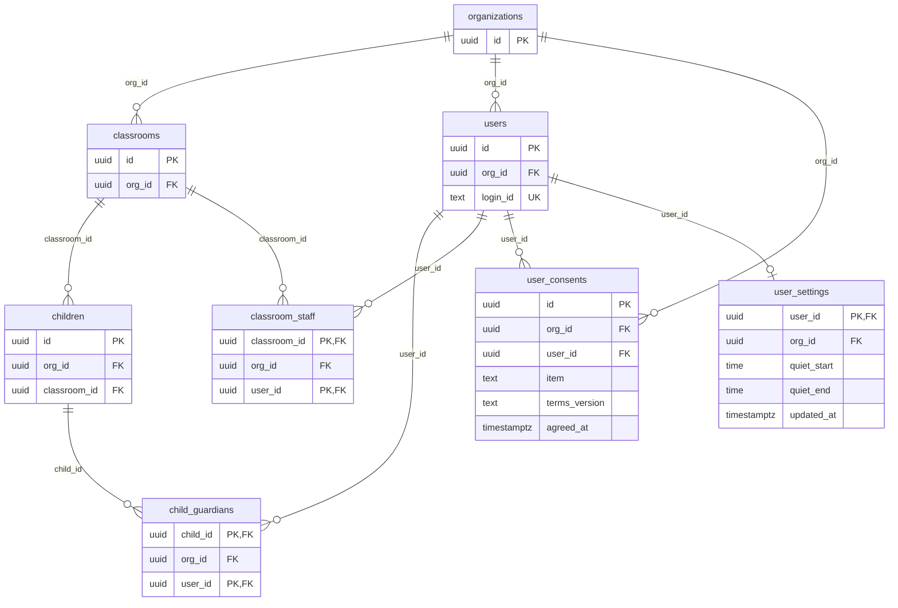
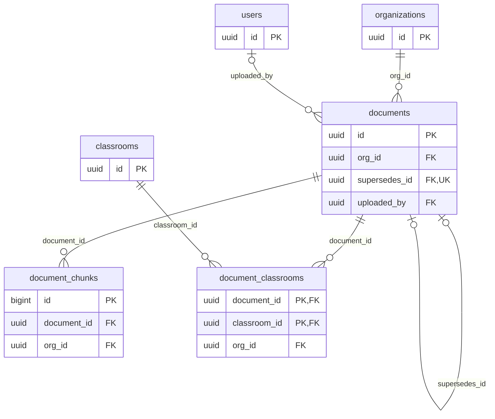
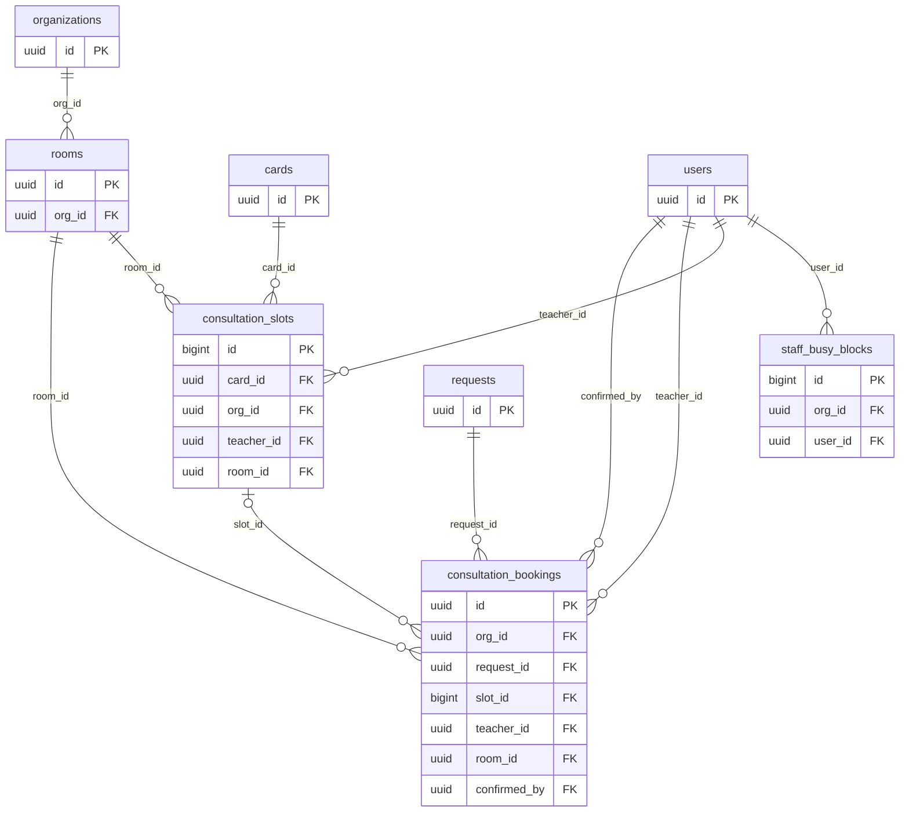
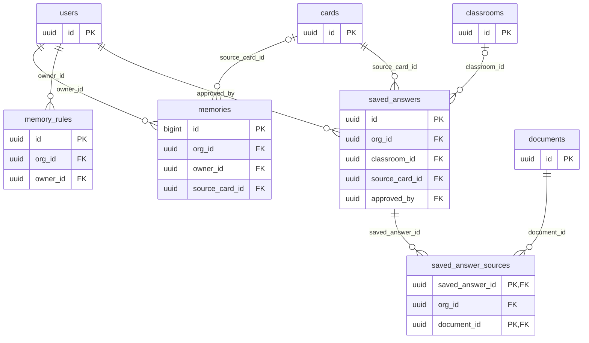
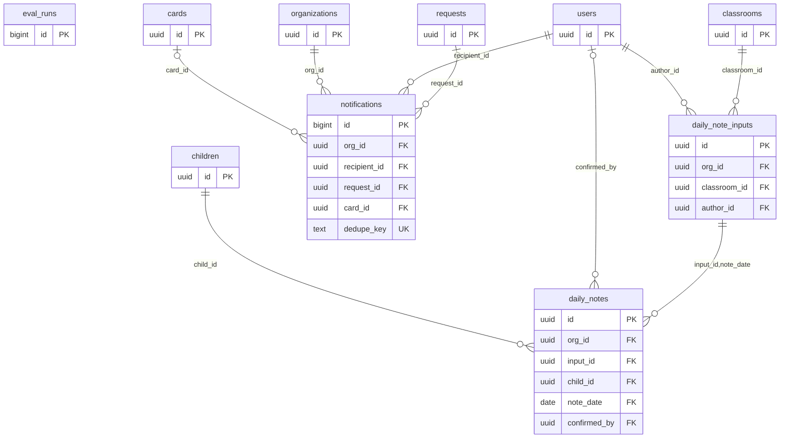

# 유치온 데이터베이스 스키마 설계서 (T09)

| 항목 | 내용 |
| --- | --- |
| 작업 | T09 데이터베이스 스키마 설계서 (#166) |
| 작성 · 검토 | 태웅 · 영민 |
| 판 | v0.24 · 2026-11-24 (판마다 바뀐 내용은 맨 끝 변경 이력에 있다) |
| 2차 검토 링크 | `develop` 브랜치의 [DB 스키마 설계서](https://github.com/aio-final-2team/FinalProject_2Team/blob/develop/Docs/Step2/DB_스키마_설계서.md) |
| 시연 코드 기준 커밋 | 레포 [README](../../README.md#2차-검토-문서)의 '시연 코드 기준 커밋' 한 줄을 본다(11/24 밤 기준 develop `641591f`, 흐름 고치기 #338까지 팀 서버에 배포). 팀 서버를 다시 배포하면 README 그 한 줄만 고친다 |
| 대상 DB | PostgreSQL 16 + pgvector 0.8 (`compose.yaml`의 `pgvector/pgvector:pg16`). Supabase를 쓰지 않는 이유는 5.1에 있다 |
| DDL | 최종 모양은 [`db_schema_draft.sql`](db_schema_draft.sql)에 있고, 실제 DB에는 `apps/api/migrations`의 0001~0016·0020을 차례로 적용한다 |
| 함께 보는 문서 | 기획서 11/23 develop 판(`8f45d51`, #319) 3장(FR-01~FR-13)·4장(NFR)·6장(공통 상태)·7장, T04 흐름·권한 명세, [입출력 계약표 v0.21](입출력_계약표_초안.md), [API 설계 문서 v0.13](API_설계_문서.md) |

**1차 검토 뒤 보완.** 1차 검토 뒤에 바뀐 내용과 그 내용을 지키는 시험을 표 하나에 모았다. 시험은 모두 시연 코드 기준 커밋에서 `tools/test_db.sh`로 다시 돌려 통과했다. 표의 시험 파일은 모두 `tests/integration/`(DB는 `db/`, HTTP는 `api/`) 아래에 있고, `api/` 시험은 모의·시험 PG 두 모드에서 모두 돈다. 반영 커밋 칸에는 develop에 합쳐진 커밋을 적었다.

| 바뀐 내용 | 고친 절 | 지키는 시험(파일::함수) | 반영 커밋 |
| --- | --- | --- | --- |
| **접근 차단.** 다른 기관 사용자, 다른 반 보호자, 연결이 끝난 보호자가 조회·수정·파일 열람을 하는 경우를 나눠 실제 HTTP로 시험했다. 연결된 아이가 없는 보호자는 원 칸 피드에서도 403을 받는다(`core/feed.py`의 `lane_access`) | [4.4](#44-차단-시험) | `db/test_scope_cases.py::test_other_org_user_gets_404_for_document_and_feed_files_with_denial`, `db/test_scope_cases.py::test_other_class_guardian_is_blocked_on_read_update_and_file`, `db/test_scope_cases.py::test_unlinked_guardian_loses_child_notes_requests_and_all_feed_photos`, `api/test_feed.py::test_org_lane_closes_for_guardian_without_linked_child` | [`bf75f8f`](https://github.com/aio-final-2team/FinalProject_2Team/commit/bf75f8f) |
| **사진 정리.** 공개 범위를 바꾸거나, 아이가 퇴소하거나, 파일 삭제가 실패하거나, 백업을 복원할 때 사진·태그·기억·이력을 어떻게 다룰지 정했다. 관리 작업으로 퇴소(`withdraw_child`), 고아 파일 정리(`media_sweep`), 복원 뒤 다시 적용(`after_restore`)을 두었다. 데모 시드는 퇴소한 아이를 다시 넣지 않는다 | [사진·기억의 보존과 삭제](#사진기억의-보존과-삭제) | `db/test_maintenance.py::test_withdraw_dry_run_changes_nothing_then_apply_follows_four_steps`, `db/test_maintenance.py::test_sweep_lists_only_orphans_and_deletes_them_only_with_apply`, `db/test_backup_restore.py::test_dump_restore_revives_later_deletions_until_after_restore_applies_them`, `db/test_maintenance.py::test_demo_seed_does_not_bring_back_a_withdrawn_child` | [`bf75f8f`](https://github.com/aio-final-2team/FinalProject_2Team/commit/bf75f8f)·[`1d2c228`](https://github.com/aio-final-2team/FinalProject_2Team/commit/1d2c228)(코드·시험). [`783d5b1`](https://github.com/aio-final-2team/FinalProject_2Team/commit/783d5b1)은 시험이 아니라 팀 서버 첫 백업 기록 |
| **초안 실패 뒤 처리 — 알림장.** 실패 감지부터 다시 시도·검증·저장까지를 같은 작업 ID의 incident 이력으로 남긴다. `tools/daily_note_recovery.py`는 정상 복구·대체 응답·사람 이관이 각각 몇 건인지와 복구 시간을 센다 | [2.6](#26-알림장알림평가) '초안 실패와 복구 기록' | `db/test_daily_note_recovery.py::test_timeout_then_regenerate_is_one_recovered_incident_with_times`, `db/test_daily_note_recovery.py::test_failed_retry_is_handed_off_then_partial_template_is_fallback` | [`bf75f8f`](https://github.com/aio-final-2team/FinalProject_2Team/commit/bf75f8f) |
| **초안 실패 뒤 처리 — 요청 처리 3분 마감.** 사람에게 넘긴 이유(`ai_timeout`·`ai_failed`·`card_missing`)를 이력에 남긴다. 모델 응답을 기다리는 동안에는 요청 행 잠금을 잡지 않고, 늦게 끝난 결과는 먼저 만든 카드를 덮지 못한다 | [2.2](#22-요청카드승인이력) '처리 이력' | `db/test_request_lock_timeout.py::test_answer_models_run_outside_request_row_lock`, `db/test_request_lock_timeout.py::test_ai_timeout_hands_off_empty_card_and_drops_late_draft`, `db/test_request_lock_timeout.py::test_timeout_error_raised_by_agent_is_ai_failed` | [`ab58b7c`](https://github.com/aio-final-2team/FinalProject_2Team/commit/ab58b7c) |
| **초안 실패 뒤 처리 — 거절 뒤 재초안.** 회신 카드를 거절하면 새 카드의 `draft.text`는 빈 문자열, `check_result`는 NULL이다 | [2.2](#22-요청카드승인이력) `decision` | `api/test_cards.py::test_reject_redraft_has_no_text_and_needs_teacher_text` | [`ab58b7c`](https://github.com/aio-final-2team/FinalProject_2Team/commit/ab58b7c) |
| 0010을 기존 데모 아이가 있는 DB에 적용한 기록과 적용 순서 | [9.2](#92-마이그레이션-적용-기록) | `db/test_feed_migration.py::test_0010_on_existing_demo_children_fills_every_photo_scope_with_family`, `db/test_migrations.py::test_upgrade_downgrade_upgrade` | [`bf75f8f`](https://github.com/aio-final-2team/FinalProject_2Team/commit/bf75f8f) |

**2차 검토 뒤 보완.** 기준은 `taewoong-fb020-2nd`의 이 PR 최종 HEAD다. 커밋 값은 `git rev-parse HEAD`로 확인하고, 병합 뒤 develop의 시연 커밋으로 맞춘다. 시험 수치의 날짜·범위·명령은 API 설계서 2.2와 DB 설계서 9.2에 적는다.

| 강사 의견 번호 | 바뀐 내용 | 고친 절 | 지키는 시험(또는 확인 기록) | 반영 커밋 |
| --- | --- | --- | --- | --- |
| API 1 | 실제 모델로 알림장 한 반을 담임 입력부터 학부모 수신까지 돌리고 커밋·모델·아이 수·시간·실패 수를 남긴다 | API 3.19.1 ④ 실제 모델 실측 | 팀 서버 2026-11-24 14:45 KST, `tools/rehearse_daily_note.py --remote-ok`(#320). 20명·초안 17초·실패 0 | 이 PR |
| API 2 | 접수·담당 배정 대기·담임 전달 표시를 나누고, 장애 결과는 자동 복구와 사람에게 넘김으로 나눈다 | API 3.2·6.3·6.7·6.8 | `api/test_requests.py::test_unassigned_request_label_changes_after_director_reassign`, `::test_received_request_label_before_agent_runs`, API 6.8의 기존 장애 시험 | 이 PR |
| API 3 | 실제 OpenAPI·목록·계약표·모의 응답을 같은 코드에서 대조하고 MVP·팀 확인 남음을 표시한다 | API 2장·2.2 | `api/test_openapi.py`와 API 2.2 대조표 | 이 PR |
| DB 1 | 백업 뒤 삭제·공개 제한을 재적용하고 공개 전에 목록·앨범·파일을 확인한다 | DB '복원 뒤 서비스 열기 전 확인' | `db/test_backup_restore.py::test_dump_restore_revives_later_deletions_until_after_restore_applies_them` | 이 PR |
| DB 2 | 검사를 통과한 아이별 초안만 복구 성공으로 세고, 사람에게 넘김·재시도 진입 실패를 따로 센다 | DB 2.6 'T58 복구 집계 기준' | `db/test_daily_note_recovery.py`의 현재 집계와 T58 기준 차이 기록, `daily_note_drafted` 저장 코드·0001/0003 DDL 확인 | 이 PR |
| DB 3 | 시험 수치마다 커밋·날짜·alembic 판·범위·명령을 붙이고 권한·마이그레이션을 다시 확인한다 | API 2.2, DB 4.4·6.2·9.2 | `db/test_scope.py`, `db/test_scope_cases.py`, `db/test_migrations.py`, `db/test_feed_migration.py`, `db/test_request_risk_types.py` | 이 PR |

이 문서는 유치온 DB에 있는 표 32개, 뷰 2개, 트리거 2개를 설명한다. 1~6장은 강사님의 'DB 스키마 설계서 작성법'에 나온 여섯 가지 순서를 따른다. 7장부터는 이 서비스에만 있는 범위·원칙·상태 값·시험 결과를 덧붙였다. 피드·앨범 표처럼 제목에 [제안]이 붙은 절은 아직 팀이 확인하지 않았다.

**목차.** 1. ERD와 관계 명세 · 2. 엔터티 정의 · 3. pgvector 스키마 · 4. 권한 정책(RLS 대신 API 검사) · 5. 세션·캐시 설계 · 6. 인덱스와 쿼리 최적화 · 7. 범위와 설계 원칙 · 8. 상태 값과 세 흐름 대조 · 9. DB가 막는 것과 확인 결과 · 10. LangGraph 체크포인트 · 11. 나중에 더하는 표 · [제안] T54 피드·앨범 표 · 변경 이력 · 부록. 가이드 제출 전 체크리스트

## 1. ERD와 관계 명세

### 1.1 영역과 그리는 방법

ERD는 피드·앨범 표 3개(맨 끝 절)를 뺀 표 29개를 여섯 영역으로 나눠 그린다. 상자 안에는 키 컬럼(PK·FK·UK)만 적고, 다른 영역에 있는 부모 표는 `id PK`만 든 작은 상자로 넣는다. 선 하나는 DDL의 FK 제약 하나와 짝을 이루고, 선 이름으로는 FK 컬럼을 적는다. 다만 기관 짝(`org_id`)과 함께 거는 FK는 `org_id`를 빼고 남은 컬럼 이름만 적는다.

- `||--o{` 1 : N (자식의 FK가 NOT NULL) · `|o--o{` 0..1 : N (FK가 비어도 됨) · `|o--o|` 0..1 : 0..1 (FK에 UNIQUE)
- N : M 관계는 다음 중간 테이블로 푼다: `classroom_staff`(반 ↔ 교사), `child_guardians`(아이 ↔ 보호자), `card_evidence`(카드 ↔ 문서 조각), `saved_answer_sources`(원에 남은 답 ↔ 문서), `document_classrooms`(문서 ↔ 대상 반).

| 영역 | 테이블 | 선 수 |
| --- | --- | --- |
| ① 기관·사람 | `organizations` `classrooms` `users` `classroom_staff` `children` `child_guardians` `user_consents` `user_settings` | 10 |
| ② 요청·카드·승인 | `requests` `request_messages` `cards` `approvals` `card_evidence` `events` | 18 |
| ③ 자료·검색 | `documents` `document_chunks` `document_classrooms` | 6 |
| ④ 상담 | `rooms` `staff_busy_blocks` `consultation_slots` `consultation_bookings` | 10 |
| ⑤ 기억·원에 남은 답 | `memories` `memory_rules` `saved_answers` `saved_answer_sources` | 8 |
| ⑥ 알림장·알림·평가 | `daily_note_inputs` `daily_notes` `notifications` `eval_runs`(기관에 속하지 않는 평가 기록이라 선 없음) | 9 |


### 1.2 영역별 ERD

**① 기관·사람** (다른 영역 부모: 없음)



**② 요청·카드·승인** (다른 영역 부모: `children`, `classrooms`, `document_chunks`, `organizations`, `users`)

```mermaid
erDiagram
    requests { uuid id PK uuid org_id FK uuid classroom_id FK uuid child_id FK uuid requester_id FK uuid assignee_id FK uuid previous_request_id FK }
    request_messages { bigint id PK uuid request_id FK uuid org_id FK uuid sender_id FK }
    cards { uuid id PK uuid org_id FK uuid request_id FK uuid assignee_id FK }
    approvals { bigint id PK uuid card_id FK uuid org_id FK uuid decided_by FK }
    card_evidence { uuid card_id PK, FK uuid org_id FK bigint chunk_id PK, FK }
    events { bigint id PK uuid org_id FK uuid request_id FK uuid card_id FK uuid actor_id FK uuid daily_note_id FK }
    children { uuid id PK }
    classrooms { uuid id PK }
    document_chunks { bigint id PK }
    organizations { uuid id PK }
    users { uuid id PK }
    cards ||--o{ approvals : "card_id"
    users ||--o{ approvals : "decided_by"
    cards ||--o{ card_evidence : "card_id"
    document_chunks ||--o{ card_evidence : "chunk_id"
    users |o--o{ cards : "assignee_id"
    requests |o--o{ cards : "request_id"
    users |o--o{ events : "actor_id"
    cards |o--o{ events : "card_id"
    organizations ||--o{ events : "org_id"
    requests |o--o{ events : "request_id"
    daily_notes { uuid id PK }
    daily_notes |o--o{ events : "daily_note_id"
    requests ||--o{ request_messages : "request_id"
    users |o--o{ request_messages : "sender_id"
    users |o--o{ requests : "assignee_id"
    children |o--o{ requests : "child_id"
    classrooms |o--o{ requests : "classroom_id"
    requests |o--o{ requests : "previous_request_id"
    users ||--o{ requests : "requester_id"
```



**③ 자료·검색** (다른 영역 부모: `classrooms`, `organizations`, `users`)



**④ 상담** (다른 영역 부모: `cards`, `organizations`, `requests`, `users`)



**⑤ 기억·원에 남은 답** (다른 영역 부모: `cards`, `classrooms`, `documents`, `users`)



**⑥ 알림장·알림·평가** (다른 영역 부모: `cards`, `children`, `classrooms`, `organizations`, `requests`, `users`)



### 1.3 관계 명세 표

| # | 부모 테이블 | 관계 | 자식 테이블 | 연결 키 |
| --- | --- | --- | --- | --- |
| 1 | `children` | 1 : N | `child_guardians` | `child_guardians.(child_id, org_id)` → `children.(id, org_id)` |
| 2 | `users` | 1 : N | `child_guardians` | `child_guardians.(user_id, org_id)` → `users.(id, org_id)` |
| 3 | `classrooms` | 1 : N | `children` | `children.(classroom_id, org_id)` → `classrooms.(id, org_id)` |
| 4 | `organizations` | 1 : N | `classrooms` | `classrooms.org_id` → `organizations.id` |
| 5 | `classrooms` | 1 : N | `classroom_staff` | `classroom_staff.(classroom_id, org_id)` → `classrooms.(id, org_id)` |
| 6 | `users` | 1 : N | `classroom_staff` | `classroom_staff.(user_id, org_id)` → `users.(id, org_id)` |
| 7 | `organizations` | 1 : N | `users` | `users.org_id` → `organizations.id` |
| 8 | `cards` | 1 : N | `approvals` | `approvals.(card_id, org_id)` → `cards.(id, org_id)` |
| 9 | `users` | 1 : N | `approvals` | `approvals.(decided_by, org_id)` → `users.(id, org_id)` |
| 10 | `cards` | 1 : N | `card_evidence` | `card_evidence.(card_id, org_id)` → `cards.(id, org_id)` · 부모를 지우면 같이 지움 |
| 11 | `document_chunks` | 1 : N | `card_evidence` | `card_evidence.(chunk_id, org_id)` → `document_chunks.(id, org_id)` |
| 12 | `users` | 0..1 : N | `cards` | `cards.(assignee_id, org_id)` → `users.(id, org_id)` |
| 13 | `requests` | 0..1 : N | `cards` | `cards.(request_id, org_id)` → `requests.(id, org_id)` |
| 14 | `users` | 0..1 : N | `events` | `events.(actor_id, org_id)` → `users.(id, org_id)` |
| 15 | `cards` | 0..1 : N | `events` | `events.(card_id, org_id)` → `cards.(id, org_id)` |
| 16 | `organizations` | 1 : N | `events` | `events.org_id` → `organizations.id` |
| 17 | `requests` | 0..1 : N | `events` | `events.(request_id, org_id)` → `requests.(id, org_id)` |
| 18 | `requests` | 1 : N | `request_messages` | `request_messages.(request_id, org_id)` → `requests.(id, org_id)` |
| 19 | `users` | 0..1 : N | `request_messages` | `request_messages.(sender_id, org_id)` → `users.(id, org_id)` |
| 20 | `users` | 0..1 : N | `requests` | `requests.(assignee_id, org_id)` → `users.(id, org_id)` |
| 21 | `children` | 0..1 : N | `requests` | `requests.(child_id, org_id)` → `children.(id, org_id)` |
| 22 | `classrooms` | 0..1 : N | `requests` | `requests.(classroom_id, org_id)` → `classrooms.(id, org_id)` |
| 23 | `requests` | 0..1 : N | `requests` | `requests.(previous_request_id, org_id)` → `requests.(id, org_id)` |
| 24 | `users` | 1 : N | `requests` | `requests.(requester_id, org_id)` → `users.(id, org_id)` |
| 25 | `documents` | 1 : N | `document_chunks` | `document_chunks.(document_id, org_id)` → `documents.(id, org_id)` · 부모를 지우면 같이 지움 |
| 26 | `documents` | 1 : N | `document_classrooms` | `document_classrooms.(document_id, org_id)` → `documents.(id, org_id)` · 부모를 지우면 같이 지움 |
| 27 | `classrooms` | 1 : N | `document_classrooms` | `document_classrooms.(classroom_id, org_id)` → `classrooms.(id, org_id)` |
| 28 | `organizations` | 1 : N | `documents` | `documents.org_id` → `organizations.id` |
| 29 | `documents` | 0..1 : 0..1 | `documents` | `documents.(supersedes_id, org_id)` → `documents.(id, org_id)` |
| 30 | `users` | 0..1 : N | `documents` | `documents.(uploaded_by, org_id)` → `users.(id, org_id)` |
| 31 | `users` | 1 : N | `consultation_bookings` | `consultation_bookings.(confirmed_by, org_id)` → `users.(id, org_id)` |
| 32 | `requests` | 1 : N | `consultation_bookings` | `consultation_bookings.(request_id, org_id)` → `requests.(id, org_id)` |
| 33 | `rooms` | 1 : N | `consultation_bookings` | `consultation_bookings.(room_id, org_id)` → `rooms.(id, org_id)` |
| 34 | `consultation_slots` | 0..1 : N | `consultation_bookings` | `consultation_bookings.(slot_id, org_id)` → `consultation_slots.(id, org_id)` |
| 35 | `users` | 1 : N | `consultation_bookings` | `consultation_bookings.(teacher_id, org_id)` → `users.(id, org_id)` |
| 36 | `cards` | 1 : N | `consultation_slots` | `consultation_slots.(card_id, org_id)` → `cards.(id, org_id)` · 부모를 지우면 같이 지움 |
| 37 | `rooms` | 1 : N | `consultation_slots` | `consultation_slots.(room_id, org_id)` → `rooms.(id, org_id)` |
| 38 | `users` | 1 : N | `consultation_slots` | `consultation_slots.(teacher_id, org_id)` → `users.(id, org_id)` |
| 39 | `organizations` | 1 : N | `rooms` | `rooms.org_id` → `organizations.id` |
| 40 | `users` | 1 : N | `staff_busy_blocks` | `staff_busy_blocks.(user_id, org_id)` → `users.(id, org_id)` |
| 41 | `users` | 1 : N | `memories` | `memories.(owner_id, org_id)` → `users.(id, org_id)` |
| 42 | `cards` | 0..1 : N | `memories` | `memories.(source_card_id, org_id)` → `cards.(id, org_id)` |
| 43 | `users` | 1 : N | `memory_rules` | `memory_rules.(owner_id, org_id)` → `users.(id, org_id)` |
| 44 | `users` | 1 : N | `saved_answers` | `saved_answers.(approved_by, org_id)` → `users.(id, org_id)` |
| 45 | `classrooms` | 0..1 : N | `saved_answers` | `saved_answers.(classroom_id, org_id)` → `classrooms.(id, org_id)` |
| 46 | `cards` | 1 : N | `saved_answers` | `saved_answers.(source_card_id, org_id)` → `cards.(id, org_id)` |
| 47 | `documents` | 1 : N | `saved_answer_sources` | `saved_answer_sources.(document_id, org_id)` → `documents.(id, org_id)` |
| 48 | `saved_answers` | 1 : N | `saved_answer_sources` | `saved_answer_sources.(saved_answer_id, org_id)` → `saved_answers.(id, org_id)` · 부모를 지우면 같이 지움 |
| 49 | `users` | 1 : N | `daily_note_inputs` | `daily_note_inputs.(author_id, org_id)` → `users.(id, org_id)` |
| 50 | `classrooms` | 1 : N | `daily_note_inputs` | `daily_note_inputs.(classroom_id, org_id)` → `classrooms.(id, org_id)` |
| 51 | `children` | 1 : N | `daily_notes` | `daily_notes.(child_id, org_id)` → `children.(id, org_id)` |
| 52 | `users` | 0..1 : N | `daily_notes` | `daily_notes.(confirmed_by, org_id)` → `users.(id, org_id)` |
| 53 | `daily_note_inputs` | 1 : N | `daily_notes` | `daily_notes.(input_id, org_id, note_date)` → `daily_note_inputs.(id, org_id, note_date)` |
| 54 | `cards` | 0..1 : N | `notifications` | `notifications.(card_id, org_id)` → `cards.(id, org_id)` |
| 55 | `organizations` | 1 : N | `notifications` | `notifications.org_id` → `organizations.id` |
| 56 | `users` | 1 : N | `notifications` | `notifications.(recipient_id, org_id)` → `users.(id, org_id)` |
| 57 | `requests` | 0..1 : N | `notifications` | `notifications.(request_id, org_id)` → `requests.(id, org_id)` |
| 58 | `daily_notes` | 0..1 : N | `events` | `events.(daily_note_id, org_id)` → `daily_notes.(id, org_id)` |
| 59 | `organizations` | 1 : N | `user_consents` | `user_consents.org_id` → `organizations.id` |
| 60 | `users` | 1 : N | `user_consents` | `user_consents.(user_id, org_id)` → `users.(id, org_id)` |
| 61 | `users` | 1 : 0..1 | `user_settings` | `user_settings.(user_id, org_id)` → `users.(id, org_id)` |

**ERD 선 수 = 표 행 수 = 61.** 같은 부모와 자식 사이에 FK가 둘 이상 있으면(예: `requests`의 `requester_id`·`assignee_id` → `users`) 선과 행을 FK마다 따로 센다. DDL에 있는 FK 제약은 모두 67개인데, 이 중 6개는 맨 끝 피드·앨범 절의 표에 걸려 있어서 이 그림과 표에는 넣지 않았다. FK 제약 수는 DB 카탈로그에서 센다(9장 C3).


FK를 걸 수 없는 참조가 두 곳 있다. `cards.subject_id`와 `notifications.subject_id`는 대상 종류(`subject_type`)에 따라 가리키는 표가 달라지므로 FK를 두지 않았다. 대신 저장하기 전에 API가 대상이 같은 기관에 있는지 확인한다.

### 1.4 정규화

스키마는 3정규형(3NF)을 기준으로 맞췄다. 모든 컬럼에는 값이 하나만 들어가고(예외는 아래 표의 `jsonb`), 키가 아닌 컬럼은 기본키 전체에만 기댄다. 복합 PK를 쓰는 중간 테이블 5개에도 PK 일부에만 기대는 컬럼은 없다. 표마다 이행 종속, 곧 키가 아닌 컬럼이 다른 키가 아닌 컬럼을 정하는 곳이 있는지도 확인했는데, 아래 표에 '복사'로 적은 세 곳이 그렇다. 셋 다 이유가 있어서 그대로 두었다. 그중 알림장 날짜는 복합 FK로 어긋남을 막는다.

| 일부러 겹쳐 둔 것 | 어디 | 이유 | 어긋남을 막는 방법 |
| --- | --- | --- | --- |
| 기관 경계 `org_id` | 기관에 속한 표 29개(피드·앨범 표 3개 포함) | 부모를 따라가면 알 수 있지만, 다른 원의 행이 섞여 들어오면 DB에서 거부하도록 둠(NFR-01) | `(id, org_id)` 복합 FK. 부모와 `org_id`가 다르면 저장 거부(9장 B1~B11·B13) |
| AI 결과 `jsonb` | `cards.draft`·`check_result`, `approvals.edited_content`, `requests.missing_fields`, `events.detail`, `memories.structured`, `memory_rules.rule_json`, `daily_notes.content`·`open_checks` | AI 출력 모양이 자주 바뀌고, SQL에서 안쪽 값으로 찾지 않음 | 저장 전 Pydantic 검사. SQL에서 꼭 봐야 하는 값(`open_checks` 개수)만 CHECK |
| 집계는 저장하지 않음 | 반복 민원 수, 받은함 필터, 원장 현황 | 숫자를 칸에 저장해 두면 실제와 어긋날 수 있음 | 볼 때마다 뷰(`staff_inbox`·`director_overview`)와 인덱스(`requests_repeat_idx`)로 셈 |
| 복사 ① 상담 예약의 후보 값 | `consultation_bookings.teacher_id`·`room_id`·`period` (`slot_id`로도 알 수 있음) | 배제 제약(EXCLUDE)으로 겹침을 막으려면 비교할 칸이 같은 표에 있어야 함 | 확정하는 트랜잭션에서 API가 후보 값을 그대로 복사 |
| 복사 ② 요청 당시 반 | `requests.classroom_id` (`child_id`로도 알 수 있음) | 아이가 반을 옮겨도 담임 권한과 반복 민원 수는 요청 당시 반을 기준으로 셈 | 그때 값을 남기는 기록이라 바꾸지 않음 |
| 복사 ③ 알림장 날짜 | `daily_notes.note_date` (`input_id`로도 알 수 있음) | `(child_id, note_date)` 유니크에 필요 | `(input_id, org_id, note_date)` 복합 FK. 반 입력 날짜와 다르면 거부(9장 B11) |
| 그때 화면 값 | `card_evidence.quote`, `memories.reason_code` | 문서가 새 판으로 바뀌거나 결정이 달라져도 그때의 근거·이유를 남김 | 기록이라 바꾸지 않음 |

## 2. 엔터티 정의

이 장은 컬럼마다 타입 / 제약 / 의미를 적는다(표 27개, 컬럼 272개). 피드·앨범 표 3개와 `children.photo_scope`는 맨 끝 절에 있다. 표는 DDL을 적용한 DB 카탈로그에서 뽑았으므로 DDL과 내용이 같다. 값이 정해진 컬럼에는 허용 값을 적었고, 여러 컬럼에 걸친 제약은 영역마다 표 아래 '표 제약'에 모았다.

### 2.0 공통 규칙과 ID 형식

- 이 장의 표에는 모두 기본키와 `created_at timestamptz NOT NULL DEFAULT now()`가 있다(9장 C1·C2).
- 개인 알림의 시·분은 `time`, 그 밖의 시각은 `timestamptz`로 쓰고, 날짜만 필요한 칸(보류 예정일·적용일·알림장 날짜·담당 기간)만 `date`로 둔다.
- 값이 정해진 컬럼은 PostgreSQL ENUM 대신 `text` + `CHECK`로 둔다(7장).

| PK 형식 | 테이블 | API에서 |
| --- | --- | --- |
| `uuid` (`gen_random_uuid()`) | `organizations` `classrooms` `users` `children` `requests` `documents` `cards` `rooms` `consultation_bookings` `memory_rules` `saved_answers` `daily_note_inputs` `daily_notes` (13개) | UUID 문자열 |
| `bigint` (자동 증가) | `request_messages` `document_chunks` `approvals` `events` `staff_busy_blocks` `consultation_slots` `memories` `notifications` `eval_runs` (9개) | 정수 |
| 복합 PK | `classroom_staff (classroom_id, user_id)` `child_guardians (child_id, user_id)` `card_evidence (card_id, chunk_id)` `saved_answer_sources (saved_answer_id, document_id)` `document_classrooms (document_id, classroom_id)` (5개) | 두 ID 짝 |

화면·URL에 오래 남고, 그 값으로 다른 원의 ID를 짐작할 수 없어야 하는 대상은 `uuid`를 쓴다. 한 대상 밑에 계속 쌓이는 기록(대화·결정·이력·알림·상담 후보·기억)과 내부 행에는 짧고 순서가 있는 `bigint`를 쓴다. 정수 ID도 상담 후보 `slot_ids`, 알림, 기억 지우기처럼 화면에 나가기는 한다. 그래서 조회할 때마다 기관·본인 권한을 검사한다(4장).

### 2.1 기관·사람

표: `organizations` 유치원(FR-01) · `classrooms` 반(FR-01) · `users` 계정: 학부모·교사·원장(FR-01, NFR-01) · `classroom_staff` 반 담당 교사, 대체 담임 기간 포함(FR-01, FR-05) · `children` 원아, 가상(FR-02, FR-10) · `child_guardians` 원아와 보호자 연결(FR-01, FR-02)

| 테이블 | 컬럼 | 타입 / 제약 | 의미 |
| --- | --- | --- | --- |
| `organizations` | `id` | `uuid` / PK, 기본값 gen_random_uuid() | 기관 ID |
| `organizations` | `name` | `text` / NOT NULL | 유치원 이름(가상) |
| `organizations` | `kind` | `text` / NOT NULL, 값: private_kindergarten·public_kindergarten·daycare, 기본값 'private_kindergarten' | 기관 종류 |
| `organizations` | `region` | `text` / NULL 허용 | 지역(공공 자료 고를 때 씀) |
| `organizations` | `is_virtual` | `boolean` / NOT NULL, 기본값 true | 가상 자료 표시(NFR-02) |
| `organizations` | `created_at` | `timestamptz` / NOT NULL, 기본값 now() | 만든 시각 |
| `classrooms` | `id` | `uuid` / PK, 기본값 gen_random_uuid() | 반 ID |
| `classrooms` | `org_id` | `uuid` / NOT NULL, FK → organizations.id | 소속 기관 |
| `classrooms` | `name` | `text` / NOT NULL | 반 이름 |
| `classrooms` | `age_group` | `smallint` / NULL 허용, 값: 3~5 | 연령(만 3~5세) |
| `classrooms` | `school_year` | `smallint` / NOT NULL | 학년도 |
| `classrooms` | `created_at` | `timestamptz` / NOT NULL, 기본값 now() | 만든 시각 |
| `users` | `id` | `uuid` / PK, 기본값 gen_random_uuid() | 계정 ID(토큰의 sub) |
| `users` | `org_id` | `uuid` / NOT NULL, FK → organizations.id | 소속 기관(토큰의 org) |
| `users` | `role` | `text` / NOT NULL, 값: parent·teacher·director | 역할. 원감은 director + title |
| `users` | `title` | `text` / NULL 허용 | 직함 표시(원장·원감) |
| `users` | `display_name` | `text` / NOT NULL | 화면에 보이는 이름 |
| `users` | `login_id` | `text` / NOT NULL, UNIQUE | 로그인 ID |
| `users` | `password_hash` | `text` / NOT NULL | 비밀번호 해시(argon2 또는 bcrypt). 원문은 저장 안 함 |
| `users` | `token_version` | `integer` / NOT NULL, 기본값 0 | 토큰 판. 1 올리면 이전 JWT가 모두 무효(5장) |
| `users` | `is_active` | `boolean` / NOT NULL, 기본값 true | 사용 중 여부. 계정은 지우지 않고 끔 |
| `users` | `created_at` | `timestamptz` / NOT NULL, 기본값 now() | 만든 시각 |
| `user_consents` | `id` | `uuid` / PK, 기본값 gen_random_uuid() | [제안] 동의 기록 ID |
| `user_consents` | `org_id` | `uuid` / NOT NULL, FK → organizations | 동의한 계정의 기관 |
| `user_consents` | `user_id` | `uuid` / NOT NULL, FK (user_id, org_id) → users | 동의한 사람 |
| `user_consents` | `item` | `text` / NOT NULL, CHECK: terms·privacy·ai_processing·child_info·child_health·child_face | 필수 항목 키 |
| `user_consents` | `terms_version` | `text` / NOT NULL | 동의한 약관 판 |
| `user_consents` | `agreed_at` | `timestamptz` / NOT NULL, 기본값 now() | 항목별 최초 동의 시각 |
| `user_settings` | `user_id` | `uuid` / PK, FK (user_id, org_id) → users | 개인 알림 설정 소유자 |
| `user_settings` | `org_id` | `uuid` / NOT NULL, 기관 짝 FK에 들어감 | 소유자 기관(사용자와 같은 기관만 허용) |
| `user_settings` | `quiet_start` | `time` / NULL 허용 | KST 조용한 시간 시작(포함) |
| `user_settings` | `quiet_end` | `time` / NULL 허용 | KST 조용한 시간 종료(미포함), 자정 넘김 허용 |
| `user_settings` | `updated_at` | `timestamptz` / NOT NULL, 기본값 now() | 최초 저장·마지막 변경 시각 |
| `classroom_staff` | `classroom_id` | `uuid` / PK(classroom_id, user_id), FK (classroom_id, org_id) → classrooms | 맡은 반 |
| `classroom_staff` | `org_id` | `uuid` / NOT NULL, 기관 짝 FK에 들어감 | 기관(경계 짝) |
| `classroom_staff` | `user_id` | `uuid` / PK(classroom_id, user_id), FK (user_id, org_id) → users | 교사 계정 |
| `classroom_staff` | `is_homeroom` | `boolean` / NOT NULL, 기본값 true | 담임 여부(아니면 부담임) |
| `classroom_staff` | `valid_from` | `date` / NULL 허용 | 담당 시작일(대체 담임 기간) |
| `classroom_staff` | `valid_to` | `date` / NULL 허용 | 담당 끝일. 비면 계속 담당 |
| `classroom_staff` | `created_at` | `timestamptz` / NOT NULL, 기본값 now() | 배정한 시각 |
| `children` | `id` | `uuid` / PK, 기본값 gen_random_uuid() | 원아 ID |
| `children` | `org_id` | `uuid` / NOT NULL, 기관 짝 FK에 들어감 | 기관(경계 짝) |
| `children` | `classroom_id` | `uuid` / NOT NULL, FK (classroom_id, org_id) → classrooms | 지금 반 |
| `children` | `display_name` | `text` / NOT NULL | 가상 이름 |
| `children` | `is_virtual` | `boolean` / NOT NULL, 기본값 true | 가상 자료 표시 |
| `children` | `created_at` | `timestamptz` / NOT NULL, 기본값 now() | 등록 시각 |
| `child_guardians` | `child_id` | `uuid` / PK(child_id, user_id), FK (child_id, org_id) → children | 원아 |
| `child_guardians` | `org_id` | `uuid` / NOT NULL, 기관 짝 FK에 들어감 | 기관(경계 짝) |
| `child_guardians` | `user_id` | `uuid` / PK(child_id, user_id), FK (user_id, org_id) → users | 보호자 계정 |
| `child_guardians` | `relation` | `text` / NOT NULL, 값: mother·father·grandparent·other | 관계 |
| `child_guardians` | `created_at` | `timestamptz` / NOT NULL, 기본값 now() | 연결한 시각 |

- `classrooms` 표 제약: `UNIQUE (id, org_id)` · `UNIQUE (org_id, school_year, name)`
- `users` 표 제약: `UNIQUE (id, org_id)`
- `classroom_staff` 표 제약: `CHECK ((valid_to IS NULL) OR (valid_from IS NULL) OR (valid_to >= valid_from))`
- `children` 표 제약: `UNIQUE (id, org_id)`

원감은 원장과 같은 `role = 'director'`에 두고, `title = '원감'`을 붙여 구분한다. T04 7장 권한표도 원장·원감을 한 칸으로 본다. 대체 담임은 `classroom_staff`에 기간(`valid_from`~`valid_to`)을 넣어 두고, 그 기간에만 그 반 자료를 본다. 기간이 비어 있으면 기한 없이 계속 담당한다.

**[제안] 가입 필수 동의(API 3.31).** `user_consents`는 (org_id,user_id,item,terms_version)이 유일하다. 모든 역할은 terms·privacy·ai_processing에, 보호자는 child_info·child_health·child_face에도 전부 동의한다. ai_processing은 쓴 글을 AI 처리를 위해 국외 AI 사업자에게 전송함을 알린다. 현재 판은 코드 상수 CONSENT_VERSION이며, 이전 판도 기록으로 보존한다. 다시 동의해도 최초 agreed_at을 바꾸지 않는다. 현재 판의 역할별 항목이 전부 있어야 완료다. 반 현황은 아이마다 연결된 보호자 수·완료한 수를 세고 한 명 이상 완료하면 complete=true다.

0016은 표와 `consent_agreed` 이력의 CHECK 허용 값만 만든다. 동의 행은 넣지 않는다. 데모 시드는 mock의 모든 계정을 현재 판으로 채우며 기존 기록을 유지한다. 새 동의와 행위자·약관 판·항목 목록·trace_id를 담은 이력 한 줄은 같은 트랜잭션이다. 반복 요청은 이력도 중복하지 않는다. 0015로 내리면 동의 표가 사라지므로 기록 백업이 필요하다. 이미 남긴 consent_agreed 이력은 0012와 같은 NOT VALID 방식으로 보존한다. 최신 head 카탈로그는 표 32·뷰 2·트리거 2·FK 67·컬럼 306이다.

### 2.2 요청·카드·승인·이력


표: `requests` 학부모 요청 한 건(FR-02, FR-03, FR-07) · `request_messages` 요청 화면 대화(FR-02, FR-04) · `cards` 교직원 받은함 카드(FR-03, FR-07~FR-10) · `approvals` 사람의 결정(FR-06, FR-09) · `card_evidence` 카드 초안의 근거 조각(FR-04, NFR-04) · `events` 처리 이력, 쌓기만 함(FR-11, NFR-05)

| 테이블 | 컬럼 | 타입 / 제약 | 의미 |
| --- | --- | --- | --- |
| `requests` | `id` | `uuid` / PK, 기본값 gen_random_uuid() | 요청 ID |
| `requests` | `org_id` | `uuid` / NOT NULL, 기관 짝 FK에 들어감 | 기관 |
| `requests` | `classroom_id` | `uuid` / NULL 허용, FK (classroom_id, org_id) → classrooms | 요청 당시 반(아이가 반을 옮겨도 그대로) |
| `requests` | `child_id` | `uuid` / NULL 허용, FK (child_id, org_id) → children | 대상 아이 |
| `requests` | `requester_id` | `uuid` / NOT NULL, FK (requester_id, org_id) → users | 보낸 학부모 |
| `requests` | `client_request_id` | `text` / NOT NULL | 화면이 만든 제출 키. 같은 키 재제출은 거부 |
| `requests` | `type` | `text` / NOT NULL, 값: inquiry·consultation·complaint·medication·pickup | 요청 종류 |
| `requests` | `title` | `text` / NULL 허용 | 제목 |
| `requests` | `body` | `text` / NOT NULL | 학부모가 쓴 내용 |
| `requests` | `status` | `text` / NOT NULL, 값: received·classified·needs_info·assigned·awaiting_review·approved·sent_or_booked·completed·on_hold·escalated·rejected, 기본값 'received' | 공통 상태 11가지(8.1) |
| `requests` | `urgency` | `text` / NULL 허용, 값: low·normal·high·urgent | 급한 정도(정렬용, 모든 요청) |
| `requests` | `risk_level` | `text` / NULL 허용, 값: normal·urgent·uncertain | 문의·상담·민원 위험 등급: 일반·긴급·판단 필요 |
| `requests` | `risk_category` | `text` / NULL 허용, 값: child_safety·staff_attack·legal_external·privacy_leak | 긴급일 때 네 가지 중 무엇인지 |
| `requests` | `risk_confidence` | `real` / NULL 허용, 값: 0~1 | 감독 AI 확신 정도(기준값은 T06) |
| `requests` | `topic_key` | `text` / NULL 허용 | 감독 AI가 정해진 목록(2.2 글머리)에서 고른 민원 주제. 같은 주제 반복 수를 셈(`other`는 안 셈) |
| `requests` | `parent_confirmed_at` | `timestamptz` / NULL 허용 | 학부모가 '확인했어요'를 누른 시각(민원만) |
| `requests` | `missing_fields` | `jsonb` / NOT NULL, 기본값 '[]' | 빠진 필수 정보 목록(FR-02) |
| `requests` | `care_detail` | `jsonb` / NOT NULL, 기본값 '{}' | 투약·귀가 입력 값. 투약명·용량·시간 또는 인계자 UUID·이름·관계(0012) |
| `requests` | `assignee_id` | `uuid` / NULL 허용, FK (assignee_id, org_id) → users | 요청 담당 교직원 |
| `requests` | `previous_request_id` | `uuid` / NULL 허용, FK (previous_request_id, org_id) → requests | 다시 연 요청이면 이전 요청 |
| `requests` | `created_at` | `timestamptz` / NOT NULL, 기본값 now() | 접수 시각 |
| `requests` | `updated_at` | `timestamptz` / NOT NULL, 기본값 now() | 마지막으로 바뀐 시각 |
| `requests` | `closed_at` | `timestamptz` / NULL 허용 | 끝난 시각 |
| `request_messages` | `id` | `bigint` / PK, 자동 증가 | 대화 ID |
| `request_messages` | `request_id` | `uuid` / NOT NULL, FK (request_id, org_id) → requests | 요청 |
| `request_messages` | `org_id` | `uuid` / NOT NULL, 기관 짝 FK에 들어감 | 기관(경계 짝) |
| `request_messages` | `sender_type` | `text` / NOT NULL, 값: user·agent·system | 보낸 쪽: 사람·AI·시스템 |
| `request_messages` | `sender_id` | `uuid` / NULL 허용, FK (sender_id, org_id) → users | 보낸 사람(사람일 때만) |
| `request_messages` | `body` | `text` / NOT NULL | 내용 |
| `request_messages` | `created_at` | `timestamptz` / NOT NULL, 기본값 now() | 보낸 시각 |
| `cards` | `id` | `uuid` / PK, 기본값 gen_random_uuid() | 카드 ID |
| `cards` | `org_id` | `uuid` / NOT NULL, 기관 짝 FK에 들어감 | 기관 |
| `cards` | `request_id` | `uuid` / NULL 허용, FK (request_id, org_id) → requests | 대상 요청(알림장 묶음·규칙 제안은 비움) |
| `cards` | `subject_type` | `text` / NULL 허용, 값: daily_note_batch·memory_rule | 요청이 없을 때 대상 종류 |
| `cards` | `subject_id` | `uuid` / NULL 허용 | 요청이 없을 때 대상 ID |
| `cards` | `kind` | `text` / NOT NULL, 값: reply_draft·consult_slots·director_report·needs_info·daily_note·rule_proposal | 카드 종류 |
| `cards` | `status` | `text` / NOT NULL, 값: unassigned·pending·in_review·on_hold·approved·rejected·done, 기본값 'unassigned' | 카드 처리 단계(내부 값, 8.2) |
| `cards` | `assignee_id` | `uuid` / NULL 허용, FK (assignee_id, org_id) → users | 담당 교직원. 비면 받은함 미배정 |
| `cards` | `due_at` | `timestamptz` / NULL 허용 | 처리 기한(2.2 글머리). 비면 지연에 안 잡힘 |
| `cards` | `hold_until` | `date` / NULL 허용 | 보류 예정일(학부모 화면에 보임) |
| `cards` | `draft` | `jsonb` / NOT NULL, 기본값 '{}' | AI 초안 |
| `cards` | `check_result` | `jsonb` / NULL 허용 | 검사 AI 결과 |
| `cards` | `check_attempts` | `smallint` / NOT NULL, 값: 0~2, 기본값 0 | 검사 AI가 돌려보낸 횟수(최대 2, FR-08) |
| `cards` | `graph_thread_id` | `text` / NULL 허용 | LangGraph 체크포인트 thread_id |
| `cards` | `version` | `integer` / NOT NULL, 기본값 1 | 카드 판. 바뀔 때마다 +1(중복 결정 막기) |
| `cards` | `created_at` | `timestamptz` / NOT NULL, 기본값 now() | 만든 시각 |
| `cards` | `updated_at` | `timestamptz` / NOT NULL, 기본값 now() | 마지막으로 바뀐 시각 |
| `cards` | `closed_at` | `timestamptz` / NULL 허용 | 끝난 시각 |
| `approvals` | `id` | `bigint` / PK, 자동 증가 | 결정 ID |
| `approvals` | `card_id` | `uuid` / NOT NULL, FK (card_id, org_id) → cards | 카드 |
| `approvals` | `org_id` | `uuid` / NOT NULL, 기관 짝 FK에 들어감 | 기관(경계 짝) |
| `approvals` | `card_version` | `integer` / NOT NULL | 결정할 때 본 카드 판 |
| `approvals` | `decided_by` | `uuid` / NOT NULL, FK (decided_by, org_id) → users | 결정한 교직원 |
| `approvals` | `decision` | `text` / NOT NULL, 값: approve·edit_approve·reject·hold·resume·dismiss·complete·escalate·instruct·acknowledge | 결정 종류(2.2 글머리). acknowledge는 상담 원장 보고 확인(0014) |
| `approvals` | `reason_code` | `text` / NULL 허용 | 거절·반려 이유 코드 8가지(2.2 글머리). 기억·규칙 제안 재료 |
| `approvals` | `reason_text` | `text` / NULL 허용 | 보류 이유·원장 지시 내용 |
| `approvals` | `edited_content` | `jsonb` / NULL 허용 | 고쳐서 승인한 내용 |
| `approvals` | `created_at` | `timestamptz` / NOT NULL, 기본값 now() | 결정 시각 |
| `card_evidence` | `card_id` | `uuid` / PK(card_id, chunk_id), FK (card_id, org_id) → cards | 카드 |
| `card_evidence` | `org_id` | `uuid` / NOT NULL, 기관 짝 FK에 들어감 | 기관(경계 짝) |
| `card_evidence` | `chunk_id` | `bigint` / PK(card_id, chunk_id), FK (chunk_id, org_id) → document_chunks | 근거 문서 조각 |
| `card_evidence` | `rank` | `smallint` / NOT NULL | 근거 순위 |
| `card_evidence` | `score` | `real` / NULL 허용 | 검색 점수 |
| `card_evidence` | `quote` | `text` / NULL 허용 | 화면에 보일 인용 |
| `card_evidence` | `created_at` | `timestamptz` / NOT NULL, 기본값 now() | 붙인 시각 |
| `events` | `id` | `bigint` / PK, 자동 증가 | 이력 ID(순서) |
| `events` | `org_id` | `uuid` / NOT NULL, FK → organizations.id | 기관 |
| `events` | `request_id` | `uuid` / NULL 허용, FK (request_id, org_id) → requests | 대상 요청 |
| `events` | `card_id` | `uuid` / NULL 허용, FK (card_id, org_id) → cards | 대상 카드 |
| `events` | `actor_type` | `text` / NOT NULL, 값: user·agent·system | 한 쪽: 사람·AI·시스템 |
| `events` | `actor_id` | `uuid` / NULL 허용, FK (actor_id, org_id) → users | 한 사람(사람일 때만. 시스템·AI면 비움) |
| `events` | `agent_name` | `text` / NULL 허용 | 한 AI(감독·자료·기억·검사 등) |
| `events` | `daily_note_id` | `uuid` / NULL 허용, FK (daily_note_id, org_id) → daily_notes | 아이별 알림장 이력 |
| `events` | `action` | `text` / NOT NULL, 값 43가지 | 처리 이력 종류(2.2 글머리). 기존 36가지 + 추가 글·권한 밖 안내·취소·돌봄 수정·알림장 정정·상담 충돌 재제안·보고 확인 7가지(0012) |
| `events` | `from_status` | `text` / NULL 허용 | 바뀌기 전 상태 |
| `events` | `to_status` | `text` / NULL 허용 | 바뀐 뒤 상태 |
| `events` | `detail` | `jsonb` / NOT NULL, 기본값 '{}' | 부가 정보. 비밀값·불필요한 개인정보 금지. 새 escalated의 reason은 risk(위험·장애 인계)·repeat(반복 민원)·manual(사람 올리기·긴급 재분류). risk_reclassified의 reason은 사람이 쓴 재분류 이유 |
| `events` | `created_at` | `timestamptz` / NOT NULL, 기본값 now() | 일어난 시각 |

- `requests` 표 제약: `CHECK (previous_request_id IS DISTINCT FROM id)` · `CHECK ((risk_level IS NULL) OR (type IN ('inquiry', 'consultation', 'complaint')))` · `CHECK ((risk_level IS DISTINCT FROM 'urgent') OR (risk_category IS NOT NULL))` · `CHECK ((parent_confirmed_at IS NULL) OR (type = 'complaint'))` · `UNIQUE (id, org_id)` · `UNIQUE (requester_id, client_request_id)`
- `cards` 표 제약: `CHECK ((request_id IS NOT NULL) OR (subject_id IS NOT NULL))` · `CHECK ((status <> 'on_hold') OR (hold_until IS NOT NULL))` · `CHECK ((kind <> 'director_report') OR (assignee_id IS NOT NULL))` · `UNIQUE (id, org_id)`
- `approvals` 표 제약: `CHECK ((decision <> ALL (ARRAY['reject', 'dismiss'])) OR (reason_code IS NOT NULL))` · `CHECK ((decision <> ALL (ARRAY['hold', 'instruct'])) OR (reason_text IS NOT NULL))` · `CHECK ((reason_code IS DISTINCT FROM 'other') OR (reason_text IS NOT NULL))` · `UNIQUE (card_id, card_version)` · 트리거 `approvals_unconfirmed_complete_reason`(결정이 `complete`인데 요청의 `parent_confirmed_at`이 비어 있으면 `reason_text` 필수. 다른 표 값을 봐야 해서 CHECK 대신 트리거로 둠)

**요청**

- `type`: `inquiry`(안내 문의) · `consultation`(상담) · `complaint`(민원) · `medication`(투약) · `pickup`(귀가). 투약·귀가(T46, 팀 확인 전 초안)의 접수 입력은 0012에서 `requests.care_detail`로 옮긴다. 교직원이 실제로 확인·완료한 일은 이력의 `care_decision`·행위자·`created_at`으로 남긴다. 상태는 `received → assigned → completed` 순서로 바뀐다. 알림장 줄에 보이는 `request_status`는 따로 저장하지 않고, 조회할 때 요청 상태를 읽어 온다.
- `care_detail`: 투약은 `medication_name`·`medication_dose`·`medication_time`, 귀가는 `pickup_guardian_id`·`pickup_name`·`pickup_relation`을 담는다. 0012는 기존 투약·귀가의 첫 접수 이력(`created`, `to_status = received`, 요청 자체 이력)의 값을 백필한다. 접수 이력에서는 값 키를 빼고 `fields`에 키 이름 목록만 남기며, `trace_id` 등 다른 정보는 보존한다. SQL NULL은 허용하지 않고, 입력이나 접수 이력이 없으면 빈 객체다. JSON null과 빠진 키는 구별해 그대로 옮긴다. 접수·조회·학부모 부분 수정은 이 칸을 사용한다. 부분 수정 때 missing_fields도 다시 저장하고 care_updated 이력에는 값 없이 fields·version만 남긴다. 반려는 dismissed(care_decision=reject·reason_text), 학부모 취소는 cancelled(cancelled_by_parent=true)로 남기며 둘 다 요청은 rejected다. 입력 수정·추가 글의 판 증가와 실제 확인은 순서 있는 이력에서 읽는다.
- `client_request_id`: 화면이 제출할 때 만드는 키다. 같은 사람이 같은 키로 다시 보내면 DB가 거부하므로, 네트워크 재시도로 요청이 두 번 생기지 않는다.
- `urgency`: 모든 요청에 붙는 급한 정도(`low`·`normal`·`high`·`urgent`)로, 받은함을 정렬할 때 쓴다.
- `risk_level`: 보호자 글을 받는 문의·상담·민원에 붙이는 위험 등급으로(기획서 FR-03), `normal`(일반) · `urgent`(긴급) · `uncertain`(판단 필요) 중 하나다. 긴급으로 저장하려면 `risk_category`에 다음 네 가지 중 어느 것인지도 넣어야 한다: `child_safety`(아이 안전) · `staff_attack`(교직원 비난·위협) · `legal_external`(법적 조치·외부 기관) · `privacy_leak`(개인정보 유출 주장). 감독 AI가 얼마나 확신했는지는 `risk_confidence`(0~1)에 남기고, 긴급과 판단 필요를 가르는 기준값은 T06 평가로 정한다. 판단 필요였던 문의·민원을 사람이 일반이나 긴급으로 다시 나누면, `events`에 `risk_reclassified`로 이전 값·새 값·이유를 남긴다. 투약·귀가 요청에는 위험 등급이 없으므로 이 값을 NULL로 둔다. 이 CHECK는 0001에서 이름 없이 만들었기 때문에 PostgreSQL이 붙인 `requests_check1`이라는 이름을 갖고 있다. 0011에서는 이 이름은 그대로 두고 조건만 바꾼다.
- `topic_key`: 감독 AI가 민원에 붙이는 주제다. 값은 주제 10개와 `other` 중 하나이고, 에이전트 도구 `create_card`의 `topic_key` 인자와 같은 목록을 쓴다: `safety`(안전) · `meal`(급식) · `teacher`(선생님) · `belongings`(소지품) · `fee`(원비) · `pickup_bus`(등하원·버스) · `peer_conflict`(친구 다툼) · `health_hygiene`(건강·위생) · `photo_record`(사진·기록) · `communication`(소통·연락) · `other`. FR-07의 "같은 내용의 민원이 세 번째면 원장에게 보고"는 이 값으로 센다. **같은 반에서 최근 30일 동안 같은 `topic_key`로 들어온 민원 수**를 세고, 보낸 학부모가 달라도 합친다. 다만 `other`는 세지 않는다. 정해진 주제에 맞지 않는 민원끼리는 같은 내용이라고 볼 수 없기 때문이다. 그래서 백엔드는 `other`이면 6.2 ② 쿼리를 부르지 않는다. 주제 목록은 설정값이므로 `reason_code`와 마찬가지로 CHECK로 묶지 않는다.
- `parent_confirmed_at`: 학부모가 민원 회신에서 '확인했어요'를 누른 시각이다. 학부모 확인을 상태 값으로 늘리지 않고 이 칸 하나로 처리한다. 민원은 자동으로 완료되지 않고, 담임이 '처리 완료'를 눌러야 `completed`가 된다. 학부모가 끝내 확인을 누르지 않으면, 담임이 이유 글(`approvals.reason_text`, 예: '전화로 마무리함')을 남기고 처리 완료할 수 있다. 이유 없이 끝내려 하면 DB 트리거가 거부한다(9.1 F2-6).
- `missing_fields`: 필수 정보가 빠졌을 때 되물을 항목의 목록이다(FR-02).
- `previous_request_id`: `completed`·`rejected`는 끝 상태라 그 요청을 다시 열 수 없다. 이어서 다루려면 학부모가 새 요청을 보내고, 새 요청의 이 칸에 이전 요청을 잇는다. 같은 기관의 요청끼리만 이을 수 있다.
- 반복 횟수(같은 반·최근 30일·같은 `topic_key` 민원 수)는 칸에 저장하지 않고, 카드를 조회할 때 `requests_repeat_idx`로 센다. 원장 보고를 만든 시점의 수는 `events`의 `escalated` 행 `detail`에 남겨 둔다.

**카드·결정·근거**

- `kind`: `reply_draft`(답변 초안) · `consult_slots`(상담 후보) · `director_report`(원장 보고) · `needs_info`(정보 요청) · `daily_note`(알림장 묶음) · `rule_proposal`(개인 규칙 제안).
- `assignee_id`: 카드를 만들 때 담당자 ID를 바로 넣는다. 감독 AI가 담당을 정하지 못하면 비워 두는데, 이런 카드는 받은함 '미배정'에 들어가고 원장·원감이 담당을 지정한다. 원장 보고 카드만은 원장 ID가 없으면 저장되지 않는다.
- `due_at`: 카드를 만들 때 처리 기한을 계산해 넣는다. 기한 길이는 아래 표의 설정값이고, 요청 접수 시각(`requests.created_at`)부터 센다. 설정값이므로 DB CHECK로 묶지 않는다. 기한은 **주말·공휴일을 건너뛰고** 센다. 예를 들어 금요일 18시에 들어온 일반 민원(24시간)은 토·일을 건너뛰어 월요일 18시가 기한이 된다. 예외는 민원 긴급·판단 필요의 2시간뿐이고, 이 기한은 주말·공휴일에도 그대로 센다. MVP에서는 공휴일·근무 시간·즉시 알림 대상 위험 종류를 DB에 두지 않고, 서버 `.env`의 `HOLIDAYS`·`WORK_HOURS`·`IMMEDIATE_RISK_CATEGORIES`로 관리한다(API 설계 6.5·6.6·8장). 나중에 기관별로 재량휴업일이나 근무 시간을 바꾸는 기능이 생기면, 기관 설정 표를 이 문서에 더한다. **`due_at`이 NULL이면 원장 현황 '지연'에 안 잡힌다.** 뷰가 `due_at < now()`로 세기 때문이다(9장 R6).

  | 카드 | `due_at` |
  | --- | --- |
  | 민원 카드 — 긴급·판단 필요 / 일반 | 접수 + 2시간 / 접수 + 24시간 |
  | 답변 초안 — 문의 | 접수 + 4시간 |
  | 상담 후보(`consult_slots`) | 접수 + 24시간 |
  | 알림장 묶음(`daily_note`) | 그날(`note_date`) 17:00 |
  | 원장 보고(`director_report`) | 원래 민원 카드와 같은 기한 |
  | 정보 요청(`needs_info`) · 규칙 제안(`rule_proposal`) | 없음(NULL). 지연 집계에서 빠짐 |
- `check_attempts`: 검사 AI가 돌려보낸 횟수다. 최대 2를 넘으면 DB가 거부하므로, 3번째부터는 코드가 사람에게 넘겨야 한다(FR-08).
- `version`: 카드가 바뀔 때마다 1씩 올린다. 화면은 결정을 보낼 때 자기가 본 `version`을 함께 보낸다. `approvals`는 한 `(card_id, card_version)`에 결정을 하나만 받으므로, 승인 버튼이나 재개를 여러 번 눌러도 한 번만 처리된다(AC-05).
- `decision`: `approve`(승인) · `edit_approve`(고쳐서 승인) · `reject`(거절 → 초안 다시) · `hold`(보류) · `resume`(보류 재개 → `awaiting_review`) · `dismiss`(반려 → 요청을 처리하지 않음, `rejected`) · `complete`(민원 처리 완료) · `escalate`(담임이 원장님께 올리기) · `instruct`(원장 지시 → 원장 보고 카드 `done`, 요청 `escalated → awaiting_review`) · `acknowledge`(상담 원장 보고 확인 → 보고 카드만 `done`, 요청 상태 그대로; 0014). 상담 보고의 보류·수동/자동 재개도 카드만 바꾸고 학부모 요청 상태와 알림은 그대로 둔다. 거절과 반려를 다른 값으로 나눈 것은 T04 2.1이 둘을 다른 길로 그리기 때문이다.
- 회신 카드(`reply_draft`)를 거절하면 같은 요청에 새 회신 카드를 만든다. 이때 `draft.text`는 빈 문자열, `check_result`는 NULL로 두어 새 카드가 앞 카드의 검사 통과를 물려받지 않게 한다. 그래서 새 카드는 담임이 직접 쓴 글로 `edit_approve`할 때만 학부모에게 나간다.
- 결정에 따라 함께 있어야 저장되는 이유가 다르다. 거절·반려에는 `reason_code`가, 보류와 원장 지시에는 `reason_text`(지시 내용)가, 학부모가 확인하지 않은 민원의 처리 완료에는 `reason_text`(마무리한 방법)가 있어야 한다. 이렇게 남긴 거절 이유가 기억과 규칙 제안의 재료가 된다(FR-06).
- `reason_code` 값 8가지: `wrong_fact`(사실이 틀림) · `tone`(말투) · `missing_info`(근거·정보 부족) · `privacy`(개인정보) · `policy`(원 방침과 다름) · `slot_unavailable`(시간 안 됨) · `room_unavailable`(상담실 없음) · `other`(기타). 목록은 설정값이므로 DB CHECK로 묶지 않고 API가 검사한다. 다만 `other`일 때 `reason_text`가 있어야 저장되는 규칙은 DB CHECK가 지킨다. 같은 사람에게 같은 코드가 3번 쌓이면 규칙을 제안하므로(2.5), 상담을 거절할 때는 시간·상담실 코드로 남겨야 규칙이 생긴다.
- 원장 보고 카드(`director_report`)에는 원장·원감만 결정을 내릴 수 있다. 카드 종류에 따라 달라지는 이 권한은 API가 검사한다.
- 카드를 보류하려면 `cards.hold_until`(예정일)이 있어야 저장된다. 학부모 화면에는 예정일만 보이고, 보류 이유는 교직원끼리만 본다.
- 보류 재개: 담당이 직접 누르면 `approvals`에 `resume`으로 남는다. 예정일(`hold_until`)이 되면 시스템이 자동으로 재개하는데, 이건 사람의 결정이 아니라서 `approvals`에 남기지 않는다. 대신 `events`에 시스템 행위자(`actor_type = 'system'`, `actor_id` 비움)와 `action = 'resumed'`, `on_hold → awaiting_review`(받은함 '확인 필요')를 남긴다. 그리고 카드 `version`을 1 올리고, 담당에게 `hold_resumed` 알림을 보낸다.
- 근거 문서의 이름·위치·적용일은 `card_evidence → document_chunks → documents`를 따라가며 읽어 보여 준다. 복합 FK가 있어서 카드에는 같은 기관의 근거 조각만 붙는다.
- 알림장 묶음 카드와 규칙 제안 카드는 요청이 없으므로 `subject_type`·`subject_id`로 대상을 가리킨다.

**처리 이력**

- `events.action`: 생성·분류·정보 요청·배정·재배정·초안·검사·돌려보내기·승인·거절·보류·보류 재개(`resumed`)·원장 보고·원장 지시(`instructed`)·발송·예약·완료·도구 호출·도구 실패·권한 거부·학부모 확인·위험 등급 다시 분류·반려·원에 남은 답으로 답함. 부재로 담당을 바꾼 일(FR-19)은 `reassigned`로 남기고, 이전 담당·새 담당·이유를 `detail`에 넣는다. 권한이 없는 요청도 `permission_denied`로 남긴다(NFR-01).
- 0012는 `message_added`(학부모 추가 글) · `out_of_scope_answered`(권한 밖 안내) · `cancelled`(취소) · `care_updated`(투약·귀가 수정) · `daily_note_corrected`(알림장 정정) · `slot_conflict_reproposed`(상담 충돌 뒤 재제안) · `report_acknowledged`(원장 보고 확인)를 허용한다. 발생 시점의 애플리케이션 변경은 후속 묶음에서 한다.
- 0012를 0011로 되돌리면 `care_detail` 값을 첫 접수 이력의 `detail`로 돌려놓고 `fields`와 칸을 없앤다. 새 action·kind를 쓴 이력·알림 행은 삭제하거나 값을 바꾸지 않는다. 해당 행이 남아 있으면 이전 CHECK를 `NOT VALID`로 복구해 기존 행을 보존하고 이후 쓰기에는 이전 값 목록을 적용한다. 새 값이 없으면 제약 검증도 마쳐 원래 0011 스키마로 돌아간다. 다시 0012를 올리면 전체 제약을 검증한다.
- 누가 한 일인지는 행위자 칸으로 나눈다. 사람이 한 일은 `actor_type = 'user'`와 `actor_id`로, AI가 한 일은 `actor_type = 'agent'`와 `agent_name`으로 남긴다. 시스템이 한 일(보류 자동 재개, 상담 시간 잡아 두기 풀림 `slot_hold_expired`)은 `actor_type = 'system'`으로 남기고 `actor_id`는 비운다.
- 알림장 이력은 `daily_note_drafted`·`daily_note_edited`·`daily_note_confirmed`·`daily_note_sent` 네 가지이고, `daily_note_id`로 해당 알림장에 잇는다. 상태를 바꾸는 트랜잭션 안에서 함께 저장하며, 메모·초안 원문은 이력에 복사하지 않는다.
- `agent_requeued`: 접수하고 5분이 지나도 카드가 없는 요청을 시스템이 한 번 다시 전달했다는 이력이다. 이 이력의 `created_at`부터 5분이 더 지나도 카드가 없을 때만 `card_missing`으로 인계한다. 요청 상태와 알림은 바꾸지 않는다.
- 요청을 사람에게 넘긴 이유는 `events.detail.handoff_reason`에 남긴다. 요청 처리 AI가 3분 안에 끝나지 않으면 `ai_timeout`, 처리하다 예외로 멈추면 `ai_failed`, 다시 전달하고도 카드가 생기지 않으면 `card_missing`이다. 세 경우 모두 카드가 아직 없으면 초안 없는 미배정 회신 카드를 만들고 요청을 `awaiting_review`로 바꾼다. 모델 응답을 기다리는 동안에는 요청 행 잠금(`FOR UPDATE`)도 DB 연결도 잡지 않는다. 잠금은 저장할 때만 짧게 걸고, 그때 요청이 아직 처리 중인지 다시 확인한다. 그래서 3분이 지나 사람에게 넘어간 요청에 늦게 끝난 결과는 먼저 만든 카드를 덮지 못하고 버려진다(API 설계 문서 6.1).
- 애플리케이션은 `events`에 INSERT만 하고, 고치거나 지우지 않는다. 0012 데이터 이관·되돌리기에서는 접수 입력 위치만 옮긴다. `detail`에는 비밀값이나 불필요한 개인정보를 넣지 않는다(NFR-05).

### 2.3 자료·검색

표: `documents` 원 자료·공공 자료(FR-13, NFR-07) · `document_chunks` 검색 단위 조각(FR-04) · `document_classrooms` 반 자료의 대상 반(FR-04)

| 테이블 | 컬럼 | 타입 / 제약 | 의미 |
| --- | --- | --- | --- |
| `documents` | `id` | `uuid` / PK, 기본값 gen_random_uuid() | 문서 ID |
| `documents` | `org_id` | `uuid` / NOT NULL, FK → organizations.id | 기관 |
| `documents` | `title` | `text` / NOT NULL | 문서 이름 |
| `documents` | `doc_type` | `text` / NOT NULL, 값: notice·schedule·menu·policy·consult_timetable·law·public_data | 문서 종류 |
| `documents` | `visibility` | `text` / NOT NULL, 값: staff·parents·all, 기본값 'all' | 공개 범위: 교직원만·학부모·모두 |
| `documents` | `source` | `text` / NOT NULL, 값: uploaded·virtual·public_api | 출처: 원이 올림·가상·공공 API |
| `documents` | `source_url` | `text` / NULL 허용 | 원본 위치 |
| `documents` | `api_called_at` | `timestamptz` / NULL 허용 | 공공 API를 실제로 불러 온 시각. 목록만 본 API는 비움(FR-13) |
| `documents` | `effective_from` | `date` / NULL 허용 | 적용 시작일 |
| `documents` | `effective_to` | `date` / NULL 허용 | 적용 끝일 |
| `documents` | `status` | `text` / NOT NULL, 값: active·conflict_pending·superseded, 기본값 'active' | 사용 중·충돌 확인 대기·새 판으로 바뀜 |
| `documents` | `ingest_status` | `text` / NOT NULL, 값: queued·running·succeeded·failed, 기본값 'queued' | 자료 올리기(202) 뒤 조각 나누기·임베딩·충돌 검사 진행 상태. 실패 이유는 `events`(`tool_failed`)에 남김 |
| `documents` | `supersedes_id` | `uuid` / NULL 허용, UNIQUE, FK (supersedes_id, org_id) → documents | 이 문서가 대신하는 옛 판 |
| `documents` | `uploaded_by` | `uuid` / NULL 허용, FK (uploaded_by, org_id) → users | 올린 교직원 |
| `documents` | `content_sha256` | `text` / NOT NULL | 파일 해시. 같은 파일 두 번 올리기 막음 |
| `documents` | `is_virtual` | `boolean` / NOT NULL, 기본값 true | 가상 자료 표시 |
| `documents` | `created_at` | `timestamptz` / NOT NULL, 기본값 now() | 올린 시각 |
| `document_chunks` | `id` | `bigint` / PK, 자동 증가 | 조각 ID |
| `document_chunks` | `document_id` | `uuid` / NOT NULL, FK (document_id, org_id) → documents | 원래 문서 |
| `document_chunks` | `org_id` | `uuid` / NOT NULL, 기관 짝 FK에 들어감 | 기관(경계 짝) |
| `document_chunks` | `chunk_index` | `integer` / NOT NULL | 문서 안 순번 |
| `document_chunks` | `location` | `text` / NULL 허용 | 근거 위치 표시(예: '2쪽 3항') |
| `document_chunks` | `content` | `text` / NOT NULL | 조각 본문 |
| `document_chunks` | `embedding` | `vector(1024)` / NULL 허용 | bge-m3 임베딩(1024차원) |
| `document_chunks` | `embedding_model` | `text` / NULL 허용 | 임베딩 모델 이름 |
| `document_chunks` | `embedding_version` | `text` / NULL 허용 | 모델·색인 판 |
| `document_chunks` | `created_at` | `timestamptz` / NOT NULL, 기본값 now() | 적재 시각 |
| `document_classrooms` | `document_id` | `uuid` / PK(document_id, classroom_id), FK (document_id, org_id) → documents, 문서를 지우면 같이 지움 | 대상 반을 정한 문서 |
| `document_classrooms` | `classroom_id` | `uuid` / PK(document_id, classroom_id), FK (classroom_id, org_id) → classrooms | 대상 반 |
| `document_classrooms` | `org_id` | `uuid` / NOT NULL, 기관 짝 FK에 들어감 | 기관(경계 짝) |
| `document_classrooms` | `created_at` | `timestamptz` / NOT NULL, 기본값 now() | 넣은 시각 |

- `documents` 표 제약: `CHECK (supersedes_id IS DISTINCT FROM id)` · `CHECK ((effective_to IS NULL) OR (effective_from IS NULL) OR (effective_to >= effective_from))` · `UNIQUE (id, org_id)` · `UNIQUE (org_id, content_sha256)`
- `document_chunks` 표 제약: `UNIQUE (document_id, chunk_index)` · `UNIQUE (id, org_id)`

- `visibility`: `staff`(교직원만) · `parents`(학부모) · `all`. 검색할 때 묻는 사람의 역할에 따라 거른다(3.3).

- `status = 'conflict_pending'`: 다른 자료와 날짜·숫자가 달라 확인을 기다리는 자료다. 이 상태인 동안에는 답변 근거로 쓰지 않는다(FR-13).
- `api_called_at`: 공공 API를 실제로 불러 온 시각이다. 목록만 확인한 API는 이 칸을 비워 두어, "연동 완료"로 보이지 않게 한다(FR-13, FR-27).
- `content_sha256`: 같은 파일을 두 번 올리면 거부한다.
- `document_classrooms`: 반 자료가 어느 반 대상인지 적는 표다. 대상 반마다 한 줄씩 넣고, 줄이 없으면 원 전체 자료로 본다. 연결 표로 둔 데는 두 가지 이유가 있다. 한 통신문이 여러 반을 대상으로 할 수 있고(예: 김장 체험 안내 만 4·5세반), 같은 파일은 `content_sha256`이 유니크라서 반마다 문서를 따로 둘 수 없다. 학부모가 근거를 검색할 때는 원 전체 자료와 우리 아이 반 자료만 본다(3.3 ①).
- `supersedes_id`: 새 판이 대신하는 옛 판을 가리킨다(같은 기관 문서만). 자료를 올릴 때 `replaces_document_id`를 받으면, 같은 트랜잭션에서 새 문서의 이 칸을 채우고 옛 문서를 `superseded`로 바꾼다. 옛 문서가 `superseded`가 되면 2.5의 트리거가 그 판을 근거로 쓴 원에 남은 답을 무효로 한다. 한 판을 대신하는 새 판은 하나뿐이다.
- 임베딩 모델·차원·인덱스는 3장에 적는다.

### 2.4 상담 예약 (자산 = 상담실)

표: `rooms` 상담실(FR-05) · `staff_busy_blocks` 담임이 상담할 수 없는 시간(FR-05) · `consultation_slots` 일정 계산 코드가 낸 후보(FR-05, FR-06) · `consultation_bookings` 담임이 확정한 예약(FR-05, FR-17)

| 테이블 | 컬럼 | 타입 / 제약 | 의미 |
| --- | --- | --- | --- |
| `rooms` | `id` | `uuid` / PK, 기본값 gen_random_uuid() | 상담실 ID |
| `rooms` | `org_id` | `uuid` / NOT NULL, FK → organizations.id | 기관 |
| `rooms` | `name` | `text` / NOT NULL | 상담실 이름 |
| `rooms` | `is_active` | `boolean` / NOT NULL, 기본값 true | 사용 여부 |
| `rooms` | `created_at` | `timestamptz` / NOT NULL, 기본값 now() | 만든 시각 |
| `staff_busy_blocks` | `id` | `bigint` / PK, 자동 증가 | 일정 ID |
| `staff_busy_blocks` | `org_id` | `uuid` / NOT NULL, 기관 짝 FK에 들어감 | 기관(경계 짝) |
| `staff_busy_blocks` | `user_id` | `uuid` / NOT NULL, FK (user_id, org_id) → users | 교사 |
| `staff_busy_blocks` | `period` | `tstzrange` / NOT NULL | 상담할 수 없는 시간 범위 |
| `staff_busy_blocks` | `kind` | `text` / NOT NULL, 값: class·meeting·duty·off·other | 사유 |
| `staff_busy_blocks` | `created_at` | `timestamptz` / NOT NULL, 기본값 now() | 넣은 시각 |
| `consultation_slots` | `id` | `bigint` / PK, 자동 증가 | 후보 ID |
| `consultation_slots` | `card_id` | `uuid` / NOT NULL, FK (card_id, org_id) → cards | 상담 후보 카드 |
| `consultation_slots` | `org_id` | `uuid` / NOT NULL, 기관 짝 FK에 들어감 | 기관(경계 짝) |
| `consultation_slots` | `teacher_id` | `uuid` / NOT NULL, FK (teacher_id, org_id) → users | 담임 |
| `consultation_slots` | `room_id` | `uuid` / NOT NULL, FK (room_id, org_id) → rooms | 상담실 |
| `consultation_slots` | `period` | `tstzrange` / NOT NULL | 후보 시간 |
| `consultation_slots` | `round` | `smallint` / NOT NULL, 값: 1 이상, 기본값 1 | 회차. 다시 내면 +1 |
| `consultation_slots` | `rank` | `smallint` / NOT NULL, 값: 1~3 | 회차 안 순번(1~3) |
| `consultation_slots` | `status` | `text` / NOT NULL, 값: proposed·chosen_by_parent·confirmed·discarded, 기본값 'proposed' | 제안됨·학부모가 체크함·확정·버림 |
| `consultation_slots` | `chosen_at` | `timestamptz` / NULL 허용 | 학부모가 체크한 시각. 이때부터 24시간 잡아 둠(2.4) |
| `consultation_slots` | `created_at` | `timestamptz` / NOT NULL, 기본값 now() | 낸 시각 |
| `consultation_bookings` | `id` | `uuid` / PK, 기본값 gen_random_uuid() | 예약 ID |
| `consultation_bookings` | `org_id` | `uuid` / NOT NULL, 기관 짝 FK에 들어감 | 기관 |
| `consultation_bookings` | `request_id` | `uuid` / NOT NULL, FK (request_id, org_id) → requests | 상담 요청 |
| `consultation_bookings` | `slot_id` | `bigint` / NULL 허용, FK (slot_id, org_id) → consultation_slots | 학부모가 체크한 후보 |
| `consultation_bookings` | `teacher_id` | `uuid` / NOT NULL, FK (teacher_id, org_id) → users | 담임(후보에서 복사) |
| `consultation_bookings` | `room_id` | `uuid` / NOT NULL, FK (room_id, org_id) → rooms | 상담실(후보에서 복사) |
| `consultation_bookings` | `period` | `tstzrange` / NOT NULL | 상담 시간(후보에서 복사) |
| `consultation_bookings` | `status` | `text` / NOT NULL, 값: confirmed·cancelled·done, 기본값 'confirmed' | 확정·취소·끝남 |
| `consultation_bookings` | `confirmed_by` | `uuid` / NOT NULL, FK (confirmed_by, org_id) → users | 확정한 담임 |
| `consultation_bookings` | `created_at` | `timestamptz` / NOT NULL, 기본값 now() | 확정 시각 |
| `consultation_bookings` | `expected_end_at` | `timestamptz` / NULL 허용, 유한한 시각·예정 종료 뒤, 원래 종료 + 3시간 이내·예약 시작과 같은 KST 날짜 | 담임이 기록한 예상 종료. 비면 지연으로 판단하지 않음 |

- `rooms` 표 제약: `UNIQUE (id, org_id)` · `UNIQUE (org_id, name)`
- `consultation_slots` 표 제약: `CHECK ((status <> 'chosen_by_parent') OR (chosen_at IS NOT NULL))` · `UNIQUE (card_id, round, rank)` · `UNIQUE (id, org_id)`
- `consultation_bookings` 표 제약: `EXCLUDE(gist) (room_id WITH =, period WITH &&) WHERE (status = 'confirmed')` · `EXCLUDE(gist) (teacher_id WITH =, period WITH &&) WHERE (status = 'confirmed')` · `부분 UNIQUE (request_id) WHERE (status = 'confirmed')`

`consultation_bookings`에는 배제 제약 두 개를 둔다. 확정된 예약끼리 **같은 상담실의 시간이 겹치거나, 같은 담임의 시간이 겹치면** DB가 저장을 거부한다. 일정 계산 코드가 미리 확인하더라도, 저장 직전에 두 사람이 동시에 확정하면 겹칠 수 있기 때문이다. 이 제약이 있으면 동시에 저장해도 한 건만 성공한다(FR-05, AC-02). 취소된 예약은 제약에서 빠지므로 그 시간을 다시 예약할 수 있다.

학부모가 후보를 체크하면 `status = 'chosen_by_parent'`와 `chosen_at`을 함께 저장한다(시각이 없으면 거부). 담임이 확정하기 전까지는 그 시간을 `chosen_at`부터 24시간 잡아 두어, 일정 계산 코드가 다른 요청의 후보로 내지 않게 한다. 24시간이 지나면 시스템이 잡아 두기를 풀고, `events`에 `slot_hold_expired`(시스템 행위자)를 남긴 뒤 담임에게 `slot_hold_expired` 알림을 보낸다. 이때 후보 상태는 그대로 두므로 담임이 그 뒤에 확정해도 된다. 그사이 같은 시간에 다른 예약이 확정됐다면 배제 제약이 막는다.

담임이 거절하거나 저장 순간에 충돌이 나서 후보를 다시 낼 때는, 같은 카드에서 `round`를 1 올리고 앞 회차 후보는 `discarded`로 남긴다. 상담 지연·종료 10분 전 알림(FR-17, T48)은 `period`와 담임이 기록한 `expected_end_at`을 읽어 `notifications`에 넣는다. 지연은 담임이 기록한 값만 쓰고 대체 시간은 제안으로만 안내하며, 그 값이 NULL인 과거 예약을 지연이라고 추측하지 않는다. 예상 종료가 바뀌어 맞지 않게 된 옛 알림은 `consultation_reminded` 이력에 `detail.outcome = superseded`로 남긴다.

### 2.5 기억·개인 규칙·원에 남은 답

표: `memories` 사람별 기억(FR-06, FR-20) · `memory_rules` 개인 규칙 제안·켜기(FR-06) · `saved_answers` 원에 남은 답(FR-04, FR-20) · `saved_answer_sources` 원에 남은 답의 근거 문서(FR-04, FR-13)

| 테이블 | 컬럼 | 타입 / 제약 | 의미 |
| --- | --- | --- | --- |
| `memories` | `id` | `bigint` / PK, 자동 증가 | 기억 ID |
| `memories` | `org_id` | `uuid` / NOT NULL, 기관 짝 FK에 들어감 | 기관(경계 짝) |
| `memories` | `owner_id` | `uuid` / NOT NULL, FK (owner_id, org_id) → users | 기억 주인 |
| `memories` | `kind` | `text` / NOT NULL, 값: rejection_reason·preference·tone | 거절 이유·선호·말투 |
| `memories` | `reason_code` | `text` / NULL 허용 | 거절 이유면 그 코드 |
| `memories` | `content` | `text` / NOT NULL | 기억 내용(사람이 읽는 문장) |
| `memories` | `structured` | `jsonb` / NOT NULL, 기본값 '{}' | 코드가 쓰는 형태 |
| `memories` | `source_card_id` | `uuid` / NULL 허용, FK (source_card_id, org_id) → cards | 기억이 나온 카드 |
| `memories` | `created_at` | `timestamptz` / NOT NULL, 기본값 now() | 만든 시각 |
| `memories` | `deleted_at` | `timestamptz` / NULL 허용 | 사용자가 지운 시각. 차면 제안에서 뺌 |
| `memory_rules` | `id` | `uuid` / PK, 기본값 gen_random_uuid() | 규칙 ID |
| `memory_rules` | `org_id` | `uuid` / NOT NULL, 기관 짝 FK에 들어감 | 기관(경계 짝) |
| `memory_rules` | `owner_id` | `uuid` / NOT NULL, FK (owner_id, org_id) → users | 규칙 주인 |
| `memory_rules` | `reason_code` | `text` / NOT NULL | 같은 이유가 3번 쌓인 코드 |
| `memory_rules` | `rule_text` | `text` / NOT NULL | 규칙 문장 |
| `memory_rules` | `rule_json` | `jsonb` / NOT NULL | 일정 계산 코드가 쓰는 형태 |
| `memory_rules` | `status` | `text` / NOT NULL, 값: proposed·active·off·declined, 기본값 'proposed' | 제안·켜짐·꺼짐·거절 |
| `memory_rules` | `created_at` | `timestamptz` / NOT NULL, 기본값 now() | 제안된 시각 |
| `memory_rules` | `decided_at` | `timestamptz` / NULL 허용 | 담임이 정한 시각 |
| `saved_answers` | `id` | `uuid` / PK, 기본값 gen_random_uuid() | 답 ID |
| `saved_answers` | `org_id` | `uuid` / NOT NULL, 기관 짝 FK에 들어감 | 기관 |
| `saved_answers` | `classroom_id` | `uuid` / NULL 허용, FK (classroom_id, org_id) → classrooms | 반 답이면 그 반. 비면 원 전체 |
| `saved_answers` | `question` | `text` / NOT NULL | 질문 |
| `saved_answers` | `question_embedding` | `vector(1024)` / NOT NULL | 질문 임베딩(1024차원) |
| `saved_answers` | `embedding_model` | `text` / NOT NULL | 임베딩 모델 이름 |
| `saved_answers` | `embedding_version` | `text` / NULL 허용 | 모델·색인 판 |
| `saved_answers` | `answer` | `text` / NOT NULL | 승인된 답 |
| `saved_answers` | `source_card_id` | `uuid` / NOT NULL, FK (source_card_id, org_id) → cards | 답이 나온 카드 |
| `saved_answers` | `approved_by` | `uuid` / NOT NULL, FK (approved_by, org_id) → users | 승인한 담임 |
| `saved_answers` | `status` | `text` / NOT NULL, 값: active·off·invalidated, 기본값 'active' | 사용 중·담임이 끔·무효 |
| `saved_answers` | `invalidated_at` | `timestamptz` / NULL 허용 | 무효가 된 시각 |
| `saved_answers` | `invalidated_reason` | `text` / NULL 허용 | 무효 이유(예: document_superseded) |
| `saved_answers` | `created_at` | `timestamptz` / NOT NULL, 기본값 now() | 남긴 시각 |
| `saved_answer_sources` | `saved_answer_id` | `uuid` / PK(saved_answer_id, document_id), FK (saved_answer_id, org_id) → saved_answers | 원에 남은 답 |
| `saved_answer_sources` | `org_id` | `uuid` / NOT NULL, 기관 짝 FK에 들어감 | 기관(경계 짝) |
| `saved_answer_sources` | `document_id` | `uuid` / PK(saved_answer_id, document_id), FK (document_id, org_id) → documents | 근거 문서 |
| `saved_answer_sources` | `created_at` | `timestamptz` / NOT NULL, 기본값 now() | 연결한 시각 |

- `memory_rules` 표 제약: `부분 UNIQUE (owner_id, reason_code) WHERE (status = ANY (ARRAY['proposed', 'active']))`
- `saved_answers` 표 제약: `CHECK ((status <> 'invalidated') OR (invalidated_at IS NOT NULL))` · `UNIQUE (id, org_id)`


- 거절 이유가 저장되면 `memories`에 같은 `reason_code`로 쌓는다. 지우지 않은 기억 가운데 같은 값이 3개가 되면, 코드가 `memory_rules`에 `proposed`로 넣고 규칙 제안 카드를 만든다.
- 규칙은 담임이 승인해야 `active`가 되고, 그 전에는 다음 후보 계산에 쓰지 않는다. 같은 사람·같은 이유로는 `proposed`나 `active` 상태의 규칙이 하나만 있을 수 있다.
- 사용자가 기억을 지우면 `deleted_at`을 채우고 다음 제안에서 뺀다. FR-20의 "내 AI 기억 보기·지우기"도 이 표를 그대로 쓴다.
- 민감한 정보와 일회성 정보는 저장하지 않으며, 저장하기 전에 기억 AI와 검사 AI가 걸러 낸다.
- **원에 남은 답**은 한 사람의 기억이 아니라 원 전체가 쓰는 답이라서 `memories`와 따로 둔다. 같은 질문이 오면 `question_embedding`으로 가까운 답을 찾는다(3.3). 질문 뜻이 충분히 같고 근거 문서가 최신이면 그 답을 담임 카드의 답변 초안으로 쓴다. 학부모에게 바로 보내지는 않는다. "뜻이 충분히 같다"의 기준값은 T06 평가로 정한다. 남은 답을 초안으로 쓴 일은 `events`에 `answered_from_saved`로 남긴다.
- 근거 문서가 새 판에 밀려 `superseded`가 되거나 충돌 확인 대기(`conflict_pending`)가 되면, DB 트리거 `documents_invalidate_saved_answers`가 그 문서를 쓴 답을 `invalidated`로 바꾼다. 무효가 된 답은 검색 대상(HNSW 부분 인덱스)에서도 빠진다.
- 담임의 '내 AI 기억' 화면에서는 `approved_by = 나`인 원에 남은 답을 보여 주고, 담임이 그 답을 끌 수 있다. 끈 답은 `status = 'off'`가 되어 검색에서 빠지고, 같은 질문이 오면 다시 카드로 묻는다(FR-20). 꺼 둔 답이라도 근거 문서가 새 판으로 바뀌면 무효가 된다.

### 2.6 알림장·알림·평가

표: `daily_note_inputs` 반 단위 그날 활동·준비물(FR-10) · `daily_notes` 아이별 알림장(FR-10, FR-14) · `notifications` 서비스 안 알림(FR-12, FR-21) · `eval_runs` 평가 실행 기록(원장 현황, NFR-09)

| 테이블 | 컬럼 | 타입 / 제약 | 의미 |
| --- | --- | --- | --- |
| `daily_note_inputs` | `id` | `uuid` / PK, 기본값 gen_random_uuid() | 입력 ID |
| `daily_note_inputs` | `org_id` | `uuid` / NOT NULL, 기관 짝 FK에 들어감 | 기관(경계 짝) |
| `daily_note_inputs` | `classroom_id` | `uuid` / NOT NULL, FK (classroom_id, org_id) → classrooms | 반 |
| `daily_note_inputs` | `note_date` | `date` / NOT NULL | 날짜 |
| `daily_note_inputs` | `activities` | `text` / NULL 허용 | 그날 활동 |
| `daily_note_inputs` | `supplies` | `text` / NULL 허용 | 준비물 |
| `daily_note_inputs` | `draft_status` | `text` / NOT NULL, 값: queued·running·succeeded·failed, 기본값 'queued' | 알림장 초안(202) 뒤 AI가 아이별 초안을 만드는 진행 상태 |
| `daily_note_inputs` | `author_id` | `uuid` / NOT NULL, FK (author_id, org_id) → users | 입력한 교사 |
| `daily_note_inputs` | `created_at` | `timestamptz` / NOT NULL, 기본값 now() | 입력 시각 |
| `daily_note_inputs` | `child_memos` | `jsonb` / NOT NULL, 기본값 '[]', 배열만 허용 | 아이별 `{child_id, memo}` 목록. 생략하면 빈 배열이고, 기존 입력도 빈 배열로 채움 |
| `daily_notes` | `id` | `uuid` / PK, 기본값 gen_random_uuid() | 알림장 ID |
| `daily_notes` | `org_id` | `uuid` / NOT NULL, 기관 짝 FK에 들어감 | 기관(경계 짝) |
| `daily_notes` | `input_id` | `uuid` / NOT NULL, FK (input_id, org_id, note_date) → daily_note_inputs | 반 입력 |
| `daily_notes` | `child_id` | `uuid` / NOT NULL, FK (child_id, org_id) → children | 아이 |
| `daily_notes` | `note_date` | `date` / NOT NULL, FK (input_id, org_id, note_date) → daily_note_inputs | 날짜(반 입력과 같아야 함) |
| `daily_notes` | `status` | `text` / NOT NULL, 값: draft·needs_check·ready·sent, 기본값 'draft' | 초안·확인 필요·보낼 준비·보냄 |
| `daily_notes` | `content` | `jsonb` / NOT NULL, 기본값 '{}' | 하루·식사·투약/귀가 줄·준비물 |
| `daily_notes` | `ai_original` | `jsonb` / NOT NULL, 기본값 '{}' | 마지막 AI 초안. 교사 수정 때 유지, 미수정 초안 재생성 때 갱신. 기존 행은 적용 시점 content로 채움 |
| `daily_notes` | `open_checks` | `jsonb` / NOT NULL, 기본값 '[]' | 검사 AI가 짚은 확인 필요 항목 |
| `daily_notes` | `confirmed_by` | `uuid` / NULL 허용, FK (confirmed_by, org_id) → users | 확인한 교사 |
| `daily_notes` | `confirmed_at` | `timestamptz` / NULL 허용 | 교사 확인 시각 |
| `daily_notes` | `sent_at` | `timestamptz` / NULL 허용 | 보낸 시각 |
| `daily_notes` | `version` | `integer` / NOT NULL, 기본값 1, CHECK >=1 (0015) | 정정용 판. 정정 성공 때만 +1, 현재 판을 보내야 정정 가능 |
| `daily_notes` | `corrected_at` | `timestamptz` / NULL 허용 (0015) | 마지막 정정 시각. 정정 전 null, 학부모 응답에도 포함 |
| `daily_notes` | `created_at` | `timestamptz` / NOT NULL, 기본값 now() | 만든 시각 |
| `notifications` | `id` | `bigint` / PK, 자동 증가 | 알림 ID |
| `notifications` | `org_id` | `uuid` / NOT NULL, FK → organizations.id | 기관 |
| `notifications` | `recipient_id` | `uuid` / NOT NULL, FK (recipient_id, org_id) → users | 받는 사람 |
| `notifications` | `request_id` | `uuid` / NULL 허용, FK (request_id, org_id) → requests | 관련 요청 |
| `notifications` | `card_id` | `uuid` / NULL 허용, FK (card_id, org_id) → cards | 관련 카드 |
| `notifications` | `subject_type` | `text` / NULL 허용 | 요청·카드가 아닌 대상 종류 |
| `notifications` | `subject_id` | `uuid` / NULL 허용 | 그 대상 ID |
| `notifications` | `kind` | `text` / NOT NULL, 값 23가지 | 기존 17가지 + 추가 글·재배정·상담 확정·알림장 정정·취소·돌봄 반려 6가지(0012, 2.6 글머리) |
| `notifications` | `title` | `text` / NOT NULL | 제목 |
| `notifications` | `body` | `text` / NULL 허용 | 내용 |
| `notifications` | `dedupe_key` | `text` / NOT NULL, UNIQUE | 중복 막는 키(2.6 글머리) |
| `notifications` | `status` | `text` / NOT NULL, 값: pending·sent·failed·held, 기본값 'pending' | 보낼 차례·보냄·실패·보류 |
| `notifications` | `attempts` | `smallint` / NOT NULL, 값: 0~3, 기본값 0 | 보낸 시도 수(최대 3) |
| `notifications` | `last_error` | `text` / NULL 허용 | 마지막 실패 이유 |
| `notifications` | `deliver_after` | `timestamptz` / NOT NULL, 기본값 now() | 이 시각 뒤에 보냄(퇴근 뒤 모으기) |
| `notifications` | `created_at` | `timestamptz` / NOT NULL, 기본값 now() | 만든 시각 |
| `notifications` | `sent_at` | `timestamptz` / NULL 허용 | 보낸 시각 |
| `notifications` | `read_at` | `timestamptz` / NULL 허용 | 읽은 시각 |
| `notifications` | `next_attempt_at` | `timestamptz` / NOT NULL, 기본값 now() | 다음 발송 시각. 재시도·근무 시간 연기에도 목록 노출 시각은 유지함 |
| `eval_runs` | `id` | `bigint` / PK, 자동 증가 | 평가 실행 ID |
| `eval_runs` | `suite` | `text` / NOT NULL, 값: bfcl·team30·service | 평가 묶음 |
| `eval_runs` | `requested_model` | `text` / NOT NULL | 요청한 모델 ID |
| `eval_runs` | `returned_model` | `text` / NULL 허용 | 응답에 돌아온 모델 ID |
| `eval_runs` | `started_at` | `timestamptz` / NOT NULL | 평가를 시작한 시각 |
| `eval_runs` | `total` | `integer` / NOT NULL | 문항 수 |
| `eval_runs` | `passed` | `integer` / NOT NULL | 통과 수 |
| `eval_runs` | `errors` | `integer` / NOT NULL, 기본값 0 | 오류 수 |
| `eval_runs` | `report_url` | `text` / NULL 허용 | 결과 보고서 위치 |
| `eval_runs` | `note` | `text` / NULL 허용 | 메모 |
| `eval_runs` | `created_at` | `timestamptz` / NOT NULL, 기본값 now() | 기록한 시각 |

- `daily_note_inputs` 표 제약: `UNIQUE (classroom_id, note_date)` · `UNIQUE (id, org_id, note_date)` · `daily_note_inputs_child_memos_array`: `CHECK (jsonb_typeof(child_memos) = 'array')`
- `daily_notes` 표 제약: `CHECK ((status <> 'sent') OR (jsonb_array_length(open_checks) = 0))` · `CHECK ((status <> ALL (ARRAY['ready', 'sent'])) OR ((confirmed_by IS NOT NULL) AND (confirmed_at IS NOT NULL)))` · `UNIQUE (child_id, note_date)` · `UNIQUE (id, org_id)`(events의 기관 짝 FK용)
- `notifications` 표 제약: `CHECK ((subject_type IS NULL) = (subject_id IS NULL))` · `CHECK (subject_type = 'daily_note')`
- `eval_runs` 표 제약: `CHECK ((passed + errors) <= total)`

**알림장.** 상태 값 `draft`·`needs_check`·`ready`·`sent`는 T04 6장의 `note_drafted`·`note_needs_check`·`note_ready`·`note_sent`와 뜻이 같다. 알림장 표가 따로 있어서 앞의 `note_`만 뺐다. MVP는 반 전체를 한 번에 보내고, 반에 `needs_check`가 하나라도 있으면 보내기를 잠근다. 잠금은 두 겹이다. **아이별로는 DB CHECK가** `open_checks`가 남은 알림장을 `sent`로 바꾸지 못하게 막고, **반 단위 잠금은 API 트랜잭션이** 맡는다. API는 그 반·그날의 알림장을 모두 잠근 뒤, 하나라도 `ready`가 아니면 아무것도 보내지 않고 409 `NOTE_BATCH_BLOCKED`로 답한다(FR-10, AC-04). `ready`·`sent`로 저장하려면 교사 확인(`confirmed_by`·`confirmed_at`)도 있어야 한다(NFR-03). `content`에는 식단·일정을 `documents`에서, 투약·귀가 줄을 `requests`에서 가져와 넣는다. 초안 뒤 접수된 당일 보호자 투약·귀가·문의는 입력→아이 알림장 순서로 같은 잠금을 잡고 `request_missed`·`request_id`를 붙인다. ready도 확인자·시각을 비우고 needs_check로 되돌리며 기존 returned 이력을 남긴다. sent는 보존하고 반 카드 담당자에게 new_card 알림만 보낸다. 전입 아이처럼 알림장 행이 없는 현재 반 아이도 API가 발송을 막고 카드 조회에서 missing으로 표시한다. 모든 아이가 sent이면 반 카드를 done으로 닫는다.

`child_memos`는 입력한 메모 원문을 보관한다. DB는 배열인지와 NOT NULL만 검사한다. 아이 ID, 메모 길이(1~500자), 같은 아이가 두 번 들어갔는지, 그 아이가 그 반 소속인지는 API가 검사한다(API 설계 문서). 0002를 0001로 되돌리면 이 컬럼과 CHECK가 없어지므로 저장한 메모도 함께 사라지고, 다른 입력 칸은 그대로 남는다. 0003을 되돌리면 `ai_original`과 알림장 이력 연결(`events.daily_note_id`), 알림장 이력 네 종류가 사라진다.

**보낸 알림장 정정([제안], API 3.30).** 0015_daily_note_correction은 down_revision=0014로 상담 보고 확인 뒤에 이어진다(0012→0013→0014→0015). daily_notes에 version(기본 1·NOT NULL·CHECK >=1)과 corrected_at(NULL 허용)을 더한다. 기존 내용·상태·AI 원본은 그대로 두고 기존 행도 version=1·corrected_at=null로 채운다. 현재 담당 반 담임·같은 기관 원장만 sent를 정정하며, 입력→알림장 순서 잠금 아래 판 검사 후 내용 교체·시각 기록·판 +1을 한다. 판 충돌은 CARD_VERSION_CONFLICT, 미발송 상태는 INVALID_TRANSITION으로 409다. 발송 전 PATCH·확인·재생성·발송에서는 정정 판을 유지한다. daily_note_corrected 이력에는 행위자·sent→sent·reason_text·version·trace_id만 남기며, 기존 0012 action을 쓴다. 연결된 활성 parent마다 기존 note_corrected kind로 제목 "알림장이 고쳐졌어요" 알림을 한 건 저장한다. 중복 키는 알림장·정정 판·수신자이고, body는 비워 정정 이유를 노출하지 않는다. 내용·시각·판·이력·알림은 같은 트랜잭션이다. 0015를 0014로 내리면 새 두 칸만 사라지고 내용·기존 이력·알림은 보존된다. 다시 올리면 판·시각은 기본값으로 초기화되므로 운영 되돌리기 때 이 점을 고려한다. 최종 DDL도 이 두 칸을 포함하며 0015 당시 카탈로그는 표 30·뷰 2·트리거 2·FK 64·컬럼 295다.

**초안 실패와 복구 기록.** 초안 작업이 실패하면 반 입력에는 `draft_status = 'failed'`만 남는다. 그래서 실패를 감지한 때부터 다시 시도해 결과를 검증할 때까지를 이력으로 따로 남긴다. 기록 형식은 Auto-Healing 가이드의 incident 기록 칸을 그대로 쓴다. 칸은 `incident_id`·`detected_failure`·`selected_strategy`·`retry_count`·`fallback_used`·`recovery_status`·`validation_result`·`duration_ms` 여덟 개다. 이력을 붙이는 곳은 반 묶음 카드의 `card_id`다. 반 묶음 카드는 `cards.subject_type = 'daily_note_batch'`이고 `subject_id`가 입력 ID인 카드다. 가이드의 `incident_id`에는 반 입력 ID(`daily_note_inputs.id`)를 넣는다. 가이드의 작업 조회 예시에 나오는 `job_id`도 이 값에 해당한다. 알림장 초안 작업 하나가 반 입력 하나이고, API가 202로 돌려주는 작업 ID도 이 값이기 때문이다. 한 작업 안에서 난 실패는 첫 실패부터 묶어 incident 하나로 센다. 아이별 저장 이력(`daily_note_drafted`)에는 본문 대신 `draft_failed`(참/거짓)·`open_check_count`·`trigger`를 함께 남기고, 아래 반 이력을 실행마다 한 줄씩 더한다. 세 종류 모두 지금 `events.action` 목록에 있는 값이라 새 마이그레이션은 필요 없다.

| 시점 | `action` | `actor_type` | `detail` |
| --- | --- | --- | --- |
| 작업이 실패함(감지) | `tool_failed` | `system` | `incident_id`, `detected_failure`, `retry_count`, `detection_ms`, `fallback_used = false`, `validation_result = job_failed`, `recovery_status`(처음 실패면 `pending`, 다시 시도한 뒤의 실패면 `handed_off`) |
| 담임이 다시 만들기를 요청함(API 3.26) | `agent_requeued` | `user` | `incident_id`, `selected_strategy = retry_by_teacher`, `trigger = teacher_regenerate`, `retry_count`(증가하지 않음) |
| 점검 작업이 멈춘 작업을 대기로 되돌림 | `agent_requeued` | `system` | `incident_id`, `selected_strategy = requeue_stale`, `trigger = auto_retry`, `retry_count` |
| 초안을 저장하고 검증함 | `drafted` | `agent` | `incident_id`, `retry_count`, `saved`, `needs_check`, `draft_failed`, `fallback_used`, `validation_result`. 모든 실행에 `trigger`·`queue_wait_ms`·`detection_ms`, 앞에 실패가 있었으면 `recovery_status`와 `duration_ms`도 |

칸마다 넣는 값은 다음과 같다.

- `detected_failure`: 작업 시간 초과면 `writer_timeout`이고, 결과 형식·설정·저장 오류처럼 그 밖의 예외면 `writer_error`다. 워커 큐 등록 실패는 queued 입력을 failed로 바꾸고 `queue_error`로 기록한다. 이때 `detection_ms=0`은 워커 실행 전 실패를 뜻하며 첫 접수는 `recovery_status=pending`으로 담임의 다시 만들기를 기다리고, 재시도의 큐 등록 실패는 `handed_off`로 기록한다. 이미 running·succeeded·failed인 입력에는 늦은 큐 오류 이력을 덧붙이지 않는다. `tool_failed`가 되는 것은 작업 전체가 실패한 경우뿐이다. 모델 호출 하나가 시간 초과·429·5xx로 실패할 때는 작성기 안에서 1초, 2초 뒤에 두 번 다시 부르고, 그래도 실패하면 그 아이만 템플릿으로 저장한다(`fallback_used`).
- `retry_count`: 시스템이 멈춘 실행을 자동으로 다시 넣은 횟수다. 처음 실행은 0이고, `agent_requeued` 중 `actor_type=system`만 1을 더한다. 담임의 다시 만들기는 이 값을 늘리지 않는다. `trigger`는 첫 실행 `initial`, 점검 재등록 `auto_retry`, 담임 다시 만들기 `teacher_regenerate`다. 실패 작업을 저절로 재실행하는 기능을 새로 만들지는 않는다. 점검은 기존대로 멈춘 `running`만 되돌린다.
- `queue_wait_ms`: 접수·재등록부터 워커가 실행을 가져갈 때까지의 대기(ms)다. 반 카드 `draft.draft_queued_at`·`draft.draft_trigger`에서 읽고, 첫 실행은 입력 `created_at`을 쓴다. `drafted`·실행 실패 `tool_failed`에 한 번 기록한다. 큐 등록 자체의 실패는 실행 전이므로 0이다.
- `detection_ms`: 그 실행이 시작된 때부터 실패를 기록할 때까지 걸린 시간, 곧 감지 시간이다.
- `saved`·`needs_check`·`draft_failed`: `saved`는 이번 실행에서 저장한 아이별 알림장 수, `needs_check`는 그중 확인 필요로 저장한 수, `draft_failed`는 다시 그중 아이 초안을 만들지 못한 수다. 그래서 `draft_failed`는 `needs_check`에 들어 있다.
- `fallback_used`: 대체 응답을 썼는지 적는다. 알림장의 대체 응답은 한 가지뿐이다. 아이 한 명의 초안이 실패하거나 검증을 통과하지 못하면, 그 아이 알림장을 반 공통 줄(활동·준비물·식단)만 담은 템플릿으로 저장하고 확인 항목 `draft_failed`를 붙인다. 담임은 화면에서 이 확인 항목을 보고 그 아이 메모 줄을 직접 쓴다. 작성기를 다른 제공자나 대역 작성기로 바꾸는 경로는 없으므로 그런 대체는 0건이다.
- `validation_result`: 저장하기 전에 아이별 결과 모양·출처·확인 항목을 보는 계약 검사의 결과다. 모든 아이가 통과하면 `all_children_passed`, 일부만 템플릿이면 `some_children_template`, 모두 템플릿이면 `all_children_template`, 작업 자체가 실패하면 `job_failed`다. 전원 템플릿도 반 incident의 실패로 집계하며 `handed_off`로 분류한다. 템플릿은 담임이 직접 고칠 수 있으므로 입력 상태는 `succeeded`로 두지만, 반 카드에는 "AI가 못 만들었어요 · 직접 쓰거나 다시 만들기"를 표시한다.
- `recovery_status`: `recovered`(정상 복구), `fallback`(대체 응답), `handed_off`(사람 이관), `pending`(다시 시도 전이거나 진행 중) 가운데 하나다. 가이드의 `success`·검증 통과와 대응할 제출 기준은 아래 T58 규칙이다. 현재 `all_children_passed`는 `draft_failed=0`을 뜻하며, 다른 확인 항목이 없는지는 보장하지 않는다.
- `duration_ms`: 첫 실패부터 반 단위 저장까지의 경과 시간에서 실패 뒤 각 실행의 `queue_wait_ms`를 뺀 값이다. 담임이 다시 만들기를 누를 때까지의 시간은 포함한다. `tool_failed`뿐 아니라 아이 템플릿 저장도 실패 시작점으로 삼는다. 검증 통과 결과가 없으면 NULL이며, 아이별 시간은 아래 별도 결과를 쓴다. 새 계측 이전 이력의 시간에는 대기가 섞일 수 있으므로 신규 수치와 섞어 제출하지 않는다.

**T58 복구 집계 기준.** 12/18 WBS T58(Auto-Healing 구현·결과서)의 집계는 이 기준과 같다. Step4 가이드 14·20·21쪽의 감지→전략→실행→검증→기록을 같은 `input_id`로 잇고, 정상 복구·대체 응답·사람에게 넘김·복구 실패를 섞어 세지 않는다.

| 항목 | 제출 기준 | 실제 칸·읽는 곳 |
| --- | --- | --- |
| 복구 성공 | 재시도 뒤 검사에 통과한 쓸 수 있는 아이 초안이 저장된 경우만 센다. `status='draft' AND open_checks='[]'::jsonb`가 기준이며 `needs_check`는 성공이 아니다 | `daily_notes.input_id`·`child_id`·`status`·`open_checks`·`content` |
| 사람에게 넘김 | 재시도 뒤에도 확인 항목(`draft_failed`·`check_failed` 등)이 남아 담임이 직접 작성·해결해야 하는 아이는 성공에서 뺀다. 담임의 후속 수정·확인은 자동 복구로 바꾸어 세지 않는다 | `daily_note_edited`·`daily_note_confirmed` 이력의 `actor_type='user'`, `daily_notes.ai_original`과 수정 내용 |
| 대체 응답 | 반 공통 템플릿을 썼으면 별도로 표시한다. `draft_failed`가 남은 아이는 사람에게 넘긴 결과다 | `events.detail.fallback_used`·`draft_failed`, 아이의 `open_checks` |
| 실패 시각 | 같은 반 작업의 첫 실패를 읽는다. 작업 상태 표에는 `failed_at` 칸이 없다 | 반 묶음 카드 `tool_failed` 또는 아이의 `daily_note_drafted.detail.draft_failed=true` 이력 `created_at` |
| 통과 초안 저장 시각 | 같은 `input_id`·아이의 검사 통과 초안이 저장된 `daily_note_drafted` 이력 시각을 쓴다. 첫 생성 시각이나 교사 확인 시각으로 대체하지 않는다 | `events.daily_note_id → daily_notes.id`, `events.created_at`·`to_status='draft'`·`actor_type='agent'` |
| 복구 시간 | 실패 시각부터 통과 초안 저장 시각까지의 차이(ms)다. 통과 저장이 없으면 시간은 NULL이다. 결과서에는 평균·중앙값·최대를 함께 낸다 | 위 두 이력의 `created_at` 차이에서 실패 뒤 완료까지 실행별 큐 대기를 뺀 값. `daily_notes`에는 `updated_at`·`validated_at` 칸이 없다 |
| 집계 단위·분모 | 기본은 장애의 영향을 받은 아이별 `(input_id, child_id)` 결과다. 같은 아이의 재시도를 중복 합산하지 않고, 반 작업(`input_id`) 수를 옆에 같이 적는다. 복구율은 검사 통과 아이 수 ÷ 자동 복구 대상 아이 수다 | `daily_note_inputs`와 작업 당시 반 명단·아이별 이력. 담임이 재시도를 누른 경로는 `retry_by_teacher`로 따로 표시한다 |
| 재시도 진입 실패 | 큐 등록 실패·작업 미기동으로 재시도하지 못했어도 `복구 실패`로 분모에 포함하고 별도 줄에 센다. 판정 시한 안에 완료되지 않은 대기도 성공으로 빼지 않는다 | `daily_note_inputs.draft_status`, `cards.draft.draft_started_at`, 큐 등록 오류 로그·장애 주입 실행 기록 |

현재 [`tools/daily_note_recovery.py`](../../tools/daily_note_recovery.py)는 기존 **반 작업 단위** 결과와 `child_recovery`를 함께 준다. 반 결과는 `draft_failed=0`이면 `recovered`로 분류해 `needs_check`도 포함하고, 재시도 전 `pending`은 반 복구율 분모에서 빠진다. 전원 템플릿은 `tool_failed`가 없어도 실패 incident로 포함한다. `retry_count`는 시스템 재등록만 세고 담임 재생성은 `trigger`·`selected_strategy`로 나눈다. CLI도 실행 계기·큐 대기를 별도 열로 보여 준다. 기존 반 복구율을 T58 아이 복구율로 제출하지 않는다.

`child_recovery`는 기간 안에 `daily_note_drafted.detail.draft_failed=true`가 기록된 `(input_id, child_id)`를 한 번만 대상으로 삼는다. 이후 같은 아이의 첫 `actor_type=agent`·`to_status=draft`·`open_check_count=0` 저장만 `recovered`다. 확인 항목이 남거나 교사가 수정·확인해 재생성에서 보호된 아이는 `handed_off`이고 성공으로 바뀌지 않는다. 원문을 읽거나 현재 알림장 상태로 과거를 추측하지 않는다. 결과는 `children[]`(입력·아이 ID, trigger, 상태, 실패/통과 시각, duration_ms), 대상·성공·이관 수, 복구율, `teacher_regenerate`·`not_retried` 수와 시간 평균·중앙값·최대를 준다. `automatic_targets`·`automatic_recovery_rate`는 담임 경로를 제외한 현재 자동 경로와 아직 재시도하지 못한 실패를 포함한다. 담임이 누른 뒤의 결과는 별도 경로로 표시하며 자동 복구 성공으로 세지 않는다.

이 구현으로 측정할 수 있는 범위는 **아이별 템플릿 실패→재생성→검사 통과 저장**이다. 새 스냅샷 전 `needs_check` 이력은 원인 복원이 불가능하므로 `unmeasurable`에 따로 센다. 큐 등록 오류·전체 작업 예외로 아이별 저장 이력 자체가 없는 경우는 반 incident에는 포함하지만 당시 대상 명단을 보존하지 않아 아이별 분모는 아직 측정할 수 없다. T58 전체 제출에는 장애 주입 기록의 `input_id`·대상 아이 명단·실패 시각·판정 시한을 추가로 연결하고, 이 진입 실패도 실패 분모에 포함해야 한다. 계측이 없는 옛 자료·기간 밖 실패를 성공으로 추정하지 않으며, 집계 기간은 장애 주입부터 재시도 종료까지를 모두 포함해 잡는다. `test_daily_note_recovery.py`는 전원 템플릿 집계, 교사 경로와 자동 재등록 분리, 큐 대기 제외, 확인 항목·교사 확인을 성공에서 제외하고 같은 아이를 중복 합산하지 않는 경계를 검사한다.

**알림**

- `notifications.dedupe_key`: 알림은 처리 이력 한 건에서 생기므로 키를 `event:<events.id>:<받는 사람 ID>`로 만든다. 같은 이력으로 발송을 다시 시도하면 키가 같아서 한 번만 들어간다. 반대로 같은 카드가 다시 보류되는 것처럼 새 이력이 생기면 새 알림이 된다. 상담 종료·지연 알림(T48)은 `consultation:<예약 ID>:<종류>:<받는 사람 ID>`로 만들어, 같은 예약의 같은 안내를 한 번만 남긴다.
- 발송 시도: 한 알림은 최대 3번까지 보낸다(FR-12, `attempts`). 보내기에 실패하면 60초 뒤, 그다음 실패면 120초 뒤로 `next_attempt_at`을 미뤄 다시 보낸다. 이때 `deliver_after`와 목록에 보이는 시각은 바꾸지 않는다.
- `notifications.kind`: 다음 23가지만 받는다. `needs_info` · `new_card`(새 카드) · `urgent_complaint`(긴급 요청) · `uncertain_complaint`(판단 필요 요청) · `director_report`(반복 3번째 원장 보고) · `on_hold` · `sent_or_booked` · `parent_confirmed`(학부모가 확인함) · `completed`(민원 완료) · `rejected` · `note_sent`(오늘 알림장) · `slot_hold_expired`(잡아 둔 상담 시간이 풀림 → 담임) · `hold_resumed`(보류 카드가 예정일에 자동 재개 → 담당) · `care_requested`(투약·귀가 요청 접수) · `care_confirmed`(교직원이 투약·귀가 요청을 확인함). 기존 상담 알림 두 가지도 있다. `consultation_ending`은 예정 종료 10분 이내에 담임에게 가는 알림이고, `consultation_delayed`는 앞 상담의 명시된 예상 종료와 겹치는 예약의 담임·학부모에게 대체 시간을 제안하는 알림이다. 자세한 기준은 API 설계 6.6.2에 있다. 두 위험 알림(`urgent_complaint`·`uncertain_complaint`)은 이름에 complaint가 남아 있지만 문의·상담 위험에도 그대로 쓴다. 요청 유형에 따라 달라지는 것은 제목(`title`)뿐이라 '긴급 문의'·'긴급 상담'처럼 붙는다.
- 0012에서 더한 알림은 `parent_message`(학부모 추가 글) · `reassigned`(재배정받음) · `consultation_booked`(상담 예약 확정) · `note_corrected`(알림장 정정) · `cancelled`(취소) · `care_rejected`(투약·귀가 반려)다. 추가 글은 parent_message로 열린 카드 담당에게, 재배정은 reassigned("요청이 배정됐어요")로 새 담당에게, 상담 확정은 consultation_booked("상담 예약 확정", 본문 한국 날짜·시간)로 학부모에게 알린다. cancelled는 투약·귀가 학부모 취소 때 담당자(없으면 원장), care_rejected는 교직원 반려 때 사유와 함께 학부모에게 보낸다. note_corrected는 알림장 정정(0015·API 3.30)에서 연결한다. 반려 알림 본문은 사유 코드 표시 이름과 reason_text를 함께 쓴다.
- `subject_type`·`subject_id`: 요청·카드가 아닌 대상을 가리킨다. `note_sent`·`note_corrected` 및 알림장 확인 안내 알림이 아이별 알림장(`daily_note`)을 가리킬 때 쓴다.
- `deliver_after`: 이 시각이 지나야 보낸다. 근무 시간(평일 09~18시) 밖에 생긴 알림에는 다음 근무 시작 시각을 넣는다. 긴급 민원 가운데 **아이 안전(`risk_category = child_safety`)만** 지금 시각을 넣어 바로 보내고, 나머지 긴급 3가지와 판단 필요 민원은 다음 근무 시간에 보낸다(FR-21). 발송기는 `status = 'pending' AND deliver_after <= now()`인 알림만 꺼낸다(9.1 F3-5).

**평가.** `eval_runs`는 요청한 모델 ID와 응답에 돌아온 모델 ID를 함께 남긴다. 그래서 원장 현황의 '평가 결과'와 모델 선택 근거(T05)를 같은 기록에서 볼 수 있다.


### 2.7 교직원 받은함과 원장 현황 (뷰)

교직원 받은함에서는 뷰 `staff_inbox`가 카드마다 필터(`inbox_filter`)를 하나씩 붙인다.

| `inbox_filter` | 받은함 필터 | 들어가는 카드 |
| --- | --- | --- |
| `unassigned` | 미배정 | 담당이 없는 카드 |
| `needs_review` | 확인 필요 | 요청이 `awaiting_review`·`escalated`(원장 대기 중인 `reply_draft` 제외), 학부모가 확인한 민원(`sent_or_booked` + `parent_confirmed_at`), 요청 없는 카드(규칙 제안 등) 중 결정 대기 |
| `uncertain` | 판단 필요 | 위험 등급 `uncertain` 민원 |
| `on_hold` | 보류 | 카드나 요청이 보류 |
| `in_progress` | 진행 중 | 학부모·AI·시스템 차례인 것, 원장 확인 대기(`escalated`)의 담임 `reply_draft` |
| `done` | 완료 | 카드 `done`·`rejected`, 요청 `completed`·`rejected` |

0013은 요청이 `escalated`인 담임 회신 카드를 `in_progress`로 분류한다. 완료·보류·미배정 분기 뒤, `uncertain` 분기 앞에 적용하므로 원장 확인을 기다리는 동안 위험 등급과 관계없이 같은 필터에 남는다. 카드 표시 이름은 "원장 확인 중"이며 원장 보고 카드는 기존 필터를 유지한다. 원장 지시 등으로 `awaiting_review`가 되면 기존 위험 등급 기준을 다시 따른다. downgrade는 0012의 뷰 정의로만 되돌리고 행을 바꾸지 않는다.

긴급 요청에는 필터를 따로 두지 않고, `is_urgent`로 '확인 필요' 맨 위에 올린다. `is_urgent`는 `urgency`가 아니라 `risk_level = 'urgent'`인지로 정한다. 판단 필요 문의·민원을 사람이 다시 나누어도 열린 원장 보고 카드가 있으면 회신은 원장 대기 필터에 남으며, 원장이 지시하거나 원장이 일반으로 내린 뒤 기존 필터로 돌아간다.

회신한 민원 카드는 처리 완료 전까지 받은함에 남는다. 발송한 `reply_draft` 카드는 학부모가 확인하기 전에는 `in_progress`, 확인한 뒤에는 `needs_review`에 있다가 처리 완료 뒤 `done`이 된다. 거절한 옛 회신 카드는 `done`에 그대로 남는다.

원장 현황(FR-19)은 표를 따로 두지 않고, `staff_inbox`를 세는 뷰 `director_overview`로 만든다. 항목마다 세는 기준은 다음과 같다.

- 미배정: 받은함 '미배정'(`inbox_filter = 'unassigned'`)과 같은 기준
- 대기: `pending`·`in_review`·`on_hold`
- 지연: 대기 중이면서 `due_at`이 지난 것
- 완료: 오늘 `done`이 된 것
- 학부모 미확인 완료(`completed_unconfirmed`): 최근 30일에 학부모 확인 없이 담임이 이유를 남기고 끝낸 민원 수(요청마다 한 번)

재배정 이력은 `events`의 `reassigned`에서, 평가 결과는 `eval_runs`에서 가져온다.

### 2.8 엔터티 정의가 SQL이 되는 모습 (핵심 표)

엔터티 정의 표의 한 행은 SQL에서 한 줄이 된다. 여기에는 `approvals`의 DDL만 그대로 싣는다. 같은 카드 판에 결정이 두 번 들어가는 일과 이유 없는 거절·보류를 DB가 막는 핵심 표이기 때문이다. 나머지 표는 [`db_schema_draft.sql`](db_schema_draft.sql)에 있다.


```sql
CREATE TABLE approvals (
    id              bigint GENERATED ALWAYS AS IDENTITY PRIMARY KEY,
    card_id         uuid NOT NULL,
    org_id          uuid NOT NULL,
    card_version    integer NOT NULL,
    decided_by      uuid NOT NULL,
    -- reject = 거절(초안 다시) · dismiss = 반려(요청을 처리하지 않음) · complete = 민원 처리 완료(T04 합의 2)
    -- resume = 보류 재개 · escalate = 담임이 원장님께 올리기(T04 8장 #5) · instruct = 원장 지시(내용은 reason_text)
    -- acknowledge = 상담 원장 보고만 확인(요청 상태 그대로)
    decision        text NOT NULL CHECK (decision IN ('approve', 'edit_approve', 'reject', 'hold',
                                                      'resume', 'dismiss', 'complete',
                                                      'escalate', 'instruct', 'acknowledge')),
    -- 거절·반려 이유 코드(기억·규칙 제안에 씀). 값 목록은 설정값이라 CHECK로 묶지 않음(설계서 2.2):
    -- wrong_fact · tone · missing_info · privacy · policy · slot_unavailable · room_unavailable · other
    reason_code     text,
    reason_text     text,
    edited_content  jsonb,
    created_at      timestamptz NOT NULL DEFAULT now(),
    FOREIGN KEY (card_id, org_id) REFERENCES cards(id, org_id),
    FOREIGN KEY (decided_by, org_id) REFERENCES users(id, org_id),
    UNIQUE (card_id, card_version),
    CHECK (decision NOT IN ('reject', 'dismiss') OR reason_code IS NOT NULL),
    CHECK (decision NOT IN ('hold', 'instruct') OR reason_text IS NOT NULL),
    CHECK (reason_code IS DISTINCT FROM 'other' OR reason_text IS NOT NULL)   -- 기타면 이유 글 필수
);
```

## 3. pgvector 스키마

### 3.1 문서와 조각을 나눠 저장

| 표 | 저장하는 것 | 역할 |
| --- | --- | --- |
| `documents` | 제목·출처·적용일·공개 범위·상태·옛 판 | 조각이 어느 문서에서 나왔는지, 지금 근거로 써도 되는지 판단하는 기준 |
| `document_chunks` | 잘라 낸 본문·문서 안 순번·위치·임베딩 | 근거 검색이 일어나는 곳. `UNIQUE (document_id, chunk_index)`로 같은 조각을 두 번 적재하지 않음 |
| `document_classrooms` | 문서의 대상 반 | 학부모 검색에서 원 전체 자료와 우리 아이 반 자료만 남기는 조건 |
| `saved_answers` | 승인된 질문·답과 질문 임베딩 | 같은 질문이 다시 들어왔을 때 찾아보는 곳(2.5) |

### 3.2 모델·차원·인덱스

| 항목 | 정한 것 |
| --- | --- |
| 임베딩 모델 | `BAAI/bge-m3`. 서버에서 직접 돌리는 공개 임베딩 모델(기획서 7장). 모델 이름은 `embedding_model` 칸과 환경 변수로 관리 |
| 차원 | 1024 = `vector(1024)` (`document_chunks.embedding`, `saved_answers.question_embedding`) |
| 판 기록 | `embedding_version`(조각과 원에 남은 답 모두에 둔다). 모델이나 차원을 바꾸면 전체를 다시 색인하고 판을 올린다. 판이 다른 벡터끼리는 섞어서 검색하지 않는다 |
| 인덱스 | HNSW. `document_chunks_embedding_idx`(전체), `saved_answers_embedding_idx`(`status = 'active'`만) |
| 연산자 짝 | 인덱스는 `vector_cosine_ops`, 검색식은 `<=>`(코사인 거리, 작을수록 가까움)로 짝을 맞춘다. 둘이 어긋나면 검색이 인덱스를 타지 않는다 |
| 조건이 걸린 검색 | `SET hnsw.iterative_scan = relaxed_order`(pgvector 0.8). 기관·상태 조건에 걸려 결과가 줄어도 k개를 채울 때까지 인덱스를 더 읽는다 |

### 3.3 검색 SQL

아래 두 SQL은 6.2의 가상 데이터에서 실제로 실행해 본 것이다. `:이름` 자리에는 API가 값을 넣는다. ①의 실행 계획은 6.2에 있고, 그중 반 조건을 넣고 잰 결과는 6.2 ③-c다. ②는 원에 남은 답이 원마다 수십~수백 건이라 실행 계획을 따로 재지 않았다.

```sql
-- ① 근거 검색: 같은 기관 · 사용 중 문서 · 묻는 사람이 볼 수 있는 공개 범위·반만, 가까운 순 k개
SET hnsw.iterative_scan = relaxed_order;
SELECT c.id, c.document_id, c.location, c.content,
       c.embedding <=> :query_vec AS distance           -- 코사인 거리
FROM document_chunks c
JOIN documents d ON d.id = c.document_id AND d.org_id = c.org_id
WHERE c.org_id = :org_id
  AND d.status = 'active'                               -- 충돌 확인 대기·옛 판은 근거로 안 씀(FR-13)
  AND d.visibility = ANY (:visible)                     -- 학부모 {parents, all}, 교직원 {staff, parents, all}
  AND (:classroom_id IS NULL                            -- 교직원은 반으로 거르지 않음(4.3)
       OR NOT EXISTS (SELECT 1 FROM document_classrooms dc
                      WHERE dc.document_id = d.id)      -- 원 전체 자료
       OR EXISTS (SELECT 1 FROM document_classrooms dc
                  WHERE dc.document_id = d.id
                    AND dc.classroom_id = :classroom_id))  -- 우리 아이 반 자료
ORDER BY c.embedding <=> :query_vec
LIMIT :k;

-- ② 원에 남은 답 찾기: 부분 인덱스 조건과 같은 status = 'active'를 꼭 넣는다
SELECT id, question, answer,
       1 - (question_embedding <=> :query_vec) AS similarity
FROM saved_answers
WHERE org_id = :org_id
  AND status = 'active'
  AND (classroom_id IS NULL OR classroom_id = :classroom_id)
ORDER BY question_embedding <=> :query_vec
LIMIT 1;
-- similarity가 기준값(T06에서 정함) 이상이면 그 답을 담임 카드 초안으로 쓴다
```

## 4. 권한 정책 — PostgreSQL RLS 대신 API 권한 검사 + 기관 복합 FK

### 4.1 RLS를 쓰지 않는 이유


가이드는 Supabase RLS로 행마다 권한을 거는 방식을 보여 준다. 유치온은 이 일을 둘로 나눴다. 같은 권한표(4.2)를 **API 서버가 요청마다 검사**하고, **다른 기관 행이 섞이는 실수는 DB의 복합 FK가 거부**한다. 이렇게 나눈 이유는 다음과 같다.

- 로그인은 Supabase Auth가 아니라 자체 JWT로 하므로, RLS 정책이 기대는 `auth.uid()`가 없다. PostgreSQL RLS를 따로 쓰려면 요청마다 DB 연결에 사용자 값을 넣어야 한다. 이때 연결 풀에 앞 요청의 값이 남아 있으면 다른 사람의 권한으로 조회되는 사고가 날 수 있다.
- 권한 조건은 '우리 반 + 재배정받은 카드 + 대체 담임 기간 + 카드 종류(원장 보고는 원장·원감만)'처럼 여러 표를 함께 봐야 하는 규칙이다. 그래서 한 곳(API)에서 검사하고, 거부한 요청을 `events`에 `permission_denied`로 남기는 편이 시험하기도 추적하기도 쉽다.
- 앱과 웹은 DB에 직접 붙지 않고 API만 부른다. DB 계정은 API 서버만 가지며, 접속 정보도 서버의 `.env`에만 둔다(브라우저·앱에는 DB 키가 없다).
- 다만 기관 경계만큼은 DB가 한 번 더 막는다. 기관에 속한 표끼리는 `(id, org_id)` 짝으로 참조하므로, 코드 실수로 다른 원의 행을 이어도 DB가 저장을 거부한다(9장 B1~B11).

### 4.2 테이블별 권한 표

표의 각 칸에는 그 일을 허용하는 역할을 적었다. 약자는 **학** = 학부모, **담** = 담임(우리 반 + 재배정받은 카드, 대체 담임은 기간 안), **원** = 원장·원감(원 전체), **시** = 시스템(API 서버 코드와 AI 에이전트 도구)이다. 어느 칸이든 같은 기관의 행에만 해당한다. AI 도구가 쓸 수 있는 것은 분류·초안·검사 결과까지다. 승인·발송·완료·상담 확정은 사람이 결정하지 않으면 할 수 없다.

| 테이블 | SELECT | INSERT | UPDATE | DELETE |
| --- | --- | --- | --- | --- |
| `organizations` | 학·담·원(자기 기관) | 시(초기 자료) | 시 | 금지 |
| `classrooms` | 학·담·원 | 시(초기 자료) | 시 | 금지 |
| `users` | 본인 · 담: 우리 반 학부모 · 원: 원 전체 | 시(초기 자료) | 본인(비밀번호) · 시(`token_version`) | 금지(`is_active`로 끔) |
| `classroom_staff` | 담(본인 배정) · 원 | 시(초기 자료) | 시 | 시 |
| `children` | 학(우리 아이) · 담(우리 반) · 원 | 시(초기 자료) | 시 | 금지 |
| `child_guardians` | 학(본인 연결) · 담(우리 반) · 원 | 시(초기 자료) | 시 | 금지 |
| `requests` | 학(자기 요청, 위험 등급·보류 이유 칸 빼고) · 담 · 원 | 학 | 학(보완·'확인했어요') · 담·원(위험 등급 다시 분류) · 시(분류·담당·상태) | 금지 |
| `request_messages` | 그 요청을 볼 수 있는 사람 | 학(자기 요청) · 담·원 · 시(AI 답) | 금지 | 금지 |
| `cards` | 담 · 원 | 시 | 담·원(결정에 따른 상태) · 원(재배정) · 시(초안·검사) | 금지 |
| `approvals` | 담 · 원 | 담 · 원. 원장 보고 카드 결정·지시는 원만 | 금지 | 금지 |
| `card_evidence` | 담 · 원 (학부모 화면엔 근거 문서명·위치만) | 시 | 금지 | 시(카드와 함께) |
| `events` | 학(내 요청의 학부모용 요약) · 담 · 원 | 시(모든 행동마다) | 금지 | 금지 |
| `documents` | 학(`parents`·`all`) · 담·원(전부) | 담 · 원(자료 창고 올리기) | 시(충돌 대기·새 판 표시) | 금지(새 판으로 대신함) |
| `document_chunks` | 시(검색) | 시(적재) | 시(다시 색인) | 시(다시 색인) |
| `document_classrooms` | 시(검색 조건) · 담·원 | 담 · 원(자료 올리기 때 대상 반) | 금지 | 담 · 원(대상 반 고치기) |
| `rooms` | 담 · 원 | 시(초기 자료) | 시 | 금지 |
| `staff_busy_blocks` | 담(본인) · 원 · 시(일정 계산) | 시(가상 시간표) | 시 | 시 |
| `consultation_slots` | 학(자기 요청 후보) · 담 · 원 | 시(일정 계산 코드) | 학(1~3개 체크) · 시(버림·확정 표시) | 금지 |
| `consultation_bookings` | 학(자기 예약) · 담 · 원 | 시(담임 확정 뒤 저장) | 시(취소·끝남) | 금지 |
| `memories` | 본인 | 시(기억 AI) | 본인(지우기 = `deleted_at`) | 금지 |
| `memory_rules` | 본인 | 시(제안) | 본인(켜기·끄기) | 금지 |
| `saved_answers` | 시(같은 질문 찾기) · 담(`approved_by` = 본인) | 시(담임 승인 뒤) | 담(본인 승인 답 끄기) · 시(무효 트리거) | 금지 |
| `saved_answer_sources` | 시 | 시 | 금지 | 시(답과 함께) |
| `daily_note_inputs` | 담 · 원(읽기) | 담 | 담 | 금지 |
| `daily_notes` | 학(우리 아이, 발송 후) · 담 · 원(읽기) | 시(초안) | 담(수정·확인·반 전체 발송) · 시(초안·검사) | 금지 |
| `notifications` | 받는 사람 본인 | 시 | 받는 사람(읽음) · 시(발송 상태) | 금지 |
| `eval_runs` | 원(원장 현황) | 시(평가 실행) | 금지 | 금지 |
| 뷰 `staff_inbox` · `director_overview` | 담·원 / 원 | — | — | — |

API 설계 문서의 403·404 조건은 이 표와 내용이 같고, AI 보안 가드레일 문서(12/18)의 권한표에도 같은 내용이 들어간다.

### 4.3 역할별로 볼 수 있는 행

| 역할 | 요청·카드 | 자료 | 기억 |
| --- | --- | --- | --- |
| 학부모 | 자기가 낸 요청과 그 대화·진행 상태만. 카드·위험 등급·보류 이유는 볼 수 없음 | `visibility`가 `parents`·`all`이면서 원 전체 또는 우리 아이 반을 대상으로 한 자료, 우리 아이 알림장(발송 후) | 자기 기억만 |
| 담임 | 우리 반(`classroom_staff`, 대체 담임은 기간 안) 요청·카드 + 재배정받은 카드. 다른 반은 볼 수 없음 | 우리 원 자료 전부, 우리 반 알림장 | 자기 기억만 |
| 원장·원감 | 우리 원의 모든 요청·카드, 원장 보고 카드 | 우리 원 자료 전부, 원 전체 알림장(읽기) | 자기 기억만 |

어떤 조회든 토큰의 `org`와 행의 `org_id`가 같아야 한다. 권한은 화면에서 숨겨서 지키는 것이 아니다. 서버가 역할·기관·반을 검사하므로, URL이나 API로 직접 불러도 거부하고 `events`에 `permission_denied`로 남긴다(FR-01). 승인·반려·재배정·상담 확정·처리 완료 등 누가 어떤 행동을 할 수 있는지는 T04 7.2를 따르고, 피드·앨범 권한은 맨 끝의 피드·앨범 절에 따로 적었다.

### 4.4 차단 시험

실행 기준: 2026-11-24, 이 PR 최종 HEAD, alembic `0011`, 시험 PG의 `test_scope.py`·`test_scope_cases.py`와 두 모드의 `api/test_feed.py`. 명령은 `tools/test_db.sh -p no:cacheprovider`이고 결과는 9.2에 있다.

기관 복합 FK는 다른 기관의 행이 이 원의 행에 잘못 이어져 저장되는 것을 막는다. 하지만 조회·수정·파일 열람 권한은 API가 요청마다 확인하는 일이라, 아래 세 사람으로 실제 HTTP를 불러 시험했다. 기대값은 API 설계 문서 4장의 규칙과 같다. 다른 기관이면 언제나 404이고, 같은 기관이라도 범위 밖이면 404다. 피드만 예외다. 반 칸에서는 같은 기관 사람이라도 그 반 아이의 보호자가 아니면, 원 칸에서는 지금 연결된 아이가 없는 보호자면 403 `FORBIDDEN`으로 거부한다. 거부한 요청은 `events`에 `permission_denied`로 남는다. 사례마다 같은 시험 안에서 권한 있는 사람의 정상 호출 한 번과 막혀야 하는 호출을 함께 부른다. 표의 실제 결과는 9.2의 실행에서 나온 값이다.

- **다른 기관 사용자**: 다른 원에 속한 담임·학부모 계정
- **다른 반 보호자**: 햇님반 아이의 보호자이기만 한 계정이 별빛반 자료를 부르는 경우
- **연결이 끝난 보호자**: `child_guardians` 연결이 지워졌거나 처음부터 없는 보호자. 퇴소한 경우가 여기에 든다

| 사례 | 입력(누가 어느 경로를) | 기대 결과 | 실제 결과 | 통과·실패 이유 | 시험(파일::함수) |
| --- | --- | --- | --- | --- | --- |
| 다른 기관 · 정상 | 같은 기관 담임·작성자가 자료 상세·사진 파일·글 상세를 엶 | 200 | 200 | 같은 기관이고 범위 안이다 | `test_scope_cases.py::test_other_org_user_gets_404_for_document_and_feed_files_with_denial` |
| 다른 기관 · 조회 | 다른 원 담임이 요청·카드·반 입력 상세를, 다른 원 학부모가 피드 목록·앨범·글 상세를 부름 | 404, 거부 이력 | 404. 요청·카드·반 입력은 거부 이력이 커밋된 것까지 확인함 | 토큰의 기관으로 먼저 걸러 행 자체를 찾지 못한다 | `test_scope.py::test_http_foreign_scope_is_404_and_commits_audit`, `test_feed.py::test_foreign_organization_is_404_even_for_real_post_photo_child_and_class` |
| 다른 기관 · 수정 | 다른 원 담임이 알림장을 고치고, 다른 원 학부모가 글을 올리거나 사진 공개 범위를 바꿈 | 404 | 404 | 위와 같음 | 위의 두 시험 |
| 다른 기관 · 파일 열람 | 다른 원 담임이 자료 상세·사진 파일을, 다른 원 학부모가 사진 파일을 부름 | 404, 거부 이력은 부른 사람의 기관에 | 404 네 건, 거부 이력 네 건이 모두 다른 원 기관으로 남음 | 위와 같음. 이 원의 이력에는 섞이지 않는다 | `test_scope_cases.py::test_other_org_user_gets_404_for_document_and_feed_files_with_denial` |
| 다른 반 보호자 · 정상 | 그 아이 보호자가 같은 요청·인계자 목록·반 칸 사진을 엶 | 200 | 200 | 연결된 아이의 반이다 | `test_scope_cases.py::test_other_class_guardian_is_blocked_on_read_update_and_file` |
| 다른 반 보호자 · 조회 | 햇님반 보호자가 별빛반 아이의 요청·인계자 목록을 부름 | 404, 거부 이력 | 404, 거부 이력 | 요청한 사람도, 연결된 아이도 아니다 | 같은 시험 |
| 다른 반 보호자 · 조회 | 햇님반 보호자가 별빛반 피드 목록·앨범·글 상세를 부름 | 403 `FORBIDDEN`, 거부 이력 | 403, 거부 이력 | 반 칸은 그 반 아이 보호자만 연다 | `test_feed.py::test_class_all_read_surfaces_and_write_deny_with_persistent_events` |
| 다른 반 보호자 · 조회 | 햇님반 보호자가 별빛반 알림장 목록을 부름 | 200, 0건, 거부 이력 없음 | 200, 0건, 이력 없음 | 목록은 자기 아이 알림장만 걸러 보여 준다 | `test_scope_cases.py::test_other_class_guardian_is_blocked_on_read_update_and_file` |
| 다른 반 보호자 · 수정 | 별빛반 아이로 요청 접수 / 그 아이 사진 공개 범위 바꾸기 / 반 칸 글 올리기 | 404 / 403 / 403, 거부 이력 | 404 / 403 / 403, 거부 이력 | 연결된 아이가 아니다 | 같은 시험, `test_feed.py::test_class_all_read_surfaces_and_write_deny_with_persistent_events` |
| 다른 반 보호자 · 파일 열람 | 별빛반 반 칸 사진 / 가족 범위로 가려진 원 칸 사진 / 자료 상세 | 403 / 404 / 403 `FORBIDDEN_ROLE` | 403 / 404 / 403 | 반 칸 권한 없음 / 태그된 아이가 허용하지 않음 / 학부모는 자료 상세를 못 봄 | 같은 시험, `test_scope.py::test_document_endpoints_connected_and_closed` |
| 연결이 끝난 보호자 · 정상 | 연결을 지우기 전에 그 아이 알림장·반 칸 사진·태그된 원 칸 사진을 엶 | 1건, 200 | 1건, 200 | 연결된 아이다 | `test_scope_cases.py::test_unlinked_guardian_loses_child_notes_requests_and_all_feed_photos` |
| 연결이 끝난 보호자 · 조회 | 연결을 지운 뒤 자기가 낸 요청 / 그 아이 알림장 / 반 칸 목록 / 원 칸 목록·앨범·글 상세를 부름 | 404 / 0건 / 403 / 403 | 404 / 0건 / 403 / 403, 거부 이력 | 요청마다 지금의 `child_guardians`를 다시 읽는다. 남은 아이가 없으면 원 칸도 열지 않는다 | `test_scope.py::test_parent_request_ownership_and_live_guardian_link`, `test_scope_cases.py::test_unlinked_guardian_loses_child_notes_requests_and_all_feed_photos`, `test_feed.py::test_author_can_delete_after_losing_class_access`, `test_feed.py::test_org_lane_closes_for_guardian_without_linked_child` |
| 연결이 끝난 보호자 · 수정 | 그 아이로 요청 접수 / 사진 공개 범위 바꾸기 / 원 칸 글 올리기 | 404 / 403 / 403 | 404 / 403 / 403 | 위와 같음 | `test_scope_cases.py::test_unlinked_guardian_loses_child_notes_requests_and_all_feed_photos`, `test_feed.py::test_only_current_child_guardian_can_read_or_change_scope`, `test_feed.py::test_org_lane_closes_for_guardian_without_linked_child` |
| 연결이 끝난 보호자 · 파일 열람 | 반 칸 사진 / 그 아이가 태그된 원 칸 사진 / 아이와 무관한 원 칸 사진 | 403 / 403 / 403, 거부 이력 | 403 / 403 / 403, 거부 이력(목록 포함 다섯 건) | 남은 아이가 없으면 칸 권한에서 먼저 막는다. 계정까지 끄면(`is_active = false`) 401 | `test_scope_cases.py::test_unlinked_guardian_loses_child_notes_requests_and_all_feed_photos`, `test_feed.py::test_org_lane_closes_for_guardian_without_linked_child` |

위 표 밖의 차단 시험은 다음과 같다.

| 막는 것 | 시험(파일::함수) | 결과 |
| --- | --- | --- |
| 다른 기관의 반·학부모·조각·담임·상담실·요청·카드·사람을 이 원의 행에 잇기 | 9장 B1~B10·B13, `test_scope.py::test_database_boundary_rejects_only_foreign_reference` | 거부. FK 이름이 맞는지와, 같은 기관 행은 저장되는지도 대조함 |
| 알림장 날짜가 반 입력의 날짜와 다름 | 9장 B11, 같은 시험 | 거부 |
| 다른 반 담임이 요청·카드·반 입력 상세를 열거나 알림장을 고침 | `test_scope.py::test_http_foreign_scope_is_404_and_commits_audit` | 404. 거부 이력이 별도 연결에서 커밋된 것까지 확인함 |
| 담임이 다른 반 자료를 대상 반으로 올리거나 상세를 엶 | `test_documents_t20.py::test_teacher_cannot_target_or_read_other_class_document` | 404. 자료 올리기·자료 상세도 DB에 연결됨 |
| 학부모 응답에 위험 등급·보류 이유가 없음 | `test_requests.py::test_complaint_goes_to_teacher_review_with_topic`, `test_cards.py::test_hold_resume_and_private_reason` | 모의·DB 두 모드에서 통과 |
| 원장 보고 카드 결정은 원장·원감만 | `test_scope.py::test_director_report_decision_is_director_only`, `test_cards.py::test_escalation_instruction_reassignment_then_edit_approval` | 담임은 403 `FORBIDDEN_ROLE` |
| 업무 트랜잭션이 롤백돼도 거부 이력은 남음 | `test_scope.py::test_denial_audit_survives_caller_transaction_rollback` | 별도 연결에서 커밋을 확인함 |

시험 파일은 두 폴더에 있다. [`tests/integration/db/`](../../tests/integration/db/)에는 [`test_scope.py`](../../tests/integration/db/test_scope.py)·[`test_scope_cases.py`](../../tests/integration/db/test_scope_cases.py)·[`test_documents_t20.py`](../../tests/integration/db/test_documents_t20.py)가, [`tests/integration/api/`](../../tests/integration/api/)에는 [`test_feed.py`](../../tests/integration/api/test_feed.py)·[`test_requests.py`](../../tests/integration/api/test_requests.py)·[`test_cards.py`](../../tests/integration/api/test_cards.py)가 있다. API 쪽 세 파일은 같은 시험을 모의 모드와 시험 PG 모드에서 모두 돌린다.

기준 커밋은 `develop` `76900bb`이고, 여기에 이 판에서 더한 시험을 얹어 `tools/test_db.sh`로 돌렸다. 결과는 9.2에 있다.

## 5. 세션·캐시 설계

### 5.1 Supabase를 쓰지 않는 이유

DB는 Supabase 대신 Docker Compose 안에서 띄운 PostgreSQL 16 + pgvector를 쓰고, 로그인은 Supabase Auth 대신 자체 JWT로 한다. 화면·API·DB로 이뤄진 서비스 전체를 AWS EC2 한 대에 Docker Compose로 함께 띄우기 때문이다. DB까지 같은 서버에 두면 외부 서비스의 계정·요금·네트워크에 기대지 않아도 된다(배포는 기획서 7장).

Supabase도 속은 PostgreSQL + pgvector이므로, 가이드의 테이블·제약·pgvector 설계는 그대로 따른다. 달라지는 점은 두 가지다. 권한은 RLS 대신 API가 검사하고(4장), 시험은 SQL Editor 대신 같은 이미지의 컨테이너에서 실행했다(9장).

### 5.2 JWT 수명주기

| 단계 | 하는 일 | 정한 것 |
| --- | --- | --- |
| ① 발급 | 로그인(`login_id`·비밀번호)이 맞으면 서버가 access token 하나를 준다 | 유효 시간 12시간(시연 기준). 내용: `sub`(계정 ID) · `org`(기관 ID) · `role` · `ver`(`token_version`) · `iat` · `exp` |
| ② 검증 | 요청마다 서명·만료(`exp`)를 확인하고, `ver`가 `users.token_version`과 같은지, 역할·기관이 맞는지 본다 | 토큰은 "누구인지"만 알려 준다. 반·아이·요청에 접근할 수 있는지는 요청마다 DB(`classroom_staff`·`child_guardians`·`org_id`)로 다시 확인한다(4장) |
| ③ 저장 | 서버는 세션을 저장하지 않는다(무상태) | 앱·웹이 토큰을 갖고 있다가 `Authorization: Bearer` 헤더에 실어 보낸다. Android 앱과 브라우저 웹이 같은 API를 쓰므로 쿠키는 쓰지 않는다 |
| ④ 갱신 | 갱신하지 않는다 | 정함: MVP에서는 refresh token을 두지 않고, 만료되면 다시 로그인한다 |
| ⑤ 폐기 | 로그아웃·비밀번호 변경·강제 만료 때 `users.token_version`을 1 올린다 | 그 전에 발급한 토큰이 모두 무효가 된다. 로그아웃하면 그 계정의 다른 기기에 있는 토큰도 함께 끝난다 |

토큰이 끝나는 길은 만료(12시간)와 `token_version` 증가, 이 두 가지뿐이다. 서버에 세션이 없으니 "JWT 만료와 세션 TTL 중 어느 쪽이 먼저 끝나는가" 하는 문제도 생기지 않는다. 비밀번호는 argon2(또는 bcrypt)로 만든 해시만 `users.password_hash`에 저장한다. 서명 키는 환경 변수 `JWT_SECRET`에 두고, `.env.example`에는 변수 이름만 적어 둔다.

### 5.3 Redis 키·TTL: 해당 없음 · 캐시 없음

**Redis를 쓰지 않으므로 키 이름 규칙과 TTL은 해당 없음.** 세션은 저장하지 않고(5.2), 중복은 PostgreSQL 유니크 키로 막는다. 보통 Redis가 맡는 일은 아래처럼 다른 방법으로 처리한다.

| Redis가 흔히 맡는 일 | 유치온에서 대신하는 방법 |
| --- | --- |
| 로그인 세션 저장 | 무상태 JWT라 저장할 세션이 없음. 강제 만료는 `token_version` 한 칸으로 처리 |
| 중복 요청·중복 알림 막기 | PostgreSQL 유니크 키(`client_request_id`, `dedupe_key`, `card_version`)로 막음 |
| 동시 예약 잠금 | PostgreSQL 배제 제약이 겹치는 예약을 거부함 |
| 작업 대기열 | 발송 작업이 `notifications`의 `pending` 행을 읽어 알림을 처리함. 시연 규모에서는 이것으로 충분함 |
| 캐시 | 시연 규모(가상 유치원 1곳)에서는 두지 않음. 응답이 느려지면 T66 부하 시험 결과를 보고 다시 판단함 |

서버 한 대에 Docker Compose로 배포하는 구조라서, Redis 서비스를 하나 덜 띄우는 편이 메모리로 보나 운영으로 보나 낫다.

## 6. 인덱스와 쿼리 최적화

### 6.1 인덱스

복합 인덱스에서는 거르는 컬럼을 앞에, 정렬하는 컬럼을 뒤에 둔다. '열린 카드만'처럼 자주 보는 행만 따로 담아 두는 부분 인덱스도 쓴다.

| 인덱스 | 쓰는 화면·작업 | 실행 계획 |
| --- | --- | --- |
| `requests (org_id, status)` | 기관별 상태 목록 | — |
| `requests (requester_id, created_at DESC)` | 학부모 '내 요청' 목록 | — |
| `requests (classroom_id, created_at DESC)` | 반별 요청 목록 | 6.2 ② |
| `requests (classroom_id, topic_key, created_at)` 민원만 | 같은 반에서 같은 주제 민원이 반복된 횟수 | 6.2 ② |
| `cards (org_id, assignee_id, status)` 열린 카드만 | 교직원 받은함 | 6.2 ① |
| `cards (org_id, due_at)` 열린 카드만 | 원장 현황의 지연 계산 | — |
| `document_chunks` HNSW(`vector_cosine_ops`) | 근거 검색 | 6.2 ③ |
| `document_classrooms (classroom_id, document_id)` | 학부모 근거 검색의 반 조건 | 6.2 ③-c |
| `saved_answers` HNSW, `active`만 | 원에 남은 답 찾기 | — |
| `events (request_id, id)` · `events (card_id, id)` | 요청·카드 처리 이력 | — |
| `notifications (recipient_id, created_at DESC)` 안 읽은 것만 | 알림 목록 | — |
| `notifications (deliver_after)` 보낼 것만 | 알림 발송 대기열 | — |

### 6.2 실행 계획 (EXPLAIN ANALYZE)

아래 시간·배수·검색 일치 수는 과거 로컬 SQL 측정값이다. 기준 날짜는 2026-11-17(v0.5), 반 조건 ③-c는 2026-11-18(v0.6)이며 alembic 도입 전이다. **당시 실행 커밋·원 로그는 미확인**이므로 이번 HEAD의 성능 수치로 쓰지 않는다. 재현 명령은 이 절·3.3의 SQL 앞에 `EXPLAIN (ANALYZE, BUFFERS)`를 붙이는 것이며, 데이터 규모·반복 조건은 아래와 같다.

**환경.** 2026-11-17(③-c는 2026-11-18)에 `pgvector/pgvector:pg16` 임시 컨테이너(PostgreSQL 16.16, pgvector 0.8.7, CPU 2개·메모리 3GB 제한)에서 쟀다. 가상 데이터는 기관 20곳 · 반 200개 · 계정 4,200개 · 요청 50,000건(1년 치, 40%가 민원) · 카드 50,000장(15%가 열림) · 문서 1,000개 · 조각 20,000개(1024차원 무작위 벡터)다.
**방법.** 같은 조회를 두 경우로 나눠 `EXPLAIN (ANALYZE, BUFFERS)`를 실행했다. 하나는 인덱스가 있을 때이고, 다른 하나는 트랜잭션 안에서 그 인덱스를 지웠을 때다(`DROP INDEX` 뒤 `ROLLBACK`). 시간은 같은 조회를 먼저 두 번 돌린 뒤 세 번째로 잰 값이다.


| 조회 | 인덱스 없을 때 | 인덱스 있을 때 |
| --- | --- | --- |
| ① 받은함: 담임 한 명의 열린 카드 43장 (`staff_inbox`) | 11.0 ms · `cards` 순차 스캔 50,000행 | **0.47 ms** · `cards_inbox_idx` 인덱스 스캔 43행 |
| ② 같은 반·30일·같은 주제 민원 수(4건) | 17.6 ms · 순차 스캔, 49,996행 걸러냄 | **0.06 ms** · `requests_repeat_idx` 인덱스만 스캔. 이 인덱스만 빼면 0.12 ms(`requests_class_time_idx`로 20행 읽고 16행 걸러냄) |
| ③-a 근거 검색, 기관 조건 있음(기관당 조각 1,000개) | 7.2 ms | 5.8~6.8 ms · 같은 계획: 기관 인덱스로 조각을 고른 뒤 정확히 정렬 |
| ③-b 근거 검색, 한 기관에 조각 20,000개가 다 있는 경우(시연과 같음) | 129.1 ms · 조각 20,000행 순차 스캔 + 정렬 | **3.0~3.3 ms** · HNSW 인덱스 스캔 → 문서 조건 확인 |
| ③-c ③-b에 반 조건을 더함(학부모, v0.6). 문서 1,000개 중 절반이 반 자료(대상 반 680줄) | — | **3.5 ms** · HNSW 인덱스 스캔으로 조각 11개 읽고 문서·반 조건 확인. 반 조건 없는 교직원 검색은 3.4 ms |

- ①·②: 거르는 컬럼을 앞에 둔 복합 인덱스가 있으면 순차 스캔이 사라졌다. ②는 반·시각 인덱스만 있어도 빠르지만, 전용 부분 인덱스가 있으면 표를 읽지 않고 인덱스만으로 개수를 센다.
- ③-a·③-b는 반 조건을 넣기 전의 3.3 ① SQL(v0.5)로 쟀고, ③-b는 거기서 기관 조건만 뺐다. 기관 조건으로 조각이 1,000개까지 줄면 플래너는 HNSW 대신 정확 정렬을 고르므로 결과도 정확하다. 반대로 한 기관에 조각이 많을 때(시연)는 HNSW가 약 40배 빠르다. ③-c는 반 조건이 들어간 지금 SQL(v0.6)을 같은 환경에서 쟀다. 대상 반 표를 한 번 해시로 읽어 두고 문서마다 확인하기 때문에, 반 조건이 붙어도 시간은 거의 같다.
- HNSW는 근사 검색이다. 그런데 이번 가상 벡터는 무작위라 벡터 사이 거리가 거의 같다. 그래서 정확 검색 상위 5개와 겹친 수(5개 중 1개)만으로는 실제 정답률을 판단할 수 없다. 정답률은 T20(자료 창고 적재·검색)에서 실제 문서 임베딩으로 다시 재고, 그 결과를 보고 `hnsw.ef_search`를 정한다.

```sql
-- ① 받은함
SELECT card_id, inbox_filter, is_urgent, due_at FROM staff_inbox
WHERE org_id = :org_id AND assignee_id = :me
  AND card_status IN ('unassigned', 'pending', 'in_review', 'on_hold')   -- 부분 인덱스 조건과 같게
ORDER BY is_urgent DESC, due_at NULLS LAST LIMIT 50;

-- ② 같은 반·30일·같은 주제 민원 수(T04 합의 3)
SELECT count(*) FROM requests
WHERE type = 'complaint' AND classroom_id = :classroom_id AND topic_key = :topic_key
  AND created_at >= now() - interval '30 days';
```

## 7. 범위와 설계 원칙

### 7.1 범위

이 문서는 MVP(12/08) 기능 FR-01~FR-13이 쓰는 표를 모두 정의한다. 최종(반드시) 기능 가운데 MVP 표를 그대로 쓰는 상담 지연 알림·부재 재배정·원장 현황·내 AI 기억은 어느 표를 쓰는지까지 적는다. 투약·귀가(T46)는 요청·이력을 쓰고, 피드·앨범(T54)은 맨 끝 절의 표 세 개를 쓴다. 최종(선택) 기능인 사진·화상상담·반 모임·통학버스·동네 피드·성장 영상은 착수하기로 정한 뒤에 표를 설계한다.

### 7.2 설계 원칙

| 원칙 | 하는 방법 | 이유 |
| --- | --- | --- |
| 기관 경계는 DB가 막음 | 기관에 속한 표는 모두 `org_id`를 갖고, 다른 표를 참조할 때 `(id, org_id)` 짝으로 참조함 | 다른 원의 반·계정·요청이 섞이는 실수를 API 코드보다 먼저 DB가 거부함(NFR-01) |
| 중복은 유니크 키로 막음 | 요청 키·결정 판·알림 키·예약 시간에 유니크·배제 제약을 둠 | 재시도·두 번 누르기·동시 저장이 생겨도 한 건만 남음(FR-09, FR-12, AC-05) |
| 상태 값은 `text` + `CHECK` | PostgreSQL ENUM 대신 허용 값 목록을 제약으로 둠 | 상태를 더하거나 뺄 때 마이그레이션이 단순함 |
| 이력은 쌓기만 함 | `events`는 INSERT만 하고 고치거나 지우지 않음 | 누가·언제·무엇을 바꿨는지 그대로 남아야 함(FR-11, NFR-05) |
| 판단은 AI, 계산·저장은 코드 | AI 결과(분류·초안·검사)는 `jsonb` 칸에 저장하고, 확정·예약·발송 조건은 제약으로 검사함 | 기획서 2.1 "계산·저장·필수값 검사는 코드로" |
| 가상 자료 표시 | 기관·아이·문서에 `is_virtual` 칸을 둠(기본값 참) | 시연 데이터가 전부 가상임을 데이터에도 남김(NFR-02) |

## 8. 상태 값

### 8.1 요청 `requests.status`

기획서 6장의 공통 상태를 그대로 쓴다.

| 값 | 뜻 |
| --- | --- |
| `received` | 접수됨 |
| `classified` | 감독 AI가 유형·긴급도를 붙임 |
| `needs_info` | 필수 정보가 빠져 학부모에게 물음 |
| `assigned` | 담당자가 정해짐 |
| `awaiting_review` | 카드가 사람 결정을 기다림 |
| `approved` | 사람이 승인함 |
| `sent_or_booked` | 회신이 나갔거나 예약이 확정됨 |
| `completed` | 학부모 쪽 완료까지 끝남 |
| `on_hold` | 보류 |
| `escalated` | 원장 보고로 올라감 |
| `rejected` | 처리하지 않기로 함 |

어떤 상태에서 어떤 상태로 갈 수 있는지와 역할별 화면 표시 이름은 T04 2장(공통 전이 규칙·표시 이름 표)에 정해 두었다. 전이가 규칙에 맞는지는 API 코드에서 검사하고, DB에서는 값이 목록 안에 있는지만 검사한다. 상태가 바뀔 때 화면이 받는 필드는 API 설계 문서를 따른다.

### 8.2 카드 `cards.status`

카드 상태는 카드 처리 단계를 나타내는 **내부 값이고 화면에는 쓰지 않는다**. 받은함 필터는 `staff_inbox`(2.7)에서 이 값과 요청 상태를 함께 보고 정한다. 화면에 보이는 상태 이름은 요청 상태를 따르므로, T04 2장의 교직원 표시 이름(API의 `status_label`)을 쓴다.

| 값 | 뜻 |
| --- | --- |
| `unassigned` | 담당 없음 |
| `pending` | 사람 결정을 기다림 |
| `in_review` | 담당이 열어 보는 중 |
| `on_hold` | 보류 |
| `approved` | 승인됨(후속 처리 전) |
| `rejected` | 거절·반려됨 |
| `done` | 처리 끝 |

### 8.3 세 흐름의 화면·API·DB 상태 대조

상담(후보 제시·선택·확정), 민원(회신·확인·처리 완료), 긴급 건 전달의 세 흐름에서는 화면·API·DB가 같은 상태를 가리켜야 한다. 그래서 아래 표에 단계마다 화면 표시(T04 2장), API(계약표 2장·4장), DB 값을 나란히 놓았다. 마지막 칸에는 그 단계를 DB가 어떻게 지키는지와 시험 번호(9.1)를 적었다.

**상담: 후보 제시 → 학부모 선택 → 담임 확정**

| 단계 | 화면 (학부모 / 교직원) | API | DB 값 | DB가 지키는 것 · 시험 |
| --- | --- | --- | --- | --- |
| 후보 제시 | 시간을 골라 주세요 / 학부모 응답 대기 | 요청 상세 `consultation` 후보 · 도구 `find_consult_slots` | `requests.status = needs_info` · `consultation_slots.status = proposed`(회차마다 최대 3개) | 같은 회차·같은 순번 두 번 거부(`(card_id, round, rank)` 유니크) · F1-1 |
| 학부모 선택 | 선생님 확인 중 / 확인 필요 | `POST …/slot-choices` → `slots[] { status: chosen_by_parent }` · 도구 `request_consultation` | `consultation_slots.status = chosen_by_parent` + `chosen_at` · `requests.status = awaiting_review` | 체크 시각 없는 선택 거부(CHECK) · F1-2, F1-3. 24시간 지나면 풀고 시스템 이력 `slot_hold_expired` · F1-8 |
| 담임 확정 | 예약 확정 / 예약됨 | 상담 확정 → `booking { id, room, period }`, 겹치면 409 `SLOT_TAKEN` · 도구 `book_slot` | `consultation_bookings.status = confirmed` · `consultation_slots.status = confirmed` · `requests.status = approved → sent_or_booked` | 같은 판 두 번 결정 거부(`approvals` 유니크) · F1-5. 요청당 확정 예약 하나 · F1-6. 같은 상담실·겹치는 시간 거부(배제 제약) · F1-7 |

**민원: 회신 → 학부모 확인 → 처리 완료**

| 단계 | 화면 (학부모 / 교직원) | API | DB 값 | DB가 지키는 것 · 시험 |
| --- | --- | --- | --- | --- |
| 회신 | 답변 도착 [확인했어요] / 진행 중 | 카드 결정 `approve`(또는 `edit_approve`) → 회신 발송 | `approvals.decision = approve` · `requests.status = sent_or_booked` · 받은함 `in_progress` | 주제는 정해진 10개 + `other`(설정값이라 CHECK 없음) · F2-1, F2-2 |
| 학부모 확인 | 확인함 · 선생님이 마무리하고 있어요 / 확인 필요(처리 완료 대기) | '확인했어요' → `request { status, parent_confirmed_at }` | `requests.parent_confirmed_at` 기록, 상태는 `sent_or_booked` 그대로 · 받은함 `needs_review` | 민원이 아닌 요청엔 저장 거부(CHECK) · F2-3, F2-4 |
| 처리 완료 | 완료 / 완료 | 카드 결정 `complete`. 학부모 미확인이면 `reason_text` 필수(없으면 409 `REASON_REQUIRED`) | `approvals.decision = complete` · `requests.status = completed` | 학부모 미확인 + 이유 없음 거부(트리거) · F2-5, F2-6, F2-7. 원장 현황 '학부모 미확인 완료' 수 · F2-8 |

**긴급 건 전달: 긴급 분류 → 원장 보고 → 원장 지시**

| 단계 | 화면 (학부모 / 교직원) | API | DB 값 | DB가 지키는 것 · 시험 |
| --- | --- | --- | --- | --- |
| 긴급 분류 | 원장님 확인 중 / 원장 보고(받은함 맨 위) | 받은함 `risk_level = urgent` 맨 위, `is_urgent` · 카드 상세 `request.risk_level` · 알림 `urgent_complaint` | `requests.risk_level = urgent` + `risk_category`(4가지 중 하나) · `requests.status = escalated` · `notifications.deliver_after` | 긴급인데 네 가지 중 무엇인지 없으면 거부(CHECK) · F3-1, F3-2. 근무 시간 밖엔 아이 안전만 바로 보냄 · F3-5 |
| 원장 보고 | — / 원장 보고 카드 | 원장 보고 카드는 원장·원감만 결정 | `cards.kind = director_report`, `assignee_id` = 원장 | 담당 없는 원장 보고 카드 거부(CHECK) · F3-3, F3-4 |
| 원장 지시 | 선생님 확인 중 / 확인 필요 | 원장 보고 지시 → 담임 카드에 지시가 붙음, 요청 `awaiting_review` | `approvals.decision = instruct` + `reason_text`(지시 내용) · 원장 보고 카드 `done` · 이력 `instructed` | 내용 없는 지시 거부(CHECK) · F3-6, F3-7 |


## 9. DB가 막는 것과 확인 결과

2026-11-17에 v0.5 DDL을 `pgvector/pgvector:pg16` 임시 컨테이너(Supabase가 아니라 같은 PostgreSQL 16 이미지)에 적용하고, 가상 데이터로 아래 시험을 돌렸다. 표 26개와 뷰 2개, 트리거 1개가 오류 없이 만들어졌고, 시험 64개도 모두 기대대로 나왔다(실패 0; 과거 SQL 기록: 2026-11-17, v0.5 DDL, alembic 도입 전, 실행 커밋·원 명령 미확인. 이번 판의 검증 수치는 9.2). 다음 날인 2026-11-18에는 자료·검색 부분만 v0.6 DDL로 다시 확인했다. 이때 표 27개가 오류 없이 만들어졌으며, B13·D1·D2와 C1~C3의 결과도 기대와 같았다. 나머지 표는 그 사이에 바뀌지 않았으므로 11/17 결과를 그대로 둔다.

| 시험 | 기대 | 결과 | 막는 제약 |
| --- | --- | --- | --- |
| 같은 요청 키로 두 번 제출 | 거부 | 거부됨 | `requests (requester_id, client_request_id)` 유니크 |
| 다른 기관의 반에 요청 붙이기 | 거부 | 거부됨 | `(classroom_id, org_id)` 복합 FK |
| 다른 기관 학부모가 이 원 요청 만들기 | 거부 | 거부됨 | `(requester_id, org_id)` 복합 FK |
| 같은 상담실·겹치는 시간 예약 | 거부 | 거부됨 | 상담실 배제 제약 |
| 두 연결이 같은 시간을 동시에 예약 | 한 건만 저장 | 한 건 저장, 한 건 거부 | 상담실 배제 제약 |
| 안 겹치는 예약 두 건, 취소된 예약 시간 재예약 | 저장 | 저장됨 | — |
| 같은 카드 판에 결정 두 번 | 거부 | 거부됨 | `approvals (card_id, card_version)` 유니크 |
| 이유 없이 거절 | 거부 | 거부됨 | `approvals` CHECK |
| 판 1 승인 뒤 판 2에 이유 있는 거절 | 저장 | 저장됨 | — |
| 확인 항목이 남은 알림장 발송 | 거부 | 거부됨 | `daily_notes` CHECK |
| 같은 이유로 규칙 제안 두 번 | 거부 | 거부됨 | `memory_rules` 부분 유니크 |
| 같은 알림 두 번 넣기 | 거부 | 거부됨 | `notifications.dedupe_key` 유니크 |
| 검사 3번째 돌려보내기 | 거부 | 거부됨 | `cards.check_attempts` CHECK |
| 문서 조각 벡터 검색 | 가까운 조각 반환 | 반환됨 | HNSW 인덱스 |
| 원장 현황 집계 | 지연 1건 | 대기 1·지연 1 | `director_overview` 뷰 |
| 긴급 민원인데 네 가지 중 무엇인지 없음 | 거부 | 거부됨 | `requests` CHECK |
| 민원이 아닌 요청에 위험 등급·학부모 확인 | 거부 | 거부됨 | `requests` CHECK |
| 이유 없이 반려 · 이유 없이 보류 결정 | 거부 | 거부됨 | `approvals` CHECK |
| 예정일 없이 카드 보류 / 예정일 있는 보류 | 거부 / 저장 | 거부됨 / 저장됨 | `cards` CHECK |
| 근거 문서가 새 판으로 바뀜 | 그 문서를 쓴 원에 남은 답이 무효 | `invalidated` (`document_superseded`) | `documents` 트리거 |
| 받은함 필터 6종 | 판단 필요·긴급·학부모 확인·확인 전·미배정이 제 필터로 | 판단 필요=`uncertain`, 긴급=`needs_review`+맨 위, 확인함=`needs_review`, 확인 전=`in_progress`, 담당 없음=`unassigned` | `staff_inbox` 뷰 |
| 같은 반·30일·같은 주제 민원 수(학부모 3명) | 3 | 3 | `requests_repeat_idx` |
| 끝난 요청을 이전 요청으로 잇기 / 자기 자신을 잇기 | 저장 / 거부 | 저장됨 / 거부됨 | `requests` 복합 FK·CHECK |
| 새 판이 옛 판을 가리킴 / 새 판 둘이 같은 옛 판을 / 다른 기관 문서를 옛 판으로 | 저장 / 거부 / 거부 | 저장됨 / 거부됨 / 거부됨 | `documents.supersedes_id` 유니크·복합 FK |
| 담당 없는 원장 보고 카드 / 원장 ID로 만든 원장 보고 카드 | 거부 / 저장 | 거부됨 / 저장됨 | `cards` CHECK |
| 보류 재개(`resume`)·원장님께 올리기(`escalate`) 결정 | 저장 | 저장됨 | `approvals.decision` CHECK |
| 내용 없는 원장 지시 / 내용 있는 원장 지시 | 거부 / 저장 | 거부됨 / 저장됨 | `approvals` CHECK |
| 이력 `resumed`·`instructed` / 목록에 없는 이력 | 저장 / 거부 | 저장됨 / 거부됨 | `events.action` CHECK |
| 같은 카드에 2회차 후보 / 같은 회차·같은 순번 두 번 | 저장 / 거부 | 저장됨 / 거부됨 | `consultation_slots (card_id, round, rank)` 유니크 |
| 원에 남은 답 끄기 → 근거 문서 새 판 | `off` 저장 → 무효 | 저장됨 → `invalidated` (`document_superseded`) | `documents` 트리거 |
| 교사 확인 없이 보낼 준비 / 바로 발송 / 확인 후 준비 → 발송 | 거부 / 거부 / 저장 | 거부됨 / 거부됨 / 저장됨 | `daily_notes` CHECK |
| T04 9장에 없는 알림 종류 / 대상 종류만 있음 / 알림장을 가리키는 발송 알림 | 거부 / 거부 / 저장 | 거부됨 / 거부됨 / 저장됨 | `notifications` CHECK |
| 원장 현황 미배정과 받은함 미배정 | 같은 수 | 1 = 1 | `director_overview` 뷰 |
| B0 · B12 같은 기관 조각을 근거로 · 같은 기관 담임이 쓴 대화 | 저장 | 저장됨 | — |
| B1 다른 기관 자료 조각을 카드 근거로 | 거부 | 거부됨 | `card_evidence (chunk_id, org_id)` 복합 FK |
| B2 · B3 다른 기관 담임 · 다른 기관 상담실로 상담 후보 | 거부 | 거부됨 | `consultation_slots` 복합 FK |
| B4 이 원 이력에 다른 기관 요청 잇기 | 거부 | 거부됨 | `events (request_id, org_id)` 복합 FK |
| B5 · B6 다른 기관 사람에게 알림 · 다른 기관 카드로 알림 | 거부 | 거부됨 | `notifications` 복합 FK |
| B7 · B8 다른 기관 사람이 이 원 요청 대화에 씀 · 이 원 자료를 올림 | 거부 | 거부됨 | `request_messages`·`documents` 복합 FK |
| B9 · B10 다른 기관 카드를 기억 출처로 · 다른 기관 사람이 예약 확정 | 거부 | 거부됨 | `memories`·`consultation_bookings` 복합 FK |
| B11 알림장 날짜가 반 입력 날짜와 다름 | 거부 | 거부됨 | `daily_notes (input_id, org_id, note_date)` 복합 FK |
| B13 다른 기관 반을 문서 대상 반으로 (v0.6) | 거부 | 거부됨 | `document_classrooms (classroom_id, org_id)` 복합 FK |
| C1 · C2 `created_at`이 없는 표 · 기본키가 없는 표 | 0 · 0 | 0 · 0 | — |
| C3 FK 제약 수 | 관계 표 행 수와 같음 | 57 (v0.6) | — |
| R1 새 알림 종류 `slot_hold_expired`·`hold_resumed` | 저장 | 저장됨 | `notifications.kind` CHECK |
| R2 · R5 시스템이 보류 자동 재개(`resumed`) · 잡아 두기 풀림(`slot_hold_expired`)을 이력에 남김 | 저장 | 저장됨 | `events.action` CHECK |
| R3 기타(`other`) 이유인데 이유 글 없음 / 이유 글 있음 / 상담 거절 `slot_unavailable` | 거부 / 저장 / 저장 | 거부됨 / 저장됨 / 저장됨 | `approvals` CHECK |
| R4 체크 시각 없이 `chosen_by_parent` / 체크 시각과 함께 | 거부 / 저장 | 거부됨 / 저장됨 | `consultation_slots` CHECK |
| R6 기한(`due_at`)이 없는 대기 카드를 더함 | 지연 수 그대로 | 1 → 1 | `director_overview` 뷰 |
| D1 같은 문서·같은 반을 대상 반으로 두 번 (v0.6) | 거부 | 거부됨 | `document_classrooms` PK |
| D2 근거 검색 반 조건: 만 4세 학부모 / 만 3세 학부모 / 교직원 (원 전체 문서 1·만 4·5세반 문서 1·만 3세반 문서 1) (v0.6) | 원 전체+김장 / 원 전체+소풍 / 셋 다 | 기대대로 2건 / 2건 / 3건 | 3.3 ① 반 조건 |

### 9.1 세 흐름 시험

2026-11-18에 같은 `pgvector/pgvector:pg16` 임시 컨테이너에 v0.7 DDL을 올리고, 8.3의 세 흐름을 처음부터 끝까지 따라가며 시험했다. 표 27개·뷰 2개·트리거 2개·FK 57개·컬럼 266개가 오류 없이 만들어졌다. 가상 원 하나(담임·원장·학부모 2명·아이 1명·상담실 1개)를 두고 시험 23개를 돌렸는데, 모두 기대대로 나왔다(실패 0; 과거 SQL 기록: 2026-11-18, v0.7 DDL, alembic 도입 전, 실행 커밋·원 명령 미확인. 이번 판의 검증 수치는 9.2). 그중 학부모 미확인 처리 완료는 F2-5~F2-8에서, 근무 시간 밖 긴급 알림은 F3-5에서 확인한다. 자료 올리기와 알림장 초안은 202로 접수하는 기능이라, 진행 상태 칸(`documents.ingest_status`·`daily_note_inputs.draft_status`)을 J1~J5로 따로 확인했다. 9장의 B13·D1·D2·C1~C3도 바뀐 뷰 위에서 다시 돌려 같은 결과를 얻었다.

| 시험 | 기대 | 결과 | 막는 제약 |
| --- | --- | --- | --- |
| F1-1 상담 후보 3개 제시 | 저장 3 | 3 | — |
| F1-2 체크 시각 없이 학부모 선택 | 거부 | 거부됨 | `consultation_slots` CHECK |
| F1-3 체크 시각과 함께 선택, 요청 `awaiting_review` | 저장, 받은함 확인 필요 | `awaiting_review` · `needs_review` | — |
| F1-4 체크한 후보로 담임 확정 | 저장 | 예약 `confirmed` · 후보 `confirmed` · 요청 `sent_or_booked` | — |
| F1-5 같은 카드 판에 확정 두 번 | 거부 | 거부됨 | `approvals (card_id, card_version)` 유니크 |
| F1-6 같은 요청에 두 번째 확정 예약 | 거부 | 거부됨 | `consultation_bookings_one_per_request` |
| F1-7 다른 요청을 같은 상담실·겹치는 시간으로 확정 | 거부(API 409 `SLOT_TAKEN`) | 거부됨 | 상담실 배제 제약 |
| F1-8 잡아 둔 시간이 풀림(시스템 이력) | 저장 | 저장됨 | `events.action` CHECK |
| F2-1 새 주제 `pickup_bus` 민원 | 저장 | 저장됨 | — |
| F2-2 회신 승인, 요청 `sent_or_booked` | 받은함 진행 중 | `in_progress` | `staff_inbox` 뷰 |
| F2-3 상담 요청에 학부모 확인 시각 | 거부 | 거부됨 | `requests` CHECK |
| F2-4 민원에 학부모 확인 시각 | 저장, 상태 그대로, 받은함 확인 필요 | `sent_or_booked` · `needs_review` | `staff_inbox` 뷰 |
| F2-5 학부모가 확인한 민원을 이유 없이 처리 완료 | 저장 | 저장됨 | — |
| F2-6 학부모가 확인 안 한 민원을 이유 없이 처리 완료 | 거부 | 거부됨 | 트리거 `approvals_unconfirmed_complete_reason` (v0.7) |
| F2-7 같은 민원을 이유 글과 함께 처리 완료 | 저장 | 저장됨 | — |
| F2-8 원장 현황 학부모 미확인 완료 수 | 1(확인한 민원은 안 셈) | 1 (오늘 완료 2) | `director_overview.completed_unconfirmed` (v0.7) |
| F3-1 긴급인데 네 가지 중 무엇인지 없음 | 거부 | 거부됨 | `requests` CHECK |
| F3-2 긴급 + 아이 안전 · 긴급 + 교직원 위협 | 저장 2 | 2 | — |
| F3-3 담당 없는 원장 보고 카드 | 거부 | 거부됨 | `cards` CHECK |
| F3-4 원장 ID로 원장 보고 카드 | 저장, 확인 필요 맨 위 | `needs_review` · `is_urgent` 참 | `staff_inbox` 뷰 |
| F3-5 근무 시간 밖 긴급 알림 2건(아이 안전 지금 · 교직원 위협 다음 근무 시작) | 지금 보낼 것 1 | 1 | `notifications_queue_idx` 조건 |
| F3-6 내용 없는 원장 지시 | 거부 | 거부됨 | `approvals` CHECK |
| F3-7 내용 있는 원장 지시 | 카드 `done` · 요청 `awaiting_review` · 이력 `instructed` | 그대로 나옴 | — |
| J1 · J2 자료 올리기 접수 → 진행 → 성공 | `queued` → `succeeded` | 그대로 나옴 | — |
| J3 목록에 없는 적재 상태 | 거부 | 거부됨 | `documents.ingest_status` CHECK |
| J4 알림장 초안 접수 → 실패 | `queued` → `failed` | 그대로 나옴 | — |
| J5 목록에 없는 초안 상태 | 거부 | 거부됨 | `daily_note_inputs.draft_status` CHECK |

### 9.2 마이그레이션 적용 기록

이번 판의 기준은 2026-11-24, `taewoong-fb020-2nd`의 이 PR 최종 HEAD, alembic head `0011`이다. 명령은 `tools/test_db.sh -p no:cacheprovider`다. 최종 커밋 뒤 권한·마이그레이션·복원·배정 표시는 같은 스크립트에 `-k "scope or migration or request_risk_types or feed or backup_restore or agent_failure_preserves or unassigned_request_label or received_request_label"`을 붙여 다시 확인한다. 아래 과거 행은 해당 DDL 판·커밋 당시 기록이며, 이번 실행의 통과 개수와 합치지 않는다. `76900bb`+v0.18은 2026-11-23·0010, `d82b81a`+v0.21은 2026-11-24·0011에서 같은 명령을 쓴 기록이다. 설계 DDL 시기의 실행 커밋·원 명령은 미확인이며 당시 alembic은 없었다.

| 이번 실행 범위 | 마이그레이션·시험 | 결과 |
| --- | --- | --- |
| DB 통합 전체(전용 PG16·pgvector) | `tests/integration/db`, 0001 → 0011 | 343개 통과 |
| 공유 HTTP(모의·시험 PG 두 모드) | `tools/test_db.sh`의 API 시험 목록 | 공유 HTTP 726개 통과(mock·시험 PG 두 모드) |
| 권한 차단(4.4) | `db/test_scope.py`, `db/test_scope_cases.py`, `api/test_feed.py` | 전체 실행에 포함, 모두 통과 |
| 마이그레이션(최종 HEAD에서 다시 확인) | `test_migrations.py::test_upgrade_downgrade_upgrade`, `test_feed_migration.py`, `test_request_risk_types.py` | 전체 실행에 포함, 모두 통과 |
| 로컬 복원·재적용 | `db/test_backup_restore.py::test_dump_restore_revives_later_deletions_until_after_restore_applies_them` | 1개 통과(같은 전체 실행에 포함) |


9장과 9.1은 마이그레이션을 만들기 전에 설계 DDL을 한 번에 올려 시험한 기록이라, 당시 판을 함께 적는다. 그 뒤로는 `apps/api/migrations`의 0001~0011을 차례로 올린 시험 PG에서 `tools/test_db.sh`로 확인한다.

| 기준 | 적용 순서 | 확인한 것 | 시험(파일::함수) | 결과 |
| --- | --- | --- | --- | --- |
| v0.5 DDL(2026-11-17), 자료·검색만 v0.6(2026-11-18) | 설계 DDL을 한 번에 적용 | 제약·뷰·트리거(9장 표) | SQL 시험 | 실패 0 |
| v0.7 DDL(2026-11-18) | 설계 DDL을 한 번에 적용 | 세 흐름과 진행 상태(9.1) | F1~F3·J1~J5 | 실패 0 |
| `develop` `76900bb` + v0.18 변경 | 0001 → … → 0010, base로 내렸다가 다시 0010 | 표 30·뷰 2·트리거 2·FK 64·컬럼 292. 다시 올린 스키마와 설계 DDL을 직접 올린 스키마의 `pg_dump`가 같음 | `test_migrations.py::test_upgrade_downgrade_upgrade` | 통과 |
| `develop` `76900bb` + v0.18 변경 | 0001 → … → 0009, 데모 시드로 아이 21명, 0010 | 기존 아이 21명 모두 `photo_scope = 'family'`, 버전 0010 | `test_feed_migration.py::test_0010_on_existing_demo_children_fills_every_photo_scope_with_family` | 통과 |
| `develop` `76900bb` + v0.18 변경 | 0009 → 0010 → 0009 → 0010 | 다른 칸은 그대로이고 `photo_scope`만 더해짐. 피드 표 기관 FK·CHECK, 0009로 되돌린 스키마가 처음과 같음 | `test_feed_migration.py::test_feed_revision_backfill_constraints_and_previous_revision_roundtrip` | 통과 |
| `develop` `76900bb` + v0.18 변경 | 0010 | 공개 범위(`family`·`class`·`org`)별로 목록·상세·앨범·사진 파일이 보이는지 | `test_feed.py::test_photo_scope_filters_all_surfaces_and_uploader_always_sees`(시험 PG 모드) | 통과 |
| `develop` `76900bb` + v0.18 변경 | 0010 | 알림장 초안·확인·발송·다시 만들기·복구 이력 | `test_daily_notes_runner.py`, `test_note_regenerate.py`, `test_daily_note_recovery.py`, `test_daily_notes.py`(시험 PG 모드) | 통과 |
| `develop` `d82b81a` + v0.21 변경 | 0001 → … → 0011, base로 내렸다가 다시 0011 | 표 30·뷰 2·트리거 2·FK 64·컬럼 292(0011은 개수를 바꾸지 않음). 다시 올린 스키마와 설계 DDL을 직접 올린 스키마의 `pg_dump`가 같음 | `test_migrations.py::test_upgrade_downgrade_upgrade` | 통과 |
| `develop` `d82b81a` + v0.21 변경 | 0011 → 0010 → 0011 | 되돌리면 문의·상담의 위험 등급만 지우고 민원 등급은 남김. 다시 올리면 문의에 위험 등급을 저장할 수 있음 | `test_request_risk_types.py::test_0011_round_trip_keeps_complaint_risk_and_clears_other_types` | 통과 |
| `develop` `d82b81a` + v0.21 변경 | 0011 | 답변 그래프를 켜도 위험 문의는 자료·검사 AI를 부르지 않고, 요청에 `risk_level = urgent`·`risk_category = legal_external`이 저장됨 | `test_request_risk_types.py::test_risky_inquiry_skips_answer_model_and_saves_risk` | 통과 |

**0012 기반 마이그레이션 확인(2026-11-24, `taewoong-flow-fix` A0 커밋).** `tools/test_db.sh -p no:cacheprovider`의 임시 PG에서 DB 통합 367개가 통과했다. `test_migrations.py::test_upgrade_downgrade_upgrade`는 base 왕복과 설계 DDL의 `pg_dump` 일치를 확인했다(표 30·뷰 2·트리거 2·FK 64·컬럼 293). `test_0012_care_backfill_and_round_trip_preserve_events_and_notifications`는 투약·귀가 값·JSON null·빈 입력의 이관, 일반 문의·확인 이력 보존, 새 action 7개·kind 6개, 새 값을 쓰는 행을 남긴 0012 → 0011 → 0012 왕복과 새 값이 없을 때의 원래 스키마 복원을 확인했다. 정확한 커밋·공유 HTTP 결과·로그 위치는 루프 A `REPORT.md`에 남긴다. 앞의 0011 기록과 수치를 합치지 않는다.

**다시 확인하는 방법.** 기준 커밋을 받은 뒤 레포 루트에서 `tools/test_db.sh`를 실행하면 된다. 이 스크립트는 `pgvector/pgvector:pg16` 임시 컨테이너를 빈 포트에 띄우며, 공용 DB는 쓰지 않는다. 그 컨테이너에서 `tests/integration/db` 전체와 공유 HTTP 시험을 모의·시험 PG 두 모드로 돌리고, 끝나면 컨테이너와 볼륨을 지운다. 실행 환경은 Python 3.12, 그리고 pgvector를 얹은 PostgreSQL 16이다. 실행 로그에는 시험 이름과 통과 수가 남는다. 현재 판의 통과 개수는 위 이번 실행 표를 따른다. 로컬 기록이며 CI 실행 URL은 없다. 명령·정확한 최종 커밋과 실행 로그 위치는 작업 보고서에도 함께 남긴다.

## 10. LangGraph 체크포인트

승인 대기에서 멈췄다가 다시 이어 가는 흐름(interrupt)의 상태는 LangGraph의 PostgreSQL 체크포인트 저장소에 저장된다. 이때 쓰는 표는 라이브러리가 직접 만들고 관리하므로, 이 설계서의 DDL에는 넣지 않는다. 체크포인트와 카드는 `cards.graph_thread_id`로 잇는다. 다만 재개할 때 체크포인트만 믿지는 않고, 카드의 `status`·`version`과 사용자 권한을 다시 확인한다(기획서 7장). 에이전트 설계서(상태 전이 그래프 설계서)에도 체크포인트 저장소와 장기 기억 표(`memories`·`saved_answers`)를 이 문서와 같은 이름으로 적는다.

## 11. 나중에 더하는 표

| 기능 | 작업 | 방법 |
| --- | --- | --- |
| 투약·귀가 요청 | T46 | 새 표 없이 기존 `requests`·`events`·`notifications` 사용(2.2 `type` 글머리). 팀 확인 전 초안 |
| 우리 반·원 피드와 앨범 | T54 | 표는 0010에 있음(맨 끝 피드·앨범 절). API는 mock·DB 두 모드 모두 구현. 팀 확인·화면 연결은 아직 |
| 상담 지연·종료 알림 | T48 | 기존 `consultation_bookings`·`notifications` 사용 |
| 부재 재배정·원장 현황 | T53 | 기존 `cards`·`events`·`director_overview` 사용 |
| 내 AI 기억 보기·지우기 | 최종 | 기존 `memories`·`memory_rules` 사용 |
| 같은 질문 묶기 | MVP 뒤(작업 미정) | MVP에서는 요청마다 카드 한 장. 더할 때 카드 한 장에 요청 여러 건을 잇는 표 `card_requests (card_id, request_id)`를 더하고, 승인하면 묶인 요청 모두에 회신. 일반 문의·같은 반만 묶고 민원과 아이 개인 정보가 든 질문은 뺌 |
| 최종(선택) 기능 | T50·T56·T59·T60 | 착수를 정한 뒤 설계함 |

## [제안] T54 피드·앨범 표

| 표·칸 | 저장 내용·제약 |
| --- | --- |
| children.photo_scope | NOT NULL, family 기본값. CHECK는 family·class·org다. 기존 아이는 family로 채운다. 아이 보호자만 바꾸며 마지막 값이 이긴다 |
| feed_posts | UUID id, org_id, classroom_id, lane, author_id, body, status, created_at, deleted_at. class는 반 필수, org는 반 없음. body 1~2,000자, status published·hidden. 기관·반·작성자는 같은 기관 FK다 |
| feed_photos | UUID id, org_id, post_id, storage_path(유니크 UUID 파일명), media_type, size_bytes(1~5,242,880), sha256(64자리 소문자 16진수), created_at. 글·기관 FK다. 바이트는 DB가 아니라 MEDIA_DIR 파일이다 |
| feed_photo_children | org_id·photo_id·child_id. PK는 (photo_id,child_id), 사진·아이 모두 기관과 묶인 FK다. 반 일치는 API에서 검사한다 |
| events.action | feed_post_created·feed_post_deleted·feed_post_hidden·photo_scope_changed. 대상 ID와 범위 변경 전후는 detail에 넣는다. 범위 거부는 별도 트랜잭션으로 남긴다 |

칸·사진 권한은 API 설계 문서 3.29를 따른다. API는 요청이 올 때마다 현재 보호자 관계와 공개 범위를 읽어 검사한다.
교직원이나 다른 반 보호자가 우리 반 피드를 요청하면 403 FORBIDDEN을 돌려주고 permission_denied 이력을 남긴다. 다른 기관에서 요청하면 다른 자원과 마찬가지로 404다.
원 칸을 열 수 있는 사람은 같은 기관의 교직원과, 지금 연결된 아이가 하나라도 있는 보호자다. 따라서 연결된 아이가 없는 보호자는 원 칸에서도 403 FORBIDDEN을 받고, 같은 이력이 남는다.
사진 한 장에 태그된 아이가 여럿이면 전원이 허용해야 사진이 보이고, 보이지 않는 사진은 앨범 total에도 세지 않는다.
글을 삭제하면 deleted_at을 남기고 파일은 실제로 지운다. 반면 0010 downgrade는 표·새 이력·photo_scope만 되돌리고 파일 볼륨은 지우지 않는다.
T50이 붙기 전까지는 사진을 올린 사람이 아이를 직접 표시한다. 얼굴 찾기·흐림·알림·화면은 이번 계약에 들어 있지 않다.

### 사진·기억의 보존과 삭제

**0010이 미치는 범위.** 피드·앨범 표 세 개와 `children.photo_scope`는 0010에서 생긴다. 알림장 첫 시연(MVP)은 이 표를 읽지도 쓰지도 않으므로, 0010을 적용해도 알림장 흐름은 그대로다. 알림장 시험은 모두 0010까지 올린 DB에서 통과했다(9.2).

**공개 범위를 바꿀 때.** 사진·태그·메타데이터는 그대로 두고, 요청이 올 때마다 그 순간의 `photo_scope`로 볼 수 있는지 다시 판단한다. 그래서 범위를 좁히면 예전 사진도 바로 안 보인다(`test_feed.py::test_scope_changes_apply_to_old_photos_immediately_and_all_tagged_children_must_allow`). 다만 이미 내려받은 파일은 회수할 수 없다. 바꾼 사실은 `photo_scope_changed` 이력의 `detail.before`·`detail.after`로만 남긴다.

**아이가 퇴소할 때.** MVP에는 퇴소 API가 없어서 관리 작업 `python -m app.maintenance.withdraw_child <child_id>`로 처리한다. 보호자 연결(`child_guardians`)이 끝나면 그 보호자는 바로 막힌다(4.4). 그 뒤로 반 칸 목록·사진은 403, 그 아이의 알림장·요청은 0건·404가 된다. 원 칸도 지금 연결된 아이가 있는 보호자만 열 수 있으므로, 다른 아이가 남지 않은 보호자는 원 칸 글과 사진도 403으로 볼 수 없다. 태그를 지울 때는 방향이 반대라는 점을 봐야 한다. 사진 한 장은 태그된 아이 모두가 허용해야 보이기 때문에, 여러 아이가 함께 찍힌 사진에서 그 아이 태그만 지우면 오히려 더 넓게 보인다. 관리 작업은 다음 순서로 한다.

1. 그 아이의 보호자 연결을 지운다. 다른 아이가 남지 않은 보호자 계정은 추가로 `users.is_active = false`로 끌 수 있고, 그러면 그 뒤의 요청은 401이 된다.
2. 그 아이의 `photo_scope`를 `family`로 되돌린다. 보호자가 없으므로 그 아이가 태그된 사진은 올린 사람 말고는 아무도 볼 수 없게 된다.
3. 그 아이만 태그된 사진은 태그(`feed_photo_children`), 사진 행(`feed_photos`), 파일 순서로 지운다. 다른 아이와 함께 태그된 사진은 태그를 그대로 두어 계속 가려 둔다.
4. 그 아이 요청에서 나온 기억을 아래 방식으로 비운다.

관리 작업에 아이 ID만 넘기면 할 일만 보여 주고, `--apply`를 붙여야 실제로 실행한다. 네 단계는 한 트랜잭션 안에서 처리하며, 사진 파일은 커밋이 끝난 뒤에 지운다. 보호자 계정은 끄지 않는다. 처리한 내용은 `photo_scope_changed` 이력 한 줄로 남는데, 이때 `actor_type`은 `system`이고 `detail`에는 아이 ID, 바뀌기 전과 후의 범위, `withdrawn: true`, 지운 사진 ID가 들어간다. 이미 퇴소 처리가 끝난 아이에게 다시 돌려도 바뀌는 것은 없다. 시험(`test_maintenance.py::test_withdraw_dry_run_changes_nothing_then_apply_follows_four_steps`)에서는 `C-DEMO-01` 하늘이를 퇴소 처리했다. 할 일만 출력했을 때는 DB와 파일이 그대로였다. 실행한 뒤에는 보호자 `P-DEMO-01`이 반 칸과 원 칸 모두에서 403을 받았고, 하늘이와 노을이가 함께 찍힌 사진은 노을이 보호자에게도 가려졌다. 데모 시드는 이 이력이 있는 아이에게 보호자 연결, 공개 범위, 그 아이가 태그된 사진을 다시 넣지 않는다. 그래서 `SEED_DEMO`가 켜진 API가 다시 떠도 퇴소가 되돌아가지 않는다(`test_maintenance.py::test_demo_seed_does_not_bring_back_a_withdrawn_child`).

이력(`events`)은 지우지 않는다. `detail`에는 비밀값과 불필요한 개인정보를 넣지 않는다는 규칙(2.2)이 있어서, 피드 이력에 들어가는 값은 글·사진·아이 ID와 공개 범위 값, 퇴소 표시(`withdrawn`), 추적 ID뿐이다.

**기억.** `memories`는 담임 본인의 거절 이유·선호 기록이고, 보호자가 지우는 기능은 없다. 담임이 지우면(API 3.25) 내용(`content`)과 구조화 값(`structured`)을 그 자리에서 비우고 지운 시각만 남긴다. 그 반 아이 이름은 저장할 때부터 가린다. 기억이 아이와 이어지는 길은 하나뿐이다. `source_card_id`로 카드를 찾고, 그 카드가 가리키는 요청의 `child_id`를 따라가야 한다. 퇴소 관리 작업도 위 4번에서 같은 방식으로 비운다. 내용은 비우고 `deleted_at`은 채운다.

**파일 삭제가 실패할 때.** 글을 지우면 먼저 `feed_posts.deleted_at`과 `feed_post_deleted` 이력을 한 트랜잭션으로 커밋한다. 커밋되는 순간부터 API는 그 글과 사진을 어디에서도 돌려주지 않고, 파일은 그다음에 지운다. 파일 삭제가 실패해도 응답은 204다. 파일은 그대로 남고 `feed_photo_delete_failed photo_id=…` 경고 로그만 찍힌다(`test_feed.py::test_disk_delete_failure_leaves_only_orphan_file_after_commit`). 남은 파일은 `python -m app.maintenance.media_sweep`으로 정리한다. 고아 파일은 `MEDIA_DIR` 바로 아래에 있지만, 지우지 않은 글(`deleted_at IS NULL`)의 `feed_photos.storage_path` 어디에도 나오지 않는 파일이다. 피드 사진은 그 자리에만 저장되므로 하위 폴더는 보지 않는다. 모의 모드의 `mock/`, 다른 기능이 쓰는 폴더(예: 성장 영상 `videos/`)가 여기에 들고, 링크도 건너뛴다(`test_maintenance.py::test_sweep_lists_only_orphans_and_deletes_them_only_with_apply`). 10분 안의 파일은 아직 올리는 중일 수 있어서 함께 건너뛴다. 그냥 돌리면 목록만 출력하고, `--apply`를 붙여야 지운다. 지울 경로가 `MEDIA_DIR` 밖을 가리키면 지우지 않고 거부한다(`test_maintenance.py::test_sweep_lists_only_orphans_and_deletes_them_only_with_apply`, `test_paths_outside_media_dir_are_refused`). 지운 글의 `feed_photos`·`feed_photo_children` 행은 DB에 남지만 API가 읽지 않는다.

**백업에서 복원할 때.** 백업은 `infra/backup/backup.sh`로 받고, 결과는 `backups/<UTC 시각>/` 폴더 하나에 모인다. 그 안에는 DB 덤프(`db.sql.gz`)와 사진 볼륨 `media_data`를 묶은 파일(`media.tar.gz`), 그리고 만든 시각과 git 커밋, alembic 판을 적은 `meta.json`이 들어 있다. 덤프에는 백업 시각까지의 상태만 담긴다. 그래서 백업 뒤에 지운 글과 숨긴 글, 좁힌 공개 범위, 지운 기억, 퇴소 처리는 복원하면 되살아난다. 이렇게 되살아난 것은 `python -m app.maintenance.after_restore`로 다시 닫는다. 복원하기 전에 지금 DB에서 `export --since <백업 시각>`으로 백업 뒤의 변경을 뽑아 두었다가, 복원한 DB에 `apply`로 다시 적용하는 방식이다. 변경을 찾으려고 새 이력 종류를 만들지는 않았고, 지금 있는 이력과 행의 삭제 시각을 본다.

| 되살아나는 것 | export가 찾는 곳 | apply가 하는 일 |
| --- | --- | --- |
| 지운 글 | `feed_posts.deleted_at` | 같은 `deleted_at`을 채운다 |
| 숨긴 글 | `feed_post_hidden` 이력 | `status = 'hidden'` |
| 공개 범위 | 아이마다 마지막 `photo_scope_changed` 이력의 `detail.after` | `photo_scope`를 그 값으로 바꾼다 |
| 지운 기억 | `memories.deleted_at` | 내용을 비우고 `deleted_at`을 채운다 |
| 퇴소 | `detail.withdrawn`이 있는 `photo_scope_changed` 이력 | 퇴소 관리 작업을 이력 없이 다시 돌린다 |
| 피드 이력 행 | `feed_post_deleted`·`feed_post_hidden`·`photo_scope_changed` | 같은 시각·내용의 행이 없을 때만 넣는다 |

이력에 찍히는 시각은 트랜잭션이 시작된 시각이다. 백업 직전에 시작해 덤프 뒤에 커밋된 변경까지 잡으려고, export는 백업 시각보다 10분 앞부터 본다. apply는 이미 닫힌 행을 건너뛰므로 두 번 돌려도 결과가 같고, 파일은 지우지 않는다.

시험 PG의 이번 확인은 2026-11-24, 이 PR HEAD, 0011에서 `tools/test_db.sh -p no:cacheprovider`로 실행한다(9.2). DB 덤프와 사진 tar를 보관하고 `meta.json.created_at`을 재적용 기준으로 읽는다. 백업 뒤 글 삭제·하늘 공개 범위 org→family·기억 삭제·노을 퇴소를 한 뒤 DB와 사진을 복원한다. 삭제했던 글과 사진 파일이 다시 200으로 열리는 것을 확인하고, 저장한 JSON을 재적용하면 글 1건·범위 2건·퇴소 1건·기억 1건·이력 3줄이 복원 전의 차단 상태로 돌아간다. 글 목록·앨범에서 삭제 대상이 빠지고, 상세·사진 파일은 404, 지운 기억은 목록에서 빠진다. 같은 JSON의 두 번째 적용은 전부 0건이다(`test_backup_restore.py::test_dump_restore_revives_later_deletions_until_after_restore_applies_them`). 이 시험은 전용 PG의 `pg_dump`/`psql`과 로컬 사진 tar를 쓰며 팀 서버용 Compose 스크립트 전체를 실행하는 시험은 아니다.

복원은 `infra/backup/restore.sh <백업 폴더>`로 하고, 스크립트가 아래 순서대로 진행한다. 폴더만 주면 할 일만 보여 주며, `--yes`를 붙여야 실행한다. 시작하기 전에 두 파일을 `meta.json`의 sha256과 맞춰 보고, 어느 단계든 실패하면 그 자리에서 멈춘다.

1. 지금 DB에서 `export`로 백업 뒤에 생긴 변경을 뽑아 둔다. 지금 DB를 읽을 수 없으면 여기서 멈춘다. 이 단계를 건너뛰는 것은 DB를 통째로 잃어 다시 적용할 기록이 없을 때뿐이고, 그때는 `SKIP_EXPORT=1`을 붙인다(`test_backup_scripts.py::test_restore_stops_when_current_db_is_unreadable_unless_skip_export`).
2. api·worker·beat를 멈춘다.
3. DB를 지우고 덤프로 다시 만든다. 사진 볼륨도 비운 뒤 백업 파일로 채운다.
4. 마이그레이션을 올린 다음, 1에서 뽑아 둔 변경을 `apply`한다.
5. `media_sweep --apply`로 고아 파일을 지운다. 백업 뒤에 지운 글의 사진과 퇴소로 지운 사진은 백업에서 파일까지 함께 돌아오므로, 여기서 다시 지워야 한다.
6. 2에서 멈춘 서비스를 다시 켠다.

과거 로컬 Compose 기록(2026-11-23, 문서 반영 `1d2c228`, alembic 0010, `infra/backup/backup.sh` → `infra/backup/restore.sh <폴더> --yes`; 원 실행 커밋·로그는 미확인)은 다음과 같다. 이 PR에서 Compose 전체를 다시 실행하지는 않았다. 백업 뒤에 글 삭제, 범위 좁힘, 기억 삭제, 원 칸 글 숨김, 노을이 퇴소를 해 둔 다음 복원했다. 그러자 apply가 글 1건, 숨김 1건, 범위 2건, 퇴소 1건, 기억 1건을 다시 적용했고, 사진 정리에서 파일 2개가 지워졌다. 지금 DB의 `alembic_version`을 지운 상태에서는 1단계에서 멈췄고, api는 그대로 돌았다. 같은 상태에서 `SKIP_EXPORT=1`을 붙이자 나머지 단계까지 끝났다. 파일 하나를 바꿔 둔 경우에는 sha256이 맞지 않아 1단계에 들어가기 전에 멈췄다. 쓰는 법은 `infra/backup/README.md`에 있다.

**지금 상태와 남은 일.**

- 정기 백업 예약은 아직 없다. 주기와 보관 개수가 정해지면 `infra/backup/README.md`에 적는다.
- 팀 서버에서는 2026-11-23 develop `a0106cf`에서 `backup.sh`를 한 번 돌렸다. DB 덤프와 사진 5개, `meta.json`(alembic `0010`)이 한 폴더에 받아졌고, 지금 DB의 사진 행 수와 묶음 안 파일 수가 같았다. 같은 날 `after_restore export`(백업 뒤 변경 0건)와 `media_sweep`(고아 0개)도 목록만 확인했다. 복원은 `restore.sh`로 할 일만 띄워 보았다. 실제 복원과 다시 적용은 로컬 임시 Compose 프로젝트에서만 해 보았다.
- 지금 DB를 잃어 export를 못 하면 먼저 기존 `REAPPLY_FILE`이나 별도로 보관한 삭제 기록을 찾는다. `SKIP_EXPORT=1`은 삭제·공개 제한을 복구하지 않는다. 기록을 못 구하면 아래 확인을 마칠 때까지 서비스를 열지 않는다.

### 복원 뒤 서비스 열기 전 확인

MVP에서 이미 적용되는 삭제는 담임 기억의 내용 비우기·`deleted_at`, 퇴소 관리의 보호자 연결 종료·기억 삭제다. 요청·카드 자체를 지우는 API는 없고 감사 이력도 지우지 않는다(4.2). T54 사진·앨범은 [제안] 계약이며 모의·DB 구현과 시험은 있다. 서비스 전체에 사진 기능이 없다고 가정하지 않는다. 팀 확인·화면 연결은 아직 남아 있다.

| 확인 범위 | 이번 판의 확인 | 남은 범위 |
| --- | --- | --- |
| 로컬 전용 PG·가상 사진 | 9.2의 백업→삭제/범위 좁힘→DB·사진 복원→JSON 재적용→차단 시험 통과 | 팀 서버 Compose 볼륨·역방향 프록시까지 검증한 것은 아님 |
| 팀 서버 | 이 작업에서 접속·백업·복원 모두 안 함. 기존 2026-11-23 `a0106cf` 기록은 위에 보존 | 실제 복원·재적용·공개 전 검증 안 함 |

공개 전에 다음 순서를 지킨다. 기존 `restore.sh`는 재적용·정리가 끝나면 서비스를 다시 켜므로, 아래 권한 확인까지 자동 보장하는 스크립트로 읽지 않는다. 운영 복원에서는 외부 진입을 닫은 상태로 검사하고 통과 뒤에만 연다.

1. `meta.json.created_at`·`git_commit`·`alembic_version`·DB/사진 sha256을 확인한다. 복원 전에 현재 DB에서 `PYTHONPATH=apps/api .venv/bin/python -m app.maintenance.after_restore export --since <created_at> > reapply.json`으로 변경을 따로 보관한다. 찾는 표·이력은 바로 위 대응표다. 별도의 영구 삭제 원장은 없으며 현재 DB·export 파일을 둘 다 잃으면 백업만으로 이후 삭제를 알 수 없다.
2. DB·사진 복원과 마이그레이션 뒤 같은 명령 접두어로 `app.maintenance.after_restore apply reapply.json`을 실행한다. `app.maintenance.media_sweep --apply --min-age 0`으로 되살아난 고아 파일도 지운다. 정리가 끝날 때까지 외부 목록·파일 경로를 열지 않는다.
3. 권한 있는 계정의 정상 호출과 함께, 지운 글은 목록·상세에서 빠지고 앨범에 사진이 없으며 `/photos/{id}/file`도 404인지 본다. 숨긴 글·family로 좁힌 사진·퇴소 보호자도 목록·앨범·파일 전체에서 4.4와 API 3.29의 403/404를 받는지 본다. 파일 볼륨을 정적 URL로 공개하지 않는다. 지운 기억은 본인 목록에서 빠지고 내용이 비워져야 한다.
4. 변경 기록을 못 가져오면 공개를 보류한다. 사진은 백업 시각 이후 것뿐 아니라 삭제·범위 변경 여부가 불명인 기존 사진도 우선 닫고, 보호자 연결·사진 범위·삭제·숨김·기억을 담임/관리자가 대조해 확인한 범위만 연다. 이후 복원에 쓸 삭제·공개 제한 기록을 외부에 보관하는 운영 방법은 T54 운영 확정 때 더한다. `SKIP_EXPORT=1`의 종료 코드나 파일이 없다는 사실을 공개 허가로 쓰지 않는다.

## 변경 이력

| 판 | 날짜 | 바뀐 것 | 작성 |
| --- | --- | --- | --- |
| v0.1~v0.3 | 2026-11-17 | 초안 1~3. 표·DDL을 만들고 T04 흐름·권한 명세와 맞춤 | 태웅 |
| v0.4 | 2026-11-17 | 강사님 'DB 스키마 설계서 작성법'의 목차와 제출 전 체크리스트에 맞춰 1~6장을 다시 짬 | 태웅 |
| v0.5 | 2026-11-17 | 입출력 계약표의 규칙·기본값(알림 종류·보류 자동 재개·거절 이유·처리 기한)에 맞춤 | 태웅 |
| v0.6 | 2026-11-18 | `topic_key`를 정해진 목록(`other`는 반복 수 제외)으로 두고 에이전트 `create_card` 인자와 맞춤. 같은 질문 묶기를 MVP에서 뺌. 여러 반 대상 자료를 위한 `document_classrooms`와 근거 검색 반 조건을 더함 | 태웅 |
| v0.7 | 2026-11-18 | 학부모 미확인 처리 완료의 이유 필수 트리거, `ingest_status`·`draft_status`, `completed_unconfirmed`, 주제 10개 + `other`, 주말·공휴일 뺀 기한, 근무 시간 밖 긴급 알림, 세 흐름 대조(8.3)와 시험(9.1)을 더함 | 태웅 |
| v0.8 | 2026-11-20 | 0002: 아이별 메모 `daily_note_inputs.child_memos`와 배열 CHECK | 태웅 |
| v0.9 | 2026-11-20 | 0003: `daily_notes.ai_original`, `events.daily_note_id`, 알림장 이력 네 종류 | 태웅 |
| v0.10 | 2026-11-20 | 0004: 회신한 민원 카드를 처리 완료 전까지 받은함에 남김 | 태웅 |
| v0.11 | 2026-11-20 | 0005: 알림 다음 발송 시각 `notifications.next_attempt_at` | 태웅 |
| v0.12 | 2026-11-20 | 0006: 요청 재전달 이력 `agent_requeued` | 태웅 |
| v0.13 | 2026-11-20 | 0007: 상담 예상 종료 `expected_end_at`, 상담 종료·지연 알림과 이력 | 태웅 |
| v0.14 | 2026-11-20 | 0008: 투약·귀가 접수·확인 알림 `care_requested`·`care_confirmed` | 태웅 |
| v0.15 | 2026-11-21 | 0009: 상담 예상 종료를 예약 당일·원래 종료 + 3시간 안으로 제한 | 태웅 |
| v0.16 | 2026-11-21 | 0010: 피드·사진 메타데이터 표 세 개, `children.photo_scope`, 피드 이력 네 종류 | 태웅 |
| v0.17 | 2026-11-23 | 과정 이야기를 걷어내고 문장을 다듬음. 낡은 개수·진행 상태를 지금 DDL·코드에 맞춤. 원에 남은 답은 바로 답하지 않고 담임 카드 초안으로만 쓰도록 기획서·에이전트 명세(T14)에 맞춤 | 태웅 |
| v0.18 | 2026-11-23 | 11/20 강사 피드백 반영. 다른 기관·다른 반·연결이 끝난 보호자 차단 시험(4.4), 알림장 초안 실패·복구 이력(2.6), 사진·기억의 보존과 삭제(피드·앨범 절), 마이그레이션 적용 기록(9.2)을 더함. 연결된 아이가 없는 보호자에게는 원 칸도 닫음 | 태웅 |
| v0.19 | 2026-11-23 | 백업·복원 스크립트, 복원 뒤 다시 적용, 고아 사진 정리, 퇴소 관리 작업을 더하고 피드·앨범 절의 '지금 상태와 남은 일'을 그에 맞춤. 데모 시드가 퇴소한 아이를 다시 넣지 않게 하고, 지금 DB를 못 읽으면 복원이 멈추게 함 | 태웅 |
| v0.19.1 | 2026-11-23 | 팀 서버 첫 백업 기록(`backup.sh` 1회, 복원은 할 일만 확인)으로 '지금 상태와 남은 일'을 고침 | 태웅 |
| v0.20 | 2026-11-24 | 문서 머리에 2차 검토 링크, 시연 코드 기준 커밋(`ab58b7c`), 1차 검토 뒤 보완 표(바뀐 내용·고친 절·지키는 시험·반영 커밋)를 더함. 2.2에 사람에게 넘긴 이유(`ai_timeout`·`ai_failed`·`card_missing`)와 요청 행 잠금 규칙, 거절 뒤 새 회신 카드의 빈 초안을 더함 | 태웅 |
| v0.21 | 2026-11-24 | 0011: 위험 등급을 문의·상담에도 저장(`requests_check1`), 위험 알림 제목 규칙(2.6)과 받은함 설명(2.7)을 세 유형에 맞춤 | 태웅 |
| v0.22 | 2026-11-24 | 2차 의견 DB 1~3 반영. 공개 전 복원 확인·아이별 T58 복구 기준과 현 집계 차이·시험 수치의 실행 기준을 적고 권한·마이그레이션을 다시 확인함 | 태웅 |
| v0.23 | 2026-11-24 | 요청 흐름 끝까지 점검(11/24) 반영. 0012: 이력 동작 7종(추가 글·권한 밖 안내·취소·돌봄 수정·알림장 정정·충돌 재제안·보고 확인)과 알림 종류 6종을 더하고, 투약·귀가 입력을 이력 detail에서 `requests.care_detail`로 옮김(되돌리기 가능). 0013: 원장 확인을 기다리는 회신 카드는 담임 받은함에서 '진행 중'. 0014: 상담 원장 보고 확인(`acknowledge`) 결정. 0015: 보낸 알림장 정정 판(`daily_notes.version`)·정정 시각(`corrected_at`). 머리의 '11/27 시연' 문구를 뺌 | 태웅 |
| v0.24 | 2026-11-24 | [제안] 0016 필수 동의 원장(user_consents)·현재 판 완료 판단·consent_agreed 이력·멱등 데모 시드·반 보호자 동의 현황을 추가함. | 태웅 |

## 부록. 가이드 제출 전 체크리스트

| 체크리스트(가이드 22쪽) | 이 문서 |
| --- | --- |
| ERD 그림과 관계 명세 표가 서로 일치한다 | 1.2·1.3. ERD 선 60개 = 관계 표 60행 = DDL FK 제약 66개 중 피드·앨범 표의 6개를 뺀 60개(1.3) |
| 모든 컬럼에 타입·제약·의미가 적혀 있다 | 2장과 맨 끝 [제안] 피드·앨범 절. 최신 head의 컬럼은 306개이며 필수 동의 여섯 컬럼·개인 알림 설정 다섯 컬럼을 포함함 |
| 모든 테이블에 기본키와 created_at이 있다 | 2장. 기존 표 27개(9장 C1·C2). 필수 동의 시각은 agreed_at이며, 피드·앨범 표 중 feed_photo_children에는 created_at이 없다 |
| API 설계 문서와 필드명·ID 형식이 같다 | 2.0 ID 형식 표. 필드와 DB 컬럼 대응표는 API 설계 문서 7장 |
| 벡터 차원, 인덱스 연산자, 임베딩 모델이 적혀 있다 | 3장 |
| 테이블마다 역할별 권한 표가 있다 | 4.2. PostgreSQL RLS 대신 API가 검사함(4.1) |
| Redis 키 이름 규칙과 TTL이 적혀 있다 | 5.3. 해당 없음(Redis를 쓰지 않음) |
| 문서의 SQL을 실제로 실행해 확인했다 | 9장·9.1(과거 SQL 기록, 실행 커밋·원 명령 미확인), 9.2(마이그레이션 적용 기록), 6.2(실행 계획), 3.3(검색 SQL) |
