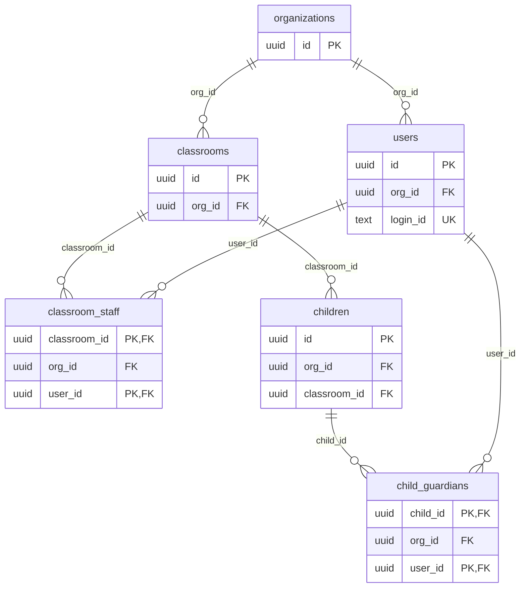
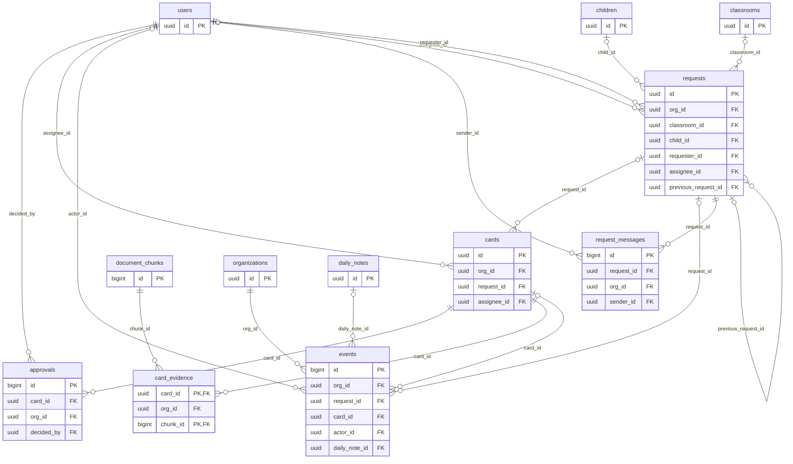
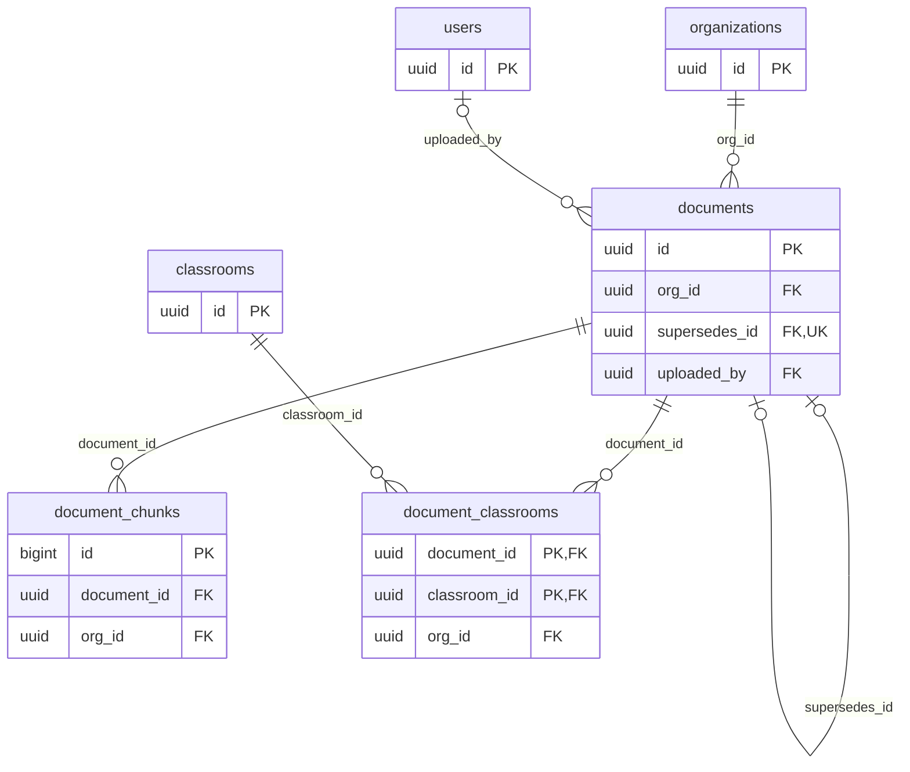
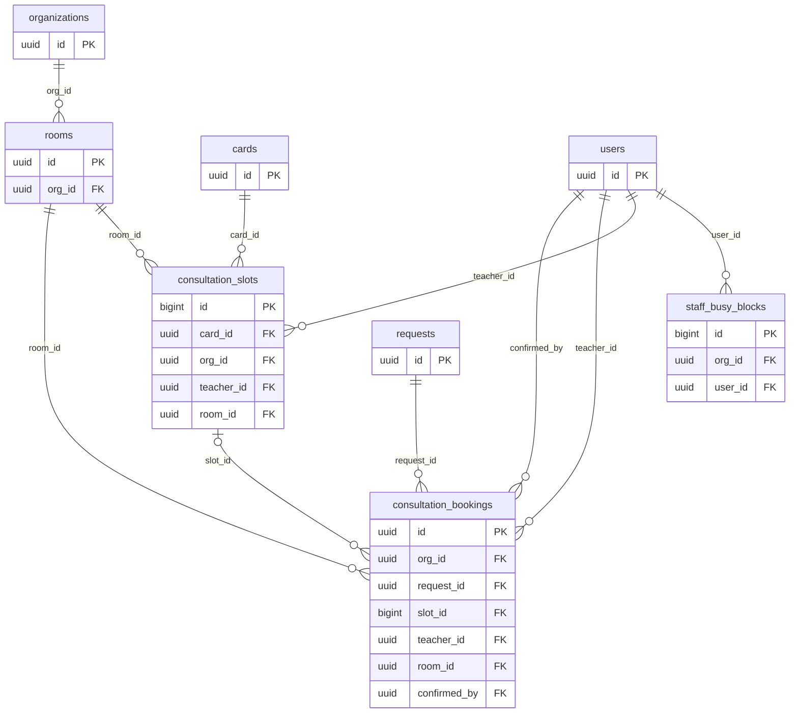
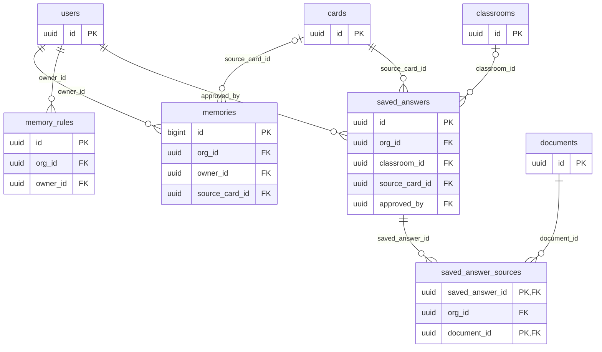
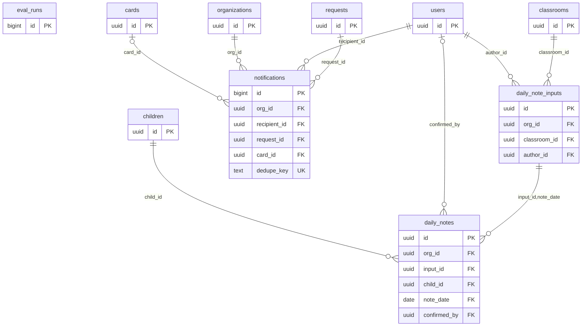

# 유치온 데이터베이스 스키마 설계서 (T09)

문서 버전 v0.21 | 작성 상태: [제안][선택] T60 성장 영상(11/23) 반영

| 항목 | 내용 |
| --- | --- |
| 작업 | T09 데이터베이스 스키마 설계서 (#166) |
| 작성 | 태웅 · 검토 영민 |
| 판 | v0.21 · 2026-11-23. [제안][선택] 0015는 아이별 진행 중 성장 영상의 부분 유니크 인덱스를 더해요. v0.20 · 2026-11-23. [제안][선택] 0014는 성장 영상 메타데이터·원본 사진 연결·이력 세 종류를 더해요. v0.19 · 2026-11-22. [제안][선택] 0013으로 동네 칸·사진 공개 범위를 넓혔어요. v0.18 · 2026-11-22. [제안][선택] 0012로 가상 음성 분석 표와 요청·완료 이력을 더했어요. v0.17 · 2026-11-22. [제안][선택] 0011로 화상상담 입퇴장 이력을 더했어요. v0.16 · 2026-11-21. [제안] 0010으로 피드·사진 메타데이터·아이별 공개 범위를 더했어요. v0.15 · 2026-11-21. 0009로 상담 예상 종료의 당일·3시간 상한을 더했어요. v0.14 · 2026-11-20. 0008로 투약·귀가 접수/확인 알림을 더했어요. v0.13 · 2026-11-20. 0007로 상담 예상 종료 시각·알림·이력을 더했어요. v0.12 · 2026-11-20. 0006으로 요청 에이전트 재전달 이력을 더했어요. v0.11 · 2026-11-20. 0005로 알림 다음 발송 시각을 더했어요. v0.10 · 2026-11-20. 0004로 회신 후 민원 카드를 처리 완료 전까지 받은함에 남겨요. v0.9 · 2026-11-20. 0003 알림장 원본·이력 연결을 더했어요. v0.8 · 2026-11-20. 아이별 메모 배열과 0002를 더했어요(아래 변경 이력). v0.7 · 2026-11-18. T10 회의 결과(FB-014) 반영: 학부모 미확인 민원은 이유 글이 있어야 처리 완료(트리거 `approvals_unconfirmed_complete_reason`), 202로 접수하는 자료 올리기·알림장 초안의 진행 상태 칸(`ingest_status`·`draft_status`, 강사님 API 작성법 11/18 수정본 '202는 상태 조회가 있어야 함'), 원장 현황에 '학부모 미확인 완료' 수(`completed_unconfirmed`), `topic_key` 주제 10개 + `other`, 처리 기한은 주말·공휴일 제외, 근무 시간 밖 긴급 알림은 아이 안전만 바로. 강사 피드백 FB-001-3에 따라 세 흐름의 화면·API·DB 상태 대조(8.3)와 흐름별 DB 시험 23개(9.1)를 더함. v0.6 · 2026-11-18. `topic_key` = 에이전트 `create_card`의 `topic_key` 인자(계약표 v0.6 4.2). T10 계약표 v0.5의 영민 리뷰 반영(`topic_key` 정해진 목록·`other`는 반복 수 제외, 같은 질문 묶기 MVP 제외). 여러 반 대상 자료를 위해 `documents.classroom_id`를 연결 표 `document_classrooms`로 바꾸고 근거 검색에 반 조건을 더함(FB-003-2). v0.5 · 2026-11-17. T10 계약표 v0.3의 정한 규칙·기본값에 맞춤(알림 종류·자동 재개·거절 이유·처리 기한). v0.4는 강사님 'DB 스키마 설계서 작성법'(11/16)의 목차·체크리스트 반영, v0.1~v0.3은 초안 1~3(T04 합의·대조 검토 반영) |
| 대상 DB | PostgreSQL 16 + pgvector 0.8 (`compose.yaml`의 `pgvector/pgvector:pg16`). Supabase를 쓰지 않는 이유는 5.1 |
| DDL | [`db_schema_draft.sql`](db_schema_draft.sql) — 최종 설계 모양이에요. 실제 적용은 `apps/api/migrations`의 0001 → 0002 → 0003 → 0004 → 0005 → 0006 → 0007 → 0008 → 0009 → 0010 → 0011 → 0012 → 0013 → 0014 → 0015로 해요 |
| 기준 문서 | 기획서 1116판 3장 FR-01~FR-13, 4장 NFR, 6장 공통 상태, 7장 기술과 데이터 · T04 흐름·권한 명세(11/17 팀 합의, PR #234) · T10 [입출력 계약표](입출력_계약표_초안.md) v0.7(1.1 정한 규칙, 6장 11/18 회의 확정) |

변경 이력: **v0.16 · 2026-11-21 [제안]** — 0010은 children.photo_scope(family 기본값·CHECK), feed_posts·feed_photos·feed_photo_children와 이력 네 종류를 더해요. head는 표 30·뷰 2·트리거 2·FK 64·컬럼 292개예요. 칸·사진 권한은 API에서 매번 검사하고, 파일 바이트는 DB에 저장하지 않아요. 기존 아이는 family로 채워요.

변경 이력: **v0.15 · 2026-11-21** — 0009는 상담 예상 종료를 원래 종료 + 3시간 이내·예약 시작과 같은 KST 날짜로 제한해요. 표·뷰·트리거·FK·컬럼 수는 같아요. 지연 변경에 따른 옛 알림은 consultation_reminded.detail.outcome=superseded로 남겨요.

변경 이력: **v0.14 · 2026-11-20** — T46 팀 확인 전 초안이에요. 0008은 notifications.kind에 care_requested·care_confirmed를 더해요. 인계자 UUID는 접수 events.detail.pickup_guardian_id, 실제 확인/완료는 care_decision·actor·created_at에 저장해요. requests.status는 received→assigned→completed예요. 알림장 request_status는 저장하지 않는 조회 값이에요. head는 표 27·뷰 2·트리거 2·FK 58·컬럼 271개로 같아요.

변경 이력: **v0.13 · 2026-11-20** — 0007로 consultation_bookings.expected_end_at, consultation_ending·consultation_delayed 알림, consultation_delay_reported·consultation_reminded 이력을 더했어요. 지연은 담임의 명시된 기록만 쓰고 대체 시간은 제안으로만 안내해요. head 컬럼은 271개예요.

변경 이력: **v0.12 · 2026-11-20** — 0006으로 events.action에 agent_requeued를 더했어요. 카드 없는 요청은 5분 뒤 한 번 재전달하고, 그 뒤 5분이 지나도 카드가 없을 때만 인계해요. 표·컬럼·FK 개수는 같아요.

변경 이력: **v0.11 · 2026-11-20** — 0005로 notifications.next_attempt_at을 더했어요. 기존 deliver_after와 목록 노출은 유지하고, 발송 실패를 최대 3회 시도하며 60초·120초 뒤에 다시 보내요. head는 표 27개·뷰 2개·트리거 2개·FK 58개·컬럼 270개예요.

이전 변경 이력: **v0.10 · 2026-11-20** — 0004로 staff_inbox의 민원 회신 예외를 API와 맞췄어요. 발송한 reply_draft는 학부모 확인 전 in_progress, 확인 후 needs_review로 남고 처리 완료 뒤 done이 돼요. 거절한 옛 카드는 done을 유지해요. head의 표·뷰·트리거·FK·컬럼 수는 v0.9와 같아요.

이전 변경 이력: **v0.9 · 2026-11-20** — 0003으로 daily_notes.ai_original과 events.daily_note_id·알림장 이력 네 종류를 더했어요. 기관 짝 FK와 인덱스를 연결했어요. head는 표 27개·뷰 2개·트리거 2개·FK 58개·컬럼 269개예요. 기존 원본은 적용 시점 content로 채워요. 교사 수정 때 유지하고, 미수정 초안의 재생성 때 마지막 AI 초안으로 갱신해요(T13 v0.5.1, DDL 구조 변경 없음). 0003을 되돌리면 원본 칸·알림장 연결·새 이력 네 종류는 사라져요.

이전 변경 이력: **v0.8 · 2026-11-20** — API 설계 문서 v0.4의 아이별 메모를 위해 `daily_note_inputs.child_memos`(`jsonb`, NOT NULL, 기본값 `[]`)와 배열 CHECK를 더했어요. 0001은 유지하고 0002로 적용해요. 당시 head의 컬럼은 267개예요.

**목차.** 1~6장은 가이드의 '문서에 들어가는 여섯 가지' 순서다. 7장부터는 이 서비스의 범위·원칙·상태 값·시험 결과 같은 보충 내용이다.

1. ERD와 관계 명세 · 2. 엔터티 정의 · 3. pgvector 스키마 · 4. 권한 정책(RLS 대신 API 검사) · 5. 세션·캐시 설계 · 6. 인덱스와 쿼리 최적화
7. 범위와 설계 원칙 · 8. 상태 값과 세 흐름 대조 · 9. DB가 막는 것과 확인 결과 · 10. LangGraph 체크포인트 · 11. 나중에 더하는 표 · 12. 정한 것 (T10 회의 11/18 확정)

**가이드 제출 전 체크리스트와 이 문서**

| 체크리스트(가이드 22쪽) | 이 문서 |
| --- | --- |
| ERD 그림과 관계 명세 표가 서로 일치한다 | 1.2·1.3. ERD 선 58개 = 관계 표 58행 = DDL FK 제약 58개(9장 C3) |
| 모든 컬럼에 타입·제약·의미가 적혀 있다 | 2장, 컬럼 271개 전부 |
| 모든 테이블에 기본키와 created_at이 있다 | 2장. 표 27개 모두(9장 C1·C2) |
| API 설계 문서와 필드명·ID 형식이 같다 | 2.0 ID 형식 표. T10 계약표와 맞춤, T13 API 설계 문서에서 필드 대응표를 더함(작성 예정) |
| 벡터 차원, 인덱스 연산자, 임베딩 모델이 적혀 있다 | 3장 |
| 테이블마다 역할별 권한 표가 있다 | 4.2. PostgreSQL RLS 대신 API가 검사함(4.1) |
| Redis 키 이름 규칙과 TTL이 적혀 있다 | 5.3. 해당 없음(Redis를 쓰지 않음) |
| 문서의 SQL을 실제로 실행해 확인했다 | 9장(시험 67개 + 세 흐름 시험 23개 + 진행 상태 5개), 6.2(실행 계획), 3.3(검색 SQL) |

## 1. ERD와 관계 명세

### 1.1 영역과 그리는 방법

표 27개를 여섯 영역으로 나눠 그린다. 상자 안에는 키 컬럼(PK·FK·UK)만 적고, 다른 영역의 부모 표는 `id PK`만 있는 작은 상자로 그린다. 선 하나가 DDL의 FK 제약 하나다. 선 이름은 FK 컬럼이고, 기관 짝(`org_id`)과 함께 거는 FK는 `org_id`를 뺀 컬럼 이름으로 적는다.

- `||--o{` 1 : N (자식의 FK가 NOT NULL) · `|o--o{` 0..1 : N (FK가 비어도 됨) · `|o--o|` 0..1 : 0..1 (FK에 UNIQUE)
- N : M은 중간 테이블로 푼다. `classroom_staff`(반 ↔ 교사), `child_guardians`(아이 ↔ 보호자), `card_evidence`(카드 ↔ 문서 조각), `saved_answer_sources`(원에 남은 답 ↔ 문서), `document_classrooms`(문서 ↔ 대상 반).

| 영역 | 테이블 | 선 수 |
| --- | --- | --- |
| ① 기관·사람 | `organizations` `classrooms` `users` `classroom_staff` `children` `child_guardians` | 7 |
| ② 요청·카드·승인 | `requests` `request_messages` `cards` `approvals` `card_evidence` `events` | 18 |
| ③ 자료·검색 | `documents` `document_chunks` `document_classrooms` | 6 |
| ④ 상담 | `rooms` `staff_busy_blocks` `consultation_slots` `consultation_bookings` | 10 |
| ⑤ 기억·원에 남은 답 | `memories` `memory_rules` `saved_answers` `saved_answer_sources` | 8 |
| ⑥ 알림장·알림·평가 | `daily_note_inputs` `daily_notes` `notifications` `eval_runs`(기관에 속하지 않는 평가 기록이라 선 없음) | 9 |

### 1.2 영역별 ERD

**① 기관·사람** (다른 영역 부모: 없음)



**② 요청·카드·승인** (다른 영역 부모: `children`, `classrooms`, `document_chunks`, `organizations`, `users`)



**③ 자료·검색** (다른 영역 부모: `classrooms`, `organizations`, `users`)



**④ 상담** (다른 영역 부모: `cards`, `organizations`, `requests`, `users`)



**⑤ 기억·원에 남은 답** (다른 영역 부모: `cards`, `classrooms`, `documents`, `users`)



**⑥ 알림장·알림·평가** (다른 영역 부모: `cards`, `children`, `classrooms`, `organizations`, `requests`, `users`)



### 1.3 관계 명세 표

| # | 부모 테이블 | 관계 | 자식 테이블 | 연결 키 |
| --- | --- | --- | --- | --- |
| 1 | `children` | 1 : N | `child_guardians` | `child_guardians.(child_id, org_id)` → `children.(id, org_id)` |
| 2 | `users` | 1 : N | `child_guardians` | `child_guardians.(user_id, org_id)` → `users.(id, org_id)` |
| 3 | `classrooms` | 1 : N | `children` | `children.(classroom_id, org_id)` → `classrooms.(id, org_id)` |
| 4 | `organizations` | 1 : N | `classrooms` | `classrooms.org_id` → `organizations.id` |
| 5 | `classrooms` | 1 : N | `classroom_staff` | `classroom_staff.(classroom_id, org_id)` → `classrooms.(id, org_id)` |
| 6 | `users` | 1 : N | `classroom_staff` | `classroom_staff.(user_id, org_id)` → `users.(id, org_id)` |
| 7 | `organizations` | 1 : N | `users` | `users.org_id` → `organizations.id` |
| 8 | `cards` | 1 : N | `approvals` | `approvals.(card_id, org_id)` → `cards.(id, org_id)` |
| 9 | `users` | 1 : N | `approvals` | `approvals.(decided_by, org_id)` → `users.(id, org_id)` |
| 10 | `cards` | 1 : N | `card_evidence` | `card_evidence.(card_id, org_id)` → `cards.(id, org_id)` · 부모를 지우면 같이 지움 |
| 11 | `document_chunks` | 1 : N | `card_evidence` | `card_evidence.(chunk_id, org_id)` → `document_chunks.(id, org_id)` |
| 12 | `users` | 0..1 : N | `cards` | `cards.(assignee_id, org_id)` → `users.(id, org_id)` |
| 13 | `requests` | 0..1 : N | `cards` | `cards.(request_id, org_id)` → `requests.(id, org_id)` |
| 14 | `users` | 0..1 : N | `events` | `events.(actor_id, org_id)` → `users.(id, org_id)` |
| 15 | `cards` | 0..1 : N | `events` | `events.(card_id, org_id)` → `cards.(id, org_id)` |
| 16 | `organizations` | 1 : N | `events` | `events.org_id` → `organizations.id` |
| 17 | `requests` | 0..1 : N | `events` | `events.(request_id, org_id)` → `requests.(id, org_id)` |
| 18 | `requests` | 1 : N | `request_messages` | `request_messages.(request_id, org_id)` → `requests.(id, org_id)` |
| 19 | `users` | 0..1 : N | `request_messages` | `request_messages.(sender_id, org_id)` → `users.(id, org_id)` |
| 20 | `users` | 0..1 : N | `requests` | `requests.(assignee_id, org_id)` → `users.(id, org_id)` |
| 21 | `children` | 0..1 : N | `requests` | `requests.(child_id, org_id)` → `children.(id, org_id)` |
| 22 | `classrooms` | 0..1 : N | `requests` | `requests.(classroom_id, org_id)` → `classrooms.(id, org_id)` |
| 23 | `requests` | 0..1 : N | `requests` | `requests.(previous_request_id, org_id)` → `requests.(id, org_id)` |
| 24 | `users` | 1 : N | `requests` | `requests.(requester_id, org_id)` → `users.(id, org_id)` |
| 25 | `documents` | 1 : N | `document_chunks` | `document_chunks.(document_id, org_id)` → `documents.(id, org_id)` · 부모를 지우면 같이 지움 |
| 26 | `documents` | 1 : N | `document_classrooms` | `document_classrooms.(document_id, org_id)` → `documents.(id, org_id)` · 부모를 지우면 같이 지움 |
| 27 | `classrooms` | 1 : N | `document_classrooms` | `document_classrooms.(classroom_id, org_id)` → `classrooms.(id, org_id)` |
| 28 | `organizations` | 1 : N | `documents` | `documents.org_id` → `organizations.id` |
| 29 | `documents` | 0..1 : 0..1 | `documents` | `documents.(supersedes_id, org_id)` → `documents.(id, org_id)` |
| 30 | `users` | 0..1 : N | `documents` | `documents.(uploaded_by, org_id)` → `users.(id, org_id)` |
| 31 | `users` | 1 : N | `consultation_bookings` | `consultation_bookings.(confirmed_by, org_id)` → `users.(id, org_id)` |
| 32 | `requests` | 1 : N | `consultation_bookings` | `consultation_bookings.(request_id, org_id)` → `requests.(id, org_id)` |
| 33 | `rooms` | 1 : N | `consultation_bookings` | `consultation_bookings.(room_id, org_id)` → `rooms.(id, org_id)` |
| 34 | `consultation_slots` | 0..1 : N | `consultation_bookings` | `consultation_bookings.(slot_id, org_id)` → `consultation_slots.(id, org_id)` |
| 35 | `users` | 1 : N | `consultation_bookings` | `consultation_bookings.(teacher_id, org_id)` → `users.(id, org_id)` |
| 36 | `cards` | 1 : N | `consultation_slots` | `consultation_slots.(card_id, org_id)` → `cards.(id, org_id)` · 부모를 지우면 같이 지움 |
| 37 | `rooms` | 1 : N | `consultation_slots` | `consultation_slots.(room_id, org_id)` → `rooms.(id, org_id)` |
| 38 | `users` | 1 : N | `consultation_slots` | `consultation_slots.(teacher_id, org_id)` → `users.(id, org_id)` |
| 39 | `organizations` | 1 : N | `rooms` | `rooms.org_id` → `organizations.id` |
| 40 | `users` | 1 : N | `staff_busy_blocks` | `staff_busy_blocks.(user_id, org_id)` → `users.(id, org_id)` |
| 41 | `users` | 1 : N | `memories` | `memories.(owner_id, org_id)` → `users.(id, org_id)` |
| 42 | `cards` | 0..1 : N | `memories` | `memories.(source_card_id, org_id)` → `cards.(id, org_id)` |
| 43 | `users` | 1 : N | `memory_rules` | `memory_rules.(owner_id, org_id)` → `users.(id, org_id)` |
| 44 | `users` | 1 : N | `saved_answers` | `saved_answers.(approved_by, org_id)` → `users.(id, org_id)` |
| 45 | `classrooms` | 0..1 : N | `saved_answers` | `saved_answers.(classroom_id, org_id)` → `classrooms.(id, org_id)` |
| 46 | `cards` | 1 : N | `saved_answers` | `saved_answers.(source_card_id, org_id)` → `cards.(id, org_id)` |
| 47 | `documents` | 1 : N | `saved_answer_sources` | `saved_answer_sources.(document_id, org_id)` → `documents.(id, org_id)` |
| 48 | `saved_answers` | 1 : N | `saved_answer_sources` | `saved_answer_sources.(saved_answer_id, org_id)` → `saved_answers.(id, org_id)` · 부모를 지우면 같이 지움 |
| 49 | `users` | 1 : N | `daily_note_inputs` | `daily_note_inputs.(author_id, org_id)` → `users.(id, org_id)` |
| 50 | `classrooms` | 1 : N | `daily_note_inputs` | `daily_note_inputs.(classroom_id, org_id)` → `classrooms.(id, org_id)` |
| 51 | `children` | 1 : N | `daily_notes` | `daily_notes.(child_id, org_id)` → `children.(id, org_id)` |
| 52 | `users` | 0..1 : N | `daily_notes` | `daily_notes.(confirmed_by, org_id)` → `users.(id, org_id)` |
| 53 | `daily_note_inputs` | 1 : N | `daily_notes` | `daily_notes.(input_id, org_id, note_date)` → `daily_note_inputs.(id, org_id, note_date)` |
| 54 | `cards` | 0..1 : N | `notifications` | `notifications.(card_id, org_id)` → `cards.(id, org_id)` |
| 55 | `organizations` | 1 : N | `notifications` | `notifications.org_id` → `organizations.id` |
| 56 | `users` | 1 : N | `notifications` | `notifications.(recipient_id, org_id)` → `users.(id, org_id)` |
| 57 | `requests` | 0..1 : N | `notifications` | `notifications.(request_id, org_id)` → `requests.(id, org_id)` |
| 58 | `daily_notes` | 0..1 : N | `events` | `events.(daily_note_id, org_id)` → `daily_notes.(id, org_id)` |

**ERD 선 수 = 표 행 수 = DDL FK 제약 수 = 58.** 같은 부모·자식 사이에 FK가 둘 이상이면(예: `requests`의 `requester_id`·`assignee_id` → `users`) 선도 행도 따로 센다. FK 제약 수는 9장 C3에서 DB 카탈로그로 셌다.

FK를 걸 수 없는 참조는 두 곳이다. `cards.subject_id`와 `notifications.subject_id`는 대상 종류(`subject_type`)에 따라 가리키는 표가 달라서 FK가 없다. 이 둘은 API가 저장 전에 대상이 같은 기관에 있는지 확인한다.

### 1.4 정규화

3정규형(3NF)을 기준으로 맞췄다. 컬럼 값은 하나의 값이고(예외는 아래 `jsonb`), 키가 아닌 컬럼은 기본키 전체에만 기댄다. 복합 PK인 중간 테이블 5개에도 PK 일부에만 기대는 컬럼은 없다. 표마다 확인했을 때 키가 아닌 컬럼이 다른 키가 아닌 컬럼을 정하는 곳(이행 종속)은 아래 표의 '복사' 세 곳이다. 셋 다 이유가 있어서 그대로 두었고, 알림장 날짜는 v0.4에서 복합 FK로 어긋남을 막았다.

| 일부러 겹쳐 둔 것 | 어디 | 이유 | 어긋남을 막는 방법 |
| --- | --- | --- | --- |
| 기관 경계 `org_id` | 기관에 속한 표 25개 | 부모를 따라가면 알 수 있지만, 다른 원 행이 섞이는 실수를 DB가 거부하게 하려고 둠(NFR-01) | `(id, org_id)` 복합 FK. 부모와 `org_id`가 다르면 저장 거부(9장 B1~B11·B13) |
| AI 결과 `jsonb` | `cards.draft`·`check_result`, `approvals.edited_content`, `requests.missing_fields`, `events.detail`, `memories.structured`, `memory_rules.rule_json`, `daily_notes.content`·`open_checks` | AI 출력 모양이 자주 바뀌고, SQL에서 안쪽 값으로 찾지 않음(가이드 8쪽 "JSONB: 구조가 자주 바뀌는 부가 정보") | 저장 전 Pydantic 검사(T13). SQL이 꼭 봐야 하는 값(`open_checks` 개수)만 CHECK |
| 집계는 저장하지 않음 | 반복 민원 수, 받은함 필터, 원장 현황 | 숫자를 칸에 저장하면 실제와 어긋날 수 있음 | 볼 때마다 뷰(`staff_inbox`·`director_overview`)와 인덱스(`requests_repeat_idx`)로 셈 |
| 복사 ① 상담 예약의 후보 값 | `consultation_bookings.teacher_id`·`room_id`·`period` (`slot_id`로도 알 수 있음) | 겹침을 막는 배제 제약(EXCLUDE)은 같은 표의 칸만 볼 수 있음 | API가 확정 트랜잭션에서 후보 값을 그대로 복사 |
| 복사 ② 요청 당시 반 | `requests.classroom_id` (`child_id`로도 알 수 있음) | 아이가 반을 옮겨도 요청은 그때 반 기준으로 담임 권한과 반복 민원 수를 셈 | 그때 값을 남기는 기록이라 바꾸지 않음 |
| 복사 ③ 알림장 날짜 | `daily_notes.note_date` (`input_id`로도 알 수 있음) | `(child_id, note_date)` 유니크에 필요 | `(input_id, org_id, note_date)` 복합 FK. 반 입력 날짜와 다르면 거부(9장 B11) |
| 그때 화면 값 | `card_evidence.quote`, `memories.reason_code` | 문서가 새 판이 되거나 결정이 바뀌어도 그때 근거·이유를 남김 | 기록이라 바꾸지 않음 |

## 2. 엔터티 정의

컬럼마다 타입 / 제약 / 의미를 적는다(271개). 표는 DDL을 적용한 DB 카탈로그에서 뽑아서 DDL과 같다. 값이 정해진 컬럼은 허용 값을 적었다. 여러 컬럼에 걸친 제약은 영역 표 아래 '표 제약'에 있다.

### 2.0 공통 규칙과 ID 형식

- 모든 테이블에 기본키와 `created_at timestamptz NOT NULL DEFAULT now()`가 있다(9장 C1·C2).
- 시각은 모두 `timestamptz`로 쓴다. 날짜만 필요한 칸(보류 예정일·적용일·알림장 날짜·담당 기간)은 `date`다.
- 값이 정해진 컬럼은 PostgreSQL ENUM 대신 `text` + `CHECK`로 둔다(7장).

| PK 형식 | 테이블 | API에서 |
| --- | --- | --- |
| `uuid` (`gen_random_uuid()`) | `organizations` `classrooms` `users` `children` `requests` `documents` `cards` `rooms` `consultation_bookings` `memory_rules` `saved_answers` `daily_note_inputs` `daily_notes` (13개) | UUID 문자열 |
| `bigint` (자동 증가) | `request_messages` `document_chunks` `approvals` `events` `staff_busy_blocks` `consultation_slots` `memories` `notifications` `eval_runs` (9개) | 정수 |
| 복합 PK | `classroom_staff (classroom_id, user_id)` `child_guardians (child_id, user_id)` `card_evidence (card_id, chunk_id)` `saved_answer_sources (saved_answer_id, document_id)` `document_classrooms (document_id, classroom_id)` (5개) | 두 ID 짝 |

화면·URL에 오래 남고 다른 원 ID를 짐작하면 안 되는 대상은 `uuid`, 한 대상 밑에 계속 쌓이는 기록(대화·결정·이력·알림·상담 후보·기억)과 내부 행은 짧고 순서가 있는 `bigint`를 쓴다. 정수 ID도 화면에 나가지만(상담 후보 `slot_ids`, 알림, 기억 지우기) 조회할 때마다 기관·본인 권한을 검사한다(4장).

### 2.1 기관·사람

표: `organizations` 유치원(FR-01) · `classrooms` 반(FR-01) · `users` 계정: 학부모·교사·원장(FR-01, NFR-01) · `classroom_staff` 반 담당 교사, 대체 담임 기간 포함(FR-01, FR-05) · `children` 원아, 가상(FR-02, FR-10) · `child_guardians` 원아와 보호자 연결(FR-01, FR-02)

| 테이블 | 컬럼 | 타입 / 제약 | 의미 |
| --- | --- | --- | --- |
| `organizations` | `id` | `uuid` / PK, 기본값 gen_random_uuid() | 기관 ID |
| `organizations` | `name` | `text` / NOT NULL | 유치원 이름(가상) |
| `organizations` | `kind` | `text` / NOT NULL, 값: private_kindergarten·public_kindergarten·daycare, 기본값 'private_kindergarten' | 기관 종류 |
| `organizations` | `region` | `text` / NULL 허용 | 지역(공공 자료 고를 때 씀) |
| `organizations` | `is_virtual` | `boolean` / NOT NULL, 기본값 true | 가상 자료 표시(NFR-02) |
| `organizations` | `created_at` | `timestamptz` / NOT NULL, 기본값 now() | 만든 시각 |
| `classrooms` | `id` | `uuid` / PK, 기본값 gen_random_uuid() | 반 ID |
| `classrooms` | `org_id` | `uuid` / NOT NULL, FK → organizations.id | 소속 기관 |
| `classrooms` | `name` | `text` / NOT NULL | 반 이름 |
| `classrooms` | `age_group` | `smallint` / NULL 허용, 값: 3~5 | 연령(만 3~5세) |
| `classrooms` | `school_year` | `smallint` / NOT NULL | 학년도 |
| `classrooms` | `created_at` | `timestamptz` / NOT NULL, 기본값 now() | 만든 시각 |
| `users` | `id` | `uuid` / PK, 기본값 gen_random_uuid() | 계정 ID(토큰의 sub) |
| `users` | `org_id` | `uuid` / NOT NULL, FK → organizations.id | 소속 기관(토큰의 org) |
| `users` | `role` | `text` / NOT NULL, 값: parent·teacher·director | 역할. 원감은 director + title |
| `users` | `title` | `text` / NULL 허용 | 직함 표시(원장·원감) |
| `users` | `display_name` | `text` / NOT NULL | 화면에 보이는 이름 |
| `users` | `login_id` | `text` / NOT NULL, UNIQUE | 로그인 ID |
| `users` | `password_hash` | `text` / NOT NULL | 비밀번호 해시(argon2 또는 bcrypt). 원문은 저장 안 함 |
| `users` | `token_version` | `integer` / NOT NULL, 기본값 0 | 토큰 판. 1 올리면 이전 JWT가 모두 무효(5장) |
| `users` | `is_active` | `boolean` / NOT NULL, 기본값 true | 사용 중 여부. 계정은 지우지 않고 끔 |
| `users` | `created_at` | `timestamptz` / NOT NULL, 기본값 now() | 만든 시각 |
| `classroom_staff` | `classroom_id` | `uuid` / PK(classroom_id, user_id), FK (classroom_id, org_id) → classrooms | 맡은 반 |
| `classroom_staff` | `org_id` | `uuid` / NOT NULL, 기관 짝 FK에 들어감 | 기관(경계 짝) |
| `classroom_staff` | `user_id` | `uuid` / PK(classroom_id, user_id), FK (user_id, org_id) → users | 교사 계정 |
| `classroom_staff` | `is_homeroom` | `boolean` / NOT NULL, 기본값 true | 담임 여부(아니면 부담임) |
| `classroom_staff` | `valid_from` | `date` / NULL 허용 | 담당 시작일(대체 담임 기간, T04 7.1) |
| `classroom_staff` | `valid_to` | `date` / NULL 허용 | 담당 끝일. 비면 계속 담당 |
| `classroom_staff` | `created_at` | `timestamptz` / NOT NULL, 기본값 now() | 배정한 시각 |
| `children` | `id` | `uuid` / PK, 기본값 gen_random_uuid() | 원아 ID |
| `children` | `org_id` | `uuid` / NOT NULL, 기관 짝 FK에 들어감 | 기관(경계 짝) |
| `children` | `classroom_id` | `uuid` / NOT NULL, FK (classroom_id, org_id) → classrooms | 지금 반 |
| `children` | `display_name` | `text` / NOT NULL | 가상 이름 |
| `children` | `is_virtual` | `boolean` / NOT NULL, 기본값 true | 가상 자료 표시 |
| `children` | `created_at` | `timestamptz` / NOT NULL, 기본값 now() | 등록 시각 |
| `child_guardians` | `child_id` | `uuid` / PK(child_id, user_id), FK (child_id, org_id) → children | 원아 |
| `child_guardians` | `org_id` | `uuid` / NOT NULL, 기관 짝 FK에 들어감 | 기관(경계 짝) |
| `child_guardians` | `user_id` | `uuid` / PK(child_id, user_id), FK (user_id, org_id) → users | 보호자 계정 |
| `child_guardians` | `relation` | `text` / NOT NULL, 값: mother·father·grandparent·other | 관계 |
| `child_guardians` | `created_at` | `timestamptz` / NOT NULL, 기본값 now() | 연결한 시각 |

- `classrooms` 표 제약: `UNIQUE (id, org_id)` · `UNIQUE (org_id, school_year, name)`
- `users` 표 제약: `UNIQUE (id, org_id)`
- `classroom_staff` 표 제약: `CHECK ((valid_to IS NULL) OR (valid_from IS NULL) OR (valid_to >= valid_from))`
- `children` 표 제약: `UNIQUE (id, org_id)`

원감은 `role = 'director'`에 `title = '원감'`으로 둔다. T04 7장 권한표도 원장·원감을 한 칸으로 본다. 대체 담임은 `classroom_staff`에 기간(`valid_from`~`valid_to`)을 넣어 그 기간에만 그 반 자료를 본다(T04 7.1). 기간이 비어 있으면 계속 담당한다.

### 2.2 요청·카드·승인·이력

표: `requests` 학부모 요청 한 건(FR-02, FR-03, FR-07) · `request_messages` 요청 화면 대화(FR-02, FR-04) · `cards` 교직원 받은함 카드(FR-03, FR-07~FR-10) · `approvals` 사람의 결정(FR-06, FR-09) · `card_evidence` 카드 초안의 근거 조각(FR-04, NFR-04) · `events` 처리 이력, 쌓기만 함(FR-11, NFR-05)

| 테이블 | 컬럼 | 타입 / 제약 | 의미 |
| --- | --- | --- | --- |
| `requests` | `id` | `uuid` / PK, 기본값 gen_random_uuid() | 요청 ID |
| `requests` | `org_id` | `uuid` / NOT NULL, 기관 짝 FK에 들어감 | 기관 |
| `requests` | `classroom_id` | `uuid` / NULL 허용, FK (classroom_id, org_id) → classrooms | 요청 당시 반(아이가 반을 옮겨도 그대로) |
| `requests` | `child_id` | `uuid` / NULL 허용, FK (child_id, org_id) → children | 대상 아이 |
| `requests` | `requester_id` | `uuid` / NOT NULL, FK (requester_id, org_id) → users | 보낸 학부모 |
| `requests` | `client_request_id` | `text` / NOT NULL | 화면이 만든 제출 키. 같은 키 재제출은 거부 |
| `requests` | `type` | `text` / NOT NULL, 값: inquiry·consultation·complaint·medication·pickup | 요청 종류(투약·귀가는 값만 미리 둠, T46) |
| `requests` | `title` | `text` / NULL 허용 | 제목 |
| `requests` | `body` | `text` / NOT NULL | 학부모가 쓴 내용 |
| `requests` | `status` | `text` / NOT NULL, 값: received·classified·needs_info·assigned·awaiting_review·approved·sent_or_booked·completed·on_hold·escalated·rejected, 기본값 'received' | 공통 상태 11가지(8.1) |
| `requests` | `urgency` | `text` / NULL 허용, 값: low·normal·high·urgent | 급한 정도(정렬용, 모든 요청) |
| `requests` | `risk_level` | `text` / NULL 허용, 값: normal·urgent·uncertain | 민원 위험 등급: 일반·긴급·판단 필요(T04 2.3) |
| `requests` | `risk_category` | `text` / NULL 허용, 값: child_safety·staff_attack·legal_external·privacy_leak | 긴급일 때 네 가지 중 무엇인지 |
| `requests` | `risk_confidence` | `real` / NULL 허용, 값: 0~1 | 감독 AI 확신 정도(기준값은 T06) |
| `requests` | `topic_key` | `text` / NULL 허용 | 감독 AI가 정해진 목록(계약표 6장 ②)에서 고른 민원 주제. 같은 주제 반복 수를 셈(`other`는 안 셈) |
| `requests` | `parent_confirmed_at` | `timestamptz` / NULL 허용 | 학부모가 '확인했어요'를 누른 시각(민원만) |
| `requests` | `missing_fields` | `jsonb` / NOT NULL, 기본값 '[]' | 빠진 필수 정보 목록(FR-02) |
| `requests` | `assignee_id` | `uuid` / NULL 허용, FK (assignee_id, org_id) → users | 요청 담당 교직원 |
| `requests` | `previous_request_id` | `uuid` / NULL 허용, FK (previous_request_id, org_id) → requests | 다시 연 요청이면 이전 요청(T04 2.1) |
| `requests` | `created_at` | `timestamptz` / NOT NULL, 기본값 now() | 접수 시각 |
| `requests` | `updated_at` | `timestamptz` / NOT NULL, 기본값 now() | 마지막으로 바뀐 시각 |
| `requests` | `closed_at` | `timestamptz` / NULL 허용 | 끝난 시각 |
| `request_messages` | `id` | `bigint` / PK, 자동 증가 | 대화 ID |
| `request_messages` | `request_id` | `uuid` / NOT NULL, FK (request_id, org_id) → requests | 요청 |
| `request_messages` | `org_id` | `uuid` / NOT NULL, 기관 짝 FK에 들어감 | 기관(경계 짝) |
| `request_messages` | `sender_type` | `text` / NOT NULL, 값: user·agent·system | 보낸 쪽: 사람·AI·시스템 |
| `request_messages` | `sender_id` | `uuid` / NULL 허용, FK (sender_id, org_id) → users | 보낸 사람(사람일 때만) |
| `request_messages` | `body` | `text` / NOT NULL | 내용 |
| `request_messages` | `created_at` | `timestamptz` / NOT NULL, 기본값 now() | 보낸 시각 |
| `cards` | `id` | `uuid` / PK, 기본값 gen_random_uuid() | 카드 ID |
| `cards` | `org_id` | `uuid` / NOT NULL, 기관 짝 FK에 들어감 | 기관 |
| `cards` | `request_id` | `uuid` / NULL 허용, FK (request_id, org_id) → requests | 대상 요청(알림장 묶음·규칙 제안은 비움) |
| `cards` | `subject_type` | `text` / NULL 허용, 값: daily_note_batch·memory_rule | 요청이 없을 때 대상 종류 |
| `cards` | `subject_id` | `uuid` / NULL 허용 | 요청이 없을 때 대상 ID |
| `cards` | `kind` | `text` / NOT NULL, 값: reply_draft·consult_slots·director_report·needs_info·daily_note·rule_proposal | 카드 종류 |
| `cards` | `status` | `text` / NOT NULL, 값: unassigned·pending·in_review·on_hold·approved·rejected·done, 기본값 'unassigned' | 카드 처리 단계(내부 값, 8.2) |
| `cards` | `assignee_id` | `uuid` / NULL 허용, FK (assignee_id, org_id) → users | 담당 교직원. 비면 받은함 미배정 |
| `cards` | `due_at` | `timestamptz` / NULL 허용 | 처리 기한(2.2 글머리). 비면 지연에 안 잡힘 |
| `cards` | `hold_until` | `date` / NULL 허용 | 보류 예정일(학부모 화면에 보임) |
| `cards` | `draft` | `jsonb` / NOT NULL, 기본값 '{}' | AI 초안 |
| `cards` | `check_result` | `jsonb` / NULL 허용 | 검사 AI 결과 |
| `cards` | `check_attempts` | `smallint` / NOT NULL, 값: 0~2, 기본값 0 | 검사 AI가 돌려보낸 횟수(최대 2, FR-08) |
| `cards` | `graph_thread_id` | `text` / NULL 허용 | LangGraph 체크포인트 thread_id |
| `cards` | `version` | `integer` / NOT NULL, 기본값 1 | 카드 판. 바뀔 때마다 +1(중복 결정 막기) |
| `cards` | `created_at` | `timestamptz` / NOT NULL, 기본값 now() | 만든 시각 |
| `cards` | `updated_at` | `timestamptz` / NOT NULL, 기본값 now() | 마지막으로 바뀐 시각 |
| `cards` | `closed_at` | `timestamptz` / NULL 허용 | 끝난 시각 |
| `approvals` | `id` | `bigint` / PK, 자동 증가 | 결정 ID |
| `approvals` | `card_id` | `uuid` / NOT NULL, FK (card_id, org_id) → cards | 카드 |
| `approvals` | `org_id` | `uuid` / NOT NULL, 기관 짝 FK에 들어감 | 기관(경계 짝) |
| `approvals` | `card_version` | `integer` / NOT NULL | 결정할 때 본 카드 판 |
| `approvals` | `decided_by` | `uuid` / NOT NULL, FK (decided_by, org_id) → users | 결정한 교직원 |
| `approvals` | `decision` | `text` / NOT NULL, 값: approve·edit_approve·reject·hold·resume·dismiss·complete·escalate·instruct | 결정 종류(2.2 글머리) |
| `approvals` | `reason_code` | `text` / NULL 허용 | 거절·반려 이유 코드 8가지(2.2 글머리). 기억·규칙 제안 재료 |
| `approvals` | `reason_text` | `text` / NULL 허용 | 보류 이유·원장 지시 내용 |
| `approvals` | `edited_content` | `jsonb` / NULL 허용 | 고쳐서 승인한 내용 |
| `approvals` | `created_at` | `timestamptz` / NOT NULL, 기본값 now() | 결정 시각 |
| `card_evidence` | `card_id` | `uuid` / PK(card_id, chunk_id), FK (card_id, org_id) → cards | 카드 |
| `card_evidence` | `org_id` | `uuid` / NOT NULL, 기관 짝 FK에 들어감 | 기관(경계 짝) |
| `card_evidence` | `chunk_id` | `bigint` / PK(card_id, chunk_id), FK (chunk_id, org_id) → document_chunks | 근거 문서 조각 |
| `card_evidence` | `rank` | `smallint` / NOT NULL | 근거 순위 |
| `card_evidence` | `score` | `real` / NULL 허용 | 검색 점수 |
| `card_evidence` | `quote` | `text` / NULL 허용 | 화면에 보일 인용 |
| `card_evidence` | `created_at` | `timestamptz` / NOT NULL, 기본값 now() | 붙인 시각 |
| `events` | `id` | `bigint` / PK, 자동 증가 | 이력 ID(순서) |
| `events` | `org_id` | `uuid` / NOT NULL, FK → organizations.id | 기관 |
| `events` | `request_id` | `uuid` / NULL 허용, FK (request_id, org_id) → requests | 대상 요청 |
| `events` | `card_id` | `uuid` / NULL 허용, FK (card_id, org_id) → cards | 대상 카드 |
| `events` | `actor_type` | `text` / NOT NULL, 값: user·agent·system | 한 쪽: 사람·AI·시스템 |
| `events` | `actor_id` | `uuid` / NULL 허용, FK (actor_id, org_id) → users | 한 사람(사람일 때만. 시스템·AI면 비움) |
| `events` | `agent_name` | `text` / NULL 허용 | 한 AI(감독·자료·기억·검사 등) |
| `events` | `daily_note_id` | `uuid` / NULL 허용, FK (daily_note_id, org_id) → daily_notes | 아이별 알림장 이력(v0.9) |
| `events` | `action` | `text` / NOT NULL, 값 32가지 | 기존 25가지와 알림장 drafted·edited·confirmed·sent(v0.9), 요청 재전달 agent_requeued(v0.12), 상담 지연 기록·알림(v0.13) |
| `events` | `from_status` | `text` / NULL 허용 | 바뀌기 전 상태 |
| `events` | `to_status` | `text` / NULL 허용 | 바뀐 뒤 상태 |
| `events` | `detail` | `jsonb` / NOT NULL, 기본값 '{}' | 부가 정보. 비밀값·불필요한 개인정보 금지 |
| `events` | `created_at` | `timestamptz` / NOT NULL, 기본값 now() | 일어난 시각 |

- `requests` 표 제약: `CHECK (previous_request_id IS DISTINCT FROM id)` · `CHECK ((risk_level IS NULL) OR (type = 'complaint'))` · `CHECK ((risk_level IS DISTINCT FROM 'urgent') OR (risk_category IS NOT NULL))` · `CHECK ((parent_confirmed_at IS NULL) OR (type = 'complaint'))` · `UNIQUE (id, org_id)` · `UNIQUE (requester_id, client_request_id)`
- `cards` 표 제약: `CHECK ((request_id IS NOT NULL) OR (subject_id IS NOT NULL))` · `CHECK ((status <> 'on_hold') OR (hold_until IS NOT NULL))` · `CHECK ((kind <> 'director_report') OR (assignee_id IS NOT NULL))` · `UNIQUE (id, org_id)`
- `approvals` 표 제약: `CHECK ((decision <> ALL (ARRAY['reject', 'dismiss'])) OR (reason_code IS NOT NULL))` · `CHECK ((decision <> ALL (ARRAY['hold', 'instruct'])) OR (reason_text IS NOT NULL))` · `CHECK ((reason_code IS DISTINCT FROM 'other') OR (reason_text IS NOT NULL))` · `UNIQUE (card_id, card_version)` · 트리거 `approvals_unconfirmed_complete_reason`(`complete`인데 요청의 `parent_confirmed_at`이 비어 있으면 `reason_text` 필수. 다른 표 값을 봐야 해서 CHECK 대신 트리거, v0.7)

**요청**

- `type`: `inquiry`(안내 문의) · `consultation`(상담) · `complaint`(민원) · `medication`(투약) · `pickup`(귀가). 투약·귀가는 값만 미리 두고 세부 칸은 T46에서 더한다.
- `client_request_id`: 화면이 제출할 때 만드는 키다. 같은 사람이 같은 키로 다시 보내면 DB가 거부하므로, 네트워크 재시도로 요청이 두 번 생기지 않는다.
- `urgency`: 모든 요청의 급한 정도(`low`·`normal`·`high`·`urgent`). 받은함 정렬에 쓴다.
- `risk_level`: 민원에만 붙이는 위험 등급이다. `normal`(일반) · `urgent`(긴급) · `uncertain`(판단 필요)(T04 2.3, 합의 4). 긴급이면 `risk_category`에 네 가지 중 무엇인지 넣어야 저장된다: `child_safety`(아이 안전) · `staff_attack`(교직원 비난·위협) · `legal_external`(법적 조치·외부 기관) · `privacy_leak`(개인정보 유출 주장). 감독 AI의 확신 정도는 `risk_confidence`(0~1)에 남기고, 긴급과 판단 필요를 나누는 기준값은 T06 평가로 정한다. 사람이 판단 필요를 일반·긴급으로 다시 나누면 `events`에 `risk_reclassified`로 이전 값·새 값·이유를 남긴다.
- `topic_key`: 감독 AI가 민원에 붙이는 주제 값이다. "같은 내용 3번째 민원이면 원장 보고"(FR-07)는 **같은 반 · 최근 30일 · 같은 `topic_key`** 민원 수로 센다. 보낸 학부모가 달라도 합산한다(T04 합의 3). 값은 T10 회의(11/18)에서 정한 주제 10개와 `other` 중 하나이고, 에이전트 `create_card`의 `topic_key` 인자 그대로다: `safety`(안전) · `meal`(급식) · `teacher`(선생님) · `belongings`(소지품) · `fee`(원비) · `pickup_bus`(등하원·버스) · `peer_conflict`(친구 다툼) · `health_hygiene`(건강·위생) · `photo_record`(사진·기록) · `communication`(소통·연락) · `other`(계약표 6장 ②). 확정본은 영민이 T14에서 공유한다. 목록은 설정값이라 `reason_code`처럼 CHECK로 묶지 않는다. `other`는 반복 수를 세지 않는다. 정해진 주제에 안 맞는 민원끼리는 같은 내용이라는 보장이 없어서다(계약표 6장 ②). 백엔드는 `topic_key = 'other'`이면 6.2 ② 쿼리를 부르지 않는다.
- `parent_confirmed_at`: 민원 회신에 학부모가 '확인했어요'를 누른 시각이다. 민원은 담임이 '처리 완료'를 눌러야 `completed`가 되고, 자동 완료는 하지 않는다(T04 합의 2). 상태 값을 늘리지 않고 이 칸 하나로 처리한다. 학부모가 끝내 누르지 않으면 담임이 이유 글(`approvals.reason_text`, 예: '전화로 마무리함')을 남기고 처리 완료할 수 있다(계약표 6장 ⑦, T10 회의). 이유 없이 끝내려 하면 DB 트리거가 거부한다(9.1 F2-6).
- `missing_fields`: 필수 정보가 빠졌을 때 물어볼 항목 목록(FR-02).
- `previous_request_id`: `completed`·`rejected`는 끝 상태라, 다시 열려면 학부모가 새 요청을 보내고 이 칸에 이전 요청을 잇는다(T04 2.1). 같은 기관 요청만 이을 수 있다.
- 반복 횟수(같은 반·최근 30일·같은 `topic_key` 민원 수)는 칸으로 두지 않고 카드를 조회할 때 `requests_repeat_idx`로 센다. 원장 보고를 만든 때의 수는 `events`의 `escalated` 행 `detail`에 남긴다.

**카드·결정·근거**

- `kind`: `reply_draft`(답변 초안) · `consult_slots`(상담 후보) · `director_report`(원장 보고) · `needs_info`(정보 요청) · `daily_note`(알림장 묶음) · `rule_proposal`(개인 규칙 제안).
- `assignee_id`: 카드를 만들 때 담당자 ID를 바로 넣는다. 원장 보고 카드는 원장 ID가 없으면 저장되지 않는다. 감독 AI가 담당을 못 정하면 비워 두고, 그 카드가 받은함 '미배정'에 들어가 원장·원감이 지정한다.
- `due_at`: 카드를 만들 때 처리 기한을 계산해 넣는다. 값은 계약표 6장 ⑤ 설정값이고, 시작 시각은 요청 접수(`requests.created_at`)다. 설정값이라 DB CHECK로 묶지 않는다. 기한은 **주말·공휴일을 건너뛰고** 센다. 금요일 18시에 들어온 일반 민원(24시간)은 토·일을 건너뛰어 월요일 18시가 기한이다. 민원 긴급·판단 필요 2시간만 주말·공휴일에도 그대로 센다(T10 회의 11/18). MVP 공휴일·근무 시간·즉시 알림 위험 종류는 DB에 두지 않고 서버 `.env`의 `HOLIDAYS`·`WORK_HOURS`·`IMMEDIATE_RISK_CATEGORIES`로 관리한다(API 설계 6.5·6.6·8장). 기관별 재량휴업일·근무 시간 변경 기능이 생기면 기관 설정 테이블을 T09에 추가한다. **`due_at`이 NULL이면 원장 현황 '지연'에 안 잡힌다**(뷰가 `due_at < now()`로 세므로, 9장 R6).

  | 카드 | `due_at` |
  | --- | --- |
  | 민원 카드 — 긴급·판단 필요 / 일반 | 접수 + 2시간 / 접수 + 24시간 |
  | 답변 초안 — 문의 | 접수 + 4시간 |
  | 상담 후보(`consult_slots`) | 접수 + 24시간 |
  | 알림장 묶음(`daily_note`) | 그날(`note_date`) 17:00 |
  | 원장 보고(`director_report`) | 원래 민원 카드와 같은 기한 |
  | 정보 요청(`needs_info`) · 규칙 제안(`rule_proposal`) | 없음(NULL). 지연 집계에서 빠짐 |
- `check_attempts`: 검사 AI가 돌려보낸 횟수. 최대 2를 넘으면 DB가 거부하므로, 3번째부터는 코드가 사람에게 넘겨야 한다(FR-08).
- `version`: 카드가 바뀔 때마다 1씩 올린다. `approvals`는 `(card_id, card_version)`에 결정을 하나만 받으므로, 승인 버튼이나 재개를 여러 번 눌러도 한 번만 처리된다(AC-05). 화면은 결정할 때 자기가 본 `version`을 같이 보낸다.
- `decision`: `approve`(승인) · `edit_approve`(고쳐서 승인) · `reject`(거절 → 초안 다시) · `hold`(보류) · `resume`(보류 재개 → `awaiting_review`) · `dismiss`(반려 → 요청을 처리하지 않음, `rejected`) · `complete`(민원 처리 완료) · `escalate`(담임이 원장님께 올리기, T04 8장 #5) · `instruct`(원장 지시 → 원장 보고 카드 `done`, 요청 `escalated → awaiting_review`). T04 2.1이 거절과 반려를 다른 길로 그리므로 값을 나눴다.
- 거절·반려는 `reason_code`, 보류와 원장 지시는 `reason_text`(지시 내용), 학부모 미확인 민원의 처리 완료는 `reason_text`(마무리한 방법)가 있어야 저장된다. 거절 이유가 기억과 규칙 제안의 재료가 된다(FR-06).
- `reason_code` 값(계약표 6장 ①에 상담 거절용 2개를 더함): `wrong_fact`(사실이 틀림) · `tone`(말투) · `missing_info`(근거·정보 부족) · `privacy`(개인정보) · `policy`(원 방침과 다름) · `slot_unavailable`(시간 안 됨) · `room_unavailable`(상담실 없음) · `other`(기타). 목록은 설정값이라 DB CHECK로 묶지 않고 API가 검사한다. `other`면 `reason_text`가 있어야 저장된다(DB CHECK). 같은 사람에게 같은 코드가 3번 쌓이면 규칙을 제안하므로(2.5), 상담 거절은 시간·상담실 코드로 남겨야 규칙이 생긴다.
- 원장 보고 카드(`director_report`)에 결정을 내리는 사람은 원장·원감뿐이다(T04 7.2). 카드 종류에 따른 이 권한은 API가 검사한다.
- 보류한 카드는 `cards.hold_until`(예정일)이 있어야 저장된다. 학부모 화면에는 예정일만 보이고, 보류 이유는 교직원끼리만 본다(T04 3장·9장).
- 보류 재개: 담당이 누르면 `approvals`에 `resume`으로 남는다. 예정일(`hold_until`)이 되면 시스템이 자동으로 재개한다(계약표 6장 ⑨). 이건 사람 결정이 아니라서 `approvals`에 남기지 않는다. 대신 `events`에 시스템 행위자(`actor_type = 'system'`, `actor_id` 비움), `action = 'resumed'`, `on_hold → awaiting_review`(받은함 '확인 필요', T04 2.1)로 남기고, 카드 `version`을 1 올리고, 담당에게 `hold_resumed` 알림을 보낸다.
- 근거 문서명·위치·적용일은 `card_evidence → document_chunks → documents`로 이어서 보여 준다. 근거 조각은 카드와 같은 기관 것만 붙는다(복합 FK).
- 알림장 묶음 카드와 규칙 제안 카드는 요청이 없으므로 `subject_type`·`subject_id`로 대상을 가리킨다.

**처리 이력**

- v0.12 `agent_requeued`는 카드가 없는 요청을 한 번 재전달한 시스템 이력이에요. created_at부터 5분이 더 지나야 card_missing으로 인계해요. 요청 상태·알림은 바꾸지 않아요.

- v0.9 알림장 이력은 `daily_note_drafted`·`daily_note_edited`·`daily_note_confirmed`·`daily_note_sent`이며 `daily_note_id`에 잇는다. 상태 변경과 같은 트랜잭션에서 저장한다. 이력에는 메모·초안 원문을 복사하지 않는다.
- `events.action`: 생성·분류·정보 요청·배정·재배정·초안·검사·돌려보내기·승인·거절·보류·보류 재개(`resumed`)·원장 보고·원장 지시(`instructed`)·발송·예약·완료·도구 호출·도구 실패·권한 거부·학부모 확인·위험 등급 다시 분류·반려·원에 남은 답으로 답함. 부재 재배정(FR-19)은 `reassigned`에 이전 담당·새 담당·이유를 `detail`로 남긴다. 권한 없는 요청도 `permission_denied`로 남긴다(NFR-01).
- 사람이 한 일은 `actor_type = 'user'`와 `actor_id`, AI가 한 일은 `actor_type = 'agent'`와 `agent_name`, 시스템이 한 일(보류 자동 재개, 상담 시간 잡아 두기 풀림 `slot_hold_expired`)은 `actor_type = 'system'`으로 남기고 `actor_id`는 비운다.
- `events`는 INSERT만 하고 고치거나 지우지 않는다. `detail`에는 비밀값과 불필요한 개인정보를 넣지 않는다(NFR-05).

### 2.3 자료·검색

표: `documents` 원 자료·공공 자료(FR-13, NFR-07) · `document_chunks` 검색 단위 조각(FR-04) · `document_classrooms` 반 자료의 대상 반(FR-04)

| 테이블 | 컬럼 | 타입 / 제약 | 의미 |
| --- | --- | --- | --- |
| `documents` | `id` | `uuid` / PK, 기본값 gen_random_uuid() | 문서 ID |
| `documents` | `org_id` | `uuid` / NOT NULL, FK → organizations.id | 기관 |
| `documents` | `title` | `text` / NOT NULL | 문서 이름 |
| `documents` | `doc_type` | `text` / NOT NULL, 값: notice·schedule·menu·policy·consult_timetable·law·public_data | 문서 종류 |
| `documents` | `visibility` | `text` / NOT NULL, 값: staff·parents·all, 기본값 'all' | 공개 범위: 교직원만·학부모·모두 |
| `documents` | `source` | `text` / NOT NULL, 값: uploaded·virtual·public_api | 출처: 원이 올림·가상·공공 API |
| `documents` | `source_url` | `text` / NULL 허용 | 원본 위치 |
| `documents` | `api_called_at` | `timestamptz` / NULL 허용 | 공공 API를 실제로 불러 온 시각. 목록만 본 API는 비움(FR-13) |
| `documents` | `effective_from` | `date` / NULL 허용 | 적용 시작일 |
| `documents` | `effective_to` | `date` / NULL 허용 | 적용 끝일 |
| `documents` | `status` | `text` / NOT NULL, 값: active·conflict_pending·superseded, 기본값 'active' | 사용 중·충돌 확인 대기·새 판으로 바뀜 |
| `documents` | `ingest_status` | `text` / NOT NULL, 값: queued·running·succeeded·failed, 기본값 'queued' | 자료 올리기(202) 뒤 조각 나누기·임베딩·충돌 검사 진행 상태. 실패 이유는 `events`(`tool_failed`)에 남김 (v0.7) |
| `documents` | `supersedes_id` | `uuid` / NULL 허용, UNIQUE, FK (supersedes_id, org_id) → documents | 이 문서가 대신하는 옛 판 |
| `documents` | `uploaded_by` | `uuid` / NULL 허용, FK (uploaded_by, org_id) → users | 올린 교직원 |
| `documents` | `content_sha256` | `text` / NOT NULL | 파일 해시. 같은 파일 두 번 올리기 막음 |
| `documents` | `is_virtual` | `boolean` / NOT NULL, 기본값 true | 가상 자료 표시 |
| `documents` | `created_at` | `timestamptz` / NOT NULL, 기본값 now() | 올린 시각 |
| `document_chunks` | `id` | `bigint` / PK, 자동 증가 | 조각 ID |
| `document_chunks` | `document_id` | `uuid` / NOT NULL, FK (document_id, org_id) → documents | 원래 문서 |
| `document_chunks` | `org_id` | `uuid` / NOT NULL, 기관 짝 FK에 들어감 | 기관(경계 짝) |
| `document_chunks` | `chunk_index` | `integer` / NOT NULL | 문서 안 순번 |
| `document_chunks` | `location` | `text` / NULL 허용 | 근거 위치 표시(예: '2쪽 3항') |
| `document_chunks` | `content` | `text` / NOT NULL | 조각 본문 |
| `document_chunks` | `embedding` | `vector(1024)` / NULL 허용 | bge-m3 임베딩(1024차원) |
| `document_chunks` | `embedding_model` | `text` / NULL 허용 | 임베딩 모델 이름 |
| `document_chunks` | `embedding_version` | `text` / NULL 허용 | 모델·색인 판 |
| `document_chunks` | `created_at` | `timestamptz` / NOT NULL, 기본값 now() | 적재 시각 |
| `document_classrooms` | `document_id` | `uuid` / PK(document_id, classroom_id), FK (document_id, org_id) → documents, 문서를 지우면 같이 지움 | 대상 반을 정한 문서 |
| `document_classrooms` | `classroom_id` | `uuid` / PK(document_id, classroom_id), FK (classroom_id, org_id) → classrooms | 대상 반 |
| `document_classrooms` | `org_id` | `uuid` / NOT NULL, 기관 짝 FK에 들어감 | 기관(경계 짝) |
| `document_classrooms` | `created_at` | `timestamptz` / NOT NULL, 기본값 now() | 넣은 시각 |

- `documents` 표 제약: `CHECK (supersedes_id IS DISTINCT FROM id)` · `CHECK ((effective_to IS NULL) OR (effective_from IS NULL) OR (effective_to >= effective_from))` · `UNIQUE (id, org_id)` · `UNIQUE (org_id, content_sha256)`
- `document_chunks` 표 제약: `UNIQUE (document_id, chunk_index)` · `UNIQUE (id, org_id)`

- `visibility`: `staff`(교직원만) · `parents`(학부모) · `all`. 검색할 때 묻는 사람 역할로 거른다(3.3).
- `status = 'conflict_pending'`: 다른 자료와 날짜·숫자가 달라 확인을 기다리는 자료. 이 상태 자료는 답변 근거로 쓰지 않는다(FR-13).
- `api_called_at`: 공공 API를 실제로 불러 온 시각. 목록만 확인한 API는 비워 두어 "연동 완료"로 보이지 않게 한다(FR-13, FR-27).
- `content_sha256`: 같은 파일을 두 번 올리면 거부한다.
- `document_classrooms`: 반 자료의 대상 반이다. 대상 반마다 한 줄이고, 줄이 없으면 원 전체 자료다. 한 통신문이 여러 반 대상일 수 있고(예: 김장 체험 안내 만 4·5세반), 같은 파일은 `content_sha256` 유니크라 반마다 문서를 따로 둘 수 없어서 연결 표로 둔다(v0.6). 학부모 근거 검색은 원 전체 자료와 우리 아이 반 자료만 본다(3.3 ①).
- `supersedes_id`: 새 판이 대신하는 옛 판(같은 기관 문서만). 자료를 올릴 때 `replaces_document_id`를 받으면 같은 트랜잭션에서 새 문서의 이 칸을 채우고 옛 문서를 `superseded`로 바꾼다. 그러면 2.5의 트리거가 옛 판을 근거로 쓴 원에 남은 답을 무효로 한다(T04 합의 7). 한 판을 대신하는 새 판은 하나뿐이다.
- 임베딩 모델·차원·인덱스는 3장에 적는다.

### 2.4 상담 예약 (자산 = 상담실)

표: `rooms` 상담실(FR-05) · `staff_busy_blocks` 담임이 상담할 수 없는 시간(FR-05) · `consultation_slots` 일정 계산 코드가 낸 후보(FR-05, FR-06) · `consultation_bookings` 담임이 확정한 예약(FR-05, FR-17)

| 테이블 | 컬럼 | 타입 / 제약 | 의미 |
| --- | --- | --- | --- |
| `rooms` | `id` | `uuid` / PK, 기본값 gen_random_uuid() | 상담실 ID |
| `rooms` | `org_id` | `uuid` / NOT NULL, FK → organizations.id | 기관 |
| `rooms` | `name` | `text` / NOT NULL | 상담실 이름 |
| `rooms` | `is_active` | `boolean` / NOT NULL, 기본값 true | 사용 여부 |
| `rooms` | `created_at` | `timestamptz` / NOT NULL, 기본값 now() | 만든 시각 |
| `staff_busy_blocks` | `id` | `bigint` / PK, 자동 증가 | 일정 ID |
| `staff_busy_blocks` | `org_id` | `uuid` / NOT NULL, 기관 짝 FK에 들어감 | 기관(경계 짝) |
| `staff_busy_blocks` | `user_id` | `uuid` / NOT NULL, FK (user_id, org_id) → users | 교사 |
| `staff_busy_blocks` | `period` | `tstzrange` / NOT NULL | 상담할 수 없는 시간 범위 |
| `staff_busy_blocks` | `kind` | `text` / NOT NULL, 값: class·meeting·duty·off·other | 사유 |
| `staff_busy_blocks` | `created_at` | `timestamptz` / NOT NULL, 기본값 now() | 넣은 시각 |
| `consultation_slots` | `id` | `bigint` / PK, 자동 증가 | 후보 ID |
| `consultation_slots` | `card_id` | `uuid` / NOT NULL, FK (card_id, org_id) → cards | 상담 후보 카드 |
| `consultation_slots` | `org_id` | `uuid` / NOT NULL, 기관 짝 FK에 들어감 | 기관(경계 짝) |
| `consultation_slots` | `teacher_id` | `uuid` / NOT NULL, FK (teacher_id, org_id) → users | 담임 |
| `consultation_slots` | `room_id` | `uuid` / NOT NULL, FK (room_id, org_id) → rooms | 상담실 |
| `consultation_slots` | `period` | `tstzrange` / NOT NULL | 후보 시간 |
| `consultation_slots` | `round` | `smallint` / NOT NULL, 값: 1 이상, 기본값 1 | 회차. 다시 내면 +1(T04 4.1) |
| `consultation_slots` | `rank` | `smallint` / NOT NULL, 값: 1~3 | 회차 안 순번(1~3) |
| `consultation_slots` | `status` | `text` / NOT NULL, 값: proposed·chosen_by_parent·confirmed·discarded, 기본값 'proposed' | 제안됨·학부모가 체크함·확정·버림 |
| `consultation_slots` | `chosen_at` | `timestamptz` / NULL 허용 | 학부모가 체크한 시각. 이때부터 24시간 잡아 둠(2.4) |
| `consultation_slots` | `created_at` | `timestamptz` / NOT NULL, 기본값 now() | 낸 시각 |
| `consultation_bookings` | `id` | `uuid` / PK, 기본값 gen_random_uuid() | 예약 ID |
| `consultation_bookings` | `org_id` | `uuid` / NOT NULL, 기관 짝 FK에 들어감 | 기관 |
| `consultation_bookings` | `request_id` | `uuid` / NOT NULL, FK (request_id, org_id) → requests | 상담 요청 |
| `consultation_bookings` | `slot_id` | `bigint` / NULL 허용, FK (slot_id, org_id) → consultation_slots | 학부모가 체크한 후보 |
| `consultation_bookings` | `teacher_id` | `uuid` / NOT NULL, FK (teacher_id, org_id) → users | 담임(후보에서 복사) |
| `consultation_bookings` | `room_id` | `uuid` / NOT NULL, FK (room_id, org_id) → rooms | 상담실(후보에서 복사) |
| `consultation_bookings` | `period` | `tstzrange` / NOT NULL | 상담 시간(후보에서 복사) |
| `consultation_bookings` | `status` | `text` / NOT NULL, 값: confirmed·cancelled·done, 기본값 'confirmed' | 확정·취소·끝남 |
| `consultation_bookings` | `confirmed_by` | `uuid` / NOT NULL, FK (confirmed_by, org_id) → users | 확정한 담임 |
| `consultation_bookings` | `created_at` | `timestamptz` / NOT NULL, 기본값 now() | 확정 시각 |
| `consultation_bookings` | `expected_end_at` | `timestamptz` / NULL 허용, 유한한 시각·예정 종료 뒤, 원래 종료 + 3시간 이내·예약 시작과 같은 KST 날짜 | 담임이 기록한 예상 종료. 비면 지연으로 판단하지 않아요(v0.13) |

- `rooms` 표 제약: `UNIQUE (id, org_id)` · `UNIQUE (org_id, name)`
- `consultation_slots` 표 제약: `CHECK ((status <> 'chosen_by_parent') OR (chosen_at IS NOT NULL))` · `UNIQUE (card_id, round, rank)` · `UNIQUE (id, org_id)`
- `consultation_bookings` 표 제약: `EXCLUDE(gist) (room_id WITH =, period WITH &&) WHERE (status = 'confirmed')` · `EXCLUDE(gist) (teacher_id WITH =, period WITH &&) WHERE (status = 'confirmed')` · `부분 UNIQUE (request_id) WHERE (status = 'confirmed')`

`consultation_bookings`에는 배제 제약 두 개를 둔다. 확정된 예약끼리 **같은 상담실의 시간이 겹치거나, 같은 담임의 시간이 겹치면** DB가 저장을 거부한다. 일정 계산 코드가 미리 확인하더라도, 저장 직전에 두 사람이 동시에 확정하면 겹칠 수 있다. 이 제약이 있으면 동시에 저장해도 한 건만 성공한다(FR-05, AC-02). 취소된 예약은 제약에서 빠지므로 그 시간을 다시 예약할 수 있다. 학부모가 후보를 체크하면 `status = 'chosen_by_parent'`와 `chosen_at`을 함께 저장한다(시각이 없으면 거부). 담임 확정까지 `chosen_at`부터 24시간 그 시간을 잡아 두어, 일정 계산 코드가 다른 요청의 후보로 내지 않는다(계약표 6장 ⑥). 24시간이 지나면 시스템이 잡아 두기를 풀고 `events`에 `slot_hold_expired`(시스템 행위자)를 남긴 뒤 담임에게 `slot_hold_expired` 알림을 보낸다. 후보 상태는 그대로 두므로 담임이 그 뒤에 확정해도 되고, 그사이 같은 시간에 다른 예약이 확정됐으면 배제 제약이 막는다. 담임 거절이나 저장 순간 충돌로 후보를 다시 낼 때는 같은 카드에서 `round`를 1 올리고, 앞 회차 후보는 `discarded`로 남긴다(T04 4.1). 상담 지연·종료 10분 전 알림(FR-17, T48)은 `period`와 담임이 기록한 `expected_end_at`을 읽어 `notifications`에 넣어요. NULL인 과거 예약을 지연이라고 추측하지 않아요.

### 2.5 기억·개인 규칙·원에 남은 답

표: `memories` 사람별 기억(FR-06, FR-20) · `memory_rules` 개인 규칙 제안·켜기(FR-06) · `saved_answers` 원에 남은 답(FR-04, FR-20) · `saved_answer_sources` 원에 남은 답의 근거 문서(FR-04, FR-13)

| 테이블 | 컬럼 | 타입 / 제약 | 의미 |
| --- | --- | --- | --- |
| `memories` | `id` | `bigint` / PK, 자동 증가 | 기억 ID |
| `memories` | `org_id` | `uuid` / NOT NULL, 기관 짝 FK에 들어감 | 기관(경계 짝) |
| `memories` | `owner_id` | `uuid` / NOT NULL, FK (owner_id, org_id) → users | 기억 주인 |
| `memories` | `kind` | `text` / NOT NULL, 값: rejection_reason·preference·tone | 거절 이유·선호·말투 |
| `memories` | `reason_code` | `text` / NULL 허용 | 거절 이유면 그 코드 |
| `memories` | `content` | `text` / NOT NULL | 기억 내용(사람이 읽는 문장) |
| `memories` | `structured` | `jsonb` / NOT NULL, 기본값 '{}' | 코드가 쓰는 형태 |
| `memories` | `source_card_id` | `uuid` / NULL 허용, FK (source_card_id, org_id) → cards | 기억이 나온 카드 |
| `memories` | `created_at` | `timestamptz` / NOT NULL, 기본값 now() | 만든 시각 |
| `memories` | `deleted_at` | `timestamptz` / NULL 허용 | 사용자가 지운 시각. 차면 제안에서 뺌 |
| `memory_rules` | `id` | `uuid` / PK, 기본값 gen_random_uuid() | 규칙 ID |
| `memory_rules` | `org_id` | `uuid` / NOT NULL, 기관 짝 FK에 들어감 | 기관(경계 짝) |
| `memory_rules` | `owner_id` | `uuid` / NOT NULL, FK (owner_id, org_id) → users | 규칙 주인 |
| `memory_rules` | `reason_code` | `text` / NOT NULL | 같은 이유가 3번 쌓인 코드 |
| `memory_rules` | `rule_text` | `text` / NOT NULL | 규칙 문장 |
| `memory_rules` | `rule_json` | `jsonb` / NOT NULL | 일정 계산 코드가 쓰는 형태 |
| `memory_rules` | `status` | `text` / NOT NULL, 값: proposed·active·off·declined, 기본값 'proposed' | 제안·켜짐·꺼짐·거절 |
| `memory_rules` | `created_at` | `timestamptz` / NOT NULL, 기본값 now() | 제안된 시각 |
| `memory_rules` | `decided_at` | `timestamptz` / NULL 허용 | 담임이 정한 시각 |
| `saved_answers` | `id` | `uuid` / PK, 기본값 gen_random_uuid() | 답 ID |
| `saved_answers` | `org_id` | `uuid` / NOT NULL, 기관 짝 FK에 들어감 | 기관 |
| `saved_answers` | `classroom_id` | `uuid` / NULL 허용, FK (classroom_id, org_id) → classrooms | 반 답이면 그 반. 비면 원 전체 |
| `saved_answers` | `question` | `text` / NOT NULL | 질문 |
| `saved_answers` | `question_embedding` | `vector(1024)` / NOT NULL | 질문 임베딩(1024차원) |
| `saved_answers` | `embedding_model` | `text` / NOT NULL | 임베딩 모델 이름 |
| `saved_answers` | `embedding_version` | `text` / NULL 허용 | 모델·색인 판 |
| `saved_answers` | `answer` | `text` / NOT NULL | 승인된 답 |
| `saved_answers` | `source_card_id` | `uuid` / NOT NULL, FK (source_card_id, org_id) → cards | 답이 나온 카드 |
| `saved_answers` | `approved_by` | `uuid` / NOT NULL, FK (approved_by, org_id) → users | 승인한 담임 |
| `saved_answers` | `status` | `text` / NOT NULL, 값: active·off·invalidated, 기본값 'active' | 사용 중·담임이 끔·무효 |
| `saved_answers` | `invalidated_at` | `timestamptz` / NULL 허용 | 무효가 된 시각 |
| `saved_answers` | `invalidated_reason` | `text` / NULL 허용 | 무효 이유(예: document_superseded) |
| `saved_answers` | `created_at` | `timestamptz` / NOT NULL, 기본값 now() | 남긴 시각 |
| `saved_answer_sources` | `saved_answer_id` | `uuid` / PK(saved_answer_id, document_id), FK (saved_answer_id, org_id) → saved_answers | 원에 남은 답 |
| `saved_answer_sources` | `org_id` | `uuid` / NOT NULL, 기관 짝 FK에 들어감 | 기관(경계 짝) |
| `saved_answer_sources` | `document_id` | `uuid` / PK(saved_answer_id, document_id), FK (document_id, org_id) → documents | 근거 문서 |
| `saved_answer_sources` | `created_at` | `timestamptz` / NOT NULL, 기본값 now() | 연결한 시각 |

- `memory_rules` 표 제약: `부분 UNIQUE (owner_id, reason_code) WHERE (status = ANY (ARRAY['proposed', 'active']))`
- `saved_answers` 표 제약: `CHECK ((status <> 'invalidated') OR (invalidated_at IS NOT NULL))` · `UNIQUE (id, org_id)`

- 거절 이유가 저장되면 `memories`에 같은 `reason_code`로 쌓는다. 지우지 않은 기억 중 같은 값이 3개가 되면 코드가 `memory_rules`에 `proposed`로 넣고 규칙 제안 카드를 만든다.
- 규칙은 담임이 승인해야 `active`가 되고, 그 전에는 다음 후보 계산에 쓰지 않는다. 같은 사람·같은 이유의 규칙은 `proposed`나 `active` 상태로 하나만 있을 수 있다.
- 사용자가 기억을 지우면 `deleted_at`을 채우고 다음 제안에서 뺀다(FR-20 "내 AI 기억 보기·지우기"는 이 표를 그대로 씀).
- 민감·일회성 정보는 저장하지 않는다. 저장 전 거르는 일은 기억 AI와 검사 AI가 맡는다.
- **원에 남은 답**은 한 사람의 기억이 아니라 원 전체가 쓰는 답이라 `memories`와 따로 둔다. 같은 질문이 오면 `question_embedding`으로 가까운 답을 찾고(3.3), 질문 뜻이 충분히 같고 근거 문서가 최신일 때만 카드 없이 바로 답한다(T04 합의 7). 바로 답한 일은 `events`에 `answered_from_saved`로 남긴다.
- 근거 문서가 새 판(`superseded`)이 되거나 충돌 확인 대기(`conflict_pending`)가 되면, DB 트리거 `documents_invalidate_saved_answers`가 그 문서를 쓴 답을 `invalidated`로 바꾼다. 무효가 된 답은 검색 대상(HNSW 부분 인덱스)에서도 빠진다. "뜻이 충분히 같다"의 기준값은 T06 평가로 정한다.
- 담임의 '내 AI 기억' 화면에서 `approved_by = 나`인 원에 남은 답을 보여 주고 끌 수 있다. 끄면 `status = 'off'`가 되어 검색에서 빠지고, 같은 질문은 다시 카드로 묻는다(FR-20). 꺼 둔 답도 근거 문서가 새 판이 되면 무효로 바뀐다.

### 2.6 알림장·알림·평가

표: `daily_note_inputs` 반 단위 그날 활동·준비물(FR-10) · `daily_notes` 아이별 알림장(FR-10, FR-14) · `notifications` 서비스 안 알림(FR-12, FR-21) · `eval_runs` 평가 실행 기록(원장 현황, NFR-09)

| 테이블 | 컬럼 | 타입 / 제약 | 의미 |
| --- | --- | --- | --- |
| `daily_note_inputs` | `id` | `uuid` / PK, 기본값 gen_random_uuid() | 입력 ID |
| `daily_note_inputs` | `org_id` | `uuid` / NOT NULL, 기관 짝 FK에 들어감 | 기관(경계 짝) |
| `daily_note_inputs` | `classroom_id` | `uuid` / NOT NULL, FK (classroom_id, org_id) → classrooms | 반 |
| `daily_note_inputs` | `note_date` | `date` / NOT NULL | 날짜 |
| `daily_note_inputs` | `activities` | `text` / NULL 허용 | 그날 활동 |
| `daily_note_inputs` | `supplies` | `text` / NULL 허용 | 준비물 |
| `daily_note_inputs` | `draft_status` | `text` / NOT NULL, 값: queued·running·succeeded·failed, 기본값 'queued' | 알림장 초안(202) 뒤 AI가 아이별 초안을 만드는 진행 상태 (v0.7) |
| `daily_note_inputs` | `author_id` | `uuid` / NOT NULL, FK (author_id, org_id) → users | 입력한 교사 |
| `daily_note_inputs` | `created_at` | `timestamptz` / NOT NULL, 기본값 now() | 입력 시각 |
| `daily_note_inputs` | `child_memos` | `jsonb` / NOT NULL, 기본값 '[]', 배열만 허용 | 아이별 `{child_id, memo}` 목록이에요. 생략하면 빈 배열이고, 기존 입력도 빈 배열로 채워요(v0.8) |
| `daily_notes` | `id` | `uuid` / PK, 기본값 gen_random_uuid() | 알림장 ID |
| `daily_notes` | `org_id` | `uuid` / NOT NULL, 기관 짝 FK에 들어감 | 기관(경계 짝) |
| `daily_notes` | `input_id` | `uuid` / NOT NULL, FK (input_id, org_id, note_date) → daily_note_inputs | 반 입력 |
| `daily_notes` | `child_id` | `uuid` / NOT NULL, FK (child_id, org_id) → children | 아이 |
| `daily_notes` | `note_date` | `date` / NOT NULL, FK (input_id, org_id, note_date) → daily_note_inputs | 날짜(반 입력과 같아야 함) |
| `daily_notes` | `status` | `text` / NOT NULL, 값: draft·needs_check·ready·sent, 기본값 'draft' | 초안·확인 필요·보낼 준비·보냄 |
| `daily_notes` | `content` | `jsonb` / NOT NULL, 기본값 '{}' | 하루·식사·투약/귀가 줄·준비물 |
| `daily_notes` | `ai_original` | `jsonb` / NOT NULL, 기본값 '{}' | 마지막 AI 초안. 교사 수정 때 유지, 미수정 초안 재생성 때 갱신. 기존 행은 적용 시점 content(v0.9) |
| `daily_notes` | `open_checks` | `jsonb` / NOT NULL, 기본값 '[]' | 검사 AI가 짚은 확인 필요 항목 |
| `daily_notes` | `confirmed_by` | `uuid` / NULL 허용, FK (confirmed_by, org_id) → users | 확인한 교사 |
| `daily_notes` | `confirmed_at` | `timestamptz` / NULL 허용 | 교사 확인 시각 |
| `daily_notes` | `sent_at` | `timestamptz` / NULL 허용 | 보낸 시각 |
| `daily_notes` | `created_at` | `timestamptz` / NOT NULL, 기본값 now() | 만든 시각 |
| `notifications` | `id` | `bigint` / PK, 자동 증가 | 알림 ID |
| `notifications` | `org_id` | `uuid` / NOT NULL, FK → organizations.id | 기관 |
| `notifications` | `recipient_id` | `uuid` / NOT NULL, FK (recipient_id, org_id) → users | 받는 사람 |
| `notifications` | `request_id` | `uuid` / NULL 허용, FK (request_id, org_id) → requests | 관련 요청 |
| `notifications` | `card_id` | `uuid` / NULL 허용, FK (card_id, org_id) → cards | 관련 카드 |
| `notifications` | `subject_type` | `text` / NULL 허용 | 요청·카드가 아닌 대상 종류 |
| `notifications` | `subject_id` | `uuid` / NULL 허용 | 그 대상 ID |
| `notifications` | `kind` | `text` / NOT NULL, 값 15가지 | 알림 종류 15가지(2.6 글머리) |
| `notifications` | `title` | `text` / NOT NULL | 제목 |
| `notifications` | `body` | `text` / NULL 허용 | 내용 |
| `notifications` | `dedupe_key` | `text` / NOT NULL, UNIQUE | 중복 막는 키(2.6 글머리) |
| `notifications` | `status` | `text` / NOT NULL, 값: pending·sent·failed·held, 기본값 'pending' | 보낼 차례·보냄·실패·보류 |
| `notifications` | `attempts` | `smallint` / NOT NULL, 값: 0~3, 기본값 0 | 보낸 시도 수(최대 3) |
| `notifications` | `last_error` | `text` / NULL 허용 | 마지막 실패 이유 |
| `notifications` | `deliver_after` | `timestamptz` / NOT NULL, 기본값 now() | 이 시각 뒤에 보냄(퇴근 뒤 모으기) |
| `notifications` | `created_at` | `timestamptz` / NOT NULL, 기본값 now() | 만든 시각 |
| `notifications` | `sent_at` | `timestamptz` / NULL 허용 | 보낸 시각 |
| `notifications` | `read_at` | `timestamptz` / NULL 허용 | 읽은 시각 |
| `notifications` | `next_attempt_at` | `timestamptz` / NOT NULL, 기본값 now() | 다음 발송 시각. 재시도·근무 시간 연기에도 목록 노출 시각은 유지해요(v0.11) |
| `eval_runs` | `id` | `bigint` / PK, 자동 증가 | 평가 실행 ID |
| `eval_runs` | `suite` | `text` / NOT NULL, 값: bfcl·team30·service | 평가 묶음 |
| `eval_runs` | `requested_model` | `text` / NOT NULL | 요청한 모델 ID |
| `eval_runs` | `returned_model` | `text` / NULL 허용 | 응답에 돌아온 모델 ID |
| `eval_runs` | `started_at` | `timestamptz` / NOT NULL | 평가를 시작한 시각 |
| `eval_runs` | `total` | `integer` / NOT NULL | 문항 수 |
| `eval_runs` | `passed` | `integer` / NOT NULL | 통과 수 |
| `eval_runs` | `errors` | `integer` / NOT NULL, 기본값 0 | 오류 수 |
| `eval_runs` | `report_url` | `text` / NULL 허용 | 결과 보고서 위치 |
| `eval_runs` | `note` | `text` / NULL 허용 | 메모 |
| `eval_runs` | `created_at` | `timestamptz` / NOT NULL, 기본값 now() | 기록한 시각 |

- `daily_note_inputs` 표 제약: `UNIQUE (classroom_id, note_date)` · `UNIQUE (id, org_id, note_date)` · `daily_note_inputs_child_memos_array`: `CHECK (jsonb_typeof(child_memos) = 'array')`(v0.8)
- `daily_notes` 표 제약: `CHECK ((status <> 'sent') OR (jsonb_array_length(open_checks) = 0))` · `CHECK ((status <> ALL (ARRAY['ready', 'sent'])) OR ((confirmed_by IS NOT NULL) AND (confirmed_at IS NOT NULL)))` · `UNIQUE (child_id, note_date)` · `UNIQUE (id, org_id)`(events의 기관 짝 FK용, v0.9)
- `notifications` 표 제약: `CHECK ((subject_type IS NULL) = (subject_id IS NULL))` · `CHECK (subject_type = 'daily_note')`
- `eval_runs` 표 제약: `CHECK ((passed + errors) <= total)`

**알림장.** 상태 값 `draft`·`needs_check`·`ready`·`sent`는 T04 6장의 `note_drafted`·`note_needs_check`·`note_ready`·`note_sent`와 같은 뜻이다(표가 따로라 앞의 `note_`를 뺐다). MVP는 반 전체를 한 번에 보내고, 반에 `needs_check`가 하나라도 있으면 보내기를 잠근다(T04 합의 6). 잠금은 두 겹이다. **아이별로는 DB CHECK가** `open_checks`가 남은 알림장을 `sent`로 바꾸지 못하게 막고, **반 단위 잠금은 API 트랜잭션이** 막는다. API는 그 반·그날 알림장을 모두 잠근 뒤 하나라도 `ready`가 아니면 아무것도 보내지 않고 409 `NOTE_BATCH_BLOCKED`로 답한다(FR-10, AC-04). `ready`·`sent`는 교사 확인(`confirmed_by`·`confirmed_at`)이 있어야 저장된다(T04 6.1 "교사가 확인함", NFR-03). 식단·일정은 `documents`에서, 투약·귀가 줄은 `requests`에서 가져와 `content`에 넣는다.

`child_memos`는 입력한 메모 원문을 보관해요. DB는 배열 여부와 NOT NULL을 검사하고, 아이 ID·메모 1~500자·아이 중복·그 반 소속 여부는 API 설계 문서 v0.4에 따라 API가 검사해요. 0002를 0001로 되돌리면 이 컬럼과 CHECK가 없어져 저장한 메모도 사라져요. 다른 입력 칸은 유지해요.

**알림**

- `notifications.dedupe_key`: 알림은 처리 이력 한 건에서 생기므로 `event:<events.id>:<받는 사람 ID>`로 만든다(정함). 같은 이력으로 발송을 다시 시도해도 키가 같아 한 번만 들어가고, 같은 카드가 다시 보류되는 것처럼 새 이력이 생기면 새 알림이 된다. 재시도는 최대 3번이다(FR-12). T48 주기 알림은 `consultation:<예약 ID>:<종류>:<받는 사람 ID>`로 만들어 같은 예약의 같은 안내를 한 번만 남겨요.
- `notifications.kind`: T04 9장 알림 시점 11가지와 계약표 6장 기본값 2가지, T48 두 가지를 합쳐 모두 15가지만 받는다. `needs_info` · `new_card`(새 카드) · `urgent_complaint`(긴급 민원) · `uncertain_complaint`(판단 필요 민원) · `director_report`(반복 3번째 원장 보고) · `on_hold` · `sent_or_booked` · `parent_confirmed`(학부모가 확인함) · `completed`(민원 완료) · `rejected` · `note_sent`(오늘 알림장) · `slot_hold_expired`(잡아 둔 상담 시간이 풀림 → 담임, ⑥) · `hold_resumed`(보류 카드가 예정일에 자동 재개 → 담당, ⑨). `consultation_ending`은 예정 종료 10분 이내 담임 알림, `consultation_delayed`는 앞 상담의 명시된 예상 종료와 겹치는 예약의 담임·학부모 대체 시간 제안이에요. 자세한 기준은 API 설계 6.6.2예요.
- `subject_type`·`subject_id`: 요청·카드가 아닌 대상을 가리킨다. 지금은 `note_sent` 알림이 아이별 알림장(`daily_note`)을 가리킬 때만 쓴다.
- `deliver_after`: 이 시각이 지나야 보낸다. 근무 시간(평일 09~18시) 밖에 생긴 알림은 다음 근무 시작 시각을 넣는다. 긴급 민원 중 **아이 안전(`risk_category = child_safety`)만** 지금 시각을 넣어 바로 보내고, 나머지 긴급 3가지와 판단 필요 민원은 다음 근무 시간에 보낸다(FR-21, 계약표 6장 ⑬, T10 회의 11/18). 발송기는 `status = 'pending' AND deliver_after <= now()`만 꺼낸다(9.1 F3-5).

**평가.** `eval_runs`는 요청한 모델 ID와 응답에 돌아온 모델 ID를 함께 남긴다. 원장 현황의 '평가 결과'와 모델 선택 근거(T05)를 같은 기록에서 본다.

### 2.7 교직원 받은함과 원장 현황 (뷰)

교직원 받은함은 뷰 `staff_inbox`가 카드마다 필터 하나(`inbox_filter`)를 붙인다(T04 2.2, 합의 5).

| `inbox_filter` | 받은함 필터 | 들어가는 카드 |
| --- | --- | --- |
| `unassigned` | 미배정 | 담당이 없는 카드 |
| `needs_review` | 확인 필요 | 요청이 `awaiting_review`·`escalated`, 학부모가 확인한 민원(`sent_or_booked` + `parent_confirmed_at`), 요청 없는 카드(규칙 제안 등) 중 결정 대기 |
| `uncertain` | 판단 필요 | 위험 등급 `uncertain` 민원 |
| `on_hold` | 보류 | 카드나 요청이 보류 |
| `in_progress` | 진행 중 | 학부모·AI·시스템 차례인 것 |
| `done` | 완료 | 카드 `done`·`rejected`, 요청 `completed`·`rejected` |

긴급 민원은 필터를 따로 두지 않고 `is_urgent`로 '확인 필요' 맨 위에 올린다. 판단 필요 민원을 사람이 다시 나누면 `risk_level`이 바뀌어 '확인 필요'로 옮겨 간다.

원장 현황(FR-19)은 표를 따로 두지 않고 `staff_inbox`를 세는 뷰 `director_overview`로 만든다. 미배정 = 받은함 '미배정'(`inbox_filter = 'unassigned'`)과 같은 기준, 대기 = `pending`·`in_review`·`on_hold`, 지연 = 대기 중이면서 `due_at`이 지난 것, 완료 = 오늘 `done`이 된 것, 학부모 미확인 완료(`completed_unconfirmed`) = 최근 30일에 학부모 확인 없이 담임이 이유를 남기고 끝낸 민원 수(요청마다 한 번, 계약표 6장 ⑦). 재배정 이력은 `events`의 `reassigned`, 평가 결과는 `eval_runs`에서 가져온다.

### 2.8 엔터티 정의가 SQL이 되는 모습 (핵심 표)

엔터티 정의 표의 한 행이 SQL의 한 줄이다. `approvals`는 같은 카드 판에 결정이 두 번 들어가는 것과 이유 없는 거절·보류를 DB가 막는 핵심 표라 DDL을 그대로 싣는다. 나머지는 [`db_schema_draft.sql`](db_schema_draft.sql)에 있다.

```sql
CREATE TABLE approvals (
    id              bigint GENERATED ALWAYS AS IDENTITY PRIMARY KEY,
    card_id         uuid NOT NULL,
    org_id          uuid NOT NULL,
    card_version    integer NOT NULL,
    decided_by      uuid NOT NULL,
    -- reject = 거절(초안 다시) · dismiss = 반려(요청을 처리하지 않음) · complete = 민원 처리 완료(T04 합의 2)
    -- resume = 보류 재개 · escalate = 담임이 원장님께 올리기(T04 8장 #5) · instruct = 원장 지시(내용은 reason_text)
    decision        text NOT NULL CHECK (decision IN ('approve', 'edit_approve', 'reject', 'hold',
                                                      'resume', 'dismiss', 'complete',
                                                      'escalate', 'instruct')),
    -- 거절·반려 이유 코드(기억·규칙 제안에 씀). 값 목록은 설정값이라 CHECK로 묶지 않음(설계서 2.2):
    -- wrong_fact · tone · missing_info · privacy · policy · slot_unavailable · room_unavailable · other
    reason_code     text,
    reason_text     text,
    edited_content  jsonb,
    created_at      timestamptz NOT NULL DEFAULT now(),
    FOREIGN KEY (card_id, org_id) REFERENCES cards(id, org_id),
    FOREIGN KEY (decided_by, org_id) REFERENCES users(id, org_id),
    UNIQUE (card_id, card_version),
    CHECK (decision NOT IN ('reject', 'dismiss') OR reason_code IS NOT NULL),
    CHECK (decision NOT IN ('hold', 'instruct') OR reason_text IS NOT NULL),
    CHECK (reason_code IS DISTINCT FROM 'other' OR reason_text IS NOT NULL)   -- 기타면 이유 글 필수
);
```

## 3. pgvector 스키마

### 3.1 문서와 조각을 나눠 저장

| 표 | 저장하는 것 | 역할 |
| --- | --- | --- |
| `documents` | 제목·출처·적용일·공개 범위·상태·옛 판 | 조각이 어느 문서에서 나왔는지, 지금 근거로 써도 되는지 판단하는 기준 |
| `document_chunks` | 잘라 낸 본문·문서 안 순번·위치·임베딩 | 근거 검색이 일어나는 곳. `UNIQUE (document_id, chunk_index)`로 같은 조각을 두 번 적재하지 않음 |
| `document_classrooms` | 문서의 대상 반 | 학부모 검색에서 원 전체 자료와 우리 아이 반 자료만 남기는 조건 |
| `saved_answers` | 승인된 질문·답과 질문 임베딩 | 같은 질문이 다시 오면 찾는 곳(2.5) |

### 3.2 모델·차원·인덱스

| 항목 | 정한 것 |
| --- | --- |
| 임베딩 모델 | `BAAI/bge-m3`. 자체 실행 공개 임베딩(기획서 7장). 이름은 `embedding_model` 칸과 환경 변수로 관리 |
| 차원 | 1024 = `vector(1024)` (`document_chunks.embedding`, `saved_answers.question_embedding`) |
| 판 기록 | `embedding_version`(조각·원에 남은 답 둘 다). 모델이나 차원을 바꾸면 전체를 다시 색인하고 판을 올린다. 판이 다른 벡터는 섞어 검색하지 않는다 |
| 인덱스 | HNSW. `document_chunks_embedding_idx`(전체), `saved_answers_embedding_idx`(`status = 'active'`만) |
| 연산자 짝 | 인덱스 `vector_cosine_ops` ↔ 검색식 `<=>`(코사인 거리, 작을수록 가까움). 둘이 다르면 인덱스를 타지 않는다 |
| 조건이 걸린 검색 | `SET hnsw.iterative_scan = relaxed_order`(pgvector 0.8). 기관·상태 조건으로 걸러져도 k개를 채울 때까지 인덱스를 더 읽는다 |

### 3.3 검색 SQL

아래 두 SQL은 6.2의 가상 데이터에서 실제로 실행했다. ①의 반 조건은 v0.6에서 더했고 6.2 ③-c로 다시 쟀다. `:이름`은 API가 넣는 값이다. ①의 실행 계획은 6.2에 있고, ②는 원에 남은 답이 원마다 수십~수백 건이라 실행 계획을 따로 재지 않았다.

```sql
-- ① 근거 검색: 같은 기관 · 사용 중 문서 · 묻는 사람이 볼 수 있는 공개 범위·반만, 가까운 순 k개
SET hnsw.iterative_scan = relaxed_order;
SELECT c.id, c.document_id, c.location, c.content,
       c.embedding <=> :query_vec AS distance           -- 코사인 거리
FROM document_chunks c
JOIN documents d ON d.id = c.document_id AND d.org_id = c.org_id
WHERE c.org_id = :org_id
  AND d.status = 'active'                               -- 충돌 확인 대기·옛 판은 근거로 안 씀(FR-13)
  AND d.visibility = ANY (:visible)                     -- 학부모 {parents, all}, 교직원 {staff, parents, all}
  AND (:classroom_id IS NULL                            -- 교직원은 반으로 거르지 않음(4.3)
       OR NOT EXISTS (SELECT 1 FROM document_classrooms dc
                      WHERE dc.document_id = d.id)      -- 원 전체 자료
       OR EXISTS (SELECT 1 FROM document_classrooms dc
                  WHERE dc.document_id = d.id
                    AND dc.classroom_id = :classroom_id))  -- 우리 아이 반 자료
ORDER BY c.embedding <=> :query_vec
LIMIT :k;

-- ② 원에 남은 답 찾기: 부분 인덱스 조건과 같은 status = 'active'를 꼭 넣는다
SELECT id, question, answer,
       1 - (question_embedding <=> :query_vec) AS similarity
FROM saved_answers
WHERE org_id = :org_id
  AND status = 'active'
  AND (classroom_id IS NULL OR classroom_id = :classroom_id)
ORDER BY question_embedding <=> :query_vec
LIMIT 1;
-- similarity가 기준값(T06에서 정함) 이상일 때만 카드 없이 바로 답한다(T04 합의 7)
```

## 4. 권한 정책 — PostgreSQL RLS 대신 API 권한 검사 + 기관 복합 FK

### 4.1 RLS를 쓰지 않는 이유

가이드는 Supabase RLS로 행 단위 권한을 거는 방식을 보여 준다. 유치온은 같은 권한표(4.2)를 **API 서버가 요청마다 검사**하고, **다른 기관 행이 섞이는 실수는 DB의 복합 FK가 거부**하게 나눴다.

- 로그인이 Supabase Auth가 아니라 자체 JWT라서 RLS 정책이 쓰는 `auth.uid()`가 없다. PostgreSQL RLS를 쓰려면 요청마다 연결에 사용자 값을 넣어야 하고, 연결 풀에서 값이 남으면 다른 사람 권한으로 조회되는 사고가 날 수 있다.
- 권한 조건이 '우리 반 + 재배정받은 카드 + 대체 담임 기간 + 카드 종류(원장 보고는 원장·원감만)'처럼 여러 표를 보는 규칙이다(T04 7장). 한 곳(API, T24)에서 검사하고 거부를 `events`에 `permission_denied`로 남기는 편이 시험·추적이 쉽다.
- 앱·웹은 DB에 직접 붙지 않고 API만 부른다. DB 계정은 API 서버만 갖고, 접속 정보는 서버의 `.env`에만 있다(브라우저·앱에 DB 키 없음).
- 그래도 기관 경계는 DB가 한 번 더 막는다. 기관에 속한 표끼리는 `(id, org_id)` 짝으로 참조해서, 코드 실수로 다른 원 행을 이어도 저장이 거부된다(9장 B1~B11).

### 4.2 테이블별 권한 표

칸에는 허용하는 역할을 적는다. **학** = 학부모, **담** = 담임(우리 반 + 재배정받은 카드, 대체 담임은 기간 안), **원** = 원장·원감(원 전체), **시** = 시스템(API 서버 코드와 AI 에이전트 도구). 모든 칸은 같은 기관 행만 해당한다. AI 도구가 쓰는 것은 분류·초안·검사 결과까지이고, 승인·발송·완료·상담 확정은 사람 결정 없이 하지 못한다(T04 7.3).

| 테이블 | SELECT | INSERT | UPDATE | DELETE |
| --- | --- | --- | --- | --- |
| `organizations` | 학·담·원(자기 기관) | 시(초기 자료) | 시 | 금지 |
| `classrooms` | 학·담·원 | 시(초기 자료) | 시 | 금지 |
| `users` | 본인 · 담: 우리 반 학부모 · 원: 원 전체 | 시(초기 자료) | 본인(비밀번호) · 시(`token_version`) | 금지(`is_active`로 끔) |
| `classroom_staff` | 담(본인 배정) · 원 | 시(초기 자료) | 시 | 시 |
| `children` | 학(우리 아이) · 담(우리 반) · 원 | 시(초기 자료) | 시 | 금지 |
| `child_guardians` | 학(본인 연결) · 담(우리 반) · 원 | 시(초기 자료) | 시 | 금지 |
| `requests` | 학(자기 요청, 위험 등급·보류 이유 칸 빼고) · 담 · 원 | 학 | 학(보완·'확인했어요') · 담·원(위험 등급 다시 분류) · 시(분류·담당·상태) | 금지 |
| `request_messages` | 그 요청을 볼 수 있는 사람 | 학(자기 요청) · 담·원 · 시(AI 답) | 금지 | 금지 |
| `cards` | 담 · 원 | 시 | 담·원(결정에 따른 상태) · 원(재배정) · 시(초안·검사) | 금지 |
| `approvals` | 담 · 원 | 담 · 원. 원장 보고 카드 결정·지시는 원만 | 금지 | 금지 |
| `card_evidence` | 담 · 원 (학부모 화면엔 근거 문서명·위치만) | 시 | 금지 | 시(카드와 함께) |
| `events` | 학(내 요청의 학부모용 요약) · 담 · 원 | 시(모든 행동마다) | 금지 | 금지 |
| `documents` | 학(`parents`·`all`) · 담·원(전부) | 담 · 원(자료 창고 올리기) | 시(충돌 대기·새 판 표시) | 금지(새 판으로 대신함) |
| `document_chunks` | 시(검색) | 시(적재) | 시(다시 색인) | 시(다시 색인) |
| `document_classrooms` | 시(검색 조건) · 담·원 | 담 · 원(자료 올리기 때 대상 반) | 금지 | 담 · 원(대상 반 고치기) |
| `rooms` | 담 · 원 | 시(초기 자료) | 시 | 금지 |
| `staff_busy_blocks` | 담(본인) · 원 · 시(일정 계산) | 시(가상 시간표) | 시 | 시 |
| `consultation_slots` | 학(자기 요청 후보) · 담 · 원 | 시(일정 계산 코드) | 학(1~3개 체크) · 시(버림·확정 표시) | 금지 |
| `consultation_bookings` | 학(자기 예약) · 담 · 원 | 시(담임 확정 뒤 저장) | 시(취소·끝남) | 금지 |
| `memories` | 본인 | 시(기억 AI) | 본인(지우기 = `deleted_at`) | 금지 |
| `memory_rules` | 본인 | 시(제안) | 본인(켜기·끄기) | 금지 |
| `saved_answers` | 시(같은 질문 찾기) · 담(`approved_by` = 본인) | 시(담임 승인 뒤) | 담(본인 승인 답 끄기) · 시(무효 트리거) | 금지 |
| `saved_answer_sources` | 시 | 시 | 금지 | 시(답과 함께) |
| `daily_note_inputs` | 담 · 원(읽기) | 담 | 담 | 금지 |
| `daily_notes` | 학(우리 아이, 발송 후) · 담 · 원(읽기) | 시(초안) | 담(수정·확인·반 전체 발송) · 시(초안·검사) | 금지 |
| `notifications` | 받는 사람 본인 | 시 | 받는 사람(읽음) · 시(발송 상태) | 금지 |
| `eval_runs` | 원(원장 현황) | 시(평가 실행) | 금지 | 금지 |
| 뷰 `staff_inbox` · `director_overview` | 담·원 / 원 | — | — | — |

이 표는 API 설계 문서의 403·404 조건(T13)과 AI 보안 가드레일 문서의 권한표(12/18)에 같은 내용으로 들어간다.

### 4.3 역할별로 볼 수 있는 행 (T04 7.1 기준)

| 역할 | 요청·카드 | 자료 | 기억 |
| --- | --- | --- | --- |
| 학부모 | 자기가 낸 요청과 그 대화·진행 상태만. 카드·위험 등급·보류 이유는 볼 수 없음 | `visibility`가 `parents`·`all`이고 원 전체이거나 우리 아이 반 대상인 자료, 우리 아이 알림장(발송 후) | 자기 기억만 |
| 담임 | 우리 반(`classroom_staff`, 대체 담임은 기간 안) 요청·카드 + 재배정받은 카드. 다른 반은 볼 수 없음 | 우리 원 자료 전부, 우리 반 알림장 | 자기 기억만 |
| 원장·원감 | 우리 원의 모든 요청·카드, 원장 보고 카드 | 우리 원 자료 전부, 원 전체 알림장(읽기) | 자기 기억만 |

모든 조회는 토큰의 `org`와 행의 `org_id`가 같아야 한다. 권한은 화면에서 숨기는 것이 아니라 서버가 역할·기관·반을 검사하고, URL·API로 직접 불러도 거부하며 `events`에 `permission_denied`로 남긴다(T04 7.1, FR-01). 누가 어떤 행동을 할 수 있는지(승인·반려·재배정·상담 확정·처리 완료 등)는 T04 7.2를 따른다. [제안] 우리 반 피드는 교직원·다른 반 보호자에게 403 FORBIDDEN이고 permission_denied 이력을 남겨요. 다른 기관은 기존처럼 404예요. 자세한 칸·사진 규칙은 API 설계 문서 3.29를 봐요.

### 4.4 차단 시험

| 막는 것 | 어디서 시험 | 상태 |
| --- | --- | --- |
| 다른 기관 반·학부모·조각·담임·상담실·요청·카드·사람을 이 원 행에 잇기 | DB(9장 2·3행, B1~B10·B13) | 통과, T24 pytest에서 FK 이름과 같은 기관 저장도 대조했어요 |
| 알림장 날짜가 반 입력 날짜와 다름 | DB(9장 B11) | 통과, T24 pytest에서 다시 확인했어요 |
| 다른 반·다른 기관 사람의 토큰으로 요청·카드·알림장 경로 접근 → 404 | API 시험(T24 접근 제어, T27 요청·카드 API) | T24 통과, 허용 범위의 업무 조회는 아직 501이에요 |
| 학부모 응답에 위험 등급·보류 이유가 없음 | API 시험(T27) | mock 통과, DB는 공통 501 오류만 반환해요. DB 업무 응답은 T27에서 시험해요 |
| 원장 보고 카드 결정은 원장·원감만 | 범위 함수(T24), 결정 API(T27) | DB 범위 함수 403 통과, DB 결정 API 연결은 T27이에요 |
| 권한 거부가 `events`에 `permission_denied`로 남음 | API 시험(T24) | 범위 밖 404 후 별도 연결에서 이력 커밋을 확인했어요 |

## 5. 세션·캐시 설계

### 5.1 Supabase를 쓰지 않는 이유

Supabase 대신 Docker Compose 안의 PostgreSQL 16 + pgvector를 쓰고, Supabase Auth 대신 자체 JWT로 로그인한다. 서비스 전체(화면·API·DB)를 AWS EC2 한 대에 Docker Compose로 같이 띄우므로, DB를 같은 서버에 두면 외부 서비스 계정·요금·네트워크에 기대지 않는다(결정 D07 'PostgreSQL만', 배포는 기획서 7장). Supabase도 PostgreSQL + pgvector라서 가이드의 테이블·제약·pgvector 설계는 그대로 따르고, 달라지는 것은 RLS 대신 API 검사(4장)와 SQL Editor 대신 같은 이미지 컨테이너에서 실행한 시험(9장)이다.

### 5.2 JWT 수명주기

| 단계 | 하는 일 | 정한 것 |
| --- | --- | --- |
| ① 발급 | 로그인(`login_id`·비밀번호)이 맞으면 서버가 access token 하나를 준다 | 유효 시간 12시간(시연 기준). 내용: `sub`(계정 ID) · `org`(기관 ID) · `role` · `ver`(`token_version`) · `iat` · `exp` |
| ② 검증 | 요청마다 서명·만료(`exp`)를 확인하고, `ver`가 `users.token_version`과 같은지, 역할·기관이 맞는지 본다 | 토큰은 "누구인지"만 알려 준다. 반·아이·요청 접근은 요청마다 DB(`classroom_staff`·`child_guardians`·`org_id`)로 다시 확인한다(4장) |
| ③ 저장 | 서버는 세션을 저장하지 않는다(무상태) | 앱·웹이 토큰을 들고 `Authorization: Bearer` 헤더로 보낸다. Android 앱과 브라우저 웹이 같은 API를 쓰므로 쿠키를 쓰지 않는다 |
| ④ 갱신 | 갱신하지 않는다 | 정함: MVP는 refresh token 없이, 만료되면 다시 로그인한다 |
| ⑤ 폐기 | 로그아웃·비밀번호 변경·강제 만료 때 `users.token_version`을 1 올린다 | 그 전에 발급한 토큰이 모두 무효가 된다. 로그아웃하면 그 계정의 다른 기기 토큰도 같이 끝난다 |

토큰이 끝나는 길은 만료(12시간)와 `token_version` 증가 두 가지뿐이다. 서버에 세션이 없으므로 "JWT 만료와 세션 TTL 중 어느 쪽이 먼저 끝나는가"는 생기지 않는다. 비밀번호는 `users.password_hash`에 argon2(또는 bcrypt) 해시만 저장하고, 서명 키는 환경 변수 `JWT_SECRET`(`.env.example`에 이름만 있음)에 둔다.

### 5.3 Redis 키·TTL: 해당 없음 · 캐시 없음

**Redis를 쓰지 않으므로 키 이름 규칙과 TTL은 해당 없음.** 세션을 저장하지 않고(5.2), 중복 방지는 PostgreSQL 유니크 키로 한다. Redis가 흔히 맡는 일은 아래처럼 대신한다.

| Redis가 흔히 맡는 일 | 유치온에서 대신하는 방법 |
| --- | --- |
| 로그인 세션 저장 | 무상태 JWT라 저장할 세션이 없음. 강제 만료는 `token_version` 한 칸으로 처리 |
| 중복 요청·중복 알림 막기 | PostgreSQL 유니크 키(`client_request_id`, `dedupe_key`, `card_version`)로 막음 |
| 동시 예약 잠금 | PostgreSQL 배제 제약이 겹치는 예약을 거부함 |
| 작업 대기열 | 알림은 `notifications`의 `pending` 행을 발송 작업이 읽어 처리함. 시연 규모에서는 이것으로 충분함 |
| 캐시 | 시연 규모(가상 유치원 1곳)에서는 두지 않음. 응답이 느려지면 T66 부하 시험 결과를 보고 다시 판단함 |

서버 한 대에 Docker Compose로 배포하므로 서비스를 하나 줄이는 것이 메모리·운영 면에서도 낫다.

## 6. 인덱스와 쿼리 최적화

### 6.1 인덱스

복합 인덱스는 거르는 컬럼을 앞에, 정렬 컬럼을 뒤에 둔다. '열린 카드만'처럼 자주 보는 행만 담는 부분 인덱스를 쓴다. API 경로 칸은 T13 API 설계 문서가 나오면 더한다(작성 예정).

| 인덱스 | 쓰는 화면·작업 | 실행 계획 |
| --- | --- | --- |
| `requests (org_id, status)` | 기관별 상태 목록 | — |
| `requests (requester_id, created_at DESC)` | 학부모 '내 요청' 목록 | — |
| `requests (classroom_id, created_at DESC)` | 반별 요청 목록 | 6.2 ② |
| `requests (classroom_id, topic_key, created_at)` 민원만 | 같은 반·같은 주제 민원 반복 횟수 | 6.2 ② |
| `cards (org_id, assignee_id, status)` 열린 카드만 | 교직원 받은함 | 6.2 ① |
| `cards (org_id, due_at)` 열린 카드만 | 원장 현황 지연 계산 | — |
| `document_chunks` HNSW(`vector_cosine_ops`) | 근거 검색 | 6.2 ③ |
| `document_classrooms (classroom_id, document_id)` | 학부모 근거 검색의 반 조건 | 6.2 ③-c |
| `saved_answers` HNSW, `active`만 | 원에 남은 답 찾기 | — |
| `events (request_id, id)` · `events (card_id, id)` | 요청·카드 처리 이력 | — |
| `notifications (recipient_id, created_at DESC)` 안 읽은 것만 | 알림 목록 | — |
| `notifications (deliver_after)` 보낼 것만 | 알림 발송 대기열 | — |

### 6.2 실행 계획 (EXPLAIN ANALYZE, 2026-11-17)

**환경.** `pgvector/pgvector:pg16` 임시 컨테이너(PostgreSQL 16.16, pgvector 0.8.7, CPU 2개·메모리 3GB 제한). 가상 데이터: 기관 20곳 · 반 200개 · 계정 4,200개 · 요청 50,000건(1년 치, 40%가 민원) · 카드 50,000장(15%가 열림) · 문서 1,000개 · 조각 20,000개(1024차원 무작위 벡터).
**방법.** 같은 조회를 인덱스가 있을 때와, 트랜잭션 안에서 그 인덱스를 지운 때(`DROP INDEX` 뒤 `ROLLBACK`)로 나눠 `EXPLAIN (ANALYZE, BUFFERS)`를 실행했다. 시간은 같은 조회를 두 번 먼저 돌린 뒤 세 번째 값이다.

| 조회 | 인덱스 없을 때 | 인덱스 있을 때 |
| --- | --- | --- |
| ① 받은함: 담임 한 명의 열린 카드 43장 (`staff_inbox`) | 11.0 ms · `cards` 순차 스캔 50,000행 | **0.47 ms** · `cards_inbox_idx` 인덱스 스캔 43행 |
| ② 같은 반·30일·같은 주제 민원 수(4건) | 17.6 ms · 순차 스캔, 49,996행 걸러냄 | **0.06 ms** · `requests_repeat_idx` 인덱스만 스캔. 이 인덱스만 빼면 0.12 ms(`requests_class_time_idx`로 20행 읽고 16행 걸러냄) |
| ③-a 근거 검색, 기관 조건 있음(기관당 조각 1,000개) | 7.2 ms | 5.8~6.8 ms · 같은 계획: 기관 인덱스로 조각을 고른 뒤 정확히 정렬 |
| ③-b 근거 검색, 한 기관에 조각 20,000개가 다 있는 경우(시연과 같음) | 129.1 ms · 조각 20,000행 순차 스캔 + 정렬 | **3.0~3.3 ms** · HNSW 인덱스 스캔 → 문서 조건 확인 |
| ③-c ③-b에 반 조건(학부모, v0.6). 문서 1,000개 중 절반이 반 자료(대상 반 680줄) | — | **3.5 ms** · HNSW 인덱스 스캔으로 조각 11개 읽고 문서·반 조건 확인. 반 조건 없는 교직원 검색은 3.4 ms |

- ①·②: 거르는 컬럼이 앞에 있는 복합 인덱스가 순차 스캔을 없앴다. ②는 반·시각 인덱스만으로도 빠르지만, 전용 부분 인덱스는 표를 읽지 않고 인덱스만으로 센다.
- ③-a·③-b는 v0.5의 3.3 ① SQL(반 조건 전)이고, ③-b는 같은 SQL에서 기관 조건만 뺐다. ③-c는 v0.6 SQL을 11/18 같은 환경에서 쟀다. 대상 반 표를 한 번 해시로 읽어 문서마다 확인해서, 반 조건이 붙어도 시간이 거의 같다. 기관 조건이 조각을 1,000개로 줄이면 플래너가 HNSW 대신 정확 정렬을 고른다. 결과도 정확하다. 한 기관에 조각이 많을 때(시연)는 HNSW가 약 40배 빠르다.
- HNSW는 근사 검색이다. 이번 가상 벡터는 무작위라 벡터 사이 거리가 거의 같아서, 정확 검색 상위 5개와 겹친 수(5개 중 1개)로는 실제 정답률을 판단할 수 없다. 실제 문서 임베딩으로 T20(자료 창고 적재·검색)에서 다시 재고 `hnsw.ef_search`를 정한다.

```sql
-- ① 받은함
SELECT card_id, inbox_filter, is_urgent, due_at FROM staff_inbox
WHERE org_id = :org_id AND assignee_id = :me
  AND card_status IN ('unassigned', 'pending', 'in_review', 'on_hold')   -- 부분 인덱스 조건과 같게
ORDER BY is_urgent DESC, due_at NULLS LAST LIMIT 50;

-- ② 같은 반·30일·같은 주제 민원 수(T04 합의 3)
SELECT count(*) FROM requests
WHERE type = 'complaint' AND classroom_id = :classroom_id AND topic_key = :topic_key
  AND created_at >= now() - interval '30 days';
```

## 7. 범위와 설계 원칙

### 7.1 범위

MVP(12/08) 기능 FR-01~FR-13이 쓰는 표를 모두 정의한다. 최종(반드시) 기능 중 MVP 표를 그대로 쓰는 것(상담 지연 알림·부재 재배정·원장 현황·내 AI 기억)은 이 문서에서 어느 표를 쓰는지까지 적는다. 투약·귀가(T46)는 요청·이력을 쓰며, [제안] 피드·앨범(T54)은 0010의 표 세 개를 써요. 최종(선택) 화상상담 접속은 0011의 이력만 별도 브랜치에서 준비해요. 동네 피드는 0013, 성장 영상은 0014로 별도 브랜치에서 준비해요. 사진 AI·반 모임·통학버스의 표는 후속 결정에 따라 설계해요.

### 7.2 설계 원칙

| 원칙 | 하는 방법 | 이유 |
| --- | --- | --- |
| 기관 경계는 DB가 막음 | 기관에 속한 표는 모두 `org_id`를 갖고, 다른 표를 참조할 때 `(id, org_id)` 짝으로 참조함 | 다른 원의 반·계정·요청이 섞이는 실수를 API 코드보다 먼저 DB가 거부함(NFR-01) |
| 중복은 유니크 키로 막음 | 요청 키·결정 판·알림 키·예약 시간에 유니크·배제 제약을 둠 | 재시도·두 번 누르기·동시 저장이 생겨도 한 건만 남음(FR-09, FR-12, AC-05) |
| 상태 값은 `text` + `CHECK` | PostgreSQL ENUM 대신 허용 값 목록을 제약으로 둠 | 상태를 더하거나 뺄 때 마이그레이션이 단순함 |
| 이력은 쌓기만 함 | `events`는 INSERT만 하고 고치거나 지우지 않음 | 누가·언제·무엇을 바꿨는지 그대로 남아야 함(FR-11, NFR-05) |
| 판단은 AI, 계산·저장은 코드 | AI 결과(분류·초안·검사)는 `jsonb` 칸에 저장하고, 확정·예약·발송 조건은 제약으로 검사함 | 기획서 2.1 "계산·저장·필수값 검사는 코드로" |
| 가상 자료 표시 | 기관·아이·문서에 `is_virtual` 칸을 둠(기본값 참) | 시연 데이터가 전부 가상임을 데이터에도 남김(NFR-02) |

## 8. 상태 값

### 8.1 요청 `requests.status`

기획서 6장 공통 상태를 그대로 쓴다.

| 값 | 뜻 |
| --- | --- |
| `received` | 접수됨 |
| `classified` | 감독 AI가 유형·긴급도를 붙임 |
| `needs_info` | 필수 정보가 빠져 학부모에게 물음 |
| `assigned` | 담당자가 정해짐 |
| `awaiting_review` | 카드가 사람 결정을 기다림 |
| `approved` | 사람이 승인함 |
| `sent_or_booked` | 회신이 나갔거나 예약이 확정됨 |
| `completed` | 학부모 쪽 완료까지 끝남 |
| `on_hold` | 보류 |
| `escalated` | 원장 보고로 올라감 |
| `rejected` | 처리하지 않기로 함 |

어떤 상태에서 어떤 상태로 갈 수 있는지와 역할별 화면 표시 이름은 T04 2장(공통 전이 규칙·표시 이름 표)이 정하고, 전이는 API 코드에서 검사한다. DB는 값이 목록 안에 있는지만 검사한다.

### 8.2 카드 `cards.status`

카드 처리 단계를 나타내는 **내부 값이고 화면에는 쓰지 않는다**. 화면의 받은함 필터는 이 값과 요청 상태를 함께 보고 `staff_inbox`가 정하고(2.7), 화면에 보이는 상태 이름은 요청 상태에 맞춘 T04 2장의 교직원 표시 이름(API의 `status_label`)을 쓴다.

| 값 | 뜻 |
| --- | --- |
| `unassigned` | 담당 없음 |
| `pending` | 사람 결정을 기다림 |
| `in_review` | 담당이 열어 보는 중 |
| `on_hold` | 보류 |
| `approved` | 승인됨(후속 처리 전) |
| `rejected` | 거절·반려됨 |
| `done` | 처리 끝 |

### 8.3 세 흐름의 화면·API·DB 상태 대조 (강사 피드백 FB-001-3)

강사님 11/17 피드백 3번: "상담 후보 제시·선택·확정, 민원 회신·확인·처리 완료, 긴급 건 전달 흐름이 API와 DB에서 같은 상태로 표현되어야 해요. DB 제약 시험은 시험한 사례와 결과를 남기고, 계약 회의에서 바뀐 내용까지 반영해 주세요." 아래 표는 단계마다 화면 표시(T04 2장), API(계약표 2장·4장), DB 값을 나란히 놓고 그 단계를 DB가 어떻게 지키는지와 시험 번호(9.1)를 붙였다. T10 회의(11/18)에서 세 흐름 모두 '맞음'으로 확인했다.

**상담: 후보 제시 → 학부모 선택 → 담임 확정**

| 단계 | 화면 (학부모 / 교직원) | API | DB 값 | DB가 지키는 것 · 시험 |
| --- | --- | --- | --- | --- |
| 후보 제시 | 시간을 골라 주세요 / 학부모 응답 대기 | 요청 상세 `consultation` 후보 · 도구 `find_consult_slots` | `requests.status = needs_info` · `consultation_slots.status = proposed`(회차마다 최대 3개) | 같은 회차·같은 순번 두 번 거부(`(card_id, round, rank)` 유니크) · F1-1 |
| 학부모 선택 | 선생님 확인 중 / 확인 필요 | `POST …/slot-choices` → `slots[] { status: chosen_by_parent }` · 도구 `request_consultation` | `consultation_slots.status = chosen_by_parent` + `chosen_at` · `requests.status = awaiting_review` | 체크 시각 없는 선택 거부(CHECK) · F1-2, F1-3. 24시간 지나면 풀고 시스템 이력 `slot_hold_expired` · F1-8 |
| 담임 확정 | 예약 확정 / 예약됨 | 상담 확정 → `booking { id, room, period }`, 겹치면 409 `SLOT_TAKEN` · 도구 `book_slot` | `consultation_bookings.status = confirmed` · `consultation_slots.status = confirmed` · `requests.status = approved → sent_or_booked` | 같은 판 두 번 결정 거부(`approvals` 유니크) · F1-5. 요청당 확정 예약 하나 · F1-6. 같은 상담실·겹치는 시간 거부(배제 제약) · F1-7 |

**민원: 회신 → 학부모 확인 → 처리 완료**

| 단계 | 화면 (학부모 / 교직원) | API | DB 값 | DB가 지키는 것 · 시험 |
| --- | --- | --- | --- | --- |
| 회신 | 답변 도착 [확인했어요] / 진행 중 | 카드 결정 `approve`(또는 `edit_approve`) → 회신 발송 | `approvals.decision = approve` · `requests.status = sent_or_booked` · 받은함 `in_progress` | 주제는 정해진 10개 + `other`(설정값이라 CHECK 없음) · F2-1, F2-2 |
| 학부모 확인 | 확인함 · 선생님이 마무리하고 있어요 / 확인 필요(처리 완료 대기) | '확인했어요' → `request { status, parent_confirmed_at }` | `requests.parent_confirmed_at` 기록, 상태는 `sent_or_booked` 그대로 · 받은함 `needs_review` | 민원이 아닌 요청엔 저장 거부(CHECK) · F2-3, F2-4 |
| 처리 완료 | 완료 / 완료 | 카드 결정 `complete`. 학부모 미확인이면 `reason_text` 필수(없으면 409 `REASON_REQUIRED`) | `approvals.decision = complete` · `requests.status = completed` | 학부모 미확인 + 이유 없음 거부(트리거, v0.7) · F2-5, F2-6, F2-7. 원장 현황 '학부모 미확인 완료' 수 · F2-8 |

**긴급 건 전달: 긴급 분류 → 원장 보고 → 원장 지시**

| 단계 | 화면 (학부모 / 교직원) | API | DB 값 | DB가 지키는 것 · 시험 |
| --- | --- | --- | --- | --- |
| 긴급 분류 | 원장님 확인 중 / 원장 보고(받은함 맨 위) | 받은함 `risk_level = urgent` 맨 위, `is_urgent` · 카드 상세 `request.risk_level` · 알림 `urgent_complaint` | `requests.risk_level = urgent` + `risk_category`(4가지 중 하나) · `requests.status = escalated` · `notifications.deliver_after` | 긴급인데 네 가지 중 무엇인지 없으면 거부(CHECK) · F3-1, F3-2. 근무 시간 밖엔 아이 안전만 바로 보냄 · F3-5 |
| 원장 보고 | — / 원장 보고 카드 | 원장 보고 카드는 원장·원감만 결정 | `cards.kind = director_report`, `assignee_id` = 원장 | 담당 없는 원장 보고 카드 거부(CHECK) · F3-3, F3-4 |
| 원장 지시 | 선생님 확인 중 / 확인 필요 | 원장 보고 지시 → 담임 카드에 지시가 붙음, 요청 `awaiting_review` | `approvals.decision = instruct` + `reason_text`(지시 내용) · 원장 보고 카드 `done` · 이력 `instructed` | 내용 없는 지시 거부(CHECK) · F3-6, F3-7 |

## 9. DB가 막는 것과 확인 결과 (2026-11-17, v0.6·v0.7 부분 11/18)

v0.5 DDL을 `pgvector/pgvector:pg16` 임시 컨테이너(Supabase가 아닌 같은 PostgreSQL 16 이미지)에 적용하고 가상 데이터로 아래 시험을 모두 다시 돌렸다. 표 26개와 뷰 2개, 트리거 1개가 오류 없이 만들어졌고, 시험 64개가 모두 기대대로 나왔다(실패 0). '긴급인데 네 가지 중…' 행부터는 T04 합의를 반영한 뒤, '끝난 요청을 이전 요청으로…' 행부터는 T04 대조 검토를 반영한 뒤, B·C 행은 v0.4, R 행은 v0.5에서 더한 시험이다. v0.6(11/18)에서는 바뀐 자료·검색 부분만 v0.6 DDL로 다시 확인했다. 표 27개가 오류 없이 만들어졌고 B13·D1·D2와 C1~C3가 기대대로 나왔다. 다른 표는 바뀌지 않아 v0.5 결과를 그대로 둔다.

| 시험 | 기대 | 결과 | 막는 제약 |
| --- | --- | --- | --- |
| 같은 요청 키로 두 번 제출 | 거부 | 거부됨 | `requests (requester_id, client_request_id)` 유니크 |
| 다른 기관의 반에 요청 붙이기 | 거부 | 거부됨 | `(classroom_id, org_id)` 복합 FK |
| 다른 기관 학부모가 이 원 요청 만들기 | 거부 | 거부됨 | `(requester_id, org_id)` 복합 FK |
| 같은 상담실·겹치는 시간 예약 | 거부 | 거부됨 | 상담실 배제 제약 |
| 두 연결이 같은 시간을 동시에 예약 | 한 건만 저장 | 한 건 저장, 한 건 거부 | 상담실 배제 제약 |
| 안 겹치는 예약 두 건, 취소된 예약 시간 재예약 | 저장 | 저장됨 | — |
| 같은 카드 판에 결정 두 번 | 거부 | 거부됨 | `approvals (card_id, card_version)` 유니크 |
| 이유 없이 거절 | 거부 | 거부됨 | `approvals` CHECK |
| 판 1 승인 뒤 판 2에 이유 있는 거절 | 저장 | 저장됨 | — |
| 확인 항목이 남은 알림장 발송 | 거부 | 거부됨 | `daily_notes` CHECK |
| 같은 이유로 규칙 제안 두 번 | 거부 | 거부됨 | `memory_rules` 부분 유니크 |
| 같은 알림 두 번 넣기 | 거부 | 거부됨 | `notifications.dedupe_key` 유니크 |
| 검사 3번째 돌려보내기 | 거부 | 거부됨 | `cards.check_attempts` CHECK |
| 문서 조각 벡터 검색 | 가까운 조각 반환 | 반환됨 | HNSW 인덱스 |
| 원장 현황 집계 | 지연 1건 | 대기 1·지연 1 | `director_overview` 뷰 |
| 긴급 민원인데 네 가지 중 무엇인지 없음 | 거부 | 거부됨 | `requests` CHECK |
| 민원이 아닌 요청에 위험 등급·학부모 확인 | 거부 | 거부됨 | `requests` CHECK |
| 이유 없이 반려 · 이유 없이 보류 결정 | 거부 | 거부됨 | `approvals` CHECK |
| 예정일 없이 카드 보류 / 예정일 있는 보류 | 거부 / 저장 | 거부됨 / 저장됨 | `cards` CHECK |
| 근거 문서가 새 판으로 바뀜 | 그 문서를 쓴 원에 남은 답이 무효 | `invalidated` (`document_superseded`) | `documents` 트리거 |
| 받은함 필터 6종 | 판단 필요·긴급·학부모 확인·확인 전·미배정이 제 필터로 | 판단 필요=`uncertain`, 긴급=`needs_review`+맨 위, 확인함=`needs_review`, 확인 전=`in_progress`, 담당 없음=`unassigned` | `staff_inbox` 뷰 |
| 같은 반·30일·같은 주제 민원 수(학부모 3명) | 3 | 3 | `requests_repeat_idx` |
| 끝난 요청을 이전 요청으로 잇기 / 자기 자신을 잇기 | 저장 / 거부 | 저장됨 / 거부됨 | `requests` 복합 FK·CHECK |
| 새 판이 옛 판을 가리킴 / 새 판 둘이 같은 옛 판을 / 다른 기관 문서를 옛 판으로 | 저장 / 거부 / 거부 | 저장됨 / 거부됨 / 거부됨 | `documents.supersedes_id` 유니크·복합 FK |
| 담당 없는 원장 보고 카드 / 원장 ID로 만든 원장 보고 카드 | 거부 / 저장 | 거부됨 / 저장됨 | `cards` CHECK |
| 보류 재개(`resume`)·원장님께 올리기(`escalate`) 결정 | 저장 | 저장됨 | `approvals.decision` CHECK |
| 내용 없는 원장 지시 / 내용 있는 원장 지시 | 거부 / 저장 | 거부됨 / 저장됨 | `approvals` CHECK |
| 이력 `resumed`·`instructed` / 목록에 없는 이력 | 저장 / 거부 | 저장됨 / 거부됨 | `events.action` CHECK |
| 같은 카드에 2회차 후보 / 같은 회차·같은 순번 두 번 | 저장 / 거부 | 저장됨 / 거부됨 | `consultation_slots (card_id, round, rank)` 유니크 |
| 원에 남은 답 끄기 → 근거 문서 새 판 | `off` 저장 → 무효 | 저장됨 → `invalidated` (`document_superseded`) | `documents` 트리거 |
| 교사 확인 없이 보낼 준비 / 바로 발송 / 확인 후 준비 → 발송 | 거부 / 거부 / 저장 | 거부됨 / 거부됨 / 저장됨 | `daily_notes` CHECK |
| T04 9장에 없는 알림 종류 / 대상 종류만 있음 / 알림장을 가리키는 발송 알림 | 거부 / 거부 / 저장 | 거부됨 / 거부됨 / 저장됨 | `notifications` CHECK |
| 원장 현황 미배정과 받은함 미배정 | 같은 수 | 1 = 1 | `director_overview` 뷰 |
| B0 · B12 같은 기관 조각을 근거로 · 같은 기관 담임이 쓴 대화 | 저장 | 저장됨 | — |
| B1 다른 기관 자료 조각을 카드 근거로 | 거부 | 거부됨 | `card_evidence (chunk_id, org_id)` 복합 FK |
| B2 · B3 다른 기관 담임 · 다른 기관 상담실로 상담 후보 | 거부 | 거부됨 | `consultation_slots` 복합 FK |
| B4 이 원 이력에 다른 기관 요청 잇기 | 거부 | 거부됨 | `events (request_id, org_id)` 복합 FK |
| B5 · B6 다른 기관 사람에게 알림 · 다른 기관 카드로 알림 | 거부 | 거부됨 | `notifications` 복합 FK |
| B7 · B8 다른 기관 사람이 이 원 요청 대화에 씀 · 이 원 자료를 올림 | 거부 | 거부됨 | `request_messages`·`documents` 복합 FK |
| B9 · B10 다른 기관 카드를 기억 출처로 · 다른 기관 사람이 예약 확정 | 거부 | 거부됨 | `memories`·`consultation_bookings` 복합 FK |
| B11 알림장 날짜가 반 입력 날짜와 다름 | 거부 | 거부됨 | `daily_notes (input_id, org_id, note_date)` 복합 FK |
| B13 다른 기관 반을 문서 대상 반으로 (v0.6) | 거부 | 거부됨 | `document_classrooms (classroom_id, org_id)` 복합 FK |
| C1 · C2 `created_at`이 없는 표 · 기본키가 없는 표 | 0 · 0 | 0 · 0 | — |
| C3 FK 제약 수 | 관계 표 행 수와 같음 | 57 (v0.6) | — |
| R1 새 알림 종류 `slot_hold_expired`·`hold_resumed` | 저장 | 저장됨 | `notifications.kind` CHECK |
| R2 · R5 시스템이 보류 자동 재개(`resumed`) · 잡아 두기 풀림(`slot_hold_expired`)을 이력에 남김 | 저장 | 저장됨 | `events.action` CHECK |
| R3 기타(`other`) 이유인데 이유 글 없음 / 이유 글 있음 / 상담 거절 `slot_unavailable` | 거부 / 저장 / 저장 | 거부됨 / 저장됨 / 저장됨 | `approvals` CHECK |
| R4 체크 시각 없이 `chosen_by_parent` / 체크 시각과 함께 | 거부 / 저장 | 거부됨 / 저장됨 | `consultation_slots` CHECK |
| R6 기한(`due_at`)이 없는 대기 카드를 더함 | 지연 수 그대로 | 1 → 1 | `director_overview` 뷰 |
| D1 같은 문서·같은 반을 대상 반으로 두 번 (v0.6) | 거부 | 거부됨 | `document_classrooms` PK |
| D2 근거 검색 반 조건: 만 4세 학부모 / 만 3세 학부모 / 교직원 (원 전체 문서 1·만 4·5세반 문서 1·만 3세반 문서 1) (v0.6) | 원 전체+김장 / 원 전체+소풍 / 셋 다 | 기대대로 2건 / 2건 / 3건 | 3.3 ① 반 조건 |

### 9.1 세 흐름 시험 (v0.7, 2026-11-18)

8.3의 세 흐름을 v0.7 DDL에서 처음부터 끝까지 따라가며 다시 시험했다. 같은 `pgvector/pgvector:pg16` 임시 컨테이너에 v0.7 DDL을 올렸고, 표 27개·뷰 2개·트리거 2개·FK 57개·컬럼 266개가 오류 없이 만들어졌다. 가상 원 하나(담임·원장·학부모 2명·아이 1명·상담실 1개)로 23개를 돌렸고 모두 기대대로 나왔다(실패 0). 202로 접수하는 자료 올리기·알림장 초안의 진행 상태 칸(`documents.ingest_status`·`daily_note_inputs.draft_status`)도 J1~J5로 따로 확인했다. 바뀐 뷰 위에서 v0.6 시험(B13·D1·D2·C1~C3)도 다시 돌려 같은 결과를 확인했다. T10 회의(11/18)에서 바뀐 것은 F2-5~F2-8(학부모 미확인 처리 완료)과 F3-5(근무 시간 밖 긴급 알림)에서 확인한다.

| 시험 | 기대 | 결과 | 막는 제약 |
| --- | --- | --- | --- |
| F1-1 상담 후보 3개 제시 | 저장 3 | 3 | — |
| F1-2 체크 시각 없이 학부모 선택 | 거부 | 거부됨 | `consultation_slots` CHECK |
| F1-3 체크 시각과 함께 선택, 요청 `awaiting_review` | 저장, 받은함 확인 필요 | `awaiting_review` · `needs_review` | — |
| F1-4 체크한 후보로 담임 확정 | 저장 | 예약 `confirmed` · 후보 `confirmed` · 요청 `sent_or_booked` | — |
| F1-5 같은 카드 판에 확정 두 번 | 거부 | 거부됨 | `approvals (card_id, card_version)` 유니크 |
| F1-6 같은 요청에 두 번째 확정 예약 | 거부 | 거부됨 | `consultation_bookings_one_per_request` |
| F1-7 다른 요청을 같은 상담실·겹치는 시간으로 확정 | 거부(API 409 `SLOT_TAKEN`) | 거부됨 | 상담실 배제 제약 |
| F1-8 잡아 둔 시간이 풀림(시스템 이력) | 저장 | 저장됨 | `events.action` CHECK |
| F2-1 새 주제 `pickup_bus` 민원 | 저장 | 저장됨 | — |
| F2-2 회신 승인, 요청 `sent_or_booked` | 받은함 진행 중 | `in_progress` | `staff_inbox` 뷰 |
| F2-3 상담 요청에 학부모 확인 시각 | 거부 | 거부됨 | `requests` CHECK |
| F2-4 민원에 학부모 확인 시각 | 저장, 상태 그대로, 받은함 확인 필요 | `sent_or_booked` · `needs_review` | `staff_inbox` 뷰 |
| F2-5 학부모가 확인한 민원을 이유 없이 처리 완료 | 저장 | 저장됨 | — |
| F2-6 학부모가 확인 안 한 민원을 이유 없이 처리 완료 | 거부 | 거부됨 | 트리거 `approvals_unconfirmed_complete_reason` (v0.7) |
| F2-7 같은 민원을 이유 글과 함께 처리 완료 | 저장 | 저장됨 | — |
| F2-8 원장 현황 학부모 미확인 완료 수 | 1(확인한 민원은 안 셈) | 1 (오늘 완료 2) | `director_overview.completed_unconfirmed` (v0.7) |
| F3-1 긴급인데 네 가지 중 무엇인지 없음 | 거부 | 거부됨 | `requests` CHECK |
| F3-2 긴급 + 아이 안전 · 긴급 + 교직원 위협 | 저장 2 | 2 | — |
| F3-3 담당 없는 원장 보고 카드 | 거부 | 거부됨 | `cards` CHECK |
| F3-4 원장 ID로 원장 보고 카드 | 저장, 확인 필요 맨 위 | `needs_review` · `is_urgent` 참 | `staff_inbox` 뷰 |
| F3-5 근무 시간 밖 긴급 알림 2건(아이 안전 지금 · 교직원 위협 다음 근무 시작) | 지금 보낼 것 1 | 1 | `notifications_queue_idx` 조건 |
| F3-6 내용 없는 원장 지시 | 거부 | 거부됨 | `approvals` CHECK |
| F3-7 내용 있는 원장 지시 | 카드 `done` · 요청 `awaiting_review` · 이력 `instructed` | 그대로 나옴 | — |
| J1 · J2 자료 올리기 접수 → 진행 → 성공 | `queued` → `succeeded` | 그대로 나옴 | — |
| J3 목록에 없는 적재 상태 | 거부 | 거부됨 | `documents.ingest_status` CHECK |
| J4 알림장 초안 접수 → 실패 | `queued` → `failed` | 그대로 나옴 | — |
| J5 목록에 없는 초안 상태 | 거부 | 거부됨 | `daily_note_inputs.draft_status` CHECK |

## 10. LangGraph 체크포인트

승인 대기에서 멈췄다가 재개하는 흐름(interrupt)의 상태는 LangGraph의 PostgreSQL 체크포인트 저장소가 자기 표를 만들어 저장한다. 이 표는 라이브러리가 관리하므로 이 설계서의 DDL에 넣지 않는다. 카드와는 `cards.graph_thread_id`로 잇는다. 재개할 때는 체크포인트만 믿지 않고 카드의 `status`·`version`과 사용자 권한을 다시 확인한다(기획서 7장). 에이전트 설계서(상태 전이 그래프 설계서)에는 체크포인트 저장소와 장기 기억 표(`memories`·`saved_answers`)를 이 이름 그대로 적는다.

## 11. 나중에 더하는 표

| 기능 | 작업 | 방법 |
| --- | --- | --- |
| 투약·귀가 요청 | T46 (12/09~10) | `requests.type`은 이미 있음. 투약 정보·등록 인계자·교직원 확인 기록 표를 더함 |
| 우리 반·원 피드와 앨범 | T54 [제안] v0.16 | 0010·두 모드 API 구현. 팀 확인·화면 연결은 후속이에요 |
| 상담 지연·종료 알림 | T48 | 기존 `consultation_bookings`·`notifications` 사용 |
| 부재 재배정·원장 현황 | T53 | 기존 `cards`·`events`·`director_overview` 사용 |
| 내 AI 기억 보기·지우기 | 최종 | 기존 `memories`·`memory_rules` 사용 |
| 같은 질문 묶기(계약표 6장 ⑧) | MVP 뒤(작업 미정) | MVP에서는 요청마다 카드 한 장. 더할 때 카드 한 장에 요청 여러 건을 잇는 표 `card_requests (card_id, request_id)`를 더하고, 승인하면 묶인 요청 모두에 회신. 일반 문의·같은 반만 묶고 민원과 아이 개인 정보가 든 질문은 뺌 |
| 최종(선택) 기능 | T50·T56·T59·T60 | 착수를 정한 뒤 설계함 |

## 12. 정한 것 (T10 회의 11/18 확정)

백엔드 형식은 태웅이 정했고(계약표 1.1), 다른 사람 작업에 걸리는 것은 T10 회의(2026-11-18, 5명)에서 확정했다(계약표 6장). 회의 결과와 할 일은 #피드백 FB-014에 있다.

| 옛 안건 | 정한 것 | 이 문서 |
| --- | --- | --- |
| 거절·반려 이유 코드 | 정함 → 계약표 6장 ①, 상담 거절용 `slot_unavailable`·`room_unavailable`을 더함 | 2.2 |
| `topic_key` 붙이는 기준 | 확정(11/18 회의 A안) → 계약표 6장 ②. 주제 10개 + `other`, 확정본은 영민이 T14에서 공유. `other`는 반복 수에서 뺌 | 2.2 |
| 카드 종류별 처리 기한 | 확정(11/18 회의 B안) → 계약표 6장 ⑤. 주말·공휴일은 건너뛰고 세고, 긴급·판단 필요 2시간만 그대로. 원장 보고·정보 요청·규칙 제안은 이 문서에서 보충 | 2.2 |
| 알림 `dedupe_key` | 정함(태웅) | 2.6 |
| 상태가 바뀔 때 화면이 받을 필드 | 백엔드 형식이라 태웅이 T13 API 설계 문서에서 정함 | — |
| 학부모 미확인 처리 완료(T04 F1) | 확정(11/18 회의 A안) → 계약표 6장 ⑦ "담임이 이유를 남기면 처리 완료". 이유는 `approvals.reason_text`, 없으면 트리거가 거부. 원장 현황 `completed_unconfirmed` 수를 더함 | 2.2, 2.7, 9.1 |
| 같은 질문 묶기 | MVP에서 뺌 → 계약표 6장 ⑧ | 11장(`card_requests`) |
| 보류 예정일 재개 | 확정(11/18 회의 A안) → 계약표 6장 ⑨ 자동 재개 + `hold_resumed` 알림 | 2.2 |
| `urgency`와 위험 등급 | 정함 → 계약표 1.1 규칙 11. 받은함 맨 위는 `risk_level = urgent` | 2.7 |
| 요청 없는 카드의 받은함 위치 | 확정(11/18 회의, 기본값 그대로) → 계약표 6장 ⑩ '확인 필요'. 뷰가 이미 이렇게 나눔 | 2.7 |
| 상담 시간 잡아 두기 | 확정(11/18 회의 A안) → 계약표 6장 ⑥ 24시간, 지나면 `slot_hold_expired` | 2.4, 9.1 F1-8 |
| 근무 시간 밖 긴급 알림(T04 F2) | 확정(11/18 회의 A안) → 계약표 6장 ⑬ 아이 안전만 바로, 나머지는 다음 근무 시작(`deliver_after`) | 2.6, 9.1 F3-5 |
| 여러 반 대상 자료(FB-003-2, 11/18) | 정함 → 연결 표 `document_classrooms`. 학부모 근거 검색은 원 전체 자료와 우리 아이 반 자료만 | 2.3, 3.3 |
| `conflict_pending`이면 원에 남은 답 무효 | 정함 → 계약표 1.1 규칙 12. 트리거가 이미 이렇게 동작 | 2.5 |

## [제안] T54 피드·앨범 표(v0.16)

| 표·칸 | 저장 내용·제약 |
| --- | --- |
| children.photo_scope | NOT NULL, family 기본값. CHECK는 family·class·org·neighborhood(0013)예요. 아이 보호자만 바꾸며 마지막 값이 이겨요 |
| feed_posts | UUID id, org_id, classroom_id, lane, author_id, body, status, created_at, deleted_at. class는 반 필수, org·neighborhood(0013)는 반 없음. body 1~2,000자, status published·hidden. 기관·반·작성자는 같은 기관 FK예요 |
| feed_photos | UUID id, org_id, post_id, storage_path(유니크 UUID 파일명), media_type, size_bytes(1~5,242,880), sha256(64자리 소문자 16진수), created_at. 글·기관 FK예요. 바이트는 MEDIA_DIR 파일이에요 |
| feed_photo_children | org_id·photo_id·child_id. PK는 (photo_id,child_id), 사진·아이 모두 기관과 묶인 FK예요. 반 일치는 API에서 검사해요 |
| events.action | feed_post_created·feed_post_deleted·feed_post_hidden·photo_scope_changed. 대상 ID와 범위 변경 전후는 detail에 넣어요. 범위 거부는 별도 트랜잭션으로 남겨요 |

칸·사진 권한은 API 설계 문서 3.29를 따르며 현재 보호자 관계와 공개 범위를 읽어요.
사진 태그가 여럿이면 전원 허용이어야 하고, 안 보이는 사진은 앨범 total에도 안 세요.
삭제는 글의 deleted_at을 남기고 파일을 실제로 지워요. 0010 downgrade는 표·새 이력·photo_scope만 되돌리며 파일 볼륨은 지우지 않아요.
T50이 붙기 전에는 올린 사람이 아이를 직접 표시해요. 얼굴 찾기·흐림·알림·화면은 이번 계약에 없어요.

## [제안][선택] v0.17 화상상담 접속 이력 (0011)

새 표·컬럼은 없어요. 기존 consultation_bookings와 requests의 teacher_id·requester_id·period·expected_end_at을 읽어요.
events.action CHECK에 video_joined·video_left를 더해요. request_id는 예약 요청, detail.booking_id는 예약 UUID예요.
같은 기관 비참여자 거부는 permission_denied로 남겨요. SDP·ICE·영상·음성·접속권은 DB에 넣지 않아요.
이 절을 더한 때의 head는 0011이고, 카탈로그는 0010과 같은 표 30개·뷰 2개·트리거 2개·FK 64개·컬럼 292개예요.
0010으로 내리면 두 새 action 이력만 지우고 옛 CHECK를 복원해요. 기존 예약·요청·이력은 보존해요.
FEATURE_VIDEO_CONSULT=true 시드만 확정 예약이 없을 때 오늘 14:00 가상 예약을 더해요. UUID는 mock·DB가 같아요.

변경 이력 v0.17 · 2026-11-22 — [제안][선택] T56 room·signal의 요청 연결 입퇴장 이력과 0011 CHECK를 더했어요.


## [제안][선택] v0.18 가상 음성 분석 (0012)

0012는 `consultation_voice_analyses` 한 표를 더해요. head는 표 31·뷰 2·트리거 2·FK 66·컬럼 305개예요.

| 칸 | 형식·규칙 |
| --- | --- |
| id·org_id·booking_id·request_id | UUID, 예약·요청과 기관 짝 FK예요. 예약의 (id,org_id) UNIQUE도 더해요 |
| storage_path | nullable text. 처리 중 임시 UUID 파일 경로이며 완료 뒤 null이에요. 바이트·원본 이름은 저장하지 않아요 |
| sha256·duration_seconds | 64자리 해시, 알 수 있을 때만 0 이상 유한한 음성 길이(초)예요 |
| status | queued → running → succeeded 또는 failed, CHECK예요. 중단된 queued도 정리 때 failed로 끝내요 |
| transcript·result | text, jsonb. 요약은 T13 3.30의 summary·parent_requests·follow_ups를 API에서 검사해요 |
| created_at·started_at·completed_at | timestamptz, 시작·완료 시각은 해당 전이 전 null이에요 |

예약별 생성 시각·ID 내림차순 인덱스를 써요. 조회할 때 현재 예약 담임·같은 기관 원장인지 다시 검사해요.
`events.action`에 voice_analysis_requested·voice_analysis_completed를 더하고 예약의 request_id에 연결해요.
이력에는 분석 ID·완료 상태만 더하며 음성·녹취·요약은 넣지 않아요.
api 모드는 시작할 때 미완료를, worker 모드의 5분 점검은 300초 넘은 queued·running을 failed로 끝내요.
failed·storage_path=NULL을 함께 커밋한 뒤 파일을 지워요. 기능 플래그가 꺼져도 정리하며 재실행하지 않아요.
0011로 내리면 새 표·예약 UNIQUE·두 이력만 지우고 기존 요청·예약·다른 이력은 보존해요.
변경 이력 v0.18 · 2026-11-22 — [제안][선택] 가상 음성 분석과 0012를 더했어요. 최종 DDL과 head 왕복을 대조해요.

## [제안][선택] v0.19 동네 피드 (0013)

0013은 feed_posts.lane에 neighborhood, children.photo_scope에 neighborhood를 더해요.
반은 class 칸에만 필수이고 나머지 칸은 NULL이에요. 표·컬럼·FK·이력 종류는 늘리지 않아요.
head는 표 31·뷰 2·트리거 2·FK 66·컬럼 305개예요. 권한·작성자 표시는 T13 3.31을 따라요.
organizations.region은 기존 text 칸을 쓰고 NULL·빈 문자열·공백류(탭·줄바꿈 포함)뿐인 값은 동네 없음이에요. 새 동네 식별자·연결 표는 없어요.
DB에는 실제 author_id·org_id를 유지하고, 동네 응답만 author_id=null·기관명 보호자로 계산해요.
사진·아이 FK는 올린 기관에 묶인 채로 보존해요. 동네 칸 아이 표시는 올린 사람 자기 아이만 API에서 검사해요.
기능을 켜고 0013을 적용한 데모 시드만 가상 기관 두 개와 반·아이·보호자를 넣어요. 모의와 UUID가 같아요.
재시드는 기존 region·사진 범위·글을 덮지 않아요. 마이그레이션 자체는 데모 데이터를 넣지 않아요.
0013→0012는 동네 글·사진 메타데이터·태그만 지우고 neighborhood 범위를 org로 좁혀요.
기존 반·원 글과 기관·계정은 보존하고 파일 볼륨은 지우지 않아요.

변경 이력 v0.19 · 2026-11-22 — [제안][선택] 동네 피드·사진 공개 범위 확장과 0013을 더했어요.


## [제안][선택] v0.20 성장 영상(0014)

변경 이력 · 2026-11-23 — growth_videos·growth_video_photos와 requested·completed·deleted 이력 세 종류를 더했어요. head는 표 33·뷰 2·트리거 2·FK 70·컬럼 323개예요.

| 표 | 칸·제약 |
| --- | --- |
| growth_videos | id·org_id·child_id·requested_by·status·storage_path·photo_count·duration_seconds·size_bytes·sha256·created_at·started_at·completed_at·deleted_at. 아이·요청자는 같은 기관 FK, (id,org_id) UNIQUE예요 |
| growth_videos | queued 기본값, running·succeeded·failed CHECK. photo_count 3~20, 길이 0초 초과~60초, 크기 양수·sha256 64자리 CHECK예요. 파일 바이트는 PG에 넣지 않아요 |
| growth_video_photos | video_id·org_id·photo_id·position. (video_id,position) PK·(video_id,photo_id) UNIQUE, 순서 0~19 CHECK. 영상·사진의 기관 짝 FK이며 둘 다 ON DELETE CASCADE예요 |

다운로드는 현재 보호자·모든 원본의 사진 권한을 검사하고 연결 수와 photo_count도 비교해요. 삭제·숨김·범위 변경·사진 FK CASCADE 뒤에도 예전 영상은 권한을 우회하지 않아요.
삭제·완료 상태 전이는 이력과 같은 트랜잭션이고 파일 정리는 커밋 뒤예요. 0013으로 내리면 새 표 두 개·세 이력만 지우며 기존 피드·사진은 보존해요. downgrade는 디스크 파일을 지우지 않아요.

## [제안][선택] v0.21 성장 영상 제한(0015)

변경 이력 · 2026-11-23 — growth_videos_pending_child_idx는 deleted_at IS NULL이고 status가 queued·running인 child_id를 유니크로 묶어요. 기존 표·칸·FK 수는 같아요. 0014로 내리면 이 인덱스만 지워요.
보관 상한 5개는 아이 행 잠금 아래 개수를 검사해요. worker의 5분 점검은 queued 30분·running 150초 초과를 failed로 끝내요. 음성·알림장 기준은 그대로예요.
