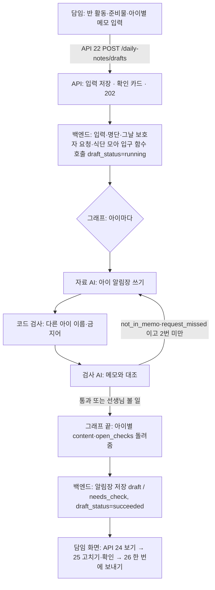

# 알림장 AI 초안 에이전트 흐름

| 항목 | 내용 |
| --- | --- |
| 목표 | 11/20 팀 결정 ① "메모에 없는 말은 쓰지 않는 알림장 AI"를 11/27 멘토님께 API·화면과 함께 시연 |
| 작성 | 영민 · v0.1 · 2026-11-20 |
| 범위 | 담임 1명, 만 4세 별빛반(C4, 담임 `T-DEMO-01`) 18명, 하루치 알림장. 말투 학습·아이 이전 기록은 다음 주 |
| 기준 | API 설계 v0.4(PR #268: API 22~26·30, 3.7 알림장 `child` 줄·`open_checks.kind` 8값, 3.19 초안 입구 함수) · 성주님 11/20 API·DB 정리 · T14 명세 3.2·3.4(PR #260) · 프롬프트 `agents/prompts/documents.md`·`checker.md` '알림장'(PR #260) |
| 데이터·평가 | 가상 데이터 `data/fixtures/kg-demo-01/daily_notes/` · 함정 20문항 `data/evaluation/daily_note/`(PR #262) |

## 1. 한눈에 보기



- 학부모에게 나가는 건 담임이 API 26을 누를 때뿐이에요. 에이전트는 초안과 확인 항목까지만 만들어요(T13 6장 ④, NFR-03).
- `open_checks`가 남은 아이가 한 명이라도 있으면 반 전체 발송이 막혀요(409 `NOTE_BATCH_BLOCKED`).

## 2. 입력과 출력

**입력** — API 22 요청 본문 (API 설계 v0.4 3.19)

```json
{
  "classroom_id": "00000000-0000-4000-8000-000000000101",
  "note_date": "2026-11-16",
  "activities": "가을 낙엽을 모아 콜라주를 만들었어요. 바깥놀이 시간에는 놀이터에서 놀았어요.",
  "supplies": "없음",
  "child_memos": [
    { "child_id": "00000000-0000-4000-8000-000000005403", "memo": "점심 조금 먹음" },
    { "child_id": "00000000-0000-4000-8000-000000005406", "memo": "놀이터에서 넘어져 무릎 살짝 긁힘, 소독함" }
  ]
}
```

**출력** — 아이마다 `daily_notes` 한 줄 (API 24 `items[]`와 같은 모양)

```json
{
  "child_id": "00000000-0000-4000-8000-000000005406",
  "status": "needs_check",
  "content": { "items": [
    { "key": "day", "label": "오늘 하루", "value": "가을 낙엽을 모아 콜라주를 만들었어요. …", "source": { "type": "teacher_input" } },
    { "key": "child", "label": "아이 메모", "value": "놀이터에서 넘어져 무릎이 살짝 긁혔어요. 바로 소독했어요.", "source": { "type": "teacher_input" } },
    { "key": "meal", "label": "식사", "value": "점심: 현미밥, 미역국, 닭갈비, 배추김치 / 간식: 바나나, 우유", "source": { "type": "document", "document_id": "…", "document_title": "11월 3주 식단표 (11/16~11/20)" } }
  ]},
  "open_checks": [ { "id": "c1", "item_key": "child", "kind": "sensitive",
                     "problem": "다친 일이에요. 보내기 전에 확인해 주세요.",
                     "sentence": "놀이터에서 넘어져 무릎이 살짝 긁혔어요." } ]
}
```

- `supplies`가 "없음"이면 그 줄을 넣지 않아요.
- 메모가 빈 아이(예: 나래 `…5402`)는 `child_memos`에 넣지 않아요(memo 1~500자). 그 아이는 `child` 줄이 없어요.
- 아이 ID는 반 아이 목록(API 30)에서 받아요. 가상 명단의 `C4-NN`은 `…54NN`이에요.
- `open_checks[]`는 `{id, item_key, kind, problem, sentence, request_id?}`예요. `kind`는 8값(`not_in_memo`·`sensitive`·`other_child`·`date_check`·`absent`·`draft_failed`·`check_failed`·`request_missed`), `problem`은 선생님이 읽는 설명, `sentence`는 걸린 초안 문장, `request_id`는 빠뜨린 보호자 요청이에요(API 설계 v0.4 3.7).
- 보호자 요청은 요청마다 줄 하나(`medication`·`pickup`·`inquiry`, 계약 v0.4.1), 출처 `{type: request, request_id}`예요. 화면 문구는 성주님 FB-017-4 답(디코 11/20 15:43)을 따라요.

## 3. 단계 (노드)

| # | 단계 | 누가 | 입력 | 출력 | 실패하면 |
| :---: | --- | --- | --- | --- | --- |
| 1 | 입력 모으기 | **백엔드** (그래프 밖) | `input_id` | 입구 함수 입력 `{input_id, note_date, classroom, activities, supplies, children[{child_id, display_name, memo, requests[{request_id, type, text}]}], menu}` | 작업 `failed` |
| 2 | (없앰) 식단 찾기 | — | — | 식단은 백엔드가 `menu`로 넣어 줘요. `menu`가 null이면 `meal` 줄 없음 | — |
| 3 | 알림장 쓰기 | **자료 AI** (`documents.md` '알림장') | 반 활동·준비물·식단·이 아이 메모·이름·그날 보호자 요청·(돌려받은 문제) | `content.items[]` (요청마다 출처 `request` 줄) | 1번 다시 → 실패면 이 아이만 `child` 줄 없이 저장 + 확인 `kind=draft_failed` |
| 4 | 코드 검사 | 코드 | 3의 결과, 반 명단 | 다른 아이 이름이 있으면 `other_child`, 금지어(병명·"괜찮아요" 등)가 있으면 `not_in_memo` 후보 | — |
| 5 | 메모 대조 | **검사 AI** (`checker.md` '알림장') | 3의 결과, 이 아이 메모·보호자 요청, 반 공통, 식단, 4의 결과 | `passed`, `open_checks[]` | 1번 다시 → 실패면 통과로 보지 않고 확인 `kind=check_failed` |
| 6 | 돌려보내기 | 그래프 분기 | 5에서 `not_in_memo`·`request_missed` | 3으로 (`attempt` +1) | 2번 돌려보내도 남으면 `open_checks`에 남기고 7로 |
| 7 | 돌려주기 | 그래프 | 모든 아이 결과 | 아이마다 `{child_id, content: {items[]}, open_checks[]}` | — |
| 8 | 저장·끝내기 | **백엔드** (그래프 밖) | 7의 결과 | `daily_notes`(`open_checks` 있으면 `needs_check`), `draft_status = succeeded`, 이력 `drafted` | 작업 `failed` |

**나눈 이유**
- 쓰는 AI와 검사하는 AI를 나눴어요(NFR-03). 같은 AI가 쓰고 스스로 검사하면 자기가 지어낸 말을 놓치기 쉬워요.
- 4번 코드 검사는 AI 없이 확실히 잡을 수 있는 것(명단에 있는 다른 아이 이름)을 먼저 걸러요. 검사 AI가 놓쳐도 이름은 새지 않아요.
- 그래프는 **쓰기와 검사만** 해요. 입력 모으기·저장·상태·이력은 백엔드가 해요(태웅님 #263 댓글, API 설계 v0.4 3.19). 그래서 11/27에 API 안 백그라운드로 돌리든 T29에 워커로 옮기든 그래프 코드는 그대로예요.

## 4. 분기 규칙

| 검사 결과 | 다음 | 이유 |
| --- | --- | --- |
| 문제 없음 | 저장(`draft`) | 담임이 확인만 누르면 `ready` |
| `not_in_memo`·`request_missed`, `attempt` < 2 | 자료 AI로 돌려보냄 | AI가 고칠 수 있는 문제 |
| `not_in_memo`·`request_missed`, `attempt` = 2 | 저장(`needs_check`) | 무한 반복을 막고 사람에게 넘김(FR-08) |
| `sensitive`·`other_child`·`date_check`·`absent` | 돌려보내지 않고 저장(`needs_check`) | AI가 고칠 문제가 아니라 선생님이 볼 일 |
| 메모가 빈 아이 | 자료 AI는 `child` 줄 없이 씀 → 검사 통과 | 빈 메모를 채우지 않음(평가 ND-04) |

## 5. 상태 (그래프가 들고 다니는 값)

| 범위 | 값 |
| --- | --- |
| 작업 전체 | `input_id`, `org_id`, `classroom_id`, `note_date`, `activities`, `supplies`, `roster[] {child_id, display_name}`, `meal_item?` |
| 아이 한 명 | `child_id`, `memo`, `items[]`, `issues[]`, `open_checks[]`, `attempt`(0~2) |

- 아이 18명은 LangGraph `Send`로 나눠 동시에 돌려요. 모델 호출 수가 한꺼번에 몰리지 않게 동시 실행 수는 설정값(예: 5)으로 묶어요.
- 아이 한 명은 쓰기 1번 + 검사 1번이 기본이에요. 돌려보내면 최대 쓰기 3번 + 검사 3번이에요.

## 6. 화면·API·DB 상태 대조

| 시점 | 화면 (담임) | API | DB |
| --- | --- | --- | --- |
| 입력 보냄 | "초안 만드는 중" | 22 → 202, 23 `queued`·`running` | `daily_note_inputs.draft_status`, 확인 카드(`daily_note`, 기한 그날 17:00) |
| 초안 끝 | 아이별 목록, 확인 필요 표시 | 23 `succeeded`, 24 `items[]` | `daily_notes.status = draft·needs_check`, `open_checks` |
| 작업 실패 | "초안을 만들지 못했어요" | 23 `failed` + `error` | 이력 `tool_failed` |
| 담임이 고침·확인 | 확인 항목 해결, 확인 | 25 `resolved_checks[]`, `confirm` | `ready`, `confirmed_by·at` |
| 보내기 | 반 전체 보내기 | 26 → `sent_count` / 409 | `sent`, 학부모 `note_sent` 알림 |

## 7. 11/27까지 vs 다음 주

| 11/27까지 | 다음 주 이후 |
| --- | --- |
| 위 1~8단계, 가상 별빛반 18명 | 말투 학습(담임이 고친 기록 → 기억 AI, 이력 표 연결 필요) |
| 함정 20문항 + 나머지 70개 메모로 지어낸 문장 수 세기 | 아이 이전 기록 참고 |
| 실행은 모의 API 뒤에 붙이거나 따로 스크립트로 먼저 돌려 봄 | Celery 워커·Redis로 옮김(태웅님 A안, T29) |

## 8. 정해야 할 것 (팀원)

| # | 무엇 | 누구 | 왜 |
| :---: | --- | --- | --- |
| 1 | ~~API 22 `child_memos`, DB `child_memos` 열~~ | 태웅님 | ✅ PR #268 머지(API 설계 v0.4·마이그레이션 0002) |
| 2 | ~~`child` 줄, `open_checks.kind` 8값, 화면 `kind`별 문구~~ | 태웅님 ✅ · 성주님 ✅ | PR #268 머지, 문구는 FB-017-4 |
| 3 | ~~시드 별빛반 18명(`…54NN`)~~ | 태웅님 | ✅ PR #268 시드 |
| 4 | ~~그래프 실행 위치~~ | 태웅님 ✅ | 11/27은 API 안 백그라운드에서 입구 함수 호출, T29에 Celery 워커·Redis(compose도 백엔드가 넣음). FB-017-3 |
| 5 | 기획서 6장 에이전트 표에 "알림장: 자료 AI 쓰기 + 검사 AI 대조" 한 줄 | 영민 메모 → 지혜님 반영 | FB-017-6 (`Docs/Feedback/youngmin/FB-017-6.md`) |

## 9. 개선 기록

함정 평가(메모 함정 20문항 `data/evaluation/daily_note/`, 보호자 요청 20개 `guardian_requests.json` PR #269)로 고친 과정이에요. 실행별 원본 점수·파일은 [`runs/README.md`](../../data/evaluation/daily_note/runs/README.md)에 있어요. 모델은 모두 gpt-6-luna, 2026-11-20이에요.

**고친 것을 두 가지로 나눠 적어요** (강사님 FB-016-5: 채점 기준을 보고 만든 프롬프트는 개선 근거에서 뺌)
- **설계 빈틈**: 설계 문서에 있던 원칙이 코드·프롬프트에 빠져 있던 것. 개선 근거로 써요.
- **정한 동작**: 평가 데이터의 기대를 보고 팀이 동작을 정한 것. 점수는 '정한 동작에 맞춘 결과'로만 봐요.
- 함정 낱말('구석' 등)을 보고 고친 것은 없어요.

| 판 | 무엇이 문제였나 | 고친 것 | 구분 | 메모 함정 | 보호자 요청 | 1회 시간 |
| --- | --- | --- | --- | :---: | :---: | :---: |
| 기준선 | — | 모델 없이 메모를 그대로 옮김(`--model echo`) | — | 7/20 | 10/20 | — |
| ① #271 | 첫 그래프 | — | — | 15/20 | (요청 없음) | 약 5분 |
| ② | 보호자 요청을 평가에 넣음(`fd5e700`) | — | — | 15/20 | 17/20 | 약 5분 |
| ③ | 자료 AI가 메모를 빼면 검사 AI도 아무 표시를 안 해서 **선생님 메모가 소리 없이 사라짐**(ND-10·14·20) | 검사 AI 규칙 한 줄, 코드 안전장치(메모가 빠지면 `sensitive`), 메모 속 다른 아이 이름 코드 검사(`7742945`) | 설계 빈틈 | 17/20 | 13/20 ※ | 약 5분 |
| ④ ×3 | 보호자 요청 줄에 무엇을 쓸지 정해지지 않아 실행마다 요청을 그대로 옮기거나 답하거나 흔들림 | 투약·귀가는 요청을 옮기고, 문의는 메모에 있는 사실로만 답함, 다른 날 이야기는 `date_check`(`3267f4e`, 팀 1안) | 정한 동작 | 18.3/20 | 17.7/20 | 약 5분 |
| ⑤ ×3 | 보호자 **투약 요청**에 선생님 확인이 3회 모두 빠짐(GR-04·05). 투약은 사람이 본다는 원칙(NFR-03)이 메모에만 적용돼 있었음 | 투약 요청 줄이 있으면 코드가 늘 `sensitive`(+`request_id`), 검사 AI 규칙에도 추가(`da22185`) | 설계 빈틈 | 18.0/20 | **20/20** | 약 5분 15초 |
| ⑥ ×3 | 아이를 한 명씩 차례로 처리해서 한 반(18명) 초안이 느림 | 아이들을 동시에 처리, `NOTE_DRAFT_CONCURRENCY` 기본 5(`71b0455`). 프롬프트·채점은 그대로 | 속도 | 18.0/20 | 19.3/20 | **약 87초** |
| ⑦ ×3 | 태웅님이 실제 서버(DB 모드)로 끝까지 돌려 찾은 것(#273·#276 리뷰): 식사 줄에 한 주 식단이 통째로 들어감, 투약 확인이 두 번, 같은 문장 두 번, 문의("기침해요")가 '따로 알려 드릴게요'로 바뀌어 사라짐 | 그날 식단 행만 고름, 같은 줄·같은 kind 확인 합침, 반복 문장은 요청 원문으로, 메모로 답 못 한 문의는 내용을 옮기고 `sensitive`(팀 1안)(`23ca459`). 채점기는 메모 함정에서 요청 쪽 확인을 빼고 셈(`48211b7`) | 설계 빈틈 + 정한 동작 | 17.7/20 | 19.3/20 | 약 84초 |

※ ③의 요청 점수 하락은 고친 부분과 상관없는 실행 편차예요(자료 AI가 요청 문장을 그대로 옮김). 그래서 ④에서 동작을 정하고 3회 평균으로 보기 시작했어요.

**⑥ 동시 처리 확인**
- 1회 시간이 약 5분 15초에서 약 87초로 줄었어요(약 3.6배). 시연에서 한 날 18명 초안은 15~20초쯤이에요.
- 메모 함정은 ⑤와 같은 18.0이에요. 요청 19.3은 GR-18(요청 속 다른 아이 이름)이 2회 틀린 실행 편차예요. 아이마다 따로 처리해서 동시 처리가 결과를 바꾸지 않는다는 것은 시험(`test_concurrent_run_keeps_child_order_and_same_result`)으로 확인했어요.

**⑦ 확인**
- 메모 함정 17.7은 ⑥(18.0)과 같은 범위예요. ND-16·ND-19가 3회 모두 틀리는 건 전과 같아요.
- 문의 1안 때문에 #269의 GR-14·GR-20 기대(`teacher_check: null`)와 실제 동작(`sensitive`)이 달라요. 채점은 null이면 확인 여부를 보지 않아서 통과로 세요. 태웅님께 두 기대값을 `sensitive`로 바꿔 달라고 부탁했어요.
- 채점기 수정 전 ⑦ 3회(메모 16.3)는 ND-03·05가 같은 날 문의 확인 때문에 틀림으로 세진 것이라 기록에서 뺐어요(초안은 맞았어요).

**남은 것**
| 문항 | 내용 | 다음 |
| --- | --- | --- |
| ND-16 | "구석에서" 같은 낙인 느낌 표현을 그대로 씀(3회 모두) | 규칙 6에 이미 있어요. 더 고치면 함정 낱말에 맞추는 것이라 팀과 정해요 |
| ND-09·GR-18 | 다른 아이 이름이 든 메모·요청에서 가끔 틀림 | 실행 편차. 다음 평가에서 계속 봐요 |
| ND-19 | "넘어질 뻔, 안 다침"에 `sensitive`를 남김(지나친 조심) | 위험 쪽 실수가 아니라 두고 봐요 |

## 10. 시연 기준 v1 (11/23 고정, FB-018-4)

강사님 11/23 피드백 4번 "알림장 규칙·화면·시연 데이터를 한 버전으로 고정"에 맞춰, 11/27 시연에서 쓰는 데이터와 규칙을 한곳에 모았어요. 아직 머지 안 된 것은 10.3에 따로 적었어요.

### 10.1 시연 데이터

| 항목 | 기준 | 파일·출처 |
| --- | --- | --- |
| 반 | 만 4세 별빛반 `…0101`, 담임 teacher01(`T-DEMO-01`) | 모의·DB 시드(#268) |
| 아이 | **20명** = 가상 18명(`C4-01`~`C4-18`, `…54NN`) + 시드 시험용 2명(하늘 `…0501` 보호자 parent01, 노을 `…0503` 보호자 parent02). **11/23 결정**: 학부모 화면 시연 계정(parent01 → 하늘)을 그대로 쓰려고 20명으로 함 | `roster_c4.json`(`children` 18 + `seed_children` 2) |
| 메모 | 20명 × 5일(11/16~20) = 100개. 하늘·노을 10개는 함정이 아닌 보통 메모 | `child_memos.json` |
| 보호자 요청 | #269 가상 20개(18명) + 시드 2개(하늘 "기침해요", 노을 "오늘 할머니가 데리러 가요") | `guardian_requests.json`, `apps/api/app/mock/seed.py` |
| 식단 | `MN-2026-W47`(11/16~20 주간 표). 알림장에는 그날 행만 | 원 자료 T11 |
| 시연 날짜(제안) | **2026-11-20(금)**: 메모 20개(빈 메모 3), 보호자 요청 GR-02·10·19, 식단 11-20 행. 태웅님 끝단 실행(11/20)과 같은 날 | — |
| 평가 분모 | 시연 20명과 따로: 메모 함정 20문항(18명), 보호자 요청 20개(18명). 기존 BFCL·상담 30문항과도 따로 봐요(FB-018-5) | `data/evaluation/daily_note/` |

### 10.2 규칙 한 표 (도구 출력 · API · 평가 정답 · 화면)

| # | 규칙 | 그래프(도구 출력) | API·DB | 평가 정답 | 화면(웹) |
| :---: | --- | --- | --- | --- | --- |
| 1 | 확인 항목 이름 `kind` 8개 | ✅ develop | ✅ v0.4 3.7 | ✅ 함정 `flag_kind`·요청 `teacher_check` | ✅ `domain/notes.ts` 8개 |
| 2 | 보호자 문의 줄 key `inquiry` | ⏳ #279 | ✅ v0.4.1(#282) | — (요청은 `request_id`로 채점) | ❌ `ItemKey`에 `inquiry` 없음, 학부모 홈이 `inquiry` 줄을 안 보여 줌 |
| 3 | 문의에 메모로 답할 내용이 없으면 문의 내용을 옮기고 `sensitive`(+`request_id`) | ⏳ #279 | ✅ `open_checks[].request_id` 선택 칸 | ✅ GR-14·20 `sensitive`(#282) | ⚠️ `sensitive` 문구가 "민감한 정보가 들어갔어요 / 이 문장 빼기"라, 문의·투약 확인에는 맞지 않음 |
| 4 | 보호자 투약 요청은 늘 `sensitive`(+`request_id`), 같은 줄 확인은 하나로 | ✅ develop(투약) · ⏳ #279(합치기) | ✅ | ✅ GR-01~05 `sensitive` | ⚠️ 3번과 같음 |
| 5 | 식사 줄 = 그날 식단 행("점심: … / 오후 간식: …") | ⏳ #279 | ✅ `menu.text`는 문서 본문 그대로 넘김(그래프가 행을 고름) | ✅ 평가도 문서 전체를 넘김 | ✅ 받은 값 그대로 |
| 6 | 준비물이 "없음"이면 준비물 줄 없음 | ✅ | ✅ | — | ✅ 학부모 홈은 있는 줄만 보여 줌 |
| 7 | 메모가 빈 아이는 아이 메모 줄 없음 | ✅ | ✅ `_validated`가 막음 | ✅ ND-04 | ✅ "기록 없음 · 반 활동만" |
| 8 | 확인 항목이 남은 아이가 있으면 반 전체 발송 막힘 | — | ✅ 409 `NOTE_BATCH_BLOCKED` | — | ✅ |
| 9 | 시연은 실제 그래프로 | `DAILY_NOTE_WRITER=graph` | 기본값은 대역(`stub_writer`). 대역은 식단 통째·준비물 "없음" 줄·하늘/노을 고정 확인이라 위 규칙 5·6과 다름 | — | — |

✅ 맞음 · ⏳ 머지 전 PR · ❌ 안 맞음 · ⚠️ 동작은 하지만 문구가 맞지 않음

### 10.3 지금 기준과 머지 전 구분 (11/23)

- **develop 기준 동작**: 1·4(투약)·6·7·8번, 평가 정답 GR-14·20 `sensitive`.
- **#279 머지 뒤 동작**: 2(그래프 `inquiry`)·3·4(합치기)·5번. 시연 전 #279 머지가 필요해요.
- **화면 맞출 것(성주님, FB-018-3과 함께)**: 2번 `inquiry` 줄 받기·학부모 홈에 보이기, 3·4번 `request_id`가 있는 `sensitive`는 "빼기" 대신 "답 넣기·확인했어요"로.
- **데이터 맞출 것(태웅님)**: 시연 날짜를 11/20으로 하면 시드 요청 2개(하늘·노을)의 `created_at`도 11/20이어야 그날 입력에 들어가요. 지금은 시드 넣는 시각(또는 `--refresh-note-requests`로 오늘)이에요. 시연을 '오늘' 날짜로 하면 메모·#269 요청 날짜를 옮기는 옵션이 필요해요. 둘 중 하나로 정해요.
