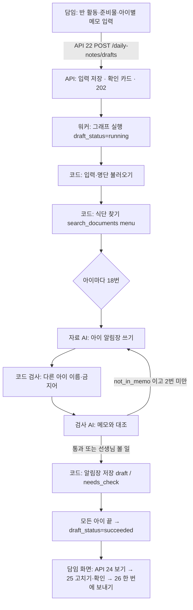

# 알림장 AI 초안 에이전트 흐름

| 항목 | 내용 |
| --- | --- |
| 목표 | 11/20 팀 결정 ① "메모에 없는 말은 쓰지 않는 알림장 AI"를 11/27 멘토님께 API·화면과 함께 시연 |
| 작성 | 영민 · v0.1 · 2026-11-20 |
| 범위 | 담임 1명, 만 4세 별빛반(C4, 담임 `T-DEMO-01`) 18명, 하루치 알림장. 말투 학습·아이 이전 기록은 다음 주 |
| 기준 | API 22~26(T13 PR #256 3.6·3.19~3.21) · 성주님 11/20 API·DB 정리(`child_memos`, `not_in_memo`) · T14 명세 3.2·3.4(PR #260) · 프롬프트 `agents/prompts/documents.md`·`checker.md` '알림장'(PR #260) |
| 데이터·평가 | 가상 데이터 `data/fixtures/kg-demo-01/daily_notes/` · 함정 20문항 `data/evaluation/daily_note/`(PR #262) |

## 1. 한눈에 보기



- 학부모에게 나가는 건 담임이 API 26을 누를 때뿐이에요. 에이전트는 초안과 확인 항목까지만 만들어요(T13 6장 ④, NFR-03).
- `open_checks`가 남은 아이가 한 명이라도 있으면 반 전체 발송이 막혀요(409 `NOTE_BATCH_BLOCKED`).

## 2. 입력과 출력

**입력** — API 22 요청 본문 (`child_memos`는 성주님 안, 아직 API에 없음)

```json
{
  "classroom_id": "…별빛반 UUID…",
  "note_date": "2026-11-16",
  "activities": "가을 낙엽을 모아 콜라주를 만들었어요. 바깥놀이 시간에는 놀이터에서 놀았어요.",
  "supplies": "없음",
  "child_memos": [
    { "child_id": "…C4-03…", "memo": "점심 조금 먹음" },
    { "child_id": "…C4-06…", "memo": "놀이터에서 넘어져 무릎 살짝 긁힘, 소독함" },
    { "child_id": "…C4-02…", "memo": "" }
  ]
}
```

**출력** — 아이마다 `daily_notes` 한 줄 (API 24 `items[]`와 같은 모양)

```json
{
  "child_id": "…C4-06…",
  "status": "needs_check",
  "content": { "items": [
    { "key": "day", "label": "오늘 하루", "value": "가을 낙엽을 모아 콜라주를 만들었어요. …", "source": { "type": "teacher_input" } },
    { "key": "child", "label": "오늘 별하는", "value": "놀이터에서 넘어져 무릎이 살짝 긁혔어요. 바로 소독했어요.", "source": { "type": "teacher_input" } },
    { "key": "meal", "label": "식사", "value": "점심: 현미밥, 미역국, 닭갈비, 배추김치 / 간식: 바나나, 우유", "source": { "type": "document", "document_id": "…", "document_title": "11월 3주 식단표 (11/16~11/20)" } }
  ]},
  "open_checks": [ { "id": "c1", "item_key": "child", "problem": "sensitive" } ]
}
```

- `supplies`가 "없음"이면 그 줄을 넣지 않아요.
- `child` 키와 `problem` 값 `sensitive`·`other_child`·`date_check`·`absent`는 제안이에요(7장). `not_in_memo`는 성주님 안이에요.

## 3. 단계 (노드)

| # | 단계 | 누가 | 입력 | 출력 | 실패하면 |
| :---: | --- | --- | --- | --- | --- |
| 1 | 입력 불러오기 | 코드 | `input_id` | 반 활동·준비물·`child_memos`·반 명단(이름) | 작업 `failed` |
| 2 | 식단 찾기 | 코드 (`search_documents`, `doc_type=menu`) | `note_date`, 기관·반 | `meal` 줄 하나 (반 전체 공통) | 1번 다시 → 실패면 `meal` 줄 없이 계속 (식단을 지어내지 않음) |
| 3 | 알림장 쓰기 | **자료 AI** (`documents.md` '알림장') | 반 활동·준비물·이 아이 메모·이름·(돌려받은 문제) | `content.items[]` | 1번 다시 → 실패면 이 아이만 `child` 줄 없이 저장 + 확인 `draft_failed` (제안) |
| 4 | 코드 검사 | 코드 | 3의 결과, 반 명단 | 다른 아이 이름이 있으면 `other_child`, 금지어(병명·"괜찮아요" 등)가 있으면 `not_in_memo` 후보 | — |
| 5 | 메모 대조 | **검사 AI** (`checker.md` '알림장', `check_draft(note_id)`) | 3의 결과, 이 아이 메모, 반 공통, 4의 결과 | `passed`, `open_checks[]` | 1번 다시 → 실패면 통과로 보지 않고 확인 `check_failed` (제안) |
| 6 | 돌려보내기 | 그래프 분기 (`return_to_step`) | 5에서 `not_in_memo` | 3으로 (`attempt` +1) | 2번 돌려보내도 남으면 `open_checks`에 남기고 7로 |
| 7 | 저장 | 코드 | `content`, `open_checks` | `daily_notes` (`open_checks` 있으면 `needs_check`, 없으면 `draft`) | 작업 `failed` |
| 8 | 끝내기 | 코드 | 모든 아이 결과 | `draft_status = succeeded`, 이력 `drafted` | — |

**나눈 이유**
- 쓰는 AI와 검사하는 AI를 나눴어요(NFR-03). 같은 AI가 쓰고 스스로 검사하면 자기가 지어낸 말을 놓치기 쉬워요.
- 4번 코드 검사는 AI 없이 확실히 잡을 수 있는 것(명단에 있는 다른 아이 이름)을 먼저 걸러요. 검사 AI가 놓쳐도 이름은 새지 않아요.
- 식단(2번)은 반 전체가 같아서 아이마다 찾지 않고 한 번만 찾아요.

## 4. 분기 규칙

| 검사 결과 | 다음 | 이유 |
| --- | --- | --- |
| 문제 없음 | 저장(`draft`) | 담임이 확인만 누르면 `ready` |
| `not_in_memo`, `attempt` < 2 | 자료 AI로 돌려보냄 | AI가 고칠 수 있는 문제 |
| `not_in_memo`, `attempt` = 2 | 저장(`needs_check`) | 무한 반복을 막고 사람에게 넘김(FR-08) |
| `sensitive`·`other_child`·`date_check`·`absent` | 돌려보내지 않고 저장(`needs_check`) | AI가 고칠 문제가 아니라 선생님이 볼 일 |
| 메모가 빈 아이 | 자료 AI는 `child` 줄 없이 씀 → 검사 통과 | 빈 메모를 채우지 않음(평가 ND-04) |

## 5. 상태 (그래프가 들고 다니는 값)

| 범위 | 값 |
| --- | --- |
| 작업 전체 | `input_id`, `org_id`, `classroom_id`, `note_date`, `activities`, `supplies`, `roster[] {child_id, display_name}`, `meal_item?` |
| 아이 한 명 | `child_id`, `memo`, `items[]`, `issues[]`, `open_checks[]`, `attempt`(0~2) |

- 아이 18명은 LangGraph `Send`로 나눠 동시에 돌려요. 모델 호출 수가 한꺼번에 몰리지 않게 동시 실행 수는 설정값(예: 5)으로 묶어요.
- 아이 한 명은 쓰기 1번 + 검사 1번이 기본이에요. 돌려보내면 최대 쓰기 3번 + 검사 3번이에요.

## 6. 화면·API·DB 상태 대조

| 시점 | 화면 (담임) | API | DB |
| --- | --- | --- | --- |
| 입력 보냄 | "초안 만드는 중" | 22 → 202, 23 `queued`·`running` | `daily_note_inputs.draft_status`, 확인 카드(`daily_note`, 기한 그날 17:00) |
| 초안 끝 | 아이별 목록, 확인 필요 표시 | 23 `succeeded`, 24 `items[]` | `daily_notes.status = draft·needs_check`, `open_checks` |
| 작업 실패 | "초안을 만들지 못했어요" | 23 `failed` + `error` | 이력 `tool_failed` |
| 담임이 고침·확인 | 확인 항목 해결, 확인 | 25 `resolved_checks[]`, `confirm` | `ready`, `confirmed_by·at` |
| 보내기 | 반 전체 보내기 | 26 → `sent_count` / 409 | `sent`, 학부모 `note_sent` 알림 |

## 7. 11/27까지 vs 다음 주

| 11/27까지 | 다음 주 이후 |
| --- | --- |
| 위 1~8단계, 가상 별빛반 18명 | 말투 학습(담임이 고친 기록 → 기억 AI, 이력 표 연결 필요) |
| 함정 20문항 + 나머지 70개 메모로 지어낸 문장 수 세기 | 아이 이전 기록 참고 |
| 실행은 모의 API 뒤에 붙이거나 따로 스크립트로 먼저 돌려 봄 | Celery 워커·Redis로 옮김(태웅님 A안, T29) |

## 8. 정해야 할 것 (팀원)

| # | 무엇 | 누구 | 왜 |
| :---: | --- | --- | --- |
| 1 | API 22에 `child_memos[] {child_id, memo}`, DB `daily_note_inputs.child_memos` jsonb 추가 | 성주님·태웅님 | 아이별 메모가 들어갈 자리가 없으면 흐름이 시작되지 않아요 |
| 2 | `content.items[].key`에 `child` 추가, `problem` 값 목록(`not_in_memo`·`sensitive`·`other_child`·`date_check`·`absent`·`draft_failed`·`check_failed`) | 성주님 | 화면이 확인 항목을 어떤 말로 보여 줄지 정해야 해요 |
| 3 | 시드 별빛반에 18명 추가(고정 UUID) | 태웅님 | 가상 데이터(PR #262)를 DB에 넣으려면 필요해요 |
| 4 | 그래프 실행 위치: 11/27에는 API 안 백그라운드로 먼저, T29에 워커로 | 태웅님·인혜님 | 22번 202 뒤 누가 그래프를 돌리는지 정해야 해요 |
| 5 | 기획서 6장 에이전트 표에 "알림장: 자료 AI 쓰기 + 검사 AI 대조" 한 줄 | 지혜님 | 태웅님이 11/20 요청한 내용 |
