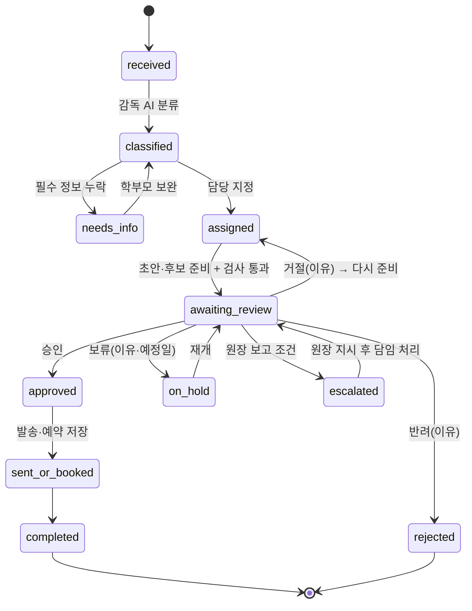
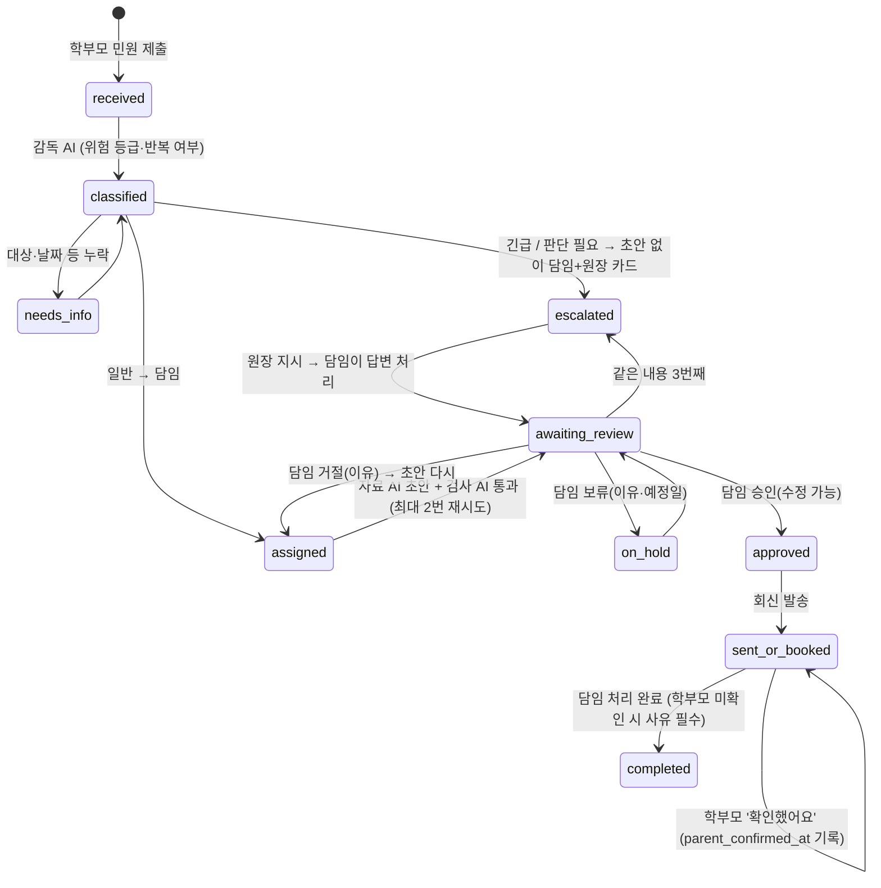
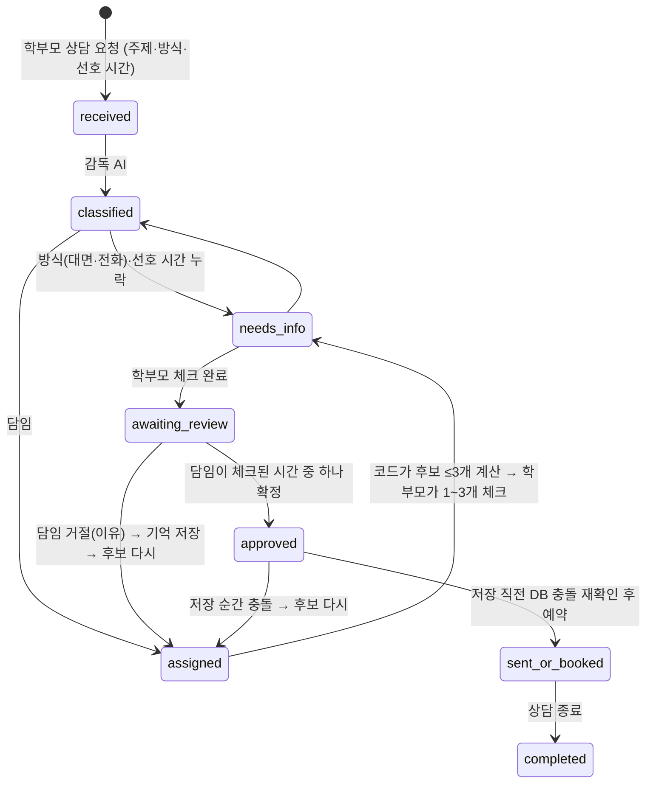
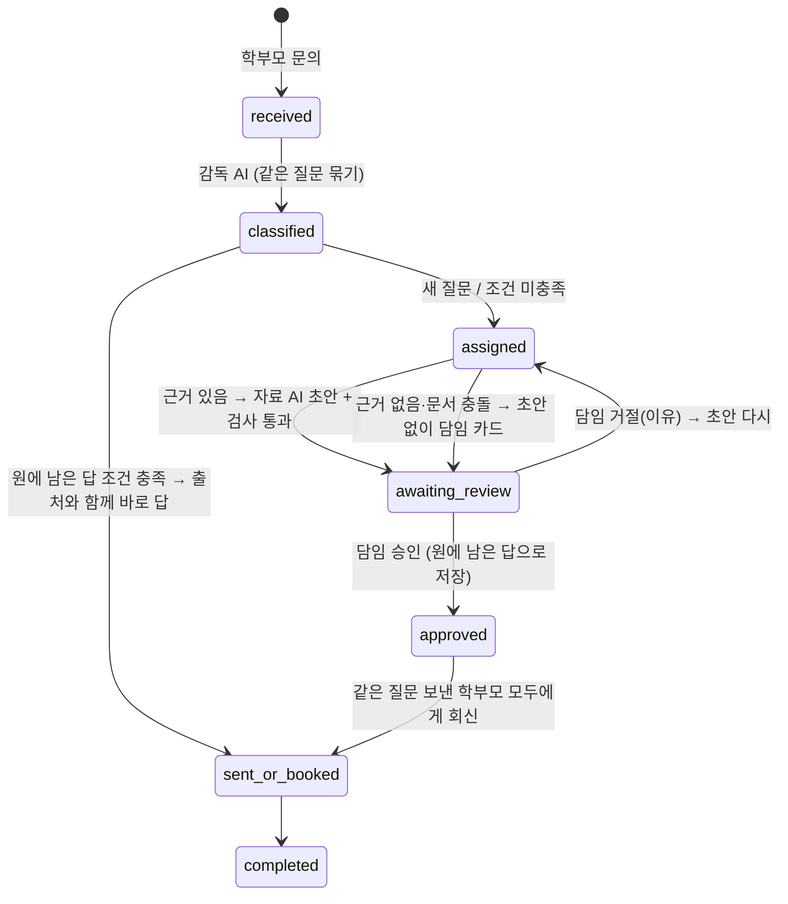
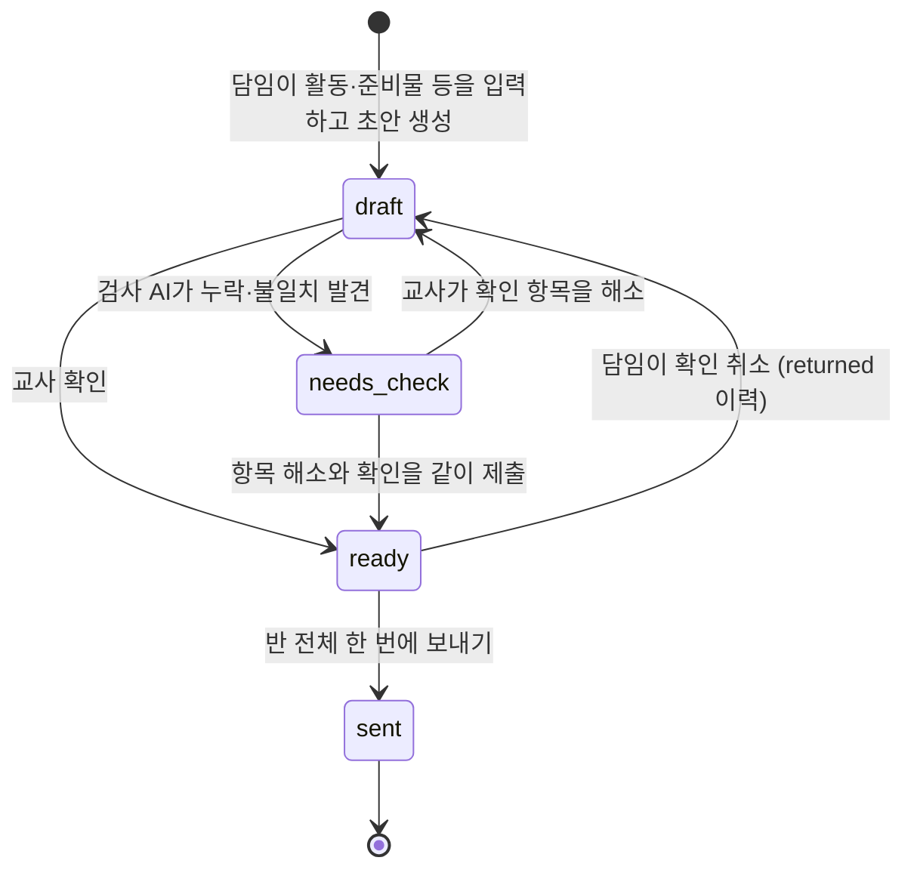

# 유치온 T04 업무 흐름·권한·상태 명세

- WBS: T04 [MVP] 업무 흐름·권한·상태 명세 (학부모 → 담임 → 원장)
- 작성: 성주 (팀 합의로 담당 변경, 원 담당 지혜)
- 이력: 2026-11-17 초안 → 2026-11-17 팀 합의 반영 (참석: 지혜, 태웅, 인혜, 성주, 영민(온라인))
- 근거: 기획서 1116 (2.3 먼저 검증할 흐름, 3장 FR, 4장 NFR, 6장 멀티 에이전트·공통 상태, 8장 AC), 시연 목업
- 완료 기준: 민원·상담·문의·알림장 4흐름의 상태 전이, 역할별 허용/거부, 원장 보고 조건이 정의됨
- 이 문서를 쓰는 작업: T10 입출력 계약, T11 가상 원 자료, T12 MVP 화면 정리, T13 API 설계

> 표시 규칙: **[확정]** 기획서에 이미 있는 내용 · **[합의]** 11/17 팀 회의에서 정한 내용 (10장 결정 번호) · **[제안]** 이 문서에서 정했고 별도 반대가 없으면 따르는 내용 · **[후속 확인]** 합의 메모에서 생긴 세부 질문

---

## 1. 용어

| 용어 | 뜻 |
| --- | --- |
| 요청 | 학부모가 보낸 문의·상담·민원·투약·귀가 한 건. 요청 ID가 붙는다 (FR-02) |
| 카드 | 교직원이 승인·거절·보류하는 처리 단위. 요청 하나에서 카드가 여러 장 생길 수 있다 (예: 담임 카드 + 원장 보고 카드) |
| 담당 | 카드를 처리할 교직원. 기본은 담임, 원장 보고 카드는 원장 |
| 위험 등급 | 감독 AI가 민원에 붙이는 등급. 일반 · 긴급 · 판단 필요 (2.3) |
| 원에 남은 답 | 담임이 승인한 문의 답. 조건을 만족하는 같은 질문에는 카드 없이 이 답으로 바로 답한다 (FR-20) |
| AI 처리 단계 | 분류 → 근거 검색 → 초안 → 검사. 상태가 아니라 진행 표시로 보여 준다 (NFR-10 스트리밍) |

---

## 2. 공통 상태 [확정: 상태 코드 / 제안: 화면 표시 이름]

기획서 6장의 공통 상태를 그대로 쓴다. 화면마다 상태 이름이 달랐던 문제(시연 목업)를 막기 위해 **역할별 표시 이름을 여기서 고정**한다.

| 상태 코드 | 의미 | 학부모 화면 표시 | 교직원 화면 표시 | 바꾸는 주체 |
| --- | --- | --- | --- | --- |
| `received` | 요청이 저장됨, 요청 ID 생성 | 접수됨 | 접수 | 시스템 |
| `classified` | 감독 AI가 유형·긴급도·담당 후보를 기록함 | 접수됨 | 미배정 | 감독 AI |
| `needs_info` | 학부모의 입력을 기다림 (빠진 정보 · 상담 시간 선택) | 정보가 더 필요해요 / 시간을 골라 주세요 | 학부모 응답 대기 | 감독 AI / 코드 |
| `assigned` | 담당이 정해짐, AI가 초안·후보를 준비 중 | 선생님께 전달됨 | 준비 중 | 감독 AI / 원장(재배정) |
| `awaiting_review` | 카드가 담당에게 올라가 사람 판단을 기다림 (흐름 멈춤) | 선생님 확인 중 | **확인 필요** | 시스템 |
| `escalated` | 원장 보고 카드가 생김 | 원장님 확인 중 | 원장 보고 | 감독 AI / 담임 |
| `on_hold` | 담당이 이유를 남기고 보류함 | 확인이 늦어지고 있어요 (예정일 표시) | 보류 | 담임·원장 |
| `approved` | 담당이 승인함 (내보내기 직전) | 선생님 확인 완료 | 승인됨 | 담임·원장 |
| `sent_or_booked` | 회신 발송 또는 예약 확정 | 답변 도착 / 예약 확정 | 발송됨 / 예약됨 | 시스템 |
| `completed` | 처리 끝 | 완료 | 완료 | 담임 (민원) / 시스템 (그 외) |
| `rejected` | 요청 자체를 처리하지 않음 (이유 필수) | 처리할 수 없는 요청이에요 (이유) | 반려 | 담임·원장 |

[합의 2·F1] 회신을 보낸 민원은 담임이 완료한다. 학부모가 확인하면 확인 시각(`parent_confirmed_at`)을 남기고, 미확인이면 담임이 완료 사유(`reason_text`)를 남긴다. 두 경우 모두 `sent_or_booked`에서 `completed`로 전이한다. 화면은 §3.3 참고.

### 2.1 공통 전이 규칙

- [확정] 승인 대기 중에는 흐름이 멈추고, 재개할 때 권한·상태를 다시 확인하며 같은 요청을 두 번 실행하지 않는다 (FR-09, AC-05).
- [확정] 검사 AI가 실패하면 앞 단계로 최대 2번 돌려보낸 뒤 사람에게 넘긴다 (FR-08). 이때 카드에 "검사 실패 · 직접 확인 필요"를 붙여 `awaiting_review`로 보낸다.
- [확정] 긴급·모호·고위험 입력은 자동 답변 없이 담당자에게 바로 전달한다 (FR-03). AI 초안 단계를 건너뛰고 `awaiting_review`로 간다. 민원의 세부 기준은 2.3.
- [제안] `rejected`와 `completed`는 끝 상태다. 다시 열려면 학부모가 새 요청을 보내고, 이전 요청 ID를 연결한다.
- [제안] 모든 상태 변경은 처리 이력에 사용자·시각·이전 상태·다음 상태·이유를 남긴다 (FR-11).

### 2.2 교직원 받은함 필터 [합의 5]

FR-09의 "미배정·대기·검토·완료" 4개 대신 **필터 6개**를 쓴다. 합의 5(C안: 5개)에 메모대로 "판단 필요"를 더했다.

| 받은함 필터 | 포함하는 카드 | 교사가 할 일 |
| --- | --- | --- |
| 미배정 | `classified` (담당 없음) | 원장·원감이 담당 지정 |
| 확인 필요 | `awaiting_review`, `escalated`, 학부모가 확인한 민원 (`sent_or_booked` + `parent_confirmed_at` 있음) | 지금 승인·거절·보류·처리 완료 |
| 판단 필요 | 위험 등급 `판단 필요`인 민원 (2.3) | 일반 또는 긴급으로 다시 분류한 뒤 처리 |
| 보류 | `on_hold` | 예정일에 재개 |
| 진행 중 | `needs_info`, `assigned`, `approved`, 학부모 확인 전 `sent_or_booked` | 학부모·AI·시스템 차례. 학부모 미확인 민원은 담임이 사유를 입력해 처리 완료할 수 있음(F1) |
| 완료 | `completed`, `rejected` | 없음 |

- [합의 4·5] **긴급** 민원은 별도 필터가 아니라 "확인 필요" 안에서 **맨 위 + 긴급 표시**로 보인다. 판단 필요 민원은 긴급 민원과 섞이지 않게 따로 모은다.
- [제안] 한 카드는 필터 하나에만 들어간다. 판단 필요 카드는 다시 분류되면 "확인 필요"로 옮겨 간다.
- 기획서 FR-09의 필터 문구를 이 표로 바꿔야 한다 (11장).

[확정 11/18] 받은함의 상태 필터 6개와 요청 종류 필터(전체·민원·상담·문의)는 함께 적용한다. 종류는 `request_type`으로 조회한다. 상태별 `counts`는 선택한 종류 안에서, 종류별 `type_counts`는 선택한 상태 안에서 센다. 긴급 건은 별도 화면 필터 없이 ‘확인 필요’ 상단에 둔다. [화면 명세](유치온_T12_화면지도.md#받은함과-원장-현황)와 [계약표 §2.2](입출력_계약표_초안.md#22-교사원장)를 참고한다.

### 2.3 민원 위험 등급 [합의 4]

합의 4(C안)와 메모에 따라 고위험을 **긴급**과 **판단 필요** 두 가지로 나눈다. 둘 다 AI 초안 없이 사람에게 바로 가지만, 표시와 처리 순서가 다르다.

| 위험 등급 | 판단 기준 | 처리 | 받은함 |
| --- | --- | --- | --- |
| 일반 | 아래 둘에 해당하지 않음 | 3장 일반 흐름 (AI 초안 → 검사 → 담임 카드) | 확인 필요 |
| **긴급** | 감독 AI가 확신을 갖고 다음 4가지 중 하나로 판단: ① 아이 안전(다침·학대 의심) ② 교직원 개인 비난·위협 ③ 법적 조치·외부 기관(교육청·언론) 언급 ④ 개인정보 유출 주장 | AI 초안 없이 **담임 카드 + 원장 보고 카드 동시 생성**, 바로 알림 | 확인 필요 맨 위, 긴급 표시 |
| **판단 필요** | 감독 AI가 위 4가지에 해당하는지 **확신하지 못함** | AI 초안 없이 담임 카드 + 원장 보고 카드 생성, "AI 판단 불확실" 표시. 사람이 일반 또는 긴급으로 다시 분류 | 판단 필요 |

- [합의 4] 확신 여부의 기준값(신뢰도 기준)은 영민님이 평가 문항(T06)으로 정한다. T06에 4가지 각각과 애매한 문항을 넣는다.
- [제안] 다시 분류하면 처리 이력에 "AI 판단 → 사람 판단, 이유"를 남긴다. 이 기록은 감독 AI 평가 자료로 쓴다.
- [확정 11/18 · F2] 근무 시간 밖 긴급 민원 중 교직원에게 즉시 보내는 건 아이 안전 건이다. 그 밖의 긴급·판단 필요·일반 교직원 알림은 주말·공휴일을 건너뛴 다음 근무일 09:00에 보낸다. 학부모 알림과 귀가 요청(`pickup`) 알림은 근무 시간과 관계없이 즉시 보낸다. 발송 가능 시각은 서버가 `deliver_after`로 계산한다. FR-21의 발열은 건강 알림 범위다.

---

## 3. 흐름 1 — 민원 (AC-01, 후속 검증)

### 3.1 단계 [확정: 기획서 2.3 / 합의 2·3·4]

학부모 민원 접수 → 감독 AI 분류(민원·위험 등급·반복 여부) → (일반) 자료 AI가 통신문·운영 규정 근거를 찾아 답변 초안 → 검사 AI 대조 → 담임 카드 → 같은 내용 3번째면 원장 보고 카드 → 담임 승인 후 회신 → 학부모 확인 후 담임 처리 완료 또는 미확인 시 담임 사유 입력 후 완료

### 3.2 규칙

| 규칙 | 내용 | 근거 |
| --- | --- | --- |
| 자동 회신 금지 | AI는 민원에 자동 회신하지 않는다. 담임 승인 전에는 회신이 나가지 않는다 | FR-07, AC-01, NFR-03 |
| 법률 판단 금지 | AI는 법률 판단을 하지 않는다. 법령은 근거로만 붙인다 | FR-07 |
| 담임 카드 내용 | 민원 요약·근거(문서명·위치·적용일)·반복 여부·위험 등급·검사 결과 | FR-07, FR-04 |
| 원장 보고 후에도 회신은 담임 승인 | 원장 보고 카드가 생겨도 회신은 담임 카드 승인으로만 나간다. 원장은 지시·재배정을 한다 | AC-01 |
| 같은 내용의 범위 | **같은 반 · 최근 30일 · 같은 주제**로 묶은 민원 수를 센다. 보낸 학부모가 달라도 합산한다 | 합의 3 |
| 완료 | 담임이 ‘처리 완료’를 눌러야 완료된다. 학부모 확인 전이라면 완료 사유가 필수다. 자동으로 완료하지 않는다. | 합의 2, F1, 계약표 §6 ⑦ |

### 3.3 회신 이후 화면 표시 [합의 2]

| 단계 | 학부모 화면 | 담임 받은함 |
| --- | --- | --- |
| 회신 발송, 학부모 확인 전 | 답변 도착 · [확인했어요] 버튼 | 진행 중. 담임이 완료할 때 사유 입력 필수 |
| 학부모가 '확인했어요' 누름 | 확인함 · 선생님이 마무리하고 있어요 | 확인 필요 ("처리 완료 대기") |
| 담임이 '처리 완료' 누름 | 완료 | 완료 |

- [제안] 학부모가 확인 전에 추가 문의를 보내면 같은 요청 ID에 이어 붙이고, 담임 카드를 다시 `awaiting_review`로 올린다.
- [확정 11/18 · F1] 학부모 미확인 상태에서 담임이 완료하면 `reason_text`를 기록한다. 사유가 빠지면 서버가 409 `REASON_REQUIRED`로 거절한다. 원장 현황에는 최근 30일 동안 미확인 상태로 완료한 민원을 요청당 한 번씩 별도 집계한다(`completed_unconfirmed`, 최종 T53).

---

## 4. 흐름 2 — 상담 (AC-02, 후속 검증)

### 4.1 단계 [확정: 기획서 2.3, FR-05·06 / 합의 1]

학부모 상담 요청 → 일정 계산 코드가 담임·상담실 빈 시간 후보 최대 3개 → **학부모가 가능한 시간을 1~3개 체크** → 담임이 그중 하나 확정 또는 거절(이유) → 거절 이유를 기억해 다음 후보에 반영 → 같은 이유 3번이면 개인 규칙 제안(담임 승인 전 미적용)

### 4.2 규칙

| 규칙 | 내용 | 근거 |
| --- | --- | --- |
| 후보 계산은 코드 | 빈 시간 계산·예약 저장·충돌 검사는 에이전트가 아니라 코드가 한다 | 6장 |
| 학부모가 먼저 체크 | 후보 3개를 학부모에게 먼저 보여 주고 가능한 시간을 1~3개 체크받는다. 이 단계는 `needs_info`("시간을 골라 주세요")로 표시한다 | 합의 1 |
| 확정 전 미예약 | 담임 확정 전에는 예약되지 않는다. 담임은 학부모가 체크한 시간 중에서만 확정한다 | FR-05, 합의 1 |
| 동시 예약 | 같은 시간·상담실 동시 저장은 한 건만 성공한다 | AC-02 |
| 거절 이유 | 담임은 이유를 골라 거절한다(예: 연장반 당번, 전화로 충분). 이유는 담임 기억에 저장 | FR-06 |
| 규칙 제안 | 같은 이유 3번째에 규칙 제안 카드가 생긴다. 담임 승인 전에는 적용하지 않는다 | FR-06, AC-02 |

- [제안] 학부모가 후보를 모두 안 된다고 하면 "다른 시간 필요"를 눌러 선호 시간을 다시 받고 후보를 다시 계산한다.

---

## 5. 흐름 3 — 문의 (AC-03)

### 5.1 단계 [확정: FR-04 / 합의 7]

### 5.2 규칙

| 규칙 | 내용 | 근거 |
| --- | --- | --- |
| 출처 표시 | 답에 근거 문서명·위치·적용일을 붙인다 | FR-04 |
| 추측 금지 | 근거가 없거나 문서끼리 충돌하면 추측하지 않고 담임 카드로 넘긴다 | FR-04, NFR-04 |
| 첫 답은 담임 승인 | 새 질문의 AI 초안은 담임 승인 후 나간다. 승인한 답은 원에 남은 답이 된다 | FR-20 |
| 바로 답하는 조건 | **질문 뜻이 충분히 같고, 근거 문서가 최신일 때만** 원에 남은 답으로 바로 답한다. 하나라도 아니면 담임 카드 | 합의 7 |
| 문서 개정 | 근거 문서가 새 판으로 바뀌면 그 문서를 쓴 원에 남은 답은 자동으로 무효가 된다 | 합의 7 |
| 옛 자료 | 옛 판 문서는 근거에서 뺀다. 작년 문서로 쓴 초안은 카드에 경고를 붙인다 | FR-13, 목업 |
| 같은 질문 묶기 | 같은 질문 여러 건은 카드 한 장으로 묶고, 승인하면 모두에게 회신 | 목업 [제안] |

- [합의 7] "뜻이 충분히 같다"의 기준값은 영민님이 평가로 정한다 (T06·T11과 함께).

---

## 6. 흐름 4 — 알림장 (AC-04, 첫 시연 중심)

알림장은 교사가 아이별로 보내는 글이다. 요청의 상태 코드와 별도로 알림장 상태를 관리한다.

### 6.1 단계 [확정: FR-10 / 합의 6]

담임이 반 활동·준비물·아이별 관찰 메모를 입력해 생성을 시작한다. 자료 AI가 원 자료와 당일 보호자 요청을 참고해 아이별 초안을 쓰고, 검사 AI가 메모·요청과 대조한다. 확인이 필요한 내용을 처리한 뒤 담임이 반 전체에 한 번에 발송한다. [알림장 에이전트 흐름](알림장_에이전트_흐름.md) 참고.

| 상태 코드(API) | 의미 | 교사 표시 | 학부모 |
| --- | --- | --- | --- |
| `draft` | AI 초안 생성 | 초안 | 보이지 않음 |
| `needs_check` | 검사 AI가 확인 필요 항목을 찾음 | 확인 필요 (발송 잠김) | 보이지 않음 |
| `ready` | 확인 필요 0건, 교사가 확인함 | 보낼 준비 | 보이지 않음 |
| `sent` | 발송됨 | 보냄 | 오늘 알림장에 보임 |

### 6.2 규칙

| 규칙 | 내용 | 근거 |
| --- | --- | --- |
| 일괄 발송만 | MVP는 반 전체 일괄 발송만 한다. 초안 작업이 `queued`·`running`·`failed`면 409 `NOTE_BATCH_BLOCKED`와 `details.blocked: []`를 반환한다. 초안 작업이 성공했어도 발송 대상에 `draft`·`needs_check`가 있거나 확인 항목이 남아 있으면 같은 오류와 해당 알림장 목록을 반환한다. | FR-10, AC-04, API 설계 §3.6 |
| 확인 취소 | 담임이 발송 전 확인을 취소하면 `ready`에서 `draft`로 돌아가고 `returned` 이력을 남긴다. | API 설계 §3.26 ⑧ |
| 사람만 발송 | 교사 확인 후에만 보낸다 | NFR-03 |
| 투약·귀가 줄 | 알림장의 투약·귀가 줄은 해당 요청 상태와 같아야 한다 | FR-14 |
| 투약 값 | 용량 같은 값은 AI가 추측하지 않고 원문만 옮긴다 | NFR-03 |
| 학부모 답장 | 발송 후 학부모 답장은 새 문의 요청으로 접수한다 [제안] | FR-14 |

---

## 7. 역할별 권한

### 7.1 볼 수 있는 범위 [확정: FR-01, NFR-01, AC-06]

| 자료 | 학부모 | 담임 | 원장·원감 |
| --- | --- | --- | --- |
| 요청·카드 | 내가 보낸 것만 | 우리 반 것 + 재배정받은 것 | 원 전체 |
| 다른 반 자료 | ❌ | ❌ (재배정·대체 담임 기간만 허용) | ✅ |
| 다른 기관 자료 | ❌ | ❌ | ❌ |
| 알림장 | 우리 아이 것만 (발송 후) | 우리 반 전체 | 원 전체 (읽기) |
| 처리 이력 | 내 요청의 학부모용 요약 | 우리 반 카드 전체 이력 | 원 전체 |
| 위험 등급 | ❌ (학부모에게는 보이지 않음) [제안] | 우리 반 | 원 전체 |
| 우리 반 피드 (최종) | 우리 반 학부모끼리 ✅ | ❌ | ❌ |
| 내 AI 기억 (최종) | 내 것만 | 내 것만 | 내 것만 |

- [확정] 권한은 화면 숨김이 아니라 서버에서 역할·기관·반을 검사한다. URL·API로 직접 불러도 거부하고 기록을 남긴다 (FR-01, NFR-01).

### 7.2 할 수 있는 행동

| 행동 | 학부모 | 담임 | 원장·원감 | AI·시스템 |
| --- | --- | --- | --- | --- |
| 요청 보내기·보완하기 | ✅ | — | — | — |
| 상담 가능 시간 체크 (1~3개) | ✅ | — | — | 후보 계산만 (코드) |
| 민원 회신 '확인했어요' | ✅ | — | — | — |
| 요청 분류·담당 지정 | — | — | ✅ (재배정) | ✅ 감독 AI |
| 위험 등급 다시 분류 (판단 필요 → 일반·긴급) | — | ✅ 우리 반 | ✅ 원 전체 | ❌ |
| 답변 초안 작성 | — | ✅ (직접 수정) | ✅ | ✅ 자료 AI |
| 카드 승인·거절·보류 | — | ✅ 우리 반 | ✅ 원 전체 | ❌ |
| 민원 회신 발송 | — | ✅ 승인으로만 | ✅ | ❌ 자동 회신 금지 |
| 민원 '처리 완료' | — | ✅ 우리 반 | ✅ | ❌ 자동 완료 금지 |
| 원장 보고 카드 확인·지시 | — | — | ✅ | — |
| 카드 재배정 | — | — | ✅ (이유 필수, FR-19) | — |
| 상담 시간 확정 | — | ✅ (학부모 체크 시간 중) | — | ❌ |
| 예약 저장 | — | — | — | ✅ 코드 (확정 후) |
| 알림장 초안 | — | ✅ 수정 | — | ✅ |
| 알림장 발송 | — | ✅ 반 전체 일괄 | — | ❌ |
| 개인 규칙 켜기 | — | ✅ 본인 것 | — | 제안만 |
| 자료 창고 올리기 | — | ✅ | ✅ | — |
| 사진 공개 승인 (최종) | — | ✅ 반 | ✅ 원 전체 | ❌ |
| 투약·인계 완료 기록 (최종) | — | ✅ 실제 확인 후 | ✅ | ❌ |

### 7.3 AI가 하지 않는 것 [확정: NFR-03, FR-07, FR-04 / 합의 2]

상담 확정 · 민원 답변 발송 · 민원 완료 처리 · 알림장 발송 · 사진 공개 · 투약·인계 완료 기록 · 법률 판단 · 투약 용량 같은 값 추측 · 근거 없는 답 단정 · 위험 등급 최종 판단(판단 필요일 때)

---

## 8. 원장 보고 조건

| # | 조건 | 결과 | 근거 |
| --- | --- | --- | --- |
| 1 | **같은 반 · 최근 30일 · 같은 주제** 민원의 3번째 (보낸 학부모가 달라도 합산) | 원장 보고 카드 생성, 담임 카드는 유지 | FR-07, AC-01, 합의 3 |
| 2 | 위험 등급 **긴급** (2.3의 4가지) | 원장 보고 카드 + 담임 카드 동시 생성, 초안 없이 바로, 받은함 맨 위 | FR-03, FR-07, 합의 4 |
| 3 | 위험 등급 **판단 필요** (AI 확신 부족) | 원장 보고 카드 + 담임 카드, "AI 판단 불확실" 표시, 판단 필요 필터 | 합의 4·5 |
| 4 | 담임 부재·미배정 | 원장이 재배정 (기존 담당·이유·시각 기록) | FR-19 [확정, 최종] |
| 5 | 담임이 직접 원장 보고 | 담임이 카드에서 "원장님께 올리기" | [제안] |
| 6 | 처리 기한 초과 | 원장 현황의 지연 건수에 포함 (자동 보고는 하지 않음) | FR-19 [제안] |

---

## 9. 알림 시점 (FR-12, 근무 시간 밖 발송 기준 F2 확정)

| 상태 변경 | 받는 사람 | 내용 |
| --- | --- | --- |
| `needs_info` | 학부모 | 빠진 항목 / 상담 시간 골라 주세요 |
| `awaiting_review` | 담당 교직원 | 새 카드 |
| 위험 등급 긴급 | 담임 + 원장 | 근무 시간 밖에는 아이 안전만 즉시, 그 밖의 긴급은 다음 근무일 09:00(F2) |
| 위험 등급 판단 필요 | 담임 + 원장 | AI 판단 불확실 민원. 근무 시간 밖에는 다음 근무일 09:00(F2) |
| `escalated` (반복 3번째) | 원장 | 원장 보고 카드 |
| `on_hold` | 학부모 | "확인이 늦어지고 있어요" + 예정일 (보류 이유는 교직원끼리만 봄) |
| `sent_or_booked` | 학부모 | 답변 도착 / 예약 확정 |
| 민원 학부모 확인 | 담임 | "학부모가 확인했어요 · 처리 완료를 눌러 주세요" |
| `completed` (민원) | 학부모 | 처리 완료 |
| `rejected` | 학부모 | 처리할 수 없는 이유 |
| `note_sent` | 학부모 | 오늘 알림장 |
| 귀가 요청(`pickup`) | 해당 교직원·학부모 | 접수·정정·미등록 인계자 경고와 확인·완료 알림은 근무 시간과 관계없이 즉시 발송 대상으로 둔다. |

- [확정] 실패 시 제한된 재시도, 요청 ID로 중복 발송을 막는다. 카카오 알림톡은 하지 않는다 (FR-12).

---

## 10. 11/17 합의 결과

참석: 지혜, 태웅, 인혜, 성주, 영민(온라인)

| # | 항목 | 결정 | 메모 반영 |
| --- | --- | --- | --- |
| 1 | 상담 후보를 누가 먼저 고르나 | A안: 학부모가 1~3개 체크 → 담임이 그중 하나 확정 또는 거절 | 4장 |
| 2 | 민원 완료 시점 | 담임이 처리 완료한다. 학부모 미확인 상태에서는 완료 사유가 필수다(F1). | 2장, 3.2, 3.3 |
| 3 | 같은 내용 민원의 범위 | A안: 같은 반 · 최근 30일 · 같은 주제 (학부모가 달라도 합산) | 3.2, 8장 |
| 4 | 고위험 기준 | C안: 4가지 + AI 확신 부족도 고위험. **긴급과 판단 필요를 따로 구분** | 2.3, 8장 |
| 5 | 받은함 필터 | C안: 미배정 · 확인 필요 · 보류 · 진행 중 · 완료 + **판단 필요** (6개) | 2.2 |
| 6 | 알림장 개별 발송 | A안: MVP는 반 전체 일괄 발송만 | 6장 |
| 7 | 원에 남은 답 바로 답 조건 | A안: 뜻이 충분히 같고 근거 문서가 최신일 때만 | 5장 |

### 10.1 후속 확인과 확정 결과

| # | 질문 | 제안 | 정할 사람 |
| --- | --- | --- | --- |
| F1 | 학부모 미확인 민원 완료 | **확정(11/18)**. 담임이 사유를 남기면 완료할 수 있고 원장 현황에 별도 집계한다. | 지혜·성주 |
| F2 | 긴급·판단 필요 민원의 근무 시간 밖 알림 | **확정(11/18)**. 근무 시간 밖에는 아이 안전 긴급 민원만 교직원에게 즉시 알리고, 나머지 긴급·판단 필요 민원은 다음 근무일 09:00에 알린다. 학부모·귀가 요청 알림의 즉시 발송 기준은 §9를 따른다. | 지혜·인혜 (FR-21) |
| F3 | 판단 필요 민원도 원장 보고 카드를 바로 만드나 | 만든다 (합의 4 C안 "고위험으로 처리") | 확인만 |
| F4 | 긴급·판단 필요의 신뢰도 기준값, 원에 남은 답 일치 기준값 | T06 평가 문항으로 정함 | 영민 |

---

## 11. 기획서·WBS 수정 요청 (지혜)

| 위치 | 현재 | 수정안 |
| --- | --- | --- |
| FR-09 | 미배정·대기·검토·완료 카드를 유형·상태·담당으로 거름 | 미배정·확인 필요·판단 필요·보류·진행 중·완료 카드를 유형·상태·담당으로 거름 |
| FR-03 | 긴급·모호·고위험 입력은 자동 답변 없이 담당자에게 바로 전달함 | 문구 유지, "민원 위험 등급은 일반·긴급·판단 필요로 나누며 기준은 T04 2.3" 추가 |
| FR-07 | 같은 내용 3번째이거나 고위험이면 원장 보고 카드가 생김 | "같은 내용 = 같은 반·최근 30일·같은 주제" 추가 |
| FR-05 | 담임 일정과 상담실 가용 시간으로 후보를 최대 3개 냄. 담임 확정 전에는 예약되지 않고… | "학부모가 가능한 후보를 1~3개 고른 뒤 담임이 그중 하나를 확정" 추가 |
| 기획서 6장 공통 상태 | received → … → completed | 담임 처리 완료로 completed. 학부모 미확인 시 완료 사유 필수(F1) |
| WBS T04 | 상태: 진행 · 담당: 지혜 | 상태: 완료 · 담당: 성주 (팀 합의로 변경) |
