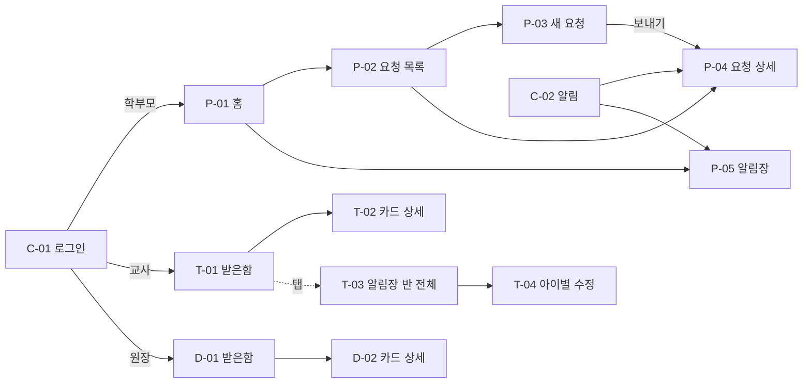

# 유치온 T12 MVP 화면 지도·명세

- WBS: T12 [MVP] MVP 화면 정리 (성주, 11/18–20). 결과물은 "MVP 화면 목록·보강안"이다.
- 이력:
  - 2026-11-17 초안 (탭 구성·로그인 방식은 성주가 확정)
  - 2026-11-18 디자인 반영: 학부모 홈 피드, 브랜드 색 상태 규칙, 로그인 로고 모션, PC 배치(2.9), 디자인 시스템 연결, 받은함 종류 필터(2.5)
- 근거:
  - 유치온_T04_흐름권한명세.md (상태, 필터, 위험 등급, 권한)
  - 기획서 1116 (FR, AC)
  - 시연 목업 진단 (학부모 19/40, 교사·원장 19/40)
- 이 문서를 쓰는 작업:
  - T10 입출력 계약: 화면별 필요 정보를 이 문서 5장에서 가져간다.
  - T13 API·모의 API
  - T21·T28·T32·T37·T53 화면 구현

> 표시 규칙:
> - **[확정]**: T04나 기획서에 이미 있는 내용
> - **[정함]**: 이 문서에서 화면 담당이 정한 내용
> - **[제안]**: 별도 반대가 없으면 따르는 내용
> - **[T10 확인]**: 11/18 계약 회의에서 필드 이름과 형식을 정할 내용
> - **[미정]**: T04 후속 확인 F1·F2의 결과를 기다리는 내용
>
> 와이어프레임은 정보 순서와 버튼 위치만 보여 준다. 색, 글꼴, 간격, 모서리, 움직임은 `유치온_디자인시스템.md`(11/18 기초 규칙 확정)를 따른다.

---

## 1. 화면 지도

### 1.1 역할별 하단 탭 [정함]

| 역할 | 하단 탭 (최종) | MVP에서 보이는 탭 | 탭에 넣지 않은 것 |
| --- | --- | --- | --- |
| 학부모 | 홈 · 요청 · 피드 · 우리 아이 | 홈 · 요청 | 알림은 상단 벨, 내 정보는 우리 아이 안, 새 요청은 요청 탭 안 버튼 |
| 교사 | 받은함 · 알림장 · 반 사진 · 내 정보 | 받은함 · 알림장 | 받은함 탭에 "확인 필요" 건수 배지, AI 기억과 알림 시간은 내 정보 안 |
| 원장 | 받은함 · 원 현황 · 자료 창고 | 받은함 | 받은함은 교사 받은함 부품을 그대로 쓴다 |

- MVP에서 탭이 하나뿐인 원장 화면은 하단 탭을 숨긴다. [제안]
- 숨긴 탭은 "준비 중"으로 보여 주지 않고 아예 뺀다. 시연 때 누를 수 없는 버튼을 남기지 않기 위해서다. [제안]

### 1.2 전체 화면 목록

| ID | 화면 | 역할 | 단계 | 관련 흐름 |
| --- | --- | --- | --- | --- |
| C-01 | 로그인 | 공통 | **MVP** | AC-06 |
| C-02 | 알림 목록 | 공통 | **MVP** | FR-12 |
| C-03 | 오류·빈 화면·권한 없음 | 공통 | **MVP** | AC-06 |
| P-01 | 홈 (오늘 알림장 피드 + 할 일 카드) | 학부모 | **MVP** | AC-01·02·04 |
| P-02 | 요청 목록 | 학부모 | **MVP** | AC-01·02·03 |
| P-03 | 새 요청 쓰기 → 보내기 전 확인 | 학부모 | **MVP** | AC-01·02·03 |
| P-04 | 요청 상세 (대화, 상담 시간 체크, '확인했어요') | 학부모 | **MVP** | AC-01·02·03 |
| P-05 | 알림장 보기 | 학부모 | **MVP** | AC-04 |
| P-06 | 피드 · 앨범 · 모임 | 학부모 | 최종 | — |
| P-07 | 우리 아이 · 내 정보 | 학부모 | 최종 | — |
| T-01 | 받은함 (필터 6개 + 카드 목록) | 교사 | **MVP** | AC-01·02·03·05 |
| T-02 | 카드 상세 (민원·상담·문의) | 교사 | **MVP** | AC-01·02·03·05 |
| T-03 | 알림장 반 전체 (아이별 상태, 한 번에 보내기) | 교사 | **MVP** | AC-04 |
| T-04 | 알림장 아이별 수정 | 교사 | **MVP** | AC-04 |
| T-05 | 반 사진 | 교사 | 최종 | — |
| T-06 | 내 정보 (AI 기억, 개인 규칙, 알림 시간) | 교사 | 최종 (규칙 제안 카드는 MVP의 T-02 안) | AC-02 |
| T-07 | AI에게 묻기 (헤더 버튼) | 교사 | 최종 | — |
| D-01 | 받은함 (원장 보고 카드 포함) | 원장 | **MVP** | AC-01 |
| D-02 | 카드 상세 (지시, 재배정, 다시 분류) | 원장 | **MVP** | AC-01 |
| D-03 | 원 현황 (대시보드, T53) | 원장 | 최종 | — |
| D-04 | 자료 창고 | 원장 | 최종 (MVP는 업로드 API만) | AC-03 |

MVP 화면은 C-01~03, P-01~05, T-01~04, D-01~02로 모두 14개다. 2장은 이 중 핵심 6묶음을 그린다.

### 1.3 이동 경로



- 알림을 누르면 해당 요청 상세나 알림장으로 바로 간다. 알림 목록은 "어디로 가는지"를 보여 주는 화면이다. [정함]
- 상세 화면에서 뒤로 가면 들어온 목록과 필터로 돌아간다. 필터는 주소에 남긴다. [제안]

### 1.4 주소 (라우트) [제안]

| 주소 | 화면 |
| --- | --- |
| `/login` | C-01 |
| `/notifications` | C-02 (역할 공통) |
| `/parent/home` | P-01 |
| `/parent/requests` | P-02 |
| `/parent/requests/new` | P-03 |
| `/parent/requests/:requestId` | P-04 |
| `/parent/notes/:date` | P-05 |
| `/teacher/inbox?filter=review&type=all` | T-01 (filter: `unassigned` · `review` · `judge` · `hold` · `progress` · `done` / type: `all` · `urgent` · `complaint` · `consult` · `inquiry`) |
| `/teacher/inbox/:cardId` | T-02 |
| `/teacher/notes` | T-03 (오늘 날짜) |
| `/teacher/notes/:childId` | T-04 |
| `/director/inbox?filter=review` | D-01 |
| `/director/inbox/:cardId` | D-02 |

- 역할이 다른 주소로 들어오면 C-03 "볼 수 없는 화면"을 보여 준다. 실제 차단은 서버가 한다. [확정: T04 7.1]
- 라우터 방식(주소에 `#`를 쓰는지)은 2단계 뼈대 작업에서 Capacitor와 nginx 설정을 보고 정한다.

---

## 2. 화면 명세와 와이어프레임

### 2.0 모든 화면에 공통인 것 [정함]

- **상태 표시:** T04 2장의 역할별 표시 이름만 쓴다. 학부모에게는 위험 등급을 보여 주지 않는다. [확정: T04 7.1]
- **AI 진행 표시:** 분류 → 근거 검색 → 초안 → 검사 4단계를 진행 막대로 보여 준다. 이것은 상태가 아니다. [확정: T04 1장]
- **AI가 쓴 글:** "AI 초안" 표시를 붙이고, 근거가 있으면 출처 칩(문서명·위치·적용일)을 붙인다. 근거 없이 단정하는 문장은 보여 주지 않는다.
- **되돌릴 수 없는 버튼:** 발송, 확정, 처리 완료, 반려는 아래 순서를 거친다. [정함]
  1. 버튼을 누르면 확인 시트가 열린다.
  2. 시트에서 받는 사람과 보낼 내용을 다시 보여 준다.
  3. 실행한 뒤 5초 동안 되돌리기 알림을 띄운다. 실제 발송은 5초 뒤에 한다.
- **두 번 누르기:** 처리 중에는 버튼을 잠근다. 서버도 요청 ID로 한 번만 처리한다. [확정: AC-05]
- **웹과 휴대폰은 같은 화면이다:** 같은 주소, 같은 데이터, 같은 부품을 쓰고 배치만 바뀐다. [정함]
- **화면 크기:** [정함]
  - 768px 미만(휴대폰, 기준 폭 360~430px): 한 칸. 목록을 누르면 상세로 넘어가고, 아래 탭바를 쓴다.
  - 768~1023px(태블릿): 두 칸(목록 + 상세). 왼쪽 메뉴는 접는다.
  - 1024px 이상(PC): 세 칸(왼쪽 메뉴 + 목록 + 상세). 학부모도 같다. 화면별 배치는 2.9를 본다.
- **상태 색과 종류 이름표:** 브랜드 색만 쓴다. [정함]
  - 상태: 긴급 = 네이비 채움, 할 일·확인 필요 = 블루, 답 왔음·일반 = 라벤더, 완료 = 민트, 기다림 = 회색. 빨강은 입력 오류에만 쓴다.
  - 상태는 색 글자로 쓴다. 긴급만 채운 배지로 쓴다(다크 모드에서는 밝은 칸 + 네이비 글자로 뒤집는다).
  - 종류(문의·상담·민원)는 색을 쓰지 않고, 목록 줄 왼쪽 아이콘 칸의 Lucide 아이콘으로 구분한다: 물음표 말풍선 · 사람들 · 확성기. 긴급 줄의 아이콘 칸만 네이비 채움 + 사이렌이다.
  - 자세한 값은 `유치온_디자인시스템.md`를 따른다.
- **되돌릴 수 없는 버튼의 위치:** 휴대폰은 화면 아래 고정 칸 안의 꽉 찬 블루 버튼 하나, PC는 상세 칸 아래 고정 칸의 오른쪽 버튼이다. [정함]
- **되돌리기 알림:** 탭바(또는 아래 버튼 칸) 바로 위에 흰 카드로 뜬다. 학부모는 말풍선 친구, 교사·원장은 '온' 심볼을 붙인다. [정함]
- **시트와 대화창:** 휴대폰은 아래에서 올라오는 시트, PC는 가운데 대화창이다. [정함]

---

### 2.1 C-01 로그인 [정함]

앱을 처음 열면 로고 모션 B(약 3.4초)가 한 번 나온다. 로고가 위로 올라가면서 아래에서 로그인 시트가 올라온다. PC는 왼쪽 반이 브랜드(블루 + 메인 로고), 오른쪽 반이 로그인 카드다. [정함]

```
│ [유치온 로고]                         ← 로고 모션이 끝난 자리
│ ─ 아래 시트 ─────────────────────
│ 아이디      [____________]
│ 비밀번호    [____________]
│ [ 로그인 ]
│ ─────────── 시연 계정 ───────────
│ [ 학부모로 ]  [ 선생님으로 ]  [ 원장으로 ]
│
│ 아이디나 비밀번호가 맞지 않아요.        ← 오류일 때만
```

- 시연 계정 버튼은 배포 설정으로 끈다. 예: `VITE_DEMO_ACCOUNTS=false` [제안, 이름은 2단계에서 확정]
- 로그인하면 역할에 맞는 첫 화면으로 간다. 1.3을 참고한다.
- 로그인 직후에는 글자 없이 역할 마크만 잠깐 보여 준다. 학부모는 말풍선 친구 `hello`, 교사·원장은 '온' 심볼 깜빡임이다. [정함]
- 움직임 줄이기 설정이 켜져 있으면 로고 모션을 건너뛰고 바로 로그인 화면을 보여 준다.
- 오류 문구는 아이디가 틀렸는지 비밀번호가 틀렸는지 구분하지 않는다.

---

### 2.2 P-01 홈 · P-02 요청 목록 (학부모)

**P-01 홈 (피드):** 맨 위에 오늘 알림장 카드를 크게 두고, 그 아래에 할 일 카드를 쌓는다. 목록이 아니라 카드 피드로 보여 준다. [정함]

```
│ [유치온 워드마크]                     [🔔 2]
│ 하은이의 오늘                          ← 큰 제목
│ ┌ 오늘 알림장 (큰 카드) ─────────────
│ │ [사진 3장]
│ │ 블록 놀이, 산책 · 점심 다 먹음
│ │ 하늘반 · 17:20              [열기 →]
│ └─────────────────────────────────
│ 할 일
│ ┌ [상담] 시간을 골라 주세요      11/18  [고르기]
│ ├ [민원] 답변 도착            [확인했어요]
│ └ [문의] 선생님 확인 중
│                         [요청 전체 보기 →]
│
│ [ 홈 ]  [ 요청 ]
```

- 알림장이 아직 없으면(오늘 보내기 전) 맨 위 카드는 "오늘 알림장은 저녁에 와요"로 바꾸고, 할 일 카드를 위로 올린다.
- 할 일 카드는 카드 안에서 바로 처리한다. 예: 상담 시간 고르기, [확인했어요].
- 알림장 카드는 "큰 사진 + 한 줄 요약"으로 임시 확정했다. 추후 더 다듬는다. (디자인 시스템 7.11)
- PC에서는 왼쪽 메뉴, 가운데 알림장 피드, 오른쪽 할 일로 나눈다.

**P-02 요청 목록**

```
│ 요청                                 [🔔]
│ [ + 새 요청 ]
│ (전체) (진행 중) (완료)
│ ┌ 민원 · 답변 도착                 11/17
│ │ "낮잠 시간 조정 요청드려요…"
│ ├ 상담 · 시간을 골라 주세요        11/16
│ ├ 문의 · 완료                       11/14
│ └ …
```

| 항목 | 내용 |
| --- | --- |
| 정렬 | "답이 필요해요"가 먼저, 나머지는 최근 순 [정함] |
| 목록 한 줄 | 종류 아이콘 칸, 첫 문장, 학부모용 상태 이름(색 글자), 날짜 |
| 빈 화면 | "아직 보낸 요청이 없어요" + [새 요청] |
| 오류 | "목록을 불러오지 못했어요" + [다시 시도] |
| 숨김 | 위험 등급, 담당 교사 이름 외 내부 정보 |

---

### 2.3 P-03 새 요청 쓰기 (학부모)

목업 진단 P0는 자유 입력이 없다는 것이었다. 이 화면은 **글을 먼저 쓰고, 유형은 고르지 않아도 되게** 한다. [정함]

```
│ ← 새 요청
│ 어떤 아이 일인가요?   (김하은 ▾)
│
│ 무엇을 도와드릴까요?
│ ┌─────────────────────────────────
│ │ (자유 입력)
│ └─────────────────────────────────
│ 종류 (선택):  (잘 모르겠어요✓) (문의) (상담) (민원)
│
│ 상담이면 ↓                            ← 상담을 고르거나 AI가 상담으로 볼 때
│ 방식 (대면) (전화)   선호 시간 (평일 오후 ▾)
│
│ [ 다음 ]
```

**보내기 전 확인 (같은 화면의 다음 단계)**

```
│ ← 보내기 전에 확인해 주세요
│ 아이: 김하은 (하늘반)
│ 내용: "낮잠 시간을 조금 줄여 주실 수 있을까요…"
│ 종류: 잘 모르겠어요 → 유치온이 분류해서 선생님께 전달해요
│
│ 보낸 뒤에는 담임 선생님이 확인한 다음 답이 가요.
│ [ 고치기 ]   [ 보내기 ]
```

| 항목 | 내용 |
| --- | --- |
| 필수 | 아이, 내용 (2자 이상). 상담은 방식과 선호 시간도 필요하다. 빠지면 서버가 `needs_info`로 되묻는다 [확정: T04 4.1] |
| MVP 종류 | 문의, 상담, 민원. 투약과 귀가는 최종 단계 [제안] |
| 보낸 뒤 | P-04로 가서 AI 진행 표시를 보여 준다 |
| 작성 중 이탈 | "작성 중인 내용이 사라져요" 확인 창을 띄운다. 쓰던 글은 기기에 임시 저장한다 [제안] |
| 오류 | 보내기에 실패해도 입력한 글은 그대로 둔다. "보내지 못했어요" + [다시 보내기] |

---

### 2.4 P-04 요청 상세 (학부모)

요청 하나의 대화와 상태를 보여 준다. 상태에 따라 아래쪽 행동 칸이 바뀐다.

```
│ ← 상담 요청                    선생님 확인 중
│ ●───◉───○───○                         ← 가로 점 단계 (디자인 시스템 7.12)
│ 접수 선생님 확인 답변 완료
│
│ [나] 11/16 14:02
│ "하은이 친구 관계 때문에 상담받고 싶어요"
│
│ [유치온] 11/16 14:03
│ 담임 선생님 빈 시간이에요. 가능한 시간을 모두 골라 주세요.
│
│ ┌ 행동 칸 (상태별) ───────────────────
│ │ ☐ 11/19(수) 15:00 대면
│ │ ☐ 11/20(목) 16:00 대면
│ │ ☐ 11/21(금) 10:00 전화
│ │ [ 다 안 돼요 · 다른 시간 필요 ]  [ 고른 시간 보내기 ]
│ └─────────────────────────────────
```

**상태별 행동 칸** [확정: T04 3.3·4.1 / 정함: 문구]

| 상태 | 행동 칸 |
| --- | --- |
| `needs_info` (빠진 정보) | 무엇이 빠졌는지 한 줄 + 입력 칸 + [보내기] |
| `needs_info` (상담 시간) | 후보 최대 3개 체크박스, 1~3개 고르면 [고른 시간 보내기]가 켜진다. [다른 시간 필요]도 둔다 |
| `received` ~ `escalated` | 행동 없음. "선생님 확인 중" + AI 진행 표시. `escalated`는 "원장님 확인 중" |
| `on_hold` | "확인이 늦어지고 있어요 · 11/20까지 답드릴게요". 보류 이유는 보여 주지 않는다 |
| `sent_or_booked` 민원, 확인 전 | 답변 본문 + 출처 칩 + [확인했어요] + [더 묻기] |
| `sent_or_booked` 민원, 확인 후 | "확인함 · 선생님이 마무리하고 있어요" |
| `sent_or_booked` 상담 | "예약 확정 · 11/19(수) 15:00 대면 · 상담실" |
| `completed` | "완료" + [이 요청으로 새로 묻기] (이전 요청 ID를 연결) |
| `rejected` | "처리할 수 없는 요청이에요" + 이유 |

- [더 묻기]는 같은 요청 ID에 이어 붙인다. [확정: T04 3.3 제안]
- 답변의 출처 칩을 누르면 문서명, 위치, 적용일이 시트로 열린다.

---

### 2.5 T-01 받은함 · D-01 원장 받은함

교사와 원장이 **같은 부품**을 쓴다. 원장에게는 원장 보고 카드와 반 표시가 더해진다. [정함]

```
│ 받은함 · 하늘반                 [🔔] [AI에게 묻기]  ← 최종 단계 버튼
│ 확인 필요 5 │ 판단 필요 1 │ 미배정 │ 보류 1 │ 진행 중 4 │ 완료   ← 상태 밑줄 탭
│ [전체 11 | 긴급 1 | 민원 4 | 상담 3 | 문의 3]                  ← 종류 분할 버튼
│
│ ┌ ■긴급(네이비 채움) · 민원 · 아이 안전   10분 전
│ │ "어제 하원 때 팔에 멍이 있었는데…"
│ │ 원장 보고 함께 생성 · AI 초안 없음
│ ├ 민원 · 반복 3번째 · 원장 보고          1시간 전
│ │ "낮잠 시간이 너무 길어요" · 검사 통과
│ ├ 민원 · 학부모가 확인했어요 · 처리 완료 대기
│ ├ 상담 · 학부모가 2개 체크함
│ └ 문의 · 같은 질문 3건 묶음 · 출처 2
```

| 항목 | 내용 |
| --- | --- |
| 필터 | 위: T04 2.2의 상태 6개(밑줄 탭). 한 카드는 상태 필터 하나에만 들어간다 [확정] |
| 종류 필터 | 아래: 전체 · 긴급 · 민원 · 상담 · 문의(분할 버튼). 상태 필터와 함께 걸린다. 예: 확인 필요 + 상담 [정함 11/18] |
| 필터 순서의 이유 | 누를 버튼이 있는지는 상태가, 어떤 버튼이 나오는지는 종류가 정한다. 그래서 상태가 위다. 확인 필요 안에서 상담만 거르면 "시간 확정" 버튼으로 몰아서 처리할 수 있다 |
| 기본 필터 | 확인 필요 + 전체 [정함] |
| 정렬 | 확인 필요 안에서는 긴급 → 원장 보고 → 처리 완료 대기 → 오래된 순 [확정: T04 2.2 / 제안: 나머지 순서] |
| 카드 한 줄 | 왼쪽 종류 아이콘 칸(긴급만 네이비 채움), 원문 첫 줄, 상태 글자, 핵심 표시(반복 횟수·검사 결과·학부모 체크 수), 경과 시간 |
| 원장 받은함 | 반 이름 표시가 더해진다. 필터 위에 "원장 보고 n건" 바로가기를 둔다. 종류 필터도 같다 [제안] |
| 미배정 필터 | 원장만 담당 지정을 할 수 있다. 교사에게는 읽기 전용이다 [확정: T04 7.2] |
| 빈 화면 | 필터별 문구. 예: 확인 필요가 0건이면 "지금 확인할 카드가 없어요" |
| 오류 | "카드를 불러오지 못했어요" + [다시 시도]. 마지막으로 불러온 시각을 표시한다 |

---

### 2.6 T-02 카드 상세 (교사) · D-02 (원장)

목업 진단 P0는 AI가 관찰하지 않은 사실을 지어냈다는 것이었다. 카드에서는 **원문, 근거, AI 초안을 눈으로 구분**한다. [정함]

**민원 카드 (일반)**

```
│ ← 민원 · 하늘반 김하은 어머니            확인 필요
│ 반복 3번째 (30일 · 같은 반 · 낮잠) · 원장 보고 생성됨
│ 검사: 통과 (근거 2건 대조)
│
│ ■ 학부모 원문
│ "낮잠 시간이 너무 길어서 밤에 잠을 안 자요…"
│
│ ■ AI 요약
│ 낮잠 시간 단축 요청. 같은 주제 3번째.
│
│ ■ 근거
│ [2026 운영 규정 · 4장 2항 · 2026.03.01]  [11월 가정통신문 · p.2 · 2026.11.01]
│
│ ■ AI 초안 (고칠 수 있음)
│ ┌────────────────────────────
│ │ 안녕하세요, 하은 어머니…
│ └────────────────────────────
│
│ [ 보류 ] [ 거절 ] [ 원장님께 올리기 ]   [ 승인하고 보내기 ]
```

**카드 종류와 상태별 아래 버튼** [확정: T04 3·4·5장, 7.2]

| 카드 | 보이는 정보 | 버튼 |
| --- | --- | --- |
| 민원 일반 | 원문, 요약, 반복 횟수, 근거, 검사 결과, AI 초안 | 승인하고 보내기, 거절(이유), 보류(이유·예정일), 원장님께 올리기 |
| 민원 긴급 | 원문, 긴급 사유 4가지 중 하나, "AI 초안 없음", 원장 보고 상태 | 직접 답 쓰기 → 승인하고 보내기, 보류, 거절 |
| 민원 판단 필요 | 원문, "AI 판단 불확실", 의심되는 항목 | **다시 분류: 일반 / 긴급** (이유 필수). 분류하면 확인 필요로 옮겨 간다 |
| 민원 학부모 확인 후 | 보낸 답, 학부모 확인 시각 | **처리 완료** |
| 민원 학부모 확인 전 | 보낸 답, "학부모 확인 기다리는 중" | [미정 F1] 이유를 남기고 처리 완료할 수 있게 할지 |
| 상담 | 주제, 방식, 학부모가 체크한 시간 1~3개 | 시간 하나 골라 **확정**, 거절(이유 칩: 연장반 당번, 전화로 충분, 기타) |
| 상담 규칙 제안 | "같은 이유 3번째: '연장반 당번' 시간 빼기" | 켜기, 끄기 (켜기 전에는 적용 안 함) |
| 문의 | 묶인 질문 수, 근거, AI 초안. 근거 없음·충돌·옛 판 경고 | 승인하고 보내기 (원에 남은 답으로 저장), 거절, 직접 답 쓰기 |
| 검사 실패 | "검사 실패 · 직접 확인 필요" + 실패 이유 | 직접 고쳐서 승인, 보류 |

**원장 D-02의 차이** [확정: T04 7.2, AC-01]

- 교사 카드의 진행 상태를 읽기 전용으로 보여 준다.
- 원장의 버튼은 **지시 남기기**(담임에게 보이는 메모), **재배정**(이유 필수), **다시 분류**(판단 필요)다.
- 민원 회신은 원장 화면에서 보내지 않는다. 담임 승인으로만 나간다.

**확인 시트 예시 (승인하고 보내기)**

```
│ 이 답을 보낼까요?
│ 받는 사람: 김하은 어머니
│ "안녕하세요, 하은 어머니…" (전체 보기)
│ 보낸 뒤에는 고칠 수 없어요.
│ [ 취소 ]  [ 보내기 ]
│ ── 보낸 뒤: 아래 흰 카드 "보냈어요 · 되돌리기 5" 알림
```

---

### 2.7 T-03 알림장 반 전체 · T-04 아이별 수정 (교사)

```
│ 알림장 · 11/17(월) 하늘반
│ 보낼 준비 18 · 확인 필요 2 · 초안 0
│
│ [ 오늘 활동 입력 ]  ← 반 공통 입력 (활동, 준비물)
│
│ (확인 필요 먼저 ▾)
│ ┌ ⚠ 김하은 · 확인 필요 · 투약 줄이 요청과 달라요
│ ├ ⚠ 이도윤 · 확인 필요 · 준비물 누락
│ ├ ✓ 박서준 · 보낼 준비
│ └ …
│
│ [ 한 번에 보내기 (확인 필요 2건 남음) ]   ← 잠김
```

**T-04 아이별 수정**

```
│ ← 김하은 알림장                       확인 필요
│ ⚠ 검사: 투약 줄 "해열제 5ml"가 투약 요청 원문 "4ml"과 달라요
│
│ 활동   [ 블록 놀이, 산책 …        ]
│ 식사   [ 점심 다 먹음 ]   ← 식단 자료에서 가져옴 [출처]
│ 투약   [ 해열제 4ml 13:00 ]  ← 요청 원문 그대로, AI가 값을 추측하지 않음
│ 귀가   [ 16:30 할머니 ]   ← 귀가 요청에서 가져옴
│
│ [ 확인했어요 ]
```

| 항목 | 내용 |
| --- | --- |
| 잠김 | 반 전체에서 `note_needs_check`가 하나라도 있으면 [한 번에 보내기]를 잠그고, 남은 건수를 버튼에 쓴다 [확정: T04 6.2] |
| 개별 발송 | MVP에는 없다 [확정: 합의 6] |
| 투약·귀가 줄 | 요청 상태와 같아야 한다. 값은 원문을 그대로 옮긴다 [확정: T04 6.2] |
| 보낸 뒤 | 상태를 "보냄"으로 바꾸고 수정은 잠근다. 학부모 P-05에 보인다 |
| 빈 화면 | 초안 생성 전이면 "오늘 알림장 초안은 16:00에 만들어져요" [제안: 시각은 T10 확인] |

---

### 2.8 C-02 알림 목록 · C-03 공통 상태 화면

- **C-02:** T04 9장의 표를 그대로 쓴다. 한 줄은 "무슨 일 · 어느 요청 · 시각"이고, 누르면 해당 화면으로 간다. 읽은 알림은 흐리게 표시한다.
- **C-03:** 모든 화면은 아래 네 가지 상태를 가진다. 3단계 공통 부품(EmptyState, ErrorState)으로 만든다.

| 상태 | 문구 형식 |
| --- | --- |
| 불러오는 중 | 뼈대 모양 회색 칸. 빙글 도는 표시만 두지 않는다 |
| 비어 있음 | 무엇이 없는지 + 할 수 있는 행동 하나 |
| 오류 | 무엇이 안 됐는지 + [다시 시도]. 입력한 내용은 지우지 않는다 |
| 권한 없음 | "이 화면은 볼 수 없어요" + [내 첫 화면으로] |

**상태 화면의 브랜드 사용 [정함]**

이 규칙은 `유치온_에셋_최종/01_브랜드에셋/README.md`의 "표정 = 서비스 상태" 원칙을 따른다.

| 역할 | 쓰는 것 | 상태별 |
| --- | --- | --- |
| 학부모 | 말풍선 친구 캐릭터 (한 화면에 한 번, 화면 폭 1/3 이하, 32px 이하는 평면판) | 불러오는 중 `processing`(통통 튀기 + 점) · 비어 있음 `guide`(둥실 + 더하기 배지) · 오류 `sorry`(흔들림 + 다시 시도 배지) · 권한 없음 `check`(기울임 + 자물쇠 배지) · 보내기 완료 `done` · 보류·지연 `waiting` · 로그인 직후 `hello` |
| 교사·원장 | '온' 심볼. 캐릭터는 쓰지 않는다 | 불러오는 중 눈동자 훑기 · 비어 있음 깜빡임 + 민트 체크 · 오류 흔들림 + 다시 시도 · 권한 없음 눈 감기 + 네이비 자물쇠 |
| 공통 | 로그인 맨 위는 메인 로고, 학부모 홈 상단은 워드마크. 배지 색은 브랜드 색만 쓴다 | — |

- 토스트도 같은 마크 규칙을 따른다: 학부모는 말풍선 친구, 교사·원장은 '온' 심볼.
- 움직임 줄이기 설정이 켜져 있으면 마크는 움직이지 않고 배지만 보여 준다.
- PC에서는 상태 화면이 전체 화면이 아니라 해당 칸 안에만 나온다. 예를 들어 상세를 못 불러오면 상세 칸에만 나오고 목록은 그대로 쓸 수 있다.

---

### 2.9 PC 배치 (1024px 이상) [정함]

휴대폰과 같은 주소·같은 부품이고, 넓은 화면에서 칸만 나눈다.

| 화면 | PC 배치 | 휴대폰에서는 |
| --- | --- | --- |
| C-01 로그인 | 왼쪽 반 브랜드(블루 + 메인 로고) · 오른쪽 반 로그인 카드 | 로고가 위, 로그인 시트가 아래 |
| C-02 알림 | 왼쪽 메뉴의 "알림"을 누르면 메뉴 옆에 창이 열린다 | 화면 하나 |
| C-03 상태 화면 | 해당 칸 안에만 표시 | 화면 전체 |
| P-01 홈 | 왼쪽 메뉴 · 가운데 알림장 피드 · 오른쪽 할 일 | 같은 카드가 위아래로 |
| P-02 요청 목록 | 왼쪽 메뉴 · 가운데 목록 · 오른쪽 고른 요청 상세 | 목록 → 누르면 상세 |
| P-03 새 요청 | 가운데 대화창 (뒤의 목록은 어둡게 남음) | 아래 시트 |
| P-04 요청 상세 | 대화는 680px 폭 안, 상태별 행동 칸은 아래 고정 | 같음 |
| P-05 알림장 | 가운데 날짜 목록 · 오른쪽 그날 알림장 | 그날 알림장 하나 |
| T-01·T-02 | 왼쪽 메뉴 · 가운데 받은함(상태 탭 + 종류 분할 버튼) · 오른쪽 카드 상세 | 목록 → 누르면 카드 상세 |
| T-03·T-04 | 가운데 반 전체(확인 필요 먼저) · 오른쪽 아이별 수정 · 아래 "한 번에 보내기"와 잠긴 이유 | 반 전체 → 누르면 아이별 수정 |
| D-01·D-02 | 교사 받은함과 같은 세 칸 + 줄마다 반 이름, 맨 위 "원장 보고 n건" | 목록 → 누르면 카드 상세 |

---

## 3. AC 흐름 점검 (화면 기준)

| AC | 화면 순서 | 화면에서 확인할 점 |
| --- | --- | --- |
| AC-01 민원 | P-03 보내기 → P-04 "선생님 확인 중" → T-01 확인 필요(반복 3번째 · 원장 보고) → D-01 원장 보고 → D-02 지시 → T-02 승인하고 보내기 → P-04 [확인했어요] → T-01 처리 완료 대기 → T-02 처리 완료 → P-04 완료 | 담임 승인 전에는 P-04에 답이 보이지 않는다. 원장 화면에는 보내기 버튼이 없다 |
| AC-02 상담 | P-03 상담 → P-04 시간 체크 → T-02 거절(연장반 당번) → P-04 새 후보 체크 → T-02 확정 → P-04 예약 확정 → (3번째 같은 이유) T-02 규칙 제안 | 확정 전에는 "예약"이라는 말을 쓰지 않는다. 동시 확정에 실패하면 "방금 다른 예약이 들어왔어요 · 후보를 다시 만들어요" |
| AC-03 문의 | P-03 문의 → (원에 남은 답) P-04 바로 답 + 출처 / (새 질문) T-02 승인 → P-04 답 | 근거가 없으면 T-02에 "근거 없음"이 보이고 AI 초안이 없다 |
| AC-04 알림장 | T-03 확인 필요 2건 · 버튼 잠김 → T-04 고침 → T-03 버튼 켜짐 → 한 번에 보내기 → P-05 | 잠긴 이유가 버튼 위에 쓰여 있다 |
| AC-05 중복 | T-02 승인하고 보내기를 두 번 누름 | 버튼 잠김과 서버 처리 한 번. 두 번째 누름에는 "이미 보냈어요"를 띄운다 |
| AC-06 권한 | 다른 반 카드 주소로 직접 들어감 | C-03 권한 없음 |

---

## 4. 미정과 다음 할 일

| 항목 | 화면 영향 | 정할 곳 |
| --- | --- | --- |
| F1 학부모 미확인 완료 | T-02 "민원 학부모 확인 전" 칸의 버튼 | T04 10.1 (지혜·성주) |
| F2 퇴근 뒤 알림 | C-02 알림 시점, 교사 내 정보 알림 시간 | T04 10.1 (지혜·인혜) |
| 필드 이름과 형식 | 5장의 모든 항목 | T10 (11/18, 태웅) |
| 알림장 초안 생성 시각 | T-03 빈 화면 문구 | T10 |
| 화면 보기 방향 (색·글꼴) | 모든 화면 | **정함 (11/18):** `유치온_디자인시스템.md` 기초 규칙. 부품 정의는 화면별로 이어서 채운다 |

---

## 5. T10에 가져갈 화면 필요 정보 [T10 확인]

이름은 임시다. 계약 회의에서 정한 이름으로 바꾼다.

| 화면 | 필요한 정보 |
| --- | --- |
| 공통 | 사용자 역할, 기관 ID, 반 ID, 표시 이름. 요청 `status`(T04 2장 코드). 상태 변경 시각 |
| P-01·P-02 | 요청 목록: 요청 ID, 유형, 상태, 첫 문장, 생성 시각, 학부모가 할 일이 있는지 |
| P-04 | 대화 메시지(보낸 쪽: 학부모·유치온·선생님, 본문, 시각), 상담 후보(시각·방식·장소, 최대 3), 보류 예정일, 반려 이유, 답변 출처(문서명·위치·적용일), `parent_confirmed_at` |
| P-04 진행 표시 | AI 처리 단계(분류·근거 검색·초안·검사)의 현재 단계. SSE로 받는다 |
| T-01·D-01 | 카드 ID, 요청 ID, 유형, 상태, 받은함 필터 이름(서버가 계산할지 화면이 계산할지도 정할 것), 위험 등급(`일반`·`긴급`·`판단 필요`), 긴급 사유, 반복 횟수, 원장 보고 여부, 검사 결과, 학부모 체크 수, 묶인 질문 수, 반 이름(원장), 필터별 건수 |
| T-02·D-02 | 원문, AI 요약, AI 초안, 근거 목록, 검사 결과와 실패 이유, 옛 판 경고, 학부모 체크 시간, 거절 이유 목록, 규칙 제안, 원장 지시 메모, 처리 이력 |
| T-03·T-04 | 날짜별 아이 목록, 알림장 상태(`note_*`), 확인 필요 항목과 이유, 항목별 값과 출처(식단·요청 원문) |
| 행동 API | 승인·거절·보류·처리 완료·다시 분류·확정·지시·재배정·알림장 일괄 발송. 모두 요청 ID 기반으로 한 번만 처리하는 키를 받는다 (AC-05) |
