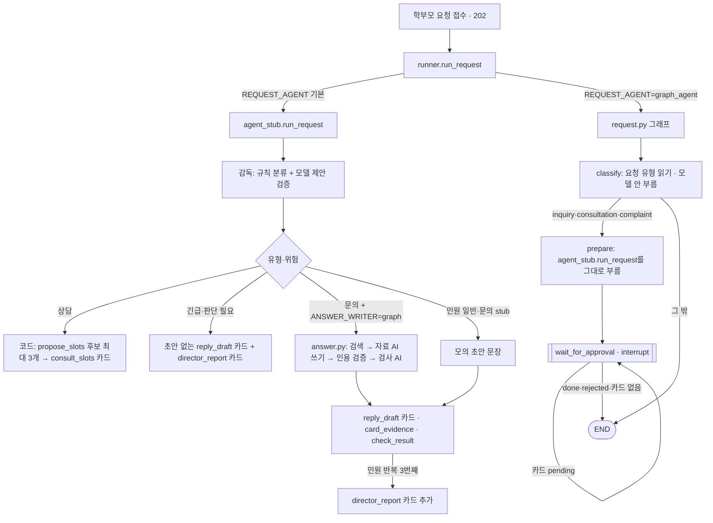
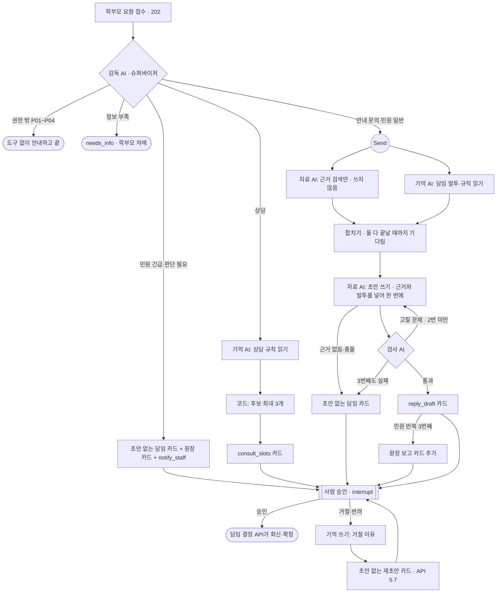
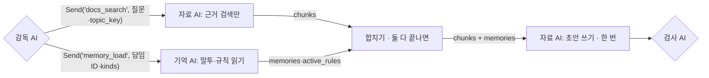
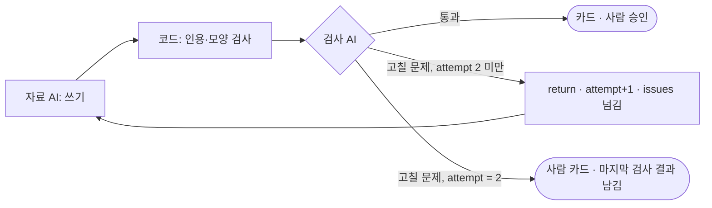
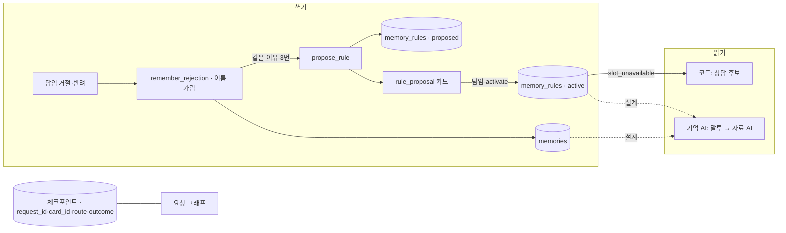

# 멀티 에이전트 협업 아키텍처 설계서 (T47)

| 항목 | 내용 |
| --- | --- |
| 작업 | T47 멀티 에이전트 협업 아키텍처 설계서 · STEP 4 제출물 |
| 작성 | 영민 · v0.6 초안 · 2026-11-24 · 검토 지혜 |
| 선행 | T40(중간 발표). 일정보다 먼저 쓴 초안이라 T43(다섯 에이전트로 나누기) 구현 뒤 다시 맞춰요 |
| 완료 기준(WBS) | 다섯 에이전트의 인계·병렬(Send)·돌려보내기·사람 승인·기억 흐름이 그림과 표로 정리됨 |
| 기준 문서 | [기획서](../Step1/기획서.md) 6장·FR-03~FR-08·NFR-03 · [T14 에이전트 명세](../Step2/T14_에이전트_명세.md) v0.2 · [T25 단일 에이전트 설계서](./T25_단일에이전트_상태전이_설계서.md) v0.3 · [알림장 에이전트 흐름](../Step2/알림장_에이전트_흐름.md) · [API 설계 문서](../Step2/API_설계_문서.md) 5.3·5.7·6장 |
| 코드 기준 | `develop` 0f43463(#303 T52, #305 T29 후속 머지 포함). 알려진 한계는 11장에 적었어요 |

> **표시 규칙.** 이 문서의 모든 표는 두 가지를 나눠 적어요.
> - **구현됨** — `develop` 코드에서 직접 확인한 것. 파일 이름을 함께 적어요.
> - **설계(T43)** — 다섯 에이전트로 나눌 때 만들 계획. 아직 코드에 없어요.
>
> 숫자(한도·횟수·시간)는 코드에 있는 값만 적었어요. 코드에 없으면 **미정**, 문서에만 있으면 "문서값, 코드 없음"이라고 적었어요.

---

## 1. 목적과 범위

| 항목 | 내용 |
| --- | --- |
| 목적 | STEP 3의 단일 요청 처리 에이전트(T29)와 알림장 그래프(T25)를, 판단이 필요한 다섯 자리로 나눴을 때 **누가 누구에게 무엇을 넘기고, 어디서 동시에 돌고, 어디서 되돌아가고, 어디서 사람을 기다리고, 무엇을 기억하는지**를 정한다 |
| 다섯 에이전트 | 기획서 6장 표의 다섯 자리(기획서 D30): **감독 AI**(슈퍼바이저) · **자료 AI**(근거 답변 + 알림장 초안 쓰기) · **기억 AI** · **검사 AI** · **사진 AI**(선택 기능, T50) |
| 에이전트 아님 | 코드: 상담 빈 시간 계산·예약 저장·충돌 검사·알림·중복 방지(기획서 6장 마지막 줄) |
| 하지 않는 일 | 학부모에게 보내기·상담 확정·완료 처리(사람만, NFR-03), 법률 판단(FR-07), 담임 승인 없는 규칙 적용(FR-06) |
| 다루는 흐름 | 안내 문의, 민원(일반·긴급·판단 필요), 상담, 알림장 초안. 사진 AI는 T50이 착수되면(D24) 붙이고, 이 판에서는 자리만 둬요 |

알림장 초안을 쓰는 에이전트는 따로 두지 않아요. T14 7장 1에서 **자료 AI가 쓰고 검사 AI가 대조**하기로 정했어요.

## 2. 지금 구조(STEP 3)와 나눌 구조(T43)

### 2.1 지금 `develop`에서 실제로 도는 길 (구현됨)

요청 처리는 설정값으로 길이 갈려요. 기본값은 모두 **대역(stub)** 이고, 그래프는 설정을 켤 때만 써요.

| 설정 | 기본값 | 켜면 | 코드 |
| --- | --- | --- | --- |
| `REQUEST_AGENT` | `app.modules.requests.agent_stub:run_request` | `app.modules.requests.graph_agent:run_request` → LangGraph 그래프 + 체크포인트 + `interrupt` | `apps/api/app/core/config.py`, `compose.yaml` |
| `ANSWER_WRITER` | `stub` (모의 초안 문장) | `graph` → 문의 답변을 자료 AI·검사 AI가 씀 | `apps/api/app/modules/documents/answer.py` `graph_enabled()` |
| `LLM_MODEL_SUPERVISOR` | 비어 있음 → 감독 모델을 부르지 않고 규칙 분류만 | 값이 있으면 모델이 분류를 **제안**하고 코드가 검증 | `apps/api/app/modules/requests/supervisor.py` |
| `DAILY_NOTE_WRITER` | `app.modules.daily_notes.stub_writer:write` | `graph` → 알림장 그래프 | `apps/api/app/modules/daily_notes/runner.py` |

- 그래프의 `classify`는 모델을 부르지 않고 `requests.type`(학부모가 화면에서 고른 유형)만 읽어요. 실제 분류·초안·검사는 `prepare` 안에서 부르는 `agent_stub.run_request`가 해요(`apps/api/app/modules/requests/graph_agent.py` `_prepare_card`).
- 그래서 지금은 **에이전트 사이 인계가 함수 호출 순서**예요. 에이전트별 상태(State)·노드·Send는 없어요.
- 알림장은 별도 그래프(`agents/graphs/daily_note.py`, T25)이고 아이마다 스레드로 동시에 돌아요(5.3).

### 2.2 T43에서 나눌 구조 (설계)

| 지금(STEP 3) | 나눈 뒤(T43) | 바뀌는 점 |
| --- | --- | --- |
| `request.py` 노드 4종(`classify`·유형별 `prepare`·`wait_for_approval`) | 감독 슈퍼바이저 노드 + 자료·기억·검사 노드 + 코드 노드 + 승인 대기 노드 | 인계가 함수 호출 순서에서 **그래프 간선**으로 바뀜 |
| `agent_stub.run_request` 한 함수가 분류·카드·초안·검사를 한 트랜잭션에서 | 노드마다 한 가지 일. DB 쓰기는 노드 안 짧은 트랜잭션 | 모델 호출은 이미 요청 행 잠금 밖에서 돎(#317, 11장). 노드로 나눠도 이 규칙을 지킴 |
| 자료 검색과 기억 읽기가 없음(기억은 상담 규칙만 코드가 읽음) | 감독이 `Send`로 자료 검색·기억 읽기를 **동시에** 보냄 | 5장 |
| 자료 AI ↔ 검사 AI 반복이 `answer.py` 안 `for` 문 | 검사 노드 → 조건 간선 → 자료 노드(최대 2번) | 6장 |
| 프롬프트: 감독은 코드 안 짧은 문장, 자료·검사는 `documents.md`·`checker.md` 일부 | 역할마다 `common.md` + 자기 파일(`agents/prompts/README.md` '쓰는 법') | 감독·기억 프롬프트를 실제로 읽게 됨 |
| 도구 허용 목록 검사 없음 | 에이전트별 허용 목록(T14 6.4, API 5.3 ①). 밖이면 `FORBIDDEN_SCOPE` | 3장 '권한 밖' 열 |

## 3. 에이전트별 명세

입력·출력·도구·넘기는 기준은 [T14 명세](../Step2/T14_에이전트_명세.md) 3장을 따르고 새로 정하지 않아요. 아래 표는 그 위에 **권한 밖 거절**과 **실패 시 행동**, **지금 구현 상태**를 붙인 거예요.

### 3.1 감독 AI (슈퍼바이저)

| 항목 | 설계(T14 3.1·6.4 인용) | 구현됨 (`develop`) |
| --- | --- | --- |
| 입력 | 요청 원문·화면 유형·`child_id`·이전 요청·대화. 기관·반·학부모 ID는 백엔드가 채움 | `classify_request(request_type, body)`: 유형과 원문만 모델에 줌 (`supervisor.py`) |
| 출력 | `type`·`urgency`·`topic_key`·`assignee_role`·`missing_fields[]`·`handoff_reason?`, 민원이면 `risk_level`·`risk_category?`·`risk_confidence`·`repeat_count`, 다음 단계 | `topic_key`·`urgency`·`risk_level`·`risk_category`만. 규칙 분류(`request_rules.classify`)가 기준이고 모델은 **올리기만** 가능(긴급을 일반으로 못 내림, 범주 없는 긴급은 판단 필요로) |
| 도구 | `route_request`·`create_card`·`notify_staff`·`request_consultation`·`get_my_requests`·`get_daily_note`·`find_saved_answer` | Function Calling 없음. 분류 저장·카드 만들기는 `agent_stub`의 SQL이 직접 함 |
| 권한 밖 거절 | P01~P04(다른 가정 요청, 옆 반 상담, 남의 전화번호, 원비 결제)는 도구를 부르지 않고 안내(T14 4장, `supervisor.md` 1절) | 프롬프트·평가 문항에만 있음. 실행 코드는 `supervisor.md`를 읽지 않음 |
| 사람에게 넘김 | 정보 부족 → `needs_info` · 모호 → 담임 카드 · 긴급·판단 필요 → 초안 없이 담임·원장 카드 + 알림 · 같은 반·30일·같은 주제 3번째 → 원장 보고 | 긴급·판단 필요 → 초안 없는 `reply_draft` + `director_report`. 반복 3번째(`complaints.repeat_count` ≥ 3) → `director_report`. `agent_stub`에서 `needs_info`는 상담 후보를 고를 때만 |
| 실패 시 | `route_request` 실패 → 미배정 사람 카드(T14 6.2) | 모델 오류(`ModelError`)면 빈 제안 → 규칙 분류만 씀. 처리 전체 예외 → `runner`가 `ai_failed`로 초안 없는 카드 |
| 모델 | `LLM_MODEL_SUPERVISOR` | 같음. 값이 비면 모델을 아예 부르지 않음 |

### 3.2 자료 AI

| 항목 | 설계(T14 3.2·6.4 인용) | 구현됨 (`develop`) |
| --- | --- | --- |
| 입력 | 질문·감독 분류·기억 AI의 담임 말투(`memories[]`)·검사 AI가 돌려보낸 `issues[]` | 문의: `question`·검색 조각 `chunks`(최대 8개)·`review_issues` (`agents/graphs/answer.py`). 말투 입력 없음 / 알림장: T25 3칸 입력 |
| 출력 | `text`·`evidence[] {chunk_id, quote}`·`no_evidence`·`conflict` | 같음. 인용은 코드가 조각 원문과 대조해 없는 인용을 버림(`_verify`) |
| 도구 | `search_documents`·`get_law_article`·`create_card` | `search_documents`는 코드가 `notice`·`schedule`·`menu`·`policy` 네 종류로 먼저 불러 모델에 줌. 법령은 민원 조건이 맞을 때 코드가 카드에 붙임(T52, `public_sources.attach_law_evidence`). 모델이 도구를 고르지 않음 |
| 권한 밖 거절 | 반 범위는 백엔드가 정함, 허용 목록 밖 도구는 `FORBIDDEN_SCOPE` | 검색이 로그인한 학부모의 기관·아이 반 범위로만 돎(`answer_for_request`의 `classroom_id`) |
| 사람에게 넘김 | 근거 없음·문서 충돌 → 추측하지 않고 담임 카드 | `no_evidence`·`conflict`면 카드 초안 문장을 비우고(`agent_stub`의 `draft["text"] = ""`), `check_result.issues`에 사유("자료에서 근거를 찾지 못했어요."·"자료끼리 내용이 달라요.")를 넣음. 본문 없이 승인하면 409라 담임이 `edit_approve`로 직접 써야 보냄 |
| 실패 시 | `search_documents` 실패 → `no_evidence`로 담임 카드 · `get_law_article` 실패 → '법령 확인 못 함' 표시 | 검색 오류는 종류마다 1번 다시, 또 실패면 초안 없는 카드. 법령 못 가져오면 카드 `draft.law_unchecked = true`. 답 모양 오류는 1번 더 물음 |
| 알림장 | 자료 AI가 아이마다 씀, 도구 없음 | 구현됨(T25). 반 공통 줄은 코드가 만듦 |

### 3.3 기억 AI

| 항목 | 설계(T14 3.3·6.4 인용) | 구현됨 (`develop`) |
| --- | --- | --- |
| 입력 | 담임 ID·필요한 기억 종류·거절 이유(`reason_code`) | 모델 없음. 담임이 카드를 거절(`reject`)·반려(`dismiss`)하면 카드 API가 `remember_rejection`을 부름 (`apps/api/app/modules/memories/memories.py`) |
| 출력 | `memories[]`·`active_rules[]` → 자료 AI(말투)·코드(상담 규칙) | 상담 후보 계산이 켜진 `slot_unavailable` 규칙만 읽음(`consultations/slots.py` `propose_slots`). 자료 AI로 넘기는 말투는 없음 |
| 도구 | `get_memory`·`propose_rule` | `propose_rule`은 파이썬 함수로 있음(같은 사람·같은 이유 3번이면 `memory_rules` + `rule_proposal` 카드). `get_memory`는 없음 |
| 권한 밖 거절 | 민감·일회성 정보 저장 안 함, 승인 없는 규칙 적용 안 함 | 교사 거절만 저장. 저장 전에 반 아이 이름을 가림(`mask_child_names`). `other` 자유 글은 규칙으로 만들지 않음. 규칙은 담임 `activate` 뒤에만 `active`(API 3.17) |
| 사람에게 넘김 | 규칙 제안 → `rule_proposal` 카드 | 같음 |
| 실패 시 | `get_memory` 실패 → 기억 없이 진행 · `propose_rule` 실패 → 이번엔 제안 안 함 | `propose_rule` 실패 → 1번 다시, 그래도 실패면 `tool_failed` 이력 남기고 거절 처리는 계속 |
| 모델 | `LLM_MODEL_MEMORY` | 부르는 곳 없음. `memory.md` 프롬프트도 실행 코드가 읽지 않음 |

### 3.4 검사 AI

| 항목 | 설계(T14 3.4·6.4 인용) | 구현됨 (`develop`) |
| --- | --- | --- |
| 입력 | 카드(초안·근거) 또는 알림장 | 문의: `question`·`draft`·`evidence`·`chunks`·`attempt` (`answer._review`) / 알림장: T25 3칸 |
| 출력 | `passed`·`issues[] {field, problem}`·`attempt` | 같음. `field`는 출처·날짜·대상·누락·민감정보 다섯 값 밖이면 답 전체를 버리고 다시 물음 |
| 도구 | `check_draft`·`return_to_step` | 도구 없음. 돌려보내기는 `for` 문 반복 |
| 권한 밖 거절 | 초안을 직접 고치지 않음(NFR-03) | 검사 답에 고친 문장 칸이 없음. 쓰는 모델(`DOCUMENT`)과 검사 모델(`CHECKER`)·프롬프트가 다름 |
| 사람에게 넘김 | 2번 돌려보내도 실패(3번째) → 사람 카드 | 문의: 3번째 검사도 실패면 초안 없는 카드 + 마지막 `check_result`. 알림장: `end:handoff`(T25 9칸) |
| 실패 시 | `check_draft` 실패 → 검사 없이 내보내지 않음, '검사 못 함' 표시 | 문의: 검사 호출·모양 오류 합쳐 2번 시도, 둘 다 실패면 초안 없는 카드(`passed: false`). 알림장: `check_failed` 확인 항목 |

### 3.5 사진 AI (선택, T50)

| 항목 | 설계(기획서 6장) | 구현됨 |
| --- | --- | --- |
| 하는 일 | 흐린 사진 빼기, 아이별 분류(가상 사진) | 없음(`agents/photos/README.md`만 있음) |
| 도구 | `classify_photos`·`match_faces` | 없음 |
| 사람에게 넘김 | 낮은 신뢰도는 교사 확인, 사진 공개는 사람 승인(NFR-03) | — |
| 협업 위치 | 알림장 흐름에서 자료 AI와 **따로** 돌고(Send 후보), 결과는 담임 확인 화면으로 감. T50 착수 여부(12/9, D24)에 따라 붙임 | — |

### 3.6 코드(에이전트 아님)

| 일 | 구현됨 | 비고 |
| --- | --- | --- |
| 상담 후보 | `propose_slots`: 내일부터 14일 안 빠른 후보 최대 3개, 켜진 `slot_unavailable` 규칙 반영 | T14 3.5. 에이전트가 부르지 않고 `agent_stub`이 부름 |
| 예약 확정 | `book_slot`은 담임 확정 API에서만 | 에이전트는 어느 단계에서도 부르지 않음(T14 6.4) |
| 민원 반복 수 | 같은 기관·반·주제, 최근 30일(`complaints.repeat_count`) | `other`는 세지 않음 |
| 카드 없는 요청 점검 | 5분마다(`worker.py` 300초) → 5분 넘게 카드 없으면 1번 다시 넣고, 또 5분 지나면 `card_missing` 미배정 카드 | API 6.3 |

## 4. 인계 흐름 (설계, T43)

### 4.1 인계 흐름도

### 4.2 인계 표

| # | 누가 → 누구 | 넘기는 값(State) | 조건 | 상태 |
| :---: | --- | --- | --- | --- |
| 1 | 접수 → 감독 | `request_id` | 요청이 202로 저장된 뒤 | 구현됨(`runner.run_request`) |
| 2 | 감독 → 끝 | 안내 문장 | 권한 밖 P01~P04 | 설계(프롬프트·평가에만 있음) |
| 3 | 감독 → 사람 | 초안 없는 카드 2장 | `risk_level` = `urgent`·`uncertain` | 구현됨(`agent_stub`), `notify_staff`는 설계 |
| 4 | 감독 → 기억 → 코드 | `teacher_id`, 켜진 규칙 | 상담 | 구현됨(코드가 규칙을 직접 읽음). 기억 AI 노드는 설계 |
| 5 | 감독 → 자료 검색·기억 읽기(Send) | 질문, `topic_key`, 담임 ID | 안내 문의·민원 일반 | 설계(5장, 12장 결정 1) |
| 6 | 자료 → 검사 | 초안·근거·조각·`attempt` | 근거가 있고 충돌이 없을 때 | 구현됨(`answer.py`, 문의만) |
| 7 | 검사 → 자료 | `issues[]` | 고칠 문제 있고 2번 미만 | 구현됨(`answer.py`·`daily_note.py`) |
| 8 | 검사·자료 → 사람 | 초안 없는 카드 + `check_result.issues` | 근거 없음·충돌·3번째 실패·모델 실패 | 구현됨(`answer.py`가 `no_evidence`로 돌려주면 `agent_stub`이 초안 문장을 비움) |
| 9 | 카드 → 사람 승인 | `card_id` | 카드가 생기면 | 구현됨(`REQUEST_AGENT=graph_agent`일 때만 `interrupt`) |
| 10 | 사람 → 기억 | `reason_code`·`reason_text` | 담임 거절·반려 | 구현됨(`remember_rejection`) |
| 11 | 거절 → 다시 초안 | 새 카드 | 담임 거절 | 구현됨: 초안 문장·검사 결과가 없는 재초안 카드(`cards.py`, API 5.7, #317). 일반 승인은 409로 막히고 담임이 직접 쓴 글(`edit_approve`)만 나감(12장 4번). AI가 다시 쓰는 것은 설계 |

## 5. Send 병렬 구간 (설계, T43)

**결정(2026-11-23, 영민, 12장 1번 1안):** 동시에 도는 것은 자료 AI의 **근거 검색**과 기억 AI의 **읽기** 두 가지뿐이에요. 초안 쓰기는 둘 다 끝난 뒤 근거와 말투를 함께 넣어 **한 번에** 써요. 자료 AI가 말투를 받아 쓴다는 T14 3.2 입력과 순서가 맞아요.

| 항목 | 내용 | 상태 |
| --- | --- | --- |
| 동시에 도는 것 | 자료 검색(도구, DB·벡터 검색)과 기억 읽기(DB) 두 가지만. 둘 다 모델로 글을 쓰지 않음 | 설계(결정됨) |
| 동시에 돌지 않는 것 | 초안 쓰기·검사·돌려보내기. 돌려보내기로 다시 쓸 때도 검색·기억은 다시 하지 않고 합쳐 둔 값을 씀 | 설계(결정됨) |
| 합치는 방법 | State에 `chunks`·`memories` 칸을 따로 두고, 둘 다 채워지면 쓰기 노드로. 쓰기는 이 둘을 함께 받아 말투를 넣은 초안을 한 번에 씀 | 설계 |
| 한쪽이 실패하면 | 기억 실패 → 기억 없이 진행(T14 6.2). 검색 실패 → `no_evidence`로 담임 카드(T14 6.2) | 설계(규칙은 T14) |
| 병렬 시간 한도 | 미정. 도구 1번 30초는 문서값(API 6.1), 코드에서 강제하는 곳 없음 | 미정 |
| 지금 구현된 병렬 | 알림장의 **아이별** 동시 처리: `ThreadPoolExecutor`, 동시 5명(`NOTE_DRAFT_CONCURRENCY`). LangGraph `Send`가 아님 | 구현됨(`daily_note.py`) |
| 알림장에 Send를 쓸 곳 | 아이마다 `Send('draft_child', child)`로 바꾸는 후보, 사진 AI(선택)와 초안 쓰기의 동시 실행 후보 | 설계 후보(12장 결정 2) |

`Send`는 코드 어디에도 아직 없어요(`grep "Send"` 결과 없음).

## 6. 돌려보내기 루프

| 흐름 | 상한 | 돌려보내는 문제 | 돌려보내지 않는 문제 | 상태 |
| --- | --- | --- | --- | --- |
| 문의 답변 | 다시 쓰기 최대 2번(`MAX_REWRITES = 2`, `agents/graphs/answer.py`) → 쓰기 최대 3번 | 검사 `issues`(출처·날짜·대상·누락·민감정보) | 근거 없음·충돌은 검사 전에 바로 사람 카드 | 구현됨 |
| 알림장 | 돌려보내기 최대 2번(`MAX_RETURNS = 2`, `agents/graphs/daily_note.py`) | `not_in_memo`·`request_missed` | `sensitive`·`other_child`·`date_check`·`absent`는 확인 항목으로만 | 구현됨(T25 5칸) |
| 민원 일반 | 다시 쓰기 최대 2번 | 검사 `issues`(출처·날짜·대상·누락·민감정보) | 근거 없음·충돌·긴급·판단 필요는 초안 없이 사람 카드 | 결정됨(2026-11-24, 영민): 문의와 같은 루프, 기획서 98줄 근거 |
| T43 그래프 모양 | 검사 노드 → `add_conditional_edges` → 자료 쓰기 노드. `attempt`는 State 칸 | 같음 | 같음 | 설계(T25 8.1 구조 예시와 같은 방식) |

- 기준은 FR-08 "앞 단계로 최대 2번 돌려보낸 뒤 사람에게 넘김"이에요. 두 구현 모두 이 숫자와 같아요.
- 답 모양이 틀렸을 때 같은 질문을 1번 더 묻는 것은 돌려보내기 횟수에 넣지 않아요(9장).

## 7. 사람 승인 지점

| # | 지점 | 누가 | 어떻게 멈추나 | 상태 |
| :---: | --- | --- | --- | --- |
| 1 | 문의·민원 답변 보내기 | 담임 | LangGraph `interrupt`(`wait_for_approval`), 체크포인트 `PostgresSaver`, `thread_id = request:<요청 UUID>`. 카드 결정이 커밋된 뒤 `try_resume`으로 재개 | 구현됨. 단 `REQUEST_AGENT=graph_agent`일 때만. 기본(stub)은 카드 상태(DB)로만 기다림 |
| 2 | 초안 없는 카드 승인 | 담임 | 본문 없이 `approve`하면 409 `INVALID_TRANSITION`, `edit_approve`로 직접 써야 보냄 | 구현됨(`cards.py`) |
| 3 | 판단 필요 민원 | 담임·원장 | `uncertain`이면 보류·재개·원장 보고만 허용 | 구현됨(`cards.py`) |
| 4 | 상담 확정 | 담임 | 학부모가 고른 후보 중 하나를 확정 API로(`book_slot`) | 구현됨(API 3.4) |
| 5 | 개인 규칙 켜기 | 담임 | `rule_proposal` 카드 → `activate`/거절(API 3.17) | 구현됨 |
| 6 | 알림장 보내기 | 담임 | 그래프는 멈추지 않고 끝남. `needs_check` → 확인 → `ready` → 반 전체 보내기. 확인 항목이 남으면 409 | 구현됨(T25 6칸) |
| 7 | 사진 공개 | 담임 | 미정 | 설계(T50) |

재개 안전장치(구현됨, `graph_agent.py`):
- 재개는 승인 DB 커밋 **뒤**에만 해요. 재개가 실패해도 승인 응답은 바뀌지 않고, 5분 점검(`sweep_approval_resumes`)이 다시 전달해요.
- 같은 요청의 동시 실행은 요청별 **세션 잠금**(`pg_advisory_lock`, 키 `request-graph:<요청 UUID>`)으로 줄을 세워요. 잠금은 체크포인트용 autocommit 연결에서 잡고 `finally`에서 풀어서, 그래프가 도는 동안 업무 트랜잭션을 쥐고 있지 않아요.
- 같은 근거 조각을 두 번 인용하면 첫 인용만 남겨요(`answer._verify`). `card_evidence`가 카드·조각 쌍으로 하나만 저장되기 때문이에요.
- 체크포인트에는 요청 UUID·카드 ID·분기·결과만 들어가요(`RequestState`). 원문·학부모 정보는 넣지 않아요.

## 8. 기억 쓰기·읽기 경계

| 구분 | 무엇 | 누가 쓰나 | 누가 읽나 | 상태 |
| --- | --- | --- | --- | --- |
| 단기(한 요청 안) | 그래프 State: `request_id`·`route`·`card_id`·`outcome` | 요청 그래프 | 같은 `thread_id` 재개 | 구현됨(`request.py`, `graph_agent.py`) |
| 단기(아이 한 명) | `own`·`found`·`issues`·`attempt`·`trace` | 알림장 그래프 | 같은 함수 안 | 구현됨(함수 안 변수, T25 6칸) |
| 장기: 거절 이유 | `memories(kind='rejection_reason')` | 교사 거절·반려 때 카드 API. 학부모·원장 결정은 저장 안 함 | `propose_rule`의 3번 세기 | 구현됨 |
| 장기: 개인 규칙 | `memory_rules` (`proposed`→`active`/`declined`) | `propose_rule`(3번째) | 상담 후보 코드(`slot_unavailable`만) | 구현됨. `room_unavailable` 규칙은 만들어지지만 읽는 곳이 없음 |
| 장기: 말투 | `memories(kind='tone')` | 미정 | 기억 AI → 자료 AI | 설계(T25 6칸 "다음 주") |
| 지우기 | 담임이 자기 기억을 봄·지움 | API 3.25 | — | 구현됨(`list_memories`·`delete`) |

경계 규칙:
- **에이전트는 기억을 직접 쓰지 않아요.** 쓰기는 사람의 결정(거절·반려)에서만 생기고, 코드가 가려서 저장해요. 기억 AI는 읽기와 규칙 **제안**만 해요(설계).
- 저장하지 않는 것: 아이 건강·가정사 같은 민감 정보, 한 번만 쓸 정보, `other` 자유 글로 만든 규칙(T14 3.3, `memories.py`).
- 규칙은 담임이 켜기 전에는 어디서도 읽지 않아요(`status='active'`만 읽음).
- 체크포인트와 장기 기억은 다른 저장소예요. 체크포인트에는 기억 내용을 넣지 않아요.
- 보관 기간: 미정(운영 정책, T25 6칸과 같음).

## 9. 한도 모음

| 대상 | 값 | 넘으면 | 출처 |
| --- | --- | --- | --- |
| 모델 호출 1번 | 30초 | 전송 실패로 보고 다시 | `agents/llm.py` `TIMEOUT_SECONDS` |
| 모델 전송 재시도 | 최대 2번, 1초 → 2초 | `ModelError` | `agents/llm.py` `RETRY_DELAYS` |
| 답 모양 재질문 | 1번 | 쓰기 실패 → 사람 카드 | `answer._ask_writer`, `daily_note.twice` |
| 검사 답 재시도(문의) | 최대 2번 시도(호출 오류·모양 오류 합쳐) | 초안 없는 카드 | `answer._review` |
| 돌려보내기 | 최대 2번 | 사람 카드 | `MAX_REWRITES`·`MAX_RETURNS` = 2 |
| 자료 검색 재시도 | 자료 종류마다 1번 | 초안 없는 카드 | `answer.draft_answer` |
| 검색 조각 수 | 종류마다 8개, 합쳐 상위 8개 | — | `answer_for_request` `top_k=8`, `draft_answer` `[:8]` |
| 외부 법령·기상 API 1번 | 10초 | `UPSTREAM_UNAVAILABLE` | `tools/public_apis/common.py` |
| 알림장 작업 전체 | 300초 | 작업 `failed` | `DAILY_NOTE_WRITER_TIMEOUT` |
| 알림장 동시 아이 수 | 5명 | 차례 기다림 | `NOTE_DRAFT_CONCURRENCY` |
| 카드 없는 요청 점검 | 300초마다, 5분 + 5분 | `card_missing` 미배정 카드 | `worker.py`, `runner.sweep_missing_cards` |
| 규칙 제안 | 같은 이유 3번 | `rule_proposal` 카드 | `REJECTION_RULE_THRESHOLD = 3` |
| 원장 보고(반복) | 같은 반·30일·같은 주제 3번째 | `director_report` 카드 | `complaints.repeat_count`, `agent_stub` |
| 요청 하나의 AI 처리 전체 | 3분 | `ai_timeout` 초안 없는 미배정 카드 | API 6.1, `runner.AI_TIMEOUT_SECONDS`(#317) |
| 도구 호출 1번 | 30초(문서값, 코드 없음) | `TOOL_TIMEOUT` | API 6.1 |
| Send 병렬 구간 | 미정 | 미정 | — |
| 감독 → 자료 재위임 횟수 | 미정 | 미정 | — |

## 10. 구현됨 vs 설계 한눈에

| 항목 | 구현됨 (`develop`) | 설계(T43) |
| --- | --- | --- |
| 감독 슈퍼바이저 | 규칙 분류 + 모델 제안 검증(설정 있을 때). 그래프 노드는 유형만 읽음 | 슈퍼바이저 노드가 다음 에이전트를 고름 |
| 자료 AI | 문의 답변 그래프(`ANSWER_WRITER=graph`), 알림장 쓰기 | 노드로 분리, 말투 입력 받음 |
| 기억 AI | 거절 저장·3번 규칙 제안·상담 규칙 읽기(모두 코드, 모델 없음) | 말투·규칙 읽기 노드, `get_memory` |
| 검사 AI | 문의·알림장 검사, 최대 2번 돌려보내기 | 별도 노드 + 조건 간선 |
| 사진 AI | 없음 | T50 착수 시 |
| Send 병렬 | 없음(알림장 아이별 스레드만) | 자료 검색 ∥ 기억 읽기, 쓰기는 합친 뒤 한 번(결정됨) |
| 사람 승인 | `interrupt` + 체크포인트(그래프 설정 시), 카드 결정 API, 알림장 DB 상태 | 같은 방식 유지 |
| 도구 허용 목록 | 없음(모델이 도구를 직접 부르지 않음) | 역할별 목록, `FORBIDDEN_SCOPE` |
| 권한 밖 질문 안내 | 프롬프트·평가에만 | 감독 노드에서 |
| AI 처리 3분 한도 | 그래프 바깥 실행기(`runner.run_request`)가 재고, 넘으면 `ai_timeout`(#317) | 같은 실행기를 그대로 씀(결정됨) |
| 법령 근거(T52) | 민원 조건 맞을 때 코드가 붙임(#303 머지) | 자료 AI 노드 안으로 옮길지 미정 |

## 11. 알려진 한계

#303(T52 법령 조건)과 #305(T29 후속: 세션 잠금, 같은 조각 중복 인용 제거, 근거 없음·충돌이면 초안 없는 카드)는 `develop`에 머지돼 있어서 3·4·7장에 '구현됨'으로 적었어요. 아래 둘은 v0.4까지 남은 한계였고, #317(`ab58b7c`)로 둘 다 풀렸어요.

| # | 한계 | 지금 동작(코드) | 후속 |
| :---: | --- | --- | --- |
| ① | 거절 뒤 다시 쓰기가 AI가 아님 | (v0.4 때) 담임이 거절하면 카드 API가 "(모의 재초안) 내용을 다시 확인해서 안내드릴게요." 대체 문장으로 새 카드를 만듦(`cards.py`). 자료 AI를 다시 부르지 않음 | 풀림(#317): 재초안 카드의 `draft.text`는 빈 문자열, `check_result`는 NULL이라 일반 승인은 409, `edit_approve`만 남음(`test_reject_redraft_has_no_text_and_needs_teacher_text`). 방향은 12장 4번 |
| ② | 자료·검사 모델 호출이 요청 행 잠금 안에서 돎 | (v0.4 때) `agent_stub.run_request`가 요청 행을 `FOR UPDATE`로 잠근 트랜잭션 안에서 `answer_for_request`(검색·자료 AI·검사 AI)를 부름. 모델이 느리면 그동안 DB 연결과 잠금을 쥠 | 풀림(#317): 모델은 잠금 밖(`draft_outside_lock`)에서 부르고 저장할 때만 짧게 잠금(`test_answer_models_run_outside_request_row_lock`). T43에서 노드를 나눠도 유지(2.2) |

## 12. 정할 것

| # | 질문 | 1안 | 2안 |
| :---: | --- | --- | --- |
| 1 | Send로 동시에 돌릴 범위 | **결정됨(2026-11-23, 영민): 1안.** 자료 **검색**과 기억 읽기만 동시에, 초안 쓰기는 둘이 끝난 뒤(말투를 넣어 한 번에 씀). 5장에 반영 | (고르지 않음) 자료 AI 전체(검색+쓰기)와 기억 읽기를 동시에, 말투는 검사 뒤 다듬기에서 반영 |
| 2 | 알림장 아이별 동시 처리 | **결정됨(2026-11-23, 영민): 1안.** 지금 스레드(동시 5명) 유지 | (고르지 않음) LangGraph `Send`로 바꿔 과제의 Send 예시로도 씀 |
| 3 | 요청 처리 3분 한도 | **결정됨(2026-11-23, 영민): 1안.** T43 그래프 바깥(실행기)에서 시간을 재서 3분을 넘으면 `ai_timeout`(초안 없는 카드)으로 담임에게 넘김 | (고르지 않음) 노드마다 시간 예산을 나눠 둠 |
| 4 | 거절 뒤 다시 쓰기(11장 한계 ①) | **결정됨(2026-11-23, 영민): 1안.** 거절 뒤 카드는 AI가 다시 쓰지 않고 담임이 직접 고침. 코드에서 이를 강제하도록 재초안 카드를 초안 없는 카드(API 5.7)로 바꿈(#317로 구현됨) | (고르지 않음) 기억에 쓴 거절 이유를 들고 자료 AI가 다시 씀(돌려보내기 횟수와 따로 셈) |

## 13. 다음 작업으로 넘기는 것

| 작업 | 이 문서에서 가져갈 것 |
| --- | --- |
| T43 다섯 에이전트로 나누기 | 4.2 인계 표 = 간선 목록, 5장 Send, 6장 조건 간선, 9장 미정 한도 |
| T44 MCP 도구 연결 | 3장 도구 열, 2.2 허용 목록 |
| T55 AI 보안 가드레일 | 3장 '권한 밖 거절' 열, 8장 기억 경계, 7장 승인 지점 |

## 변경 이력

| 판 | 날짜 | 내용 | 작성 |
| --- | --- | --- | --- |
| v0.1 | 2026-11-23 | 초안. `develop` 62a7165 코드와 대조해 구현됨/설계/PR 머지 전을 나눠 적음 | 영민 |
| v0.2 | 2026-11-23 | #305 머지(0f43463) 반영: 세션 잠금·중복 인용 제거·초안 없는 카드를 구현됨으로, 11장을 알려진 한계(모의 재초안, 잠금 안 모델 호출)로. 12장 1번 1안 결정을 4·5장에 반영 | 영민 |
| v0.3 | 2026-11-23 | 12장 2~4번 결정 반영, 거절 뒤 재초안은 초안 없는 카드로 바꾸기로(태웅님 후속, #310 코멘트) | 영민 |
| v0.4 | 2026-11-23 | 지혜님 리뷰 반영: 4.1 그림 거절 뒤를 초안 없는 재초안 카드로, 민원 일반 루프는 6장 미정 표시, 다섯 에이전트 줄에 D30 근거 | 영민 |
| v0.5 | 2026-11-24 | #317(`ab58b7c`) 머지 반영: 3분 마감·잠금 밖 모델 호출·초안 없는 재초안을 구현됨으로, 11장 한계 ①② 풀림 표시 | 태웅 |
| v0.6 | 2026-11-24 | 민원 일반도 문의와 같은 자료·검사 루프(최대 2번 돌려보내기)로 결정. 4.1 그림과 6장 표 반영 | 영민 |
