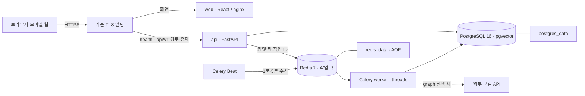

# T66 배포 아키텍처 설계도

> 상태: 초안 v0.2 · 2026-11-21 · 태웅
> 현재 Compose·백엔드 구현을 기준으로 정리했어요. 백업 자동화·자원·비용은 팀 확인 전 제안이에요.

## 1. 배포 구성

[배포 가이드](../../infra/DEPLOY.md)의 AWS EC2 단일 서버 결정을 따라요.
서버에서는 [루트 Compose](../../compose.yaml)에 [서버 설정](../../infra/team-server/compose.server.yaml)을 겹쳐요.
API·worker·Beat는 각각 하나로 실행해요. 실제 접속 정보는 환경 파일에서 관리해요.



| 구성 | 역할·기본 설정 | 상태 확인·보존 |
| --- | --- | --- |
| web | React 결과물을 nginx로 제공해요. `VITE_API_BASE_URL`은 빌드 때 들어가요. | 서버 설정에서는 API healthy 뒤 시작해요. 루트 Compose는 시작 순서만 지켜요. API 주소 변경은 재빌드가 필요해요. |
| api | 인증·권한·조회·결정·작업 접수를 담당해요. DB 변경은 SQLAlchemy Core·psycopg 트랜잭션으로 저장해요. | `/health`를 확인해요. 설정 검사·마이그레이션·데모 시드가 성공해야 시작해요. |
| worker | API·Beat와 같은 `API_IMAGE` 이미지를 써요. 기본값은 `yuchion-api:local`이에요. `default,notes` 큐를 threads 4개로 읽어요. | `WORKER_CONCURRENCY`로 조절하고 Celery ping으로 확인해요. |
| Beat | 발송·상담 알림은 60초, 요청 누락·알림장 복구 점검은 300초마다 넣어요. | 하나만 실행해요. 주기 파일은 임시 파일이며 별도 영구 볼륨이 없어요. |
| redis | 작업 ID를 담는 브로커예요. 알림장 초안은 `notes`, 나머지는 `default` 큐예요. | AOF와 `redis_data`를 써요. 작업 결과 저장소는 쓰지 않아요. |
| db | 요청·초안·결정·이력·앱 안 알림의 기준 저장소예요. | pg_isready와 `postgres_data`를 써요. 현재 Alembic head는 `0009`예요. |

서버 덮어쓰기는 API·웹을 호스트 loopback에만 연결하고 DB의 호스트 포트를 없애요.
Redis도 호스트 포트를 열지 않아요. 기존 TLS 앞단은 이 저장소가 설치·변경하지 않아요.
앞단이 다른 컨테이너라면 호스트 loopback에 연결하는 방식을 먼저 정해야 해요.
`/health`·`/api/v1/...`는 API로, 화면은 web으로 보내요.

## 2. 실행 모드와 데이터 흐름

루트 Compose 기본값은 `DATA_BACKEND=mock`, `RUN_IN=api`예요. mock은 API 메모리만 쓰며 재시작하면 초기화돼요.
서버 설정을 겹치면 API·worker·Beat의 `DATA_BACKEND` 기본값이 모두 db예요. 명시한 값은 세 서비스에 같이 적용돼요.
DB 시연에서 주기 발송까지 쓰려면 환경 파일에 `DATA_BACKEND=db`·`RUN_IN=worker`를 함께 넣어요.
`RUN_IN`만 바꿔서는 worker 프로필이 켜지지 않아요.
서버 예시 환경 파일에 `RUN_IN=worker`·`COMPOSE_PROFILES=worker`를 추가해요.
`WORKER_CONCURRENCY`는 기본 4, `CELERY_BROKER_URL`은 기본 `redis://redis:6379/0`이며 바꿀 때만 넣어요.

```sh
# 저장소 루트에서 실행해요. SERVER_ENV_FILE은 사용할 환경 파일이에요.
export COMPOSE_PROFILES=worker
infra/team-server/deploy.sh "$SERVER_ENV_FILE"
docker compose --env-file "$SERVER_ENV_FILE" \
  -f compose.yaml -f infra/team-server/compose.server.yaml ps
```

환경 파일에 넣은 `COMPOSE_PROFILES=worker`도 deploy.sh 안의 Compose에 적용돼요. 위 export와 같은 방법이에요.
API 이미지는 한 번 빌드하고 worker·Beat가 공유해요.
worker·Beat는 API와 Redis가 healthy인 뒤 시작하며 마이그레이션·시드를 반복하지 않아요.
API는 브로커 접속 실패를 경고하고 계속 뜨므로 API health만으로 워커 준비를 판단하면 안 돼요.

알림장은 입력을 queued로 커밋한 뒤 ID를 큐에 넣고 worker가 running → succeeded 또는 failed로 저장해요.
기본 writer·요청 에이전트는 대역이에요. `DAILY_NOTE_WRITER=graph`를 고른 DB 초안만 모델을 호출해요.
`RUN_IN=api`에서는 같은 입구를 FastAPI BackgroundTasks로 실행하고 Beat 주기 작업은 돌지 않아요.

알림은 DB에 pending·dedupe_key·deliver_after로 저장해요. 발송 태스크는 앱 안 알림을 sent로 바꿔요.
총 3회 시도하며 실패 뒤 60초·120초 간격으로 재시도해요. 외부 푸시·문자는 아직 보내지 않아요.
행 잠금·상태 검사·유니크 키로 중복 처리를 막고, Redis에 전달하지 못한 접수도 DB에 남겨 점검해요.
이는 DB와 큐를 묶는 분산 트랜잭션이나 모든 작업의 정확히 한 번 실행을 보장하는 구조는 아니에요.

## 3. 비밀값과 설정 관리

로컬은 `.env`, 서버는 `.env.server`를 사용해요. 예시 파일에는 키 이름·빈 값·개발 예시만 두고 실제 값은 커밋하지 않아요.
Git에서 환경 파일을 제외해도 파일이 암호화되지는 않아요. 서버 파일은 소유자만 읽도록 권한 600으로 관리해요.
Compose는 셸 변수를 환경 파일보다 먼저 쓰므로 배포 때 오래된 셸 값이 남아 있지 않은지 확인해요.

| 구분 | 키 이름 | 관리 방법 |
| --- | --- | --- |
| DB·인증 | `POSTGRES_PASSWORD`, `DATABASE_URL`, `JWT_SECRET` | 서버 환경 파일에서 각각 관리해요. DB 모드 JWT는 예시와 다른 32바이트 이상 키가 필요해요. |
| 외부 연동 | `OPENAI_API_KEY`, `LAW_GO_KR_OC`, `DATA_GO_KR_API_KEY`, `LANGSMITH_API_KEY` | 사용하는 기능의 키만 넣어요. 로그·프론트 빌드 인자에 넣지 않아요. |
| 실행 설정 | `DATA_BACKEND`, `RUN_IN`, `COMPOSE_PROFILES`, `WORKER_CONCURRENCY`, `CELERY_BROKER_URL`, `DAILY_NOTE_WRITER`, `DAILY_NOTE_WRITER_TIMEOUT`, `NOTE_DRAFT_CONCURRENCY`, `REQUEST_AGENT` | API·worker의 DB·작성기·근무 시간 설정을 같게 유지해요. |
| 모델 선택 | `LLM_MODEL_DEFAULT`, `LLM_MODEL_SUPERVISOR`, `LLM_MODEL_DOCUMENT`, `LLM_MODEL_MEMORY`, `LLM_MODEL_CHECKER`, `LLM_MODEL_CODE` | 비밀값은 아니에요. 역할별 빈 값은 기본 모델을 따라요. |
| 웹·배포 설정 | `COMPOSE_PROJECT_NAME`, `POSTGRES_DB`, `POSTGRES_USER`, `SERVER_API_PORT`, `SERVER_WEB_PORT`, `VITE_API_BASE_URL`, `CORS_ORIGINS` | 실제 접속 정보는 환경 파일에만 둬요. `VITE_*`에는 공개 가능한 값만 넣어요. |
| 이미지 선택 | `API_IMAGE` | API·worker·Beat가 같이 써요. 복구 빌드에는 원 서비스와 다른 이미지 이름을 넣어요. |
| GitHub Environment Secrets | `DEPLOY_HOST`, `DEPLOY_PORT`, `DEPLOY_USER`, `DEPLOY_SSH_KEY`, `DEPLOY_PATH` | 현재 수동 CD가 읽는 이름이에요. 배포 대상 Environment에서 관리해요. |

현재 GitHub Secrets는 SSH 접속용이에요. 앱의 비밀값을 서버 환경 파일로 전달하는 단계는 없어요.
PR CI는 mock·임시 DB·공통 HTTP 시험과 API·web 이미지 빌드를 실행해요. 실제 모델 키는 쓰지 않아요.
수동 CD도 서버의 deploy.sh를 실행하고 서버 Compose의 API 포트로 상태를 확인해요.
11/22 `aws-ec2` Environment에 CD 비밀값을 넣었고, 수동 CD 실제 실행(develop)이 통과했어요.
CD용 SSH 키는 배포 전용으로 따로 만들고 서버에서 셸 명령 외 기능(포트 전달 등)을 막았어요.

JWT 키를 바꾸면 기존 로그인 토큰이 무효가 돼요. DB 비밀번호 변경은 DB 역할과 DATABASE_URL을 함께 바꿔야 해요.
이미 생성된 볼륨의 비밀번호는 `POSTGRES_PASSWORD`만 수정해도 바뀌지 않아요.

## 4. 백업 주기와 보관 제안

DB 볼륨은 실행 데이터를 보존하지만 백업을 대신하지 않아요. 백업과 복원은 `infra/backup/`의 `backup.sh`·`restore.sh`로 해요.
아래 주기·보관·목표는 자동화 전 제안이에요. 스케줄러·외부 보관소는 아직 구성하지 않았어요.

| 백업 | 주기 | 보관 제안 | 확인 |
| --- | --- | --- | --- |
| DB·사진 백업 | 매일 KST 03:00 | 일별 7개·주별 4개 | `backup.sh` 종료 코드와 `meta.json`의 체크섬을 확인해요. |
| 배포 전 백업 | 마이그레이션 직전 | 최근 성공 배포 3개 | 쓰기를 멈춘 뒤에 받아요. 커밋과 Alembic revision도 `meta.json`에 함께 남아요. |
| 서버 밖 사본 | 백업 성공 직후 | 위 보관 정책과 동일 | 암호화한 별도 저장소에 복사하고 읽을 수 있는지 확인해요. |
| 환경 파일·복구 메타데이터 | 키·배포 설정 변경 때 | 현재와 직전 설정 | 암호화해 DB dump와 별도로 보관해요. 비밀값은 보고서에 쓰지 않아요. |
| 복구 연습 | 주 1회·DDL 변경 뒤 | 최신 성공 기록 | 독립 DB에서 복원·revision·핵심 흐름을 확인해요. |

목표 RPO는 일별 백업 기준 최대 24시간, 목표 RTO는 60분으로 제안해요. 아직 실측하지 않았어요.
성공 사본과 서버 밖 복사를 확인한 뒤 보관 개수를 넘긴 파일만 정리해요.
Redis AOF는 브로커 재시작용이며 DB 백업과 같은 시점의 복구본은 아니에요.

백업은 저장소 루트에서 `backup.sh`로 받아요. 한 번 받으면 `backups/<UTC 시각>/` 폴더가 하나 생기고, 그 안에 DB 덤프(`db.sql.gz`), 사진 볼륨(`media.tar.gz`), `meta.json`이 들어 있어요.

```bash
infra/backup/backup.sh "$SERVER_ENV_FILE"                              # 받기
infra/backup/restore.sh backups/<시각> "$SERVER_ENV_FILE"              # 복원할 일만 보기
infra/backup/restore.sh backups/<시각> "$SERVER_ENV_FILE" --yes        # 원 프로젝트에 되돌리기
```

`meta.json`에는 덤프를 시작한 시각, 커밋, Alembic revision, 두 파일의 sha256이 남아요. 스크립트는 받는 동안 `.partial` 폴더에 쓰다가 다 받은 뒤에 이름을 바꿔요. 그래서 실패한 백업을 성공한 사본으로 세는 일이 없어요. 덤프는 컨테이너 안의 PostgreSQL 16 도구로 받고, 비밀번호는 명령문에 적지 않아요. 보관은 최근 `BACKUP_KEEP`개(기본 7)까지만 해요. 주별 보관과 서버 밖 사본은 아직 스크립트에 없어요. 자세한 쓰는 법은 [백업 안내](../../infra/backup/README.md)에 있어요.
`backup.sh`는 쓰기를 멈추지 않아요. `pg_dump`가 시작 시점의 스냅숏을 받으니 덤프 자체는 한 시점으로 맞아요. 하지만 받는 동안 들어온 접수는 그 백업에 없어요. 주기 백업이라면 접수를 계속 받으면서 돌려도 괜찮아요. 배포 전 백업처럼 쓰기가 없는 스냅숏이 필요할 때는 5장 2단계대로 api·worker·beat를 먼저 멈추거나, 접수가 없는 시간에 돌려요. `backup.sh`는 api 없이 DB 컨테이너와 사진 볼륨만 쓰므로, api를 멈춘 채로 돌려도 돼요.
쓰기를 멈춘 배포 전 백업에는 users·children·requests·daily_notes 등 주요 표의 행 수도 기록해요.

## 5. 배포·마이그레이션·복구 순서

### 배포와 마이그레이션

1. 배포 커밋의 CI 결과와 환경 설정을 확인해요. 첫 배포는 Compose 2.24.4 이상·기존 TLS 앞단을 준비해요.
2. 앞단에서 신규 요청을 막고 Beat를 멈춰요. 진행 작업이 끝났는지 확인한 뒤 worker·API를 멈춰 DB 쓰기를 중단해요.
3. `backup.sh`로 백업을 받아요. 커밋·revision·체크섬은 `meta.json`에 남고, `postgres_data`는 그대로 둬요.
4. worker 프로필과 환경 파일을 지정하고 deploy.sh를 실행해요. clean 확인 → 현재 브랜치 git pull --ff-only → Compose 설정 검사 → 빌드·기동 순서예요.
5. API 엔트리포인트가 설정 검사 → alembic upgrade head → 데모 시드 → uvicorn 순서로 실행해요. API healthy 뒤 worker·Beat·web이 시작해요.
6. API·worker ping·Redis·DB와 알림 주기 작업을 확인해요. 가상 데모 환경에서 smoke를 실행하고 외부 앞단의 웹·TLS를 별도로 확인한 뒤 접수를 열어요.

현재 deploy.sh는 쓰기 중단·백업·자동 롤백을 수행하지 않아요. 위 2~3단계는 배포 담당자가 따로 진행해요.
기존 실행 컨테이너를 둔 채 up만 실행하면 마이그레이션과 옛 작업이 겹칠 수 있어요.
현재 엔트리포인트는 DB 모드마다 가상 데모 시드를 실행해요. 실제 원 데이터 운영 전에는 시드 분리 결정을 해야 해요.

현재 head `0009`는 [설계 DDL](../Step2/db_schema_draft.sql) v0.15와 같아요.
0009 적용 전 기존 상담 예상 종료가 예약 당일·원래 종료 + 3시간 상한을 넘는지 확인해요.
위반 값이 있으면 적용이 실패해요. 담임이 실제 값을 확인하며 임의로 잘라 넣지 않아요.
0009가 실패하면 엔트리포인트가 멈춰 API가 뜨지 않고 `restart: unless-stopped`로 재시작을 반복해요.
API가 healthy가 되지 않으므로 worker·Beat·web도 시작하지 않아요.
이미 적용한 0001~0009는 그대로 두고 다음 변경은 새 revision으로 추가해요.

### 백업에서 복구

1. 원 서비스의 신규 요청·Beat·worker·API를 멈춰요. 장애 시점 DB 볼륨과 로그를 남겨요.
2. 백업 폴더를 고르고 `meta.json`의 체크섬·커밋·revision을 확인해요. 백업 당시 커밋의 별도 작업 폴더와 새 `COMPOSE_PROJECT_NAME`을 가진 복구 환경 파일을 준비해요. `API_IMAGE`도 원 서비스와 다른 이름으로 정해요.
3. 복구 프로젝트는 원 DB와 다른 새 DB·Redis 볼륨을 사용해요. 환경 파일의 DATABASE_URL은 복구 DB를 가리키고, 접속 포트도 겹치지 않게 해요. DB·Redis만 먼저 띄워요.
4. 새 DB가 ready이고 비어 있는지 확인한 뒤 dump를 복원해요. 원 DB에 덮어쓰지 않아요. 덤프를 넣었으면 API를 띄우기 전에 주요 표의 행 수를 백업 기록과 맞춰 봐요.

```bash
set -Eeuo pipefail
# 새 프로젝트 이름은 볼륨·네트워크를 나누지만 이미지 태그는 나누지 않아요.
export API_IMAGE=yuchion-api:restore-check
# 원 서비스의 API_IMAGE와 다른 이름인지 확인한 뒤 빌드해요.
rc() { docker compose --env-file "$RESTORE_ENV_FILE" -f compose.yaml -f infra/team-server/compose.server.yaml --profile worker "$@"; }
# RESTORE_DIR은 고른 백업 폴더(backups/<시각>)예요. 두 파일을 meta.json의 sha256과 맞춰 봐요.
(cd "$RESTORE_DIR" && python3 -c 'import json; print("\n".join(f"{d}  {n}" for n, d in json.load(open("meta.json"))["sha256"].items()))' | sha256sum -c)
rc up -d db redis
# db healthy와 별도 프로젝트·빈 DB를 확인한 뒤 아래 명령을 실행해요.
gunzip -c "$RESTORE_DIR/db.sql.gz" | rc exec -T db sh -c 'exec psql -X -q -v ON_ERROR_STOP=1 --single-transaction -U "$POSTGRES_USER" -d "$POSTGRES_DB"'
# API 기동 시 데모 시드가 다시 들어가기 전에 백업의 행 수와 대조해요.
rc exec -T db sh -c 'exec psql -X -v ON_ERROR_STOP=1 -U "$POSTGRES_USER" -d "$POSTGRES_DB" -c "SELECT (SELECT count(*) FROM users) AS users, (SELECT count(*) FROM children) AS children, (SELECT count(*) FROM requests) AS requests, (SELECT count(*) FROM daily_notes) AS daily_notes;"'
# API 엔트리포인트를 우회해 복원된 revision부터 확인해요.
rc build api
rc run --rm --no-deps --entrypoint python api -m alembic -c apps/api/alembic.ini current
```

5. 백업 당시 커밋의 Alembic head와 복원 revision을 대조해요. 새 버전으로 올릴 때만 호환성 확인 뒤 새 마이그레이션을 적용해요.
6. 복구용 Redis는 비어 있게 시작해 옛 큐가 복원 DB를 변경하지 않게 해요. DB의 queued·running·pending 상태와 복구·재전달 대상을 확인해요. 이미 보낸 내용과 결정 이력도 대조해요.
7. 복구 프로젝트 API → worker·Beat·web을 시작해요. API는 마이그레이션·데모 시드를 다시 실행하므로 이 뒤의 행 수를 백업 시점 값으로 보지 않아요. 가상 데모 DB에서 로그인·초안·권한·알림을 확인하고 앞단을 전환해요. 복구 소요 시간·유실 범위·revision을 남겨요.

스키마 변경 뒤 코드를 되돌릴 때도 호환성을 먼저 확인해요. downgrade는 데이터·이력을 지울 수 있어서 자동 복구 수단으로 쓰지 않아요.
복구할 때 deploy.sh를 쓰면 git pull로 커밋이 바뀔 수 있어 같은 Compose 옵션으로 직접 기동해요.
백업 당시 Compose가 `API_IMAGE`를 지원하지 않으면 이미지 이름을 바꾸는 별도 덮어쓰기 파일을 붙여요.
복구가 끝나면 셸의 `API_IMAGE`를 해제하거나 원 서비스 이름으로 돌린 뒤 배포해요.
`down -v`는 DB·Redis 볼륨을 지우므로 원 서비스·복구본에 사용하지 않아요.

## 6. 부하와 비용 추정

아래는 소규모 가상 시연의 계산 가정과 첫 배포 사용량이에요. 초안 대기는 아래에 적은 영민님 실측을 참고해요.
우리 환경의 부하 시험·모델 지연·클라우드 견적은 아직 확인하지 않았어요.
서버 사양은 인스턴스 이름을 확정하지 않고 CPU 2개·메모리 4 GiB·디스크 30 GiB를 첫 측정 기준으로 제안해요.

| 항목 | 가정 | 계산·측정 기준 |
| --- | --- | --- |
| 사용량 | 반 2개·아이 40명·동시 로그인 20명, 하루 HTTP 2,000회 | 피크 5 req/s를 첫 시험 목표로 삼아요. SSE 연결은 별도로 세요. |
| 알림장 모델 작업 | 하루 아이 40명 모두 모델을 호출하고, 아이당 작성·검사 각 1회 | 재시도·반환이 없는 최소 하루 80회, 월 20일이면 1,600회예요. 쓰기·검사는 각각 1번 재시도하고, 메모 불일치·요청 누락은 자료 AI로 최대 2번 돌아가요. 재생성·추가 도구 호출도 별도예요. |
| 초안 대기 | 아이 동시 처리는 develop의 알림장 그래프(`NOTE_DRAFT_CONCURRENCY`, 기본 5) 기준이에요. | 영민님 실측은 18명 약 87초예요. 보장 시간이 아니며 이 문서 기준 작업 브랜치의 그래프는 아직 순차 처리예요. |
| 워커 | threads 4, notes·default 공유 | 초안 4묶음이 차면 발송·상담 작업도 늦을 수 있어요. 큐 분리만으로 자원은 분리되지 않아요. |
| 메모리 | DB 1 GiB·Redis 0.25·API 0.5·worker 1·Beat/web 0.25·호스트 여유 1 | 합계 4 GiB를 가정해요. 이미지 빌드·최대 동시 작업의 별도 여유를 측정해요. |
| 첫 배포 직후 메모리(11/21) | 서버 전체 사용 약 1.1GB / 7.6GB(운영체제·Docker·앞단 포함) | 앱 컨테이너 합계 약 240MB예요(api 75M·worker 77M·beat 42M·db 37M·redis 4M·web 3M). |
| 백업 공간 | 압축 dump 0.2 GiB, 일별 7·주별 4·배포 전 3개 | 보관 사본 2.8 GiB, 서버 밖 사본도 별도로 2.8 GiB예요. DB·이미지·로그 공간은 별도예요. |

단일 서버는 장애 지점 하나예요. CPU·메모리·DB 연결 수·디스크 여유와 HTTP p95·큐 대기 시간을 같이 기록해요.
`DAILY_NOTE_WRITER_TIMEOUT` 기본 300초는 아이마다가 아니라 반 입력 하나 전체에 적용돼요.
`NOTE_DRAFT_CONCURRENCY`는 develop 그래프에서 읽는 값이며, 작업 브랜치 그래프에는 아직 적용되지 않았어요.
초안 중에도 로그인·조회가 응답하고 주기 알림이 늦지 않는지 먼저 확인해요.
한도를 넘으면 동시 초안 수를 낮추거나 자원을 늘리고, notes 전용 worker 분리는 후속 설계로 검토해요.

| 월 비용 항목 | 계산용 단가·사용량 가정 | 예산 추정(USD) |
| --- | --- | --- |
| 서버 | 시간당 0.06 × 730시간 | 43.80 |
| 서버 디스크 | GiB당 월 0.10 × 30 GiB | 3.00 |
| 서버 밖 백업 | GiB당 월 0.03 × 2.8 GiB | 약 0.08 |
| 모델 | 입력 300만 token × 100만당 2, 출력 80만 × 100만당 8 | 12.40 |
| 통신·공인 주소·도메인·추적·기타 여유 | 월 15.00의 예비비 가정 | 15.00 |
| 합계 | 위 가정의 합, 세금·환율 제외 | 약 74.28 |

단가는 견적용 임의 가정이며 AWS·모델 제공사의 현재 요금표가 아니에요. 무료 한도·할인도 반영하지 않았어요.
모델 token은 위 최소 호출 가정 1,600회에 입력 평균 1,875·출력 평균 500으로 잡았어요. 재시도·반환을 포함한 실제 선택 모델·사용량으로 다시 계산해요.
배포 전에 리전·사양·디스크·공인 주소·통신·백업·모델 단가를 확인하고 예산 알림 기준을 정해요.
이미지 저장소·로드밸런서·관리형 DB를 추가하면 이 표 밖의 비용도 계산해요.

## 7. 남은 확인과 근거

팀 확인이 필요한 것은 실제 사양·예산, TLS 앞단 연결, 백업 보관소·스케줄러, 복구 목표 실측, CD 연결이에요.
대역 대신 실제 요청 에이전트 연결, 실데이터용 시드 분리, 여러 API·worker로 확장하는 설계도 후속이에요.
이 문서 작성으로 서버 배포·백업 스케줄 설치·복구 연습을 실행한 것은 아니에요.

기존 [배포 가이드](../../infra/DEPLOY.md) 5-3의 워커 후속 설명과 6장의 DB API 진행 상태에는 이전 정보가 남아 있어요.
7-2는 `restore.sh`로 원 프로젝트에 덮어써서 되돌리는 절차예요. 반면 5장의 복구는 원 DB를 그대로 두고 새 프로젝트에서 확인해요. 두 절차 모두 `backup.sh`가 만든 폴더를 써요.
현재 동작은 [API README](../../apps/api/README.md)·[worker 코드](../../apps/api/app/worker.py)·[마이그레이션 설명](../../apps/api/migrations/README.md)을 함께 봐요.
CI·CD 연결 상태는 [ci.yml](../../.github/workflows/ci.yml)·[cd.yml](../../.github/workflows/cd.yml), 실제 기동 순서는 [entrypoint.sh](../../apps/api/entrypoint.sh)와 [deploy.sh](../../infra/team-server/deploy.sh)를 기준으로 확인했어요.
